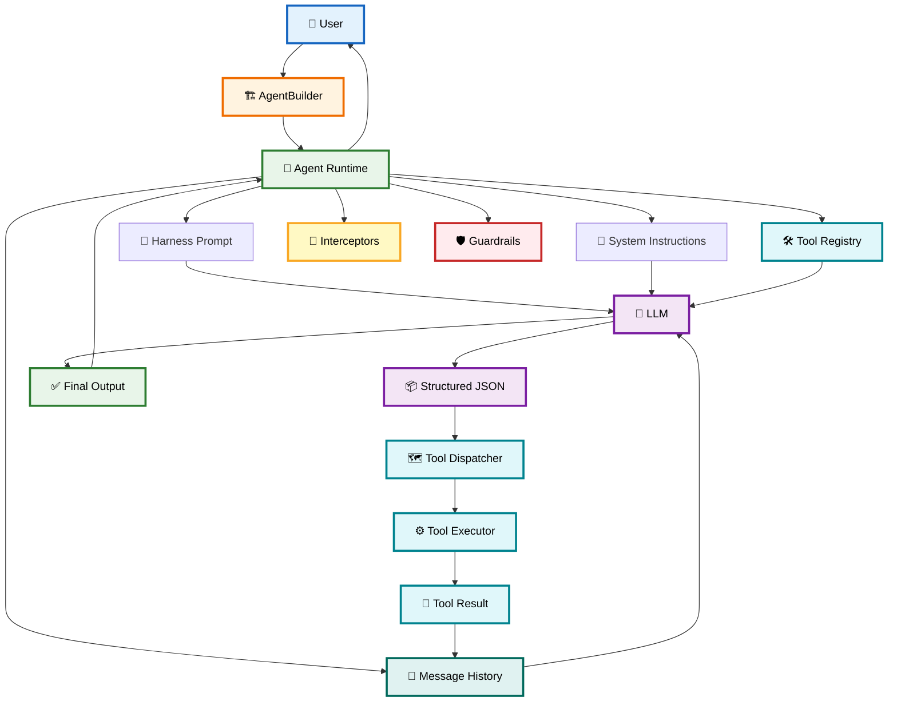

# 📘 Lecture_11_Complete_Notes

> **Lecture:** Building an Agent SDK from Scratch (Harness · Builder · ReAct Loop)
>
> **Phase:** 3 · Agency & Contracts · **Level:** 🟠 Advanced · **Source:** GAC D08

This document combines all eight chapter notes into one compact reference. For deep detail on any topic, click through to the relevant chapter file below.

---

# 🗺️ Chapter Map

| Chapter | File | One-line summary |
|---------|------|------------------|
| 01 | [`01-introduction-to-agent-sdk-and-architecture.md`](./01-introduction-to-agent-sdk-and-architecture.md) | Stateless vs stateful agents; the Agent SDK triad (LLM + Instructions + State + Tools + Execution Loop). |
| 02 | [`02-builder-pattern-and-agent-configuration.md`](./02-builder-pattern-and-agent-configuration.md) | Fluent `AgentBuilder`, config decoupling, validation at `build()`, `toolList → toolMap`. |
| 03 | [`03-harness-prompting-and-react-pipeline.md`](./03-harness-prompting-and-react-pipeline.md) | Harness prompt as LLM/runtime contract; 5-stage pipeline `INITIAL → THINK → TOOL_REQUEST → ANALYSE → OUTPUT`. |
| 04 | [`04-tool-execution-engine-and-registry.md`](./04-tool-execution-engine-and-registry.md) | `ITool` contract, metadata vs execution, tool registry, dispatch loop, error handling, self-correction. |
| 05 | [`05-message-state-execution-and-interceptors.md`](./05-message-state-execution-and-interceptors.md) | `messageHistory` lifecycle, message roles, interceptors/observability, `MAX_LOOP`, context window management. |
| 06 | [`06-structured-output-and-defensive-parsing.md`](./06-structured-output-and-defensive-parsing.md) | Strict JSON contract, defensive extraction, Zod schema validation, error recovery loops. |
| 07 | [`07-guardrails-safety-and-production-hardening.md`](./07-guardrails-safety-and-production-hardening.md) | Input/output guardrails, CLI safety, timeouts, MAX_LOOP, retries, circuit breakers, observability, testing. |
| 08 | [`08-multi-agent-swarms-providers-packaging.md`](./08-multi-agent-swarms-providers-packaging.md) | Multi-agent topologies, handoff protocol, `AgentSwarm`, provider abstraction, SDK packaging. |

Each chapter ends with **Common mistakes** and **Key takeaways**.

---

# 1. Executive Summary

An Agent SDK wraps an LLM so it can act autonomously instead of just answering once:

> **Agent = LLM + Instructions + State + Tools + Execution Loop**

The raw LLM API is `Request → LLM → Response`. An Agent adds:

1. **Builder** — configures instructions, tools, model, loops, interceptors.
2. **Harness Prompt** — forces the LLM into a structured execution protocol.
3. **ReAct Loop** — reason → act → observe → repeat until `OUTPUT`.
4. **Tool Registry** — runtime executes tools on the LLM's behalf; LLM never touches your functions.
5. **Message History** — state the Agent replays to the LLM every turn.
6. **Parsing + Validation** — defensive JSON extraction plus schema validation.
7. **Guardrails** — input/output safety, prompt injection defense, tool timeouts, `MAX_LOOP`.
8. **Swarm** — multi-agent handoffs and routing on top of the same core loop.

---

# 2. Architecture at a Glance



---

# 3. Cheat Sheet

| Concept | What it is | Where it lives |
|---------|-----------|----------------|
| `Agent` | Runtime that executes steps | `agent.ts` |
| `AgentBuilder` | Configuration object | `builder.ts` |
| `build()` | Converts builder config into `Agent` | `builder.ts` |
| `ITool` | Tool contract: `name`, `description`, `doc`, `executor` | `types.ts` |
| `toolMap` | `Map<string, ITool>` for O(1) lookup | `agent.ts` constructor |
| Harness | Structured prompt controlling LLM protocol | `config.ts` |
| 5-stage pipeline | `INITIAL → THINK → TOOL_REQUEST → ANALYSE → OUTPUT` | Harness |
| `messageHistory` | Ordered state: user / assistant / developer messages | `agent.ts` |
| `Interceptor` | Observer callback on Agent events | `types.ts` |
| `attachInterceptor()` | Registers an observer | `agent.ts` |
| `MAX_LOOP` | Hard cap on execution iterations | `agent.ts` |
| Guardrail | Input/output policy check | `guardrails/*.ts` |
| `AgentSwarm` | Multi-agent orchestrator | `swarm.ts` |
| Handoff | Structured step moving control between Agents | Swarm / tools |
| `LLMProvider` | Adapter over OpenAI / Gemini | Provider modules |

---

# 4. Decision Tables

### 4.1 What should the Agent do next?

| LLM step | Runtime action |
|----------|----------------|
| `INITIAL` | Store in history, continue |
| `THINK` | Store in history, call LLM again |
| `TOOL_REQUEST` | Look up tool in `toolMap`, execute, inject result |
| `ANALYSE` | Store in history, decide next step |
| `OUTPUT` | Stop loop, return final answer |
| `HANDOFF` | Transfer control to target Agent |

### 4.2 Error handling

| Failure | Action |
|---------|--------|
| Tool not registered | Inject error as developer message, continue loop |
| Tool execution throws | Capture error, inject into history, continue loop |
| JSON parsing fails | Defensive extraction, then schema validation, then retry |
| `MAX_LOOP` reached | Stop and throw explicit error |
| Prompt injection detected | Reject input before execution |
| Token budget exceeded | Abort run |

### 4.3 Multi-agent routing

| Scenario | Pattern |
|----------|---------|
| Query needs weather | Handoff to `WeatherAgent` |
| Query needs math | Handoff to `MathAgent` |
| Query needs CLI | Handoff to `DevOpsAgent` |
| Parallel research | Fan-out to multiple specialists |
| Combined answers | Fan-in aggregation |

---

# 5. Misconceptions

| Misconception | Reality |
|---------------|---------|
| "An LLM is an Agent" | An LLM generates responses; an Agent adds state, tools, instructions, and a loop. |
| "The LLM executes tools" | The LLM only requests a tool; the Agent runtime executes it. |
| "ReAct always uses tools" | Simple questions can skip tools entirely (`INITIAL → THINK → ANALYSE → OUTPUT`). |
| "Tool output goes directly back to user" | Tool results are injected into `messageHistory` so the LLM can reason about them. |
| "MAX_LOOP is optional" | It is required to prevent runaway execution and cost spikes. |
| "JSON parse is enough" | Parse only checks syntax; schema validation checks shape and required fields. |
| "Multi-agent replaces the core loop" | Multi-agent adds routing/handoffs; each agent still uses the same core ReAct loop. |

---

# 6. Glossary

| Term | Definition |
|------|------------|
| Agent SDK | Abstraction layer on raw LLM APIs that manages state, tools, instructions, loops, and observability. |
| Harness Prompt | System-level instruction layer that forces the LLM into a structured execution protocol. |
| ReAct Pipeline | Reason → Act → Observe loop, represented as `INITIAL → THINK → TOOL_REQUEST → ANALYSE → OUTPUT`. |
| `ITool` | Interface every tool must implement: metadata plus an executor. |
| `toolMap` | `Map<string, ITool>` used to dispatch tool requests by name. |
| `messageHistory` | Ordered execution state fed back to the LLM every turn. |
| Interceptor | Observer callback that logs/traces/redacts Agent events without changing core logic. |
| Guardrail | Policy function validating input before execution or output before returning. |
| Handoff | Structured transfer of control from one Agent to another in a swarm. |
| `AgentSwarm` | Registry + orchestrator for multi-agent handoff workflows. |
| `LLMProvider` | Adapter interface that keeps the core loop provider-agnostic. |
| `MAX_LOOP` | Hard iteration cap preventing infinite Agent loops. |

---

# 7. 20 Self-Check Questions

1. What does an Agent SDK add on top of a raw LLM API?
2. Why is state kept by the Agent runtime instead of the LLM?
3. What are the five stages of the Harness pipeline?
4. Does every Agent step require a tool call?
5. What is the Builder Pattern used for in this SDK?
6. How does `toolMap.get(functionName)` fit into tool execution?
7. Who executes the tool: the LLM or the Agent runtime?
8. What message roles are used in this SDK?
9. Why does `messageHistory` need to be sent to the LLM every turn?
10. What is an Interceptor responsible for?
11. Why does an Agent need `MAX_LOOP`?
12. Why is `JSON.parse()` alone not enough for parsing LLM output?
13. How does schema validation complement defensive parsing?
14. What happens when the LLM requests an unregistered tool?
15. What are input guardrails used for?
16. What are output guardrails used for?
17. What is a Handoff in a multi-agent swarm?
18. How does `AgentSwarm` run until completion?
19. Why keep provider logic behind an adapter interface?
20. What is the production packaging goal of this SDK?

### Answers

1. State management, tool registry/execution, execution loop, harness prompting, configuration via Builder, interceptors, safety guards.
2. LLM calls are stateless; the runtime stores and replays history so the model remembers context across turns.
3. `INITIAL → THINK → TOOL_REQUEST → ANALYSE → OUTPUT`.
4. No. Simple queries can go directly from reasoning to `OUTPUT`.
5. Clean, fluent, self-documenting configuration decoupled from Agent execution.
6. After the LLM emits `TOOL_REQUEST`, the runtime looks up the tool by name in `toolMap`.
7. The Agent runtime executes the tool; the LLM only requests it.
8. `user`, `assistant`, `developer`.
9. Each LLM call needs prior turns (reasoning, tool results) to decide the next action.
10. Observe messages/events for logging, metrics, tracing, auditing, without changing core logic.
11. To cap iterations and prevent runaway loops, excessive API calls, and cost spikes.
12. LLMs may wrap JSON in prose or markdown fences; direct parse can fail.
13. Extraction recovers the object; validation enforces shape and required fields.
14. It is not executed; an error is injected into history so the LLM can recover.
15. Validate raw user input before execution (prompt injection, topic, CLI safety).
16. Sanitize/verify output before returning (PII redaction, content safety).
17. A structured `HANDOFF` step transferring control to a specialized Agent.
18. Loops until `OUTPUT` or `MAX_HANDOFFS` is reached.
19. To support OpenAI and Gemini (and future providers) without editing the core loop.
20. Publish a reusable `agent-sdk` package with public exports, typed API, and build config.

---

# 8. Build & Gate Checklist

Based on the roadmap completion gate for Lecture 11:

```text
☐ Can add a new tool without editing the core loop
☐ Can add a new interceptor without editing the core loop
☐ Can add a second provider (e.g. OpenAI → Gemini) without editing the core loop
☐ Demonstration CLI + multi-agent swarm demo works
```

---

# 9. Cross-References

For more detail, see:

- Roadmap Lecture 11 entry: `../roadmap.md` → *"Lecture 11 — Building an Agent SDK from Scratch"*
- Source notes: `gen-ai-cohort/week04/learning/day08/notes/01…05`, `completed notes.md`, `Interview.md`
- Code examples: `gen-ai-cohort/week04/learning/day08/code/agent-sdk/`, `agent-sdk-advanced/`, `agent-sdk-complete/`, `agent-sdk-gemini/`

---