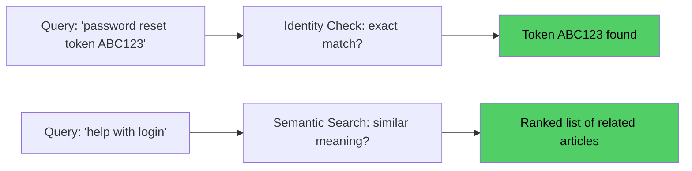
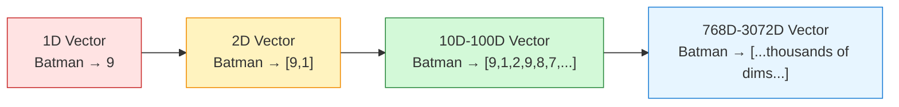
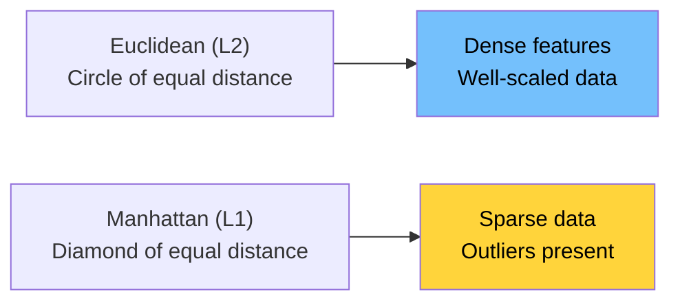
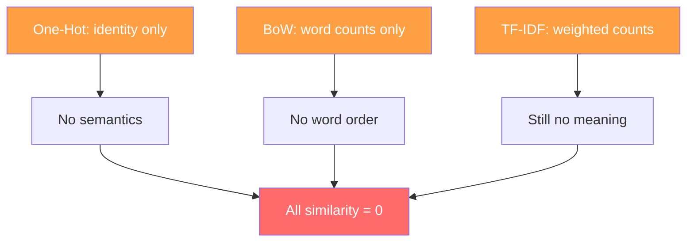
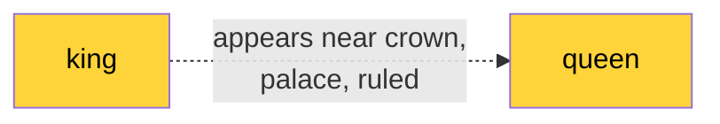
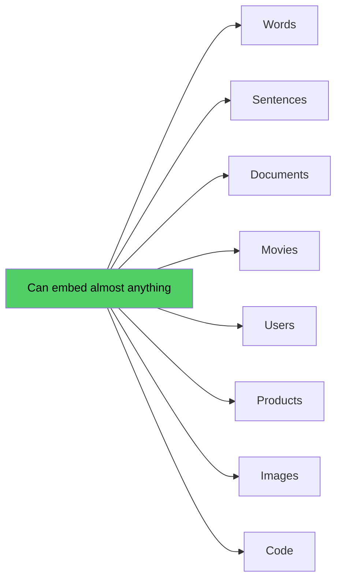
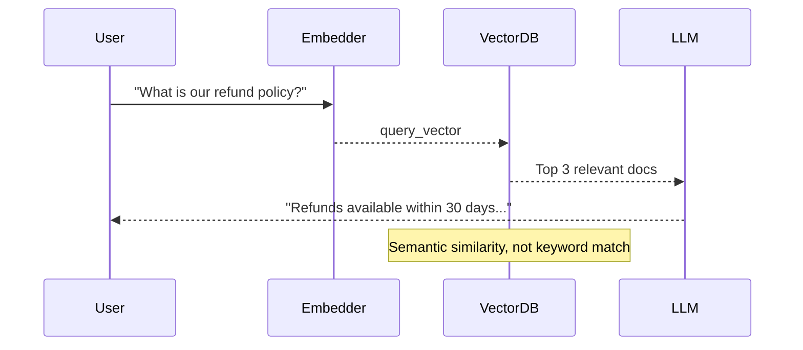
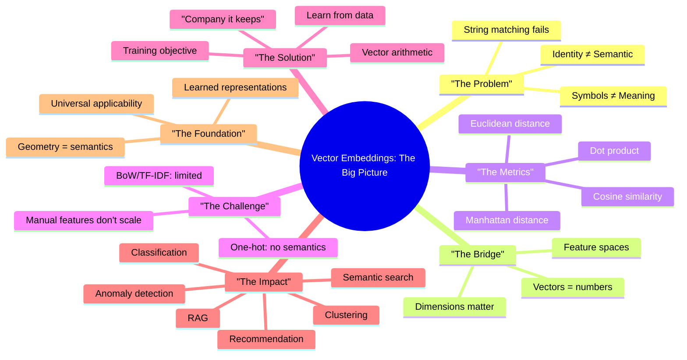

# Lecture 12: Vector Embeddings — Complete Notes

## Overview

**Lecture Goal:** Understand how a computer can represent *meaning* as a list of numbers.

This 7-chapter journey traces the evolution from:
1. The fundamental problem: computers lack semantic understanding
2. Mathematical necessity: meaning → numbers → operations
3. Scaling challenge: manual feature engineering fails
4. The breakthrough: learning representations from data
5. Practical impact: what becomes possible with embeddings
6. Synthesis: the definitive insight that geometry encodes semantics

---

## The Core Insight

> **An embedding is a position inside a learned mathematical space where useful relationships in meaning or behavior become relationships in geometry.**

The journey from a real-world object to a meaningful embedding:

```mermaid
flowchart TD
    A["REAL-WORLD OBJECT\n(e.g., Batman)"]
    B["Need Numerical Representation"]
    C["Manual Vector\n[height=?, weight=?, genre=?, ...]"]
    D["Problem: Does Not Scale\nFeature engineering limits"]
    E["Solution: Learn from Data\n'Task objective' + Training Data]
    F["Learned Embedding\n[0.23, -0.81, 0.47, ...]"]
    G["EMBEDDING\nGeometry Encodes Semantics"]

    A --> B --> C --> D --> E --> F --> G

    style C fill:#ff9f43,color:#fff
    style F fill:#51cf66,color:#000
    style G fill:#51cf66,color:#000
```

---

## Chapter 1: The Problem of Meaning in Computers

Computers store symbols, not meanings.

When you type `Batman`, the computer stores the characters `B`, `a`, `t`, `m`, `a`, `n` — binary at the hardware level. For a human, this single word instantly activates a rich web of associations (Superhero, Gotham, Bruce Wayne, Dark, DC Comics). A computer has **none of these without learning**.

### Identity Matching vs. Semantic Similarity

**Two distinct retrieval goals:**

| Identity Matching | Semantic Similarity |
|:---|:---|
| "Is this *exactly* what we want?" | "What is *related* to what we want?" |
| Exact string match | Fuzzy meaning match |
| Binary: yes/no | Continuous: 0.0–1.0 score |
| Hash tables, B-trees | Vector indexes (HNSW, IVF) |
| SQL `WHERE id = ?` | Vector DB similarity search |



### Token IDs: Labels, Not Measurements

Inside language models, tokens get assigned IDs (`cat` → 1043). These IDs are **arbitrary indices**, not semantic features. They carry no meaning — just like house numbers on a street.

The embedding table transforms these meaningless IDs into meaningful vectors. **Token IDs are "phone numbers" — they identify *where* to find something, not *what* it is.**

---

## Chapter 2: From Numbers to Vectors

A vector is an ordered list of numbers representing features of a real-world object.

### Building a Feature Space

**1D Example:**
```
Titanic = 2   (action score)
```
Only captures one property. Titanic and Hera Pheri would appear identical.

**2D Example:**
```
Batman = [9, 1]   (action=9, comedy=1)
Hera Pheri = [2, 10]
```

Now we can capture multiple properties simultaneously. The order matters: `[9, 2]` ≠ `[2, 9]`.

### High-Dimensional Vectors

Real embeddings use hundreds to thousands of dimensions:
- **768** → BERT base
- **1536** → OpenAI text-embedding-3-small
- **3072** → OpenAI text-embedding-3-large

**Key insight:** Humans cannot visualize a 768D space, but mathematics operates perfectly in it.

### Storage and Computation

- Storage: 1536-dim `float32` = 6144 bytes ≈ 6 KB per vector
- Comparison: O(d) per pair — linear in dimensions
- Trade-off: More dimensions capture more nuance but cost more



---

## Chapter 3: Measuring Similarity Between Vectors

Four primary similarity measures:

### Euclidean Distance (L2)

Straight-line distance: `√((x2-x1)² + (y2-y1)²)`

- **Good for:** Well-scaled, dense continuous features
- **Sensitive to:** Outliers, scale differences
- **Use when:** "Absolute gap" between values matters

### Manhattan Distance (L1)

Sum of absolute differences: `|x2-x1| + |y2-y1|`

- **Good for:** Sparse features, robust to outliers
- **Interpretation:** City-block travel on a grid
- **Use when:** Features add up independently



### Dot Product

`Σ(ai × bi)` = `|a| × |b| × cos(θ)`

- **Captures:** Both direction AND magnitude
- **Use when:** Preference pattern AND strength both matter
- **Bias:** Favors high-norm vectors

### Cosine Similarity

`dot(a, b) / (|a| × |b|)`

- **Captures:** Direction only, magnitude-invariant
- **Range:** -1 to 1 (1 = same direction, 0 = perpendicular, -1 = opposite)
- **Use when:** Semantic similarity in text/search

**Rule of thumb for AI systems:**
- **Embedding vectors:** Use cosine (or normalize then use dot)
- **Hand-designed features:** Use Euclidean with standardization
- **Sparse features:** Consider L1 distance

---

## Chapter 4: The Failure of Hand-Crafted Features

### The Core Problem

We cannot manually design dimensions at scale. Three fundamental limitations:

| Problem | Why It's Fatal |
|:---|:---|
| **Dimensionality explosion** | No principled stopping point; thousands of possible features |
| **Task dependency** | Same object needs different features for recommendation vs box-office vs moderation |
| **Language ambiguity** | "bank" (river vs finance), context-dependent meanings, metaphors |

### Classical Approaches and Their Limitations

| Method | Captures | Breaks |
|:---|:---|:---|
| **One-Hot** | Identity only | All items equidistant; no relatedness; sparse |
| **Bag-of-Words** | Word identity | No order, no meaning; all docs equidistant |
| **TF-IDF** | Word importance | Still zero semantics; vocabulary-limited |



### The Interpretability Trap

Even with hand-crafted features, we cannot reliably interpret every dimension. In high-dimensional spaces:
- **Dimensions are distributed** — meaning spreads across many axes
- **They emerge from training** — not human design
- **Verification requires geometry analysis** — distances, clusters, directions

> **If you can interpret a dimension, you may be overfitting to training artifacts rather than discovering true semantics.**

---

## Chapter 5: What Are Embeddings? Learning Representations

### The Key Insight

Instead of asking "Which dimensions should we create?", ask "What task should the model learn to solve?"

The correct representations **emerge as a by-product** of learning.

### The "Company It Keeps" Principle

J.R. Firth (1957): **"You shall know a word by the company it keeps."**

Words appearing in similar contexts (`king` and `queen` near `crown`, `palace`, `ruled`) develop similar vectors:



### Vector Arithmetic

Well-trained embeddings encode relationships as geometric directions:

```
king - man + woman ≈ queen
Paris - France + Germany ≈ Berlin
```

**Why it works:** The model learns that gender is a consistent direction in the vector space. Subtract the "male" component, add the "female" component.

### Embedding Model as a Function

```
f : Input → ℝᵈ

f("Batman") = [0.23, -0.81, 0.47, 0.12, ...]  // 768 dimensions
```

The function `f` is a neural network trained to produce vectors where:
- Similar items are close (high cosine similarity)
- Different items are far apart

### What Embeddings Enable

| Task | How Embeddings Help |
|:---|:---|
| **Similarity Search** | Find semantically related items |
| **Annotation** | Group items into clusters automatically |
| **Recommendation** | Match users to items by preference similarity |
| **Anomaly Detection** | Find outliers via distance from clusters |

---

## Chapter 6: Vector vs Embedding — Applications & Real-World Use Cases

### The Critical Distinction

| Feature Vector | Embedding |
|:---|:---|
| Manually created | Learned from data |
| Human-labeled dimensions | Latent (opaque) dimensions |
| Small dimensions (10–100) | Large dimensions (768–3072+) |
| Not scalable | Highly scalable |

> **Every embedding IS a vector. NOT every vector IS an embedding.**

### What Gets Embedded



### The RAG Pattern (Retrieval-Augmented Generation)



### Common Models

| Model | Dimensions | Use Case |
|:---|:---|:---|
| text-embedding-3-small | 1536 | Cost-effective text |
| text-embedding-3-large | 3072 | Best quality text |
| BERT base | 768 | Classification, search |
| CLIP | 512 | Multi-modal (text + image) |
| Word2Vec | 100–300 | Word-level tasks |

---

## Chapter 7: The Complete Synthesis

### The Definitive Definition

> **An embedding is not the meaning itself. It is a position inside a learned mathematical space where useful relationships in meaning or behavior become relationships in geometry.**

| Part | Meaning |
|:---|:---|
| "not the meaning itself" | It's a coordinate, not the content |
| "position inside a space" | Location in a continuous vector space |
| "learned mathematical space" | Structure discovered by training |
| "relationships in meaning..." | Similar concepts map to close vectors |
| "...become geometry" | Close = similar, far = dissimilar |

### Visualizing the Transformation

```
START: "Batman" — a symbol with rich human meaning
        ↓ computer stores only the bits
END: [0.23, -0.81, 0.47, ..., 0.19] — a point in 768D space

Where:
- Close to "Superman" (both dark superheroes) ✓
- Close to "The Dark Knight" (same franchise) ✓
- Far from "Titanic" (different genre) ✓
- Far from "banana" (unrelated) ✓
```

We got here **without explicitly telling the model** what action means, what genre means, or what a superhero is. The geometry learned itself from patterns in data.

---

## Key Takeaways

1. **The Problem:** Computers store symbols, not meanings. String matching fails for semantic tasks.

2. **The Bridge:** Vectors transform objects into mathematical representations.

3. **The Challenge:** Human-designed features don't scale — dimension explosion, task specificity, language ambiguity.

4. **The Solution:** Learn embeddings by training on a useful task. The correct representations emerge automatically.

5. **The Tools:** Four similarity measures — Euclidean (dense), Manhattan (sparse), Dot Product (direction+magnitude), Cosine (direction only).

6. **The Power:** Geometry encodes semantics. Similarity becomes a mathematical operation.

7. **The Impact:** Search, recommendation, clustering, classification, RAG, anomaly detection — all become possible.

---

## The Big Picture



---

## References & Further Reading

- Firth, J.R. (1957). "Parts of Speech" — "You shall know a word by the company it keeps"
- Mikolov et al. (2013). "Efficient Estimation of Word Representations in Vector Space" (Word2Vec)
- Vaswani et al. (2017). "Attention Is All You Need" (Transformer architecture enables high-dimensional embeddings)
- Radford et al. (2021). "Learning Transferable Visual Models From Language" (CLIP multi-modal embeddings)