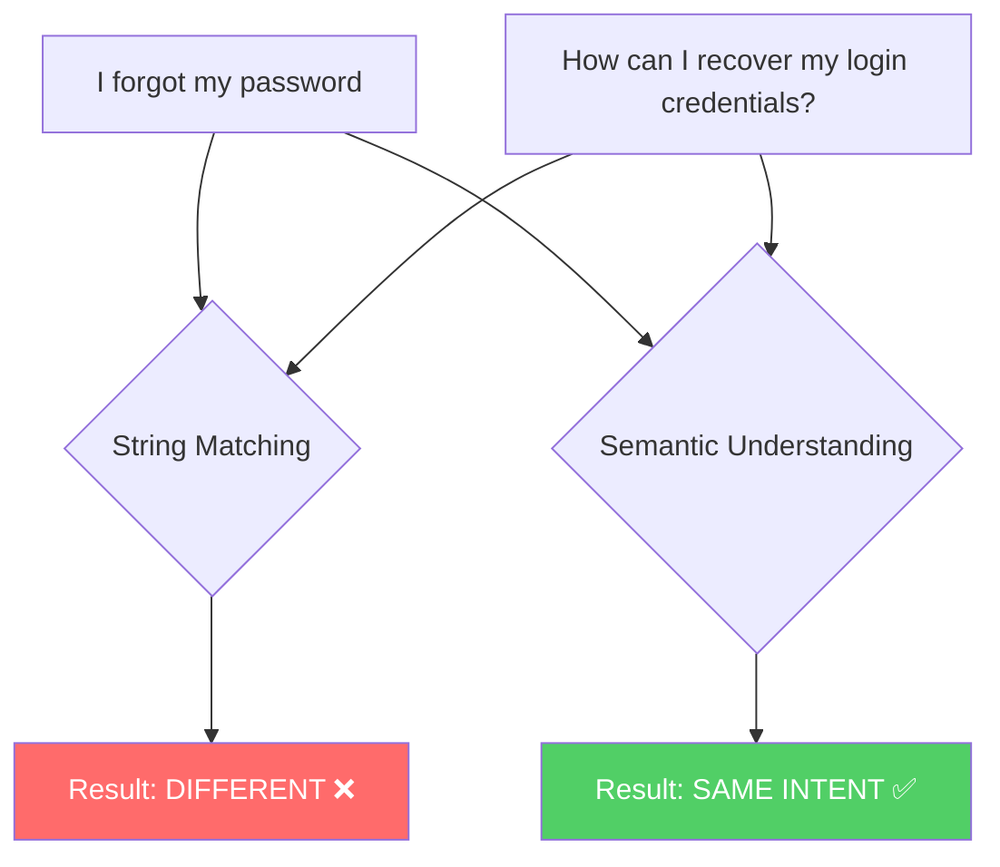
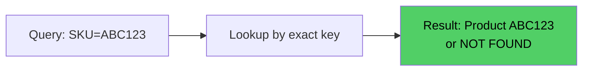
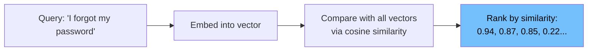
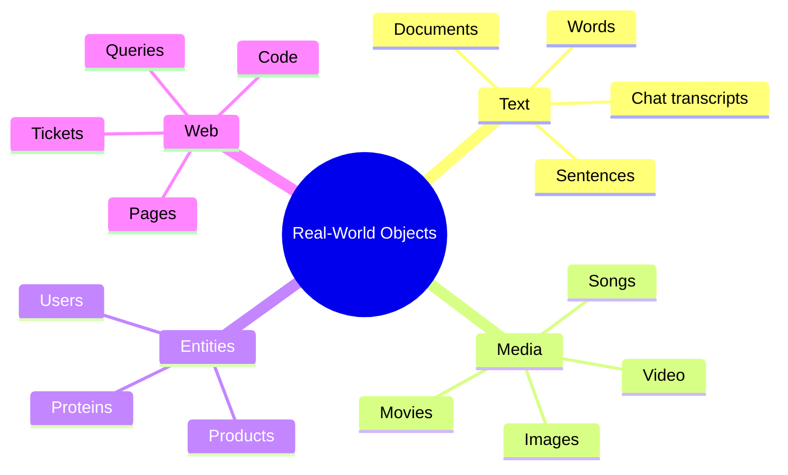
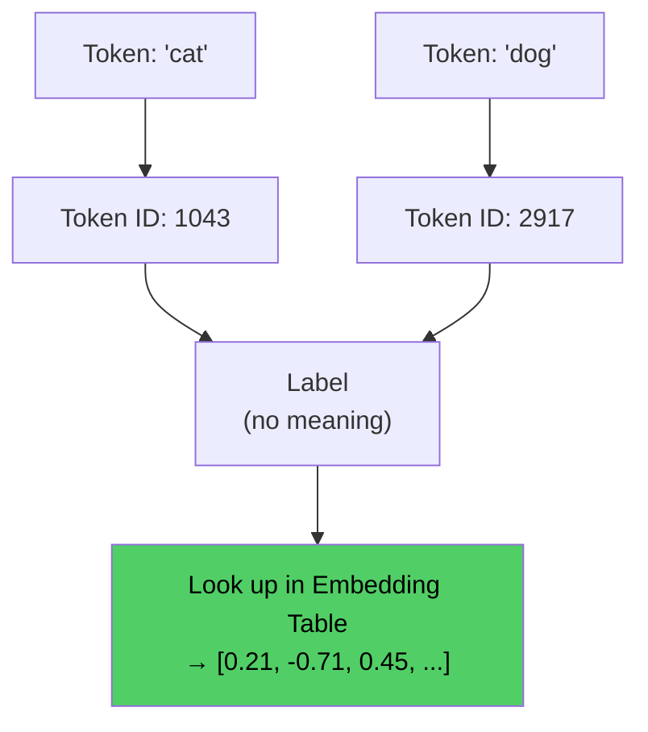
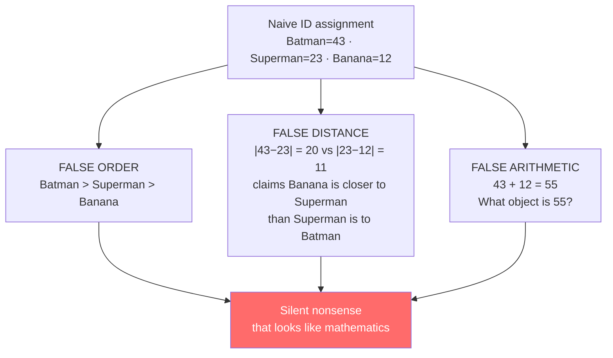
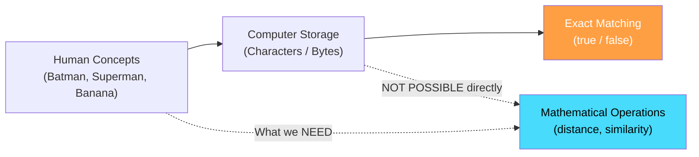

# Chapter 01: The Problem of Meaning in Computers

## Chapter Goal

Understand why computers cannot inherently understand meaning, why symbolic representation fails for semantic reasoning, and why we need a mathematical bridge between human concepts and machine computation. This chapter establishes the core motivation for everything that follows — vector embeddings.

---

## 1.1 The Gap Between Symbol and Meaning

Consider the word:

```
Batman
```

For a human, this single word instantly activates a **rich web of associations**:

| Association | Type |
|:---|:---:|
| Superhero | Category |
| Bruce Wayne | Identity |
| Gotham | Setting |
| Dark / Serious | Tone |
| Crime / Vigilante | Theme |
| Rich / Action | Attributes |

A computer, at its lowest level, works with **binary representations** (0s and 1s). It can store the characters `B`, `a`, `t`, `m`, `a`, `n` — but storing a **symbol** is fundamentally different from understanding **meaning**.

> **Core Insight:** Representing symbols is NOT the same as representing meaning.

---

## 1.2 Identity Matching vs. Semantic Similarity

Traditional computer systems excel at **exact matching**:

```js
// Exact string identity matching — pseudo code
const s1 = "Batman";
const s2 = "Batman";
const s3 = "Superman";

if (s1 === s2) {
  // true — they are identical strings
}

if (s1 === s3) {
  // false — they are different strings
}
```

This tells us whether two strings are **identical**. It does NOT tell us whether they are **conceptually related**.

### The Real Problem

Consider these two sentences:

```
"I forgot my password."
"How can I recover my login credentials?"
```

As strings → they are **very different**.  
In meaning → they represent **almost the same intent**.

A system based purely on string matching sees them as completely different. A human immediately recognizes they are asking the same thing.



---

## 1.3 Two Different Retrieval Goals: Identity vs Semantic

It is critical to distinguish between two fundamentally different retrieval problems that systems must solve:

### Goal 1: Identity Matching (Exact Retrieval)

**Question:** "Is this *exactly* the thing we're looking for?"

**Examples:**
- "Find user with email `john.doe@example.com`"
- "Look up product with SKU `ABC123`"
- "Find the document with exact title 'Q3 Financial Report'"

**Characteristics:**
- Binary outcome: match or no match
- Typically uses exact keys, IDs, or unique identifiers
- Database indexes (B-tree, hash) handle this efficiently
- Precision is paramount; recall is 100% by construction



### Goal 2: Semantic Similarity (Approximate Retrieval)

**Question:** "What is *similar* or *related* to what we're looking for?"

**Examples:**
- "Find help articles about password problems"
- "Find movies similar to Batman"
- "Find support tickets about login issues"

**Characteristics:**
- Graded outcome: similarity score (0.94, 0.87, 0.22...)
- Requires understanding meaning, not just matching strings
- Vector embeddings + cosine similarity are the modern solution
- Trade-off between recall and precision is explicit and tunable



### Why This Distinction Matters

| Aspect | Identity Matching | Semantic Similarity |
|:---|:---|:---|
| What is compared | Exact key/identifier | Meaning/concept |
| Result type | Binary (yes/no) | Continuous score |
| Data structure | Hash table, B-tree | Vector index (HNSW, IVF) |
| Failure mode | Misspelling → no result | Drift → wrong results |
| Example technology | SQL `WHERE email = ?` | Vector DB `search() with cosine` |

> **A system that only does identity matching will fail whenever the user expresses the same need in different words. A system that only does semantic matching will fail whenever exactness matters. Most production systems need both.**

---

## 1.4 Why Mathematics Requires Numbers

Machine-learning models, neural networks, and mathematical algorithms **fundamentally operate on numbers**.

There is no useful mathematics we can directly perform on:

```
Batman
Superman
Interstellar
Pizza
```

But once things become **numbers**, we can perform:

| Operation | What It Enables |
|:---|:---|
| Addition | Combining features |
| Multiplication | Scaling and weighting |
| Distance | Measuring similarity |
| Angles | Directional comparison |
| Probabilities | Uncertainty reasoning |
| Matrix operations | Neural network computation |

So our **first requirement** is:

> **Turn real-world things into numerical representations.**

---

## 1.5 The Scope of the Problem

This is not just about words. The problem applies to almost everything computers need to reason about:



This problem **existed long before modern LLMs**. The challenge of turning real-world objects into numbers that carry meaning has been a core challenge of machine learning from the start.

---

## 1.6 Token IDs: Labels, Not Measurements

Inside a language model, every word or subword token is assigned a **token ID** — an integer like `42`, `1043`, or `7291`. These IDs are used to look up embeddings in the model's embedding table.

**Token IDs are labels, not measurements.**

```
Token: "cat"  → ID: 1043
Token: "dog"  → ID: 2917
Token: "bat"  → ID: 5832
```

The fact that `cat` has ID `1043` and `dog` has ID `2917` tells us **nothing** about whether cats and dogs are similar. The IDs are arbitrary indices into a vocabulary table — they carry no semantic information whatsoever.



This is exactly the same problem as the "naive numeric encoding" from section 1.5 — assigning arbitrary numbers to objects doesn't create meaningful relationships. The embedding table is what transforms these meaningless IDs into meaningful vectors. **The token ID is just an address; the embedding is the content at that address.**

> **Key insight: Token IDs are the "phone numbers" — they identify *where* to find something, but they don't tell you *what* it is. The embedding is the person you actually want to talk to.**

---

## 1.7 What a Random Number Doesn't Solve

Simply assigning a random number to every object doesn't help:

```
Batman      → 43
Superman    → 23
Banana      → 12
```

The numbers don't represent any *meaningful relationship* between the objects. `43` and `23` being close in value says nothing about Batman and Superman being related concepts.

> **The requirement is not just any number — it's a number (or set of numbers) that encodes meaningful relationships.**

---

## 1.8 The Traps of Naive Numeric Encoding

The first instinct is to assign a number to every object:

```
Batman    → 43
Superman  → 23
Banana    → 12
```

This silently injects three false claims into every downstream computation:



An ID is a **label**, not a **measurement**. Integer IDs (and token IDs inside an LLM vocabulary) carry no semantics: ID `1000` is not "twice as much" as ID `500`, and consecutive IDs are not conceptually adjacent.

### One-Hot Encoding — Honest but Flat

One-hot encoding says "these are different categories" and nothing more:

| Encoding | Shape | What It Preserves | What It Breaks |
|:---|:---|:---|:---|
| Ordinal (`small=1`, `medium=2`, `large=3`) | 1 number | Genuine order | Only valid when property truly is ordered |
| One-hot (`cat=[1,0,0]`, `dog=[0,1,0]`) | V dimensions | Identity, zero false order | All items equidistant; no relatedness; enormous and sparse |

Because every pair has distance √2 and cosine 0, one-hot vectors cannot express that `cat` is more similar to `dog` than to `database`.

> **The requirement is therefore not "any numbers" — it is numbers whose geometry encodes the relationships we care about.**

---

## 1.9 Summary



The chapter establishes:

1. **Computers store symbols, not meanings**
2. **String matching fails for semantic understanding**
3. **Identity matching and semantic similarity are two different retrieval goals**
4. **Token IDs are labels, not measurements — embeddings provide the meaning**
5. **Mathematical operations require numbers with meaningful relationships**
6. **Randomly assigned numbers don't carry relational information**
7. **Naive ID assignment creates false order, distance, and arithmetic**
8. **One-hot encoding preserves identity but discards relatedness**

This motivates the entire concept of **vector representations** — the topic of Chapter 02.