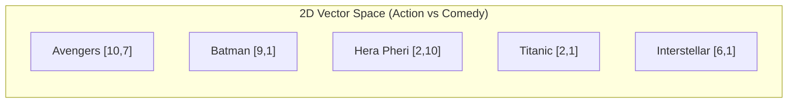
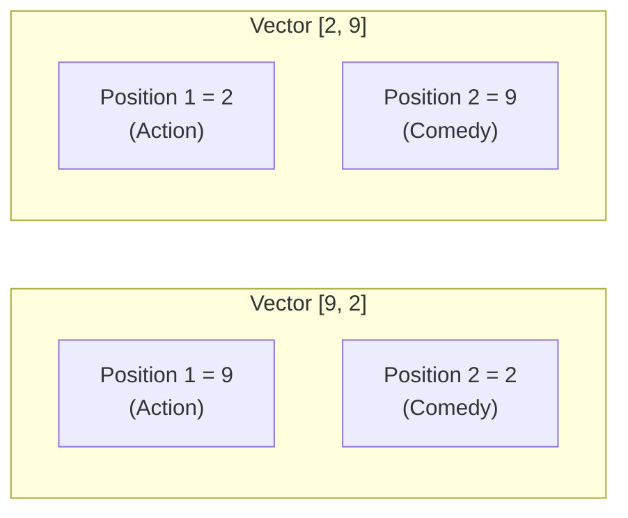
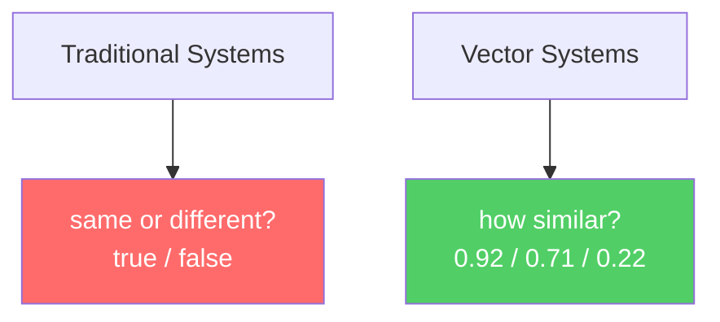
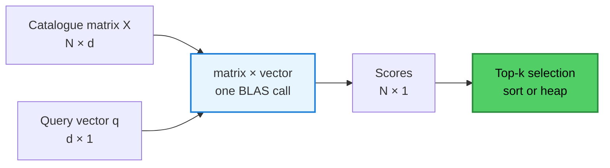
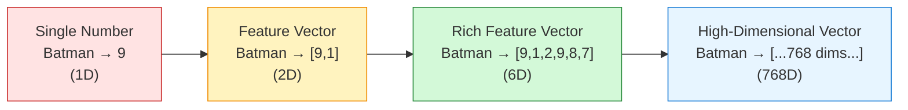

# Chapter 02: From Numbers to Vectors — Building a Feature Space

## Chapter Goal

Learn how we can represent real-world objects as lists of numbers (vectors), why multiple dimensions capture richer meaning than a single number, and what a "vector space" really means intuitively. This chapter is where the mathematics of similarity begins.

---

## 2.1 First Attempt: One Number

Forget language for a moment. Imagine building a **movie recommendation system**.

We could start by assigning every movie an **action score**:

| Movie | Action Score |
|:---|---:|
| Avengers | 10 |
| Batman | 9 |
| Interstellar | 6 |
| Titanic | 2 |
| Hera Pheri | 1 |

Previously, these were only names. Now we have:

```
Batman      → 9
Avengers    → 10
Titanic     → 2
```

For the first time, we've **converted one characteristic** of a movie into mathematics.

### Similarity Now Becomes Measurable

```
Batman    = 9
Avengers  = 10
Titanic   = 2

|9 - 10| = 1   → Batman is CLOSE to Avengers
|9 -  2| = 7   → Batman is FAR from Titanic
```

We have created a **one-dimensional space** (a number line):

```
0----1----2----3----4----5----6----7----8----9----10
     |    |              |              |    |
   Hera  Titanic      Interstellar  Batman Avengers
Pheri
```

Every movie now has a *position*. Distance becomes meaningful.

---

## 2.2 The Limitation: One Number Is Never Enough

```
Titanic     = 2
Hera Pheri  = 2
```

If action is our only feature, the system concludes these two movies are **highly similar**.

But they clearly are not:
- **Titanic** → romantic drama, tragedy, emotional
- **Hera Pheri** → comedy, slapstick, Hindi

> **One number can only capture one property. Real-world objects contain many properties.**

---

## 2.3 Adding a Second Dimension

Instead of only action, we add **comedy** as a second characteristic:

| Movie | Action | Comedy |
|:---|---:|---:|
| Batman | 9 | 1 |
| Avengers | 10 | 7 |
| Titanic | 2 | 1 |
| Hera Pheri | 2 | 10 |
| Interstellar | 6 | 1 |

Batman is no longer just `9`. It becomes:

```
Batman = [9, 1]
```

Now we have a **2D space**:



Visually:

```
Comedy
  10  |          [Hera Pheri]
   9  |
   8  |
   7  |                    [Avengers]
   6  |
   5  |
   4  |
   3  |
   2  |
   1  | [Titanic][Interstellar]  [Batman]
     +---+---+---+---+---+---+---+---+---+---> Action
     1   2   3   4   5   6   7   8   9  10
```

Now:
- **Titanic** and **Hera Pheri** are clearly separated — Titanic is at `[2,1]`, Hera Pheri at `[2,10]`
- **Batman** and **Avengers** are clustered together in the high-action zone

---

## 2.4 Why Order Matters in a Vector

These vectors are **different** things:

```
[9, 2]  ≠  [2, 9]
```

If:
- Dimension 1 = action
- Dimension 2 = comedy

Then `[9, 2]` means → **high action, low comedy**  
And `[2, 9]` means → **low action, high comedy**

> **Every position in a vector is a consistent slot. The position of each value matters because every dimension has a defined role.**



Formally, a vector is:

> **An ordered collection of numbers representing something.**

The word *ordered* is doing real work. A set `{9, 2}` has no slots; a vector has fixed, named positions. Every consumer of a vector — a distance function, a neural network, a database — relies on the contract that **slot `i` always means the same thing** across every vector in the collection.

---

## 2.5 Adding More Dimensions

We can keep adding characteristics:

```js
// Batman as a 6-dimensional feature vector — pseudo code
const Batman = [
  9,   // action
  1,   // comedy
  2,   // romance
  9,   // darkness
  8,   // violence
  7    // mystery
];
```

Each additional dimension adds **expressive power**:

| Dimensions | What It Captures |
|:---|:---|
| 1D | A single trait (action) |
| 2D | Two traits (action + comedy) |
| 3D | Three traits (action + comedy + romance) |
| 10D–100D | Dozens of independent axes |
| nD | n traits simultaneously |

A vector can contain **hundreds or thousands of dimensions**:

```
768 dimensions   → many modern embedding models (BERT base)
1536 dimensions  → OpenAI text-embedding-ada-002
3072 dimensions  → OpenAI text-embedding-3-large
```

> **Humans cannot visualize a 768-dimensional space, but mathematics can still operate on it perfectly.**

### Storage and Cost Implications

Two engineering consequences follow immediately:

1. **Storage is linear in d.** One 1536-dim `float32` vector is 1536 × 4 = 6,144 bytes ≈ 6 KB. A million of them ≈ 6 GB.
2. **Comparison cost is linear in d.** Comparing two vectors costs d multiply-adds; scoring N vectors costs O(N × d) per query. This is exactly the arithmetic wall analysed in later lectures on vector search at scale.

---

## 2.6 What Is a Dimension?

Each value in a vector represents **one dimension**:

```
[9]           → 1 dimension
[9, 2]        → 2 dimensions
[9, 2, 3]     → 3 dimensions
[9, 2, 3, ..., 8]  → d dimensions
```

Think of dimensions as **independent axes** in space. In 2D you have X and Y. In 3D you have X, Y, Z. In higher dimensions, each axis represents a different characteristic of the thing being described.

---

## 2.7 Vector Space

A **collection of vectors** exists inside a **vector space**. In 2D:

```
Batman          = [9, 1]
Titanic         = [2, 1]
Avengers        = [10, 7]
```

These numbers give every movie a **location** inside a mathematical space.

Once objects have positions, we can start asking:
- Which objects are **close**? → probably similar
- Which objects are **far apart**? → probably different

This introduces a major conceptual shift:



> **Instead of binary matching, we get continuous similarity.** This is the fundamental idea behind vector search.

---

## 2.8 From One Vector to a Matrix

Production code never scores a single vector. It holds a **catalogue** and scores it in bulk. Stacking N vectors of dimension d produces a matrix:

```
X ∈ ℝ^(N × d),  X = [[9, 1, 2, 9, 8, 7],
                     [10, 7, 3, 4, 6, 3],
                     [2, 1, 9, 3, 1, 2]]
```

Now "compare everything to a query" becomes a single algebraic operation — a matrix–vector product:

```
score = X·q   ∈ ℝ^(N)
```



This is precisely the shape later lectures build by hand (a small in-memory matrix) and replace with an index at scale. GPUs (and vector databases) are the right hardware for this problem.

---

## 2.9 Summary



Key takeaways:

1. **A single number captures only one property** — not enough
2. **Vectors (lists of numbers) can capture multiple properties simultaneously**
3. **Order matters** — each position in the vector has a consistent role
4. **Vector spaces enable continuous similarity** rather than binary matching
5. **Higher dimensions = more expressive power** (within limits)
6. **Storage and comparison cost scale linearly with dimension d**

The next critical question: who gets to decide **which dimensions to use**? That's the problem of feature engineering — covered in Chapter 04.