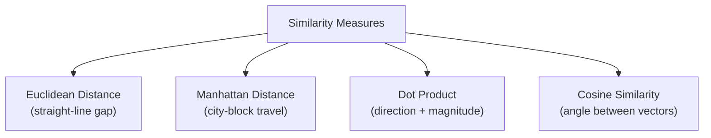
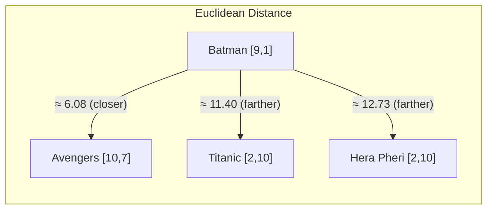
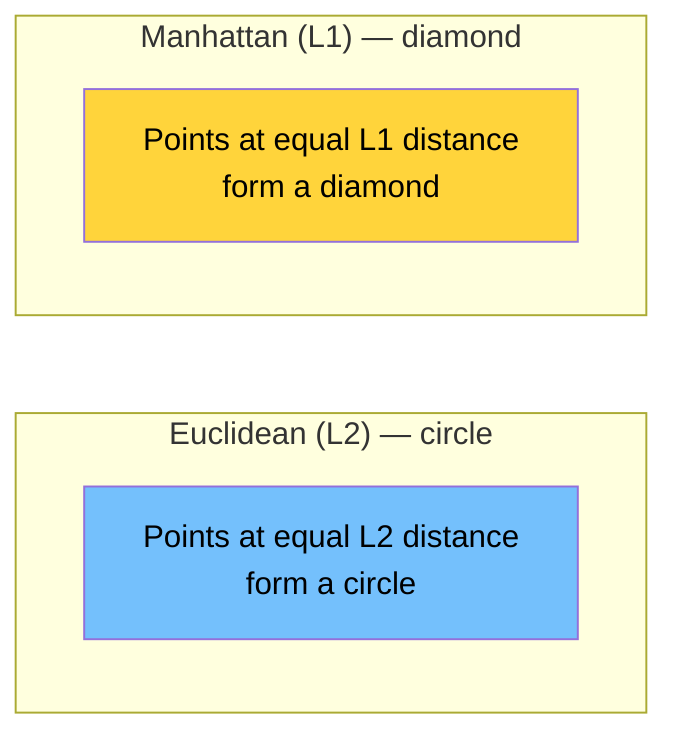
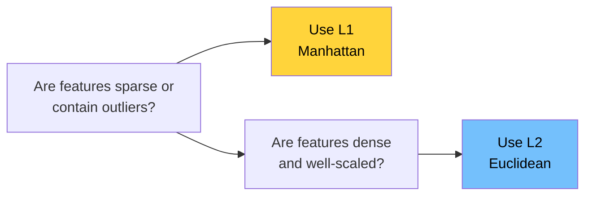
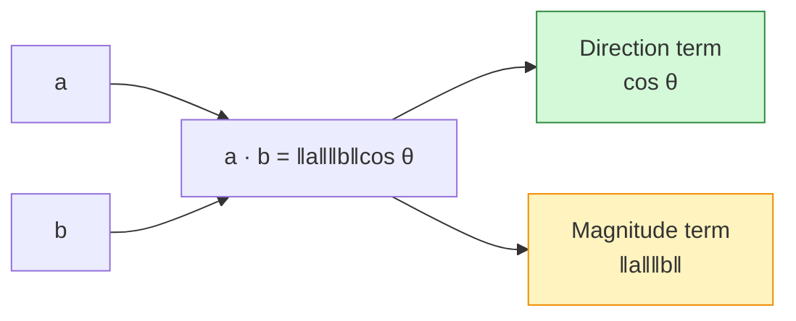
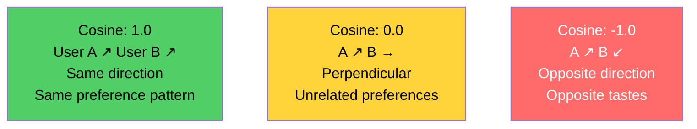
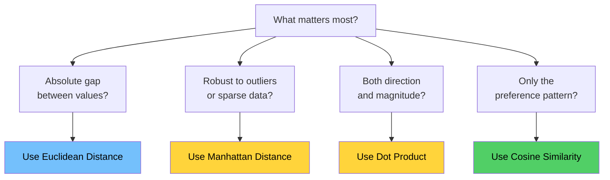
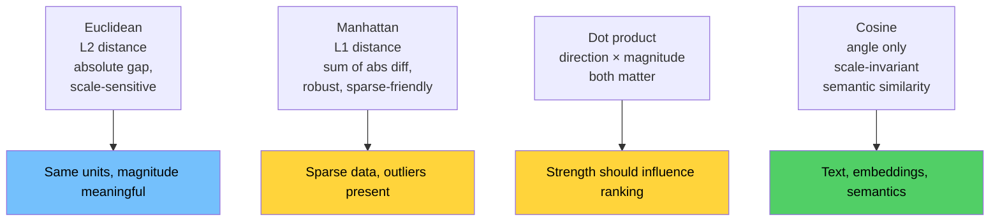

# Chapter 03: Measuring Similarity Between Vectors

## Chapter Goal

Understand the three primary mathematical approaches to measuring how similar or different vectors are — Euclidean Distance, Manhattan (L1) Distance, Dot Product, and Cosine Similarity. Learn the intuition behind each and when to prefer one over another.

---

## 3.1 Why We Need a Similarity Measure

Once objects exist inside a mathematical space as vectors, we need a way to **compare them**.

Given:
```
Batman       = [9, 1]
Avengers     = [10, 7]
Titanic      = [2, 10]
```

We want to answer: *"Which movie is most similar to Batman?"*

Four key approaches exist:



> **The important part is understanding the intuition — not memorizing formulas.**

---

## 3.2 Euclidean Distance

Euclidean distance is the **ordinary idea of straight-line distance** between two points in space.

### Intuition

```
Smaller distance → closer → more similar
Larger distance  → farther → less similar
```

### How It Works

For two points in 2D:

```
Distance = sqrt((x2 - x1)² + (y2 - y1)²)
```

For our movies (action, comedy):

```
Batman    = [9,  1]
Avengers  = [10, 7]
Hera Pheri= [2, 10]

Batman ↔ Avengers : sqrt((10-9)² + (7-1)²)  = sqrt(1 + 36)  = sqrt(37)  ≈ 6.08
Batman ↔ Titanic  : sqrt((2-9)²  + (10-1)²) = sqrt(49 + 81) = sqrt(130) ≈ 11.40
```

Batman is **closer** to Avengers than to Titanic ✅



### Properties That Matter in Practice

| Property | Consequence |
|:---|:---|
| Translation-sensitive | Adding a constant to every coordinate changes distances |
| Scale-sensitive | A feature measured in 0–10 is drowned out by one measured in 0–100000 |
| Requires comparable units | Mixing rupees with ratings produces meaningless geometry |
| O(d) per pair | Cheap, and vectorisable into L2 distance in any vector DB |

---

## 3.3 Manhattan (L1) Distance

While Euclidean distance measures the straight-line "as the crow flies" gap, **Manhattan distance** (also called L1 distance, taxicab distance, or city-block distance) measures the sum of absolute differences along each axis.

### Intuition

Imagine a city grid where you can only travel along streets (not diagonally). The Manhattan distance is the total distance you'd travel to get from one point to another.

```
In 2D:
Manhattan = |x2 - x1| + |y2 - y1|
```

### Example

```
Batman    = [9, 1]
Avengers  = [10, 7]

Manhattan(Batman, Avengers) = |10-9| + |7-1| = 1 + 6 = 7
```

Geometrically, this forms a diamond shape (rotated square) around a point, rather than the circle that Euclidean distance produces:



### When to Use Manhattan Distance

| Scenario | Why L1 Works |
|:---|:---|
| **Sparse features** | Many zeros; L1 naturally handles sparsity |
| **Robust to outliers** | L1 is less sensitive to extreme values than L2 (which squares them) |
| **Interpretable** | "Total absolute difference" is easy to explain |
| **High-dimensional sparse data** | Text features, bag-of-words, TF-IDF vectors |
| **When differences are additive** | Features measured on linear scales where contributions add up |

### L1 vs L2: The Outlier Effect

```
Vector A = [1, 1, 1, 1, 1]
Vector B = [1, 1, 1, 1, 100]   ← one extreme outlier

L1 (Manhattan):  |100-1| = 99
L2 (Euclidean):  sqrt((100-1)²) = 99     ← same for single dimension

But with multiple outliers:
Vector C = [1, 1, 1, 100, 100]

L1:  |100-1| + |100-1| = 99 + 99 = 198
L2:  sqrt(99² + 99²) = sqrt(9801 + 9801) = sqrt(19602) ≈ 140

L2 "discounts" the outliers because it squares then takes root.
```



> **Rule of thumb: L1 is robust and interpretable; L2 is the default for well-behaved continuous features. For text embeddings, cosine similarity still dominates both.**

---

## 3.4 Why Direction Sometimes Matters More Than Distance

Consider two users with action/romance preferences:

```
User A = [9,  1]   → slightly prefers action over romance
User B = [90, 10]  → also strongly prefers action over romance
```

**Euclidean distance** would say they are **very far apart** — the numbers differ by a factor of 10:

```
d(A,B) = sqrt((90-9)² + (10-1)²) = sqrt(6561 + 81) = sqrt(6642) ≈ 81.5
```

But look at the **ratio**:

```
User A: 9:1  = 9x more action than romance
User B: 90:10 = 9x more action over romance
```

Both users have the **exact same preference pattern**. Euclidean distance misses this because it's sensitive to magnitude.

Geometrically, both vectors **point in the same direction**:

```
User B   ↗
      /
     /
User A ↗  (same direction, different length)
```

| Question | Euclidean Answer | What the Business Means |
|:---|:---|:---|
| Same taste pattern? | "far apart" ❌ | yes — same 9:1 preference |
| Same intensity? | "very different" ✅ | maybe — one user is more engaged |

> **Euclidean distance conflates "how much" with "of what".** When the *shape* of a preference matters and the magnitude is an artefact (session length, click volume, document length), direction is the better signal.

---

## 3.5 Dot Product

The **dot product** of two vectors combines information about both **direction** and **magnitude**.

### How It Works

```
A = [2, 3]
B = [4, 5]

A · B = (2 × 4) + (3 × 5)
      = 8 + 15
      = 23
```

Multiply corresponding elements, then sum them all up.

### The Geometric Meaning

```
A · B = |A| × |B| × cos(θ)

where θ = angle between the vectors
```

This tells us:
- **Direction component**: `cos(θ)` — how aligned are they?
- **Magnitude component**: `|A| × |B|` — how large are they?



### Intuition

| Dot Product Value | Interpretation |
|:---|:---|
| Large positive | Vectors point in similar directions AND have large magnitudes |
| Near zero | Vectors are roughly perpendicular (unrelated) |
| Large negative | Vectors point in opposite directions |

### When to Use Dot Product

Use dot product when **both** the *direction* (type of preference) and *magnitude* (strength of preference) matter.

For example, in recommendation:
- A user who rated 100 movies highly AND prefers action is different from a user who rated 5 movies highly AND prefers action — the dot product captures this difference.

### Two Identities Worth Memorising

**1. Squared distance via dot product:**

```
‖a-b‖² = ‖a‖² + ‖b‖² - 2(a · b)
```

This is the reason L2 and inner-product indexes are often interchangeable up to a constant.

**2. Unit vectors collapse the distinction** — if ‖a‖ = ‖b‖ = 1:

```
a · b = cosθ    and    ‖a-b‖² = 2-2cosθ
```

So for **normalised** embeddings, ranking by dot product, by cosine, and by Euclidean distance produce the **same order**. This is why normalisation is a first-class operational concern.

> **Magnitude bias warning:** Raw dot product favours long documents, active users, and high-norm vectors. Use it deliberately — never accidentally.

---

## 3.6 Cosine Similarity

Cosine similarity asks:

> **"How similar is the *direction* of these two vectors — regardless of their size?"**

### Formula

```
cos(θ) = (A · B) / (|A| × |B|)
```

It's the dot product **normalised** by the magnitudes — this removes the effect of vector size.

### Output Range

```
+1.0 → vectors point in exactly the same direction (identical preference pattern)
 0.0 → vectors are perpendicular (completely unrelated)
-1.0 → vectors point in opposite directions (opposite preferences)
```

### Back to User A vs User B

```
User A = [9,  1]
User B = [90, 10]

A · B = (9 × 90) + (1 × 10) = 810 + 10 = 820
|A|   = sqrt(9² + 1²)        = sqrt(82)   ≈ 9.06
|B|   = sqrt(90² + 10²)      = sqrt(8200)  ≈ 90.6

Cosine = 820 / (9.06 × 90.6) ≈ 820 / 820.8 ≈ 0.999
```

**Near perfect cosine similarity!** ✅ — Both users have the same taste pattern.

Because B = 10 × A is a scalar multiple of A, cosine is exactly 1.0.

### Visual Comparison



---

## 3.7 Comparison Table

| Measure | What It Captures | Sensitive to Size? | Range | Best For |
|:---|:---|:---|:---|:---|
| Euclidean Distance | Absolute geometric distance | ✅ Yes | [0, ∞) | Physically scaled features |
| Manhattan Distance | Sum of absolute differences | ✅ Yes | [0, ∞) | Sparse data, robust to outliers |
| Dot Product | Direction AND magnitude | ✅ Yes | (−∞, ∞) | Recommendation with implicit feedback |
| Cosine Similarity | Direction (angle) only | ❌ No | [−1, 1] | Semantic search, document similarity |



### Rule of Thumb for AI Systems

> If the vectors come from an **embedding model**, use **cosine** (or normalise then use dot product). If the vectors are **hand-built features with real units**, use **Euclidean** — and standardise your features first.

### Operational Pairing — The Metric Must Match the Index

| Store / Index Setting | Score Returned | What to Do |
|:---|:---|:---|
| `cosine` | Cosine similarity (higher = closer) | Use directly |
| `inner_product` / `dot` | Raw dot product | Normalise inputs, or verify model was trained for it |
| `l2` / `euclidean` | Distance (lower = closer) | Invert or negate before sorting descending |
| `manhattan` | L1 distance (lower = closer) | Invert or negate before sorting descending |

Mixing a cosine query with an `l2` index produces plausible-looking but wrong rankings — one of the most common production bugs in retrieval systems.

---

## 3.8 Reference Pseudocode

```ts
// Pseudo code — illustrative, not production code

function dot(a: number[], b: number[]): number {
  let sum = 0;
  for (let i = 0; i < a.length; i++) sum += a[i] * b[i];
  return sum;
}

function norm(a: number[]): number {
  return Math.sqrt(dot(a, a));          // √(a · a)
}

function euclidean(a: number[], b: number[]): number {
  let sum = 0;
  for (let i = 0; i < a.length; i++) {
    const d = a[i] - b[i];
    sum += d * d;
  }
  return Math.sqrt(sum);                // lower = closer
}

function manhattan(a: number[], b: number[]): number {
  let sum = 0;
  for (let i = 0; i < a.length; i++) {
    sum += Math.abs(a[i] - b[i]);
  }
  return sum;                           // lower = closer
}

function cosine(a: number[], b: number[]): number {
  const denom = norm(a) * norm(b);
  if (denom === 0) return 0;            // guard: zero vector has no direction
  return dot(a, b) / denom;             // higher = closer, range [-1, 1]
}

// Normalise ONCE at write time, then use plain dot product at query time.
function normalize(a: number[]): number[] {
  const n = norm(a);
  if (n === 0) return a.slice();        // never divide by zero
  return a.map((v) => v / n);
}

// Top-k over a small in-memory catalogue: O(N × d) + O(N log k)
function topK(
  query: number[],
  catalogue: { id: string; vector: number[] }[],
  k: number,
): { id: string; score: number }[] {
  const scored = catalogue.map((item) => ({
    id: item.id,
    score: cosine(query, item.vector),
  }));
  scored.sort((x, y) => y.score - x.score);
  return scored.slice(0, k);
}
```

**Usage:**

```ts
const batman   = [9, 1];
const avengers = [10, 7];
const titanic  = [2, 1];
const hera     = [2, 10];

cosine(batman, avengers);    // ≈ 0.878 → similar direction
cosine(batman, titanic);     // ≈ 0.303 → nearly orthogonal
euclidean(batman, avengers); // ≈ 6.08  → nearest neighbour
manhattan(batman, avengers); // = 7     → also near
```

---

## 3.9 Summary



1. **All four metrics are valid; they answer different questions.** Choose based on your data distribution and what "similar" means for your use case.
2. **Euclidean is scale-sensitive** — correct when units are real, misleading when scale is an artefact.
3. **Manhattan is robust** — handles sparse data and outliers well.
4. **Dot product fuses direction and magnitude** — powerful, but biased toward high-norm vectors.
5. **Cosine isolates direction** and is the default for embedding-based retrieval.
6. **For unit-normalised vectors all three rankings agree** (`‖a-b‖² = 2-2cos θ`).
7. **The metric cannot fix the representation.** A poor feature set yields confident nonsense under every formula.
8. **Metric choice is a system-wide contract** — the same metric must be used at index time, query time, and evaluation time.

Chapter 04 now attacks the assumption underneath all of this: that *we* get to choose the dimensions.