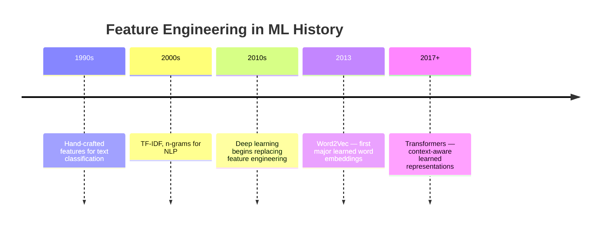
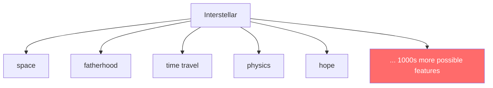
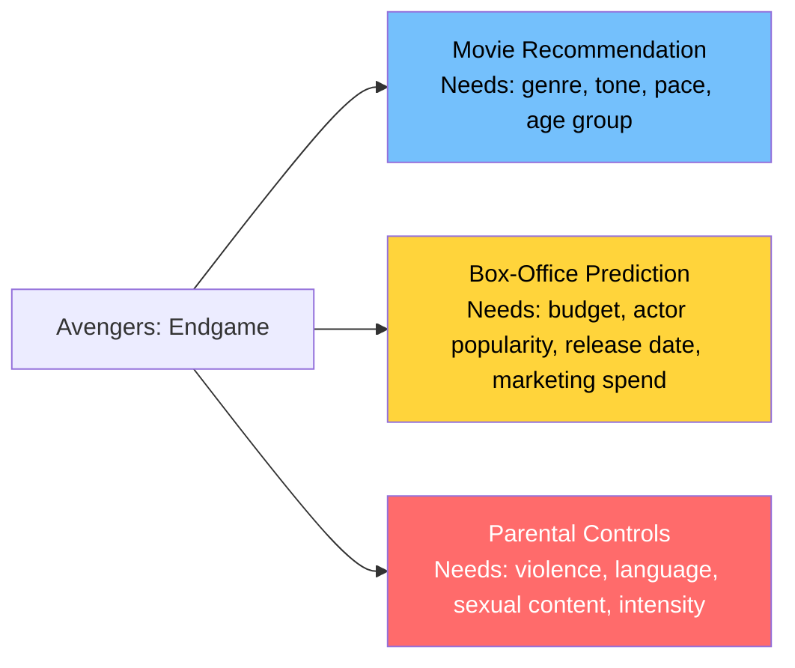
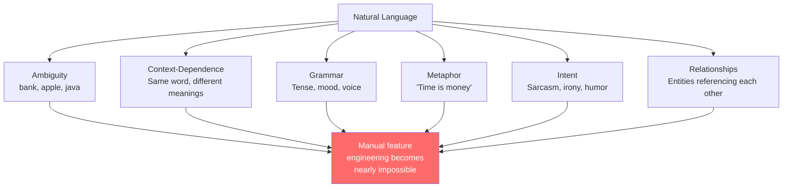
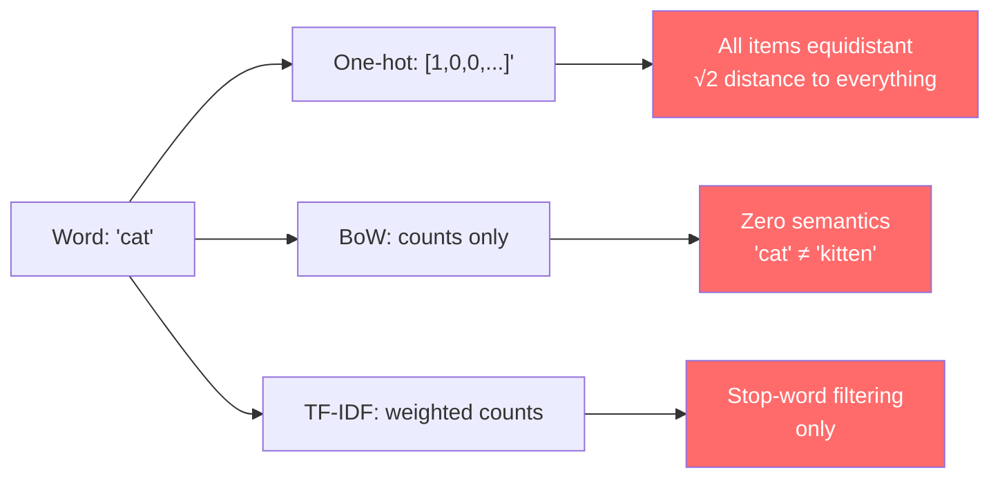
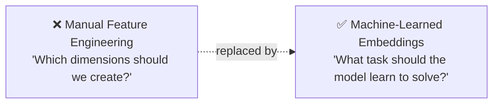
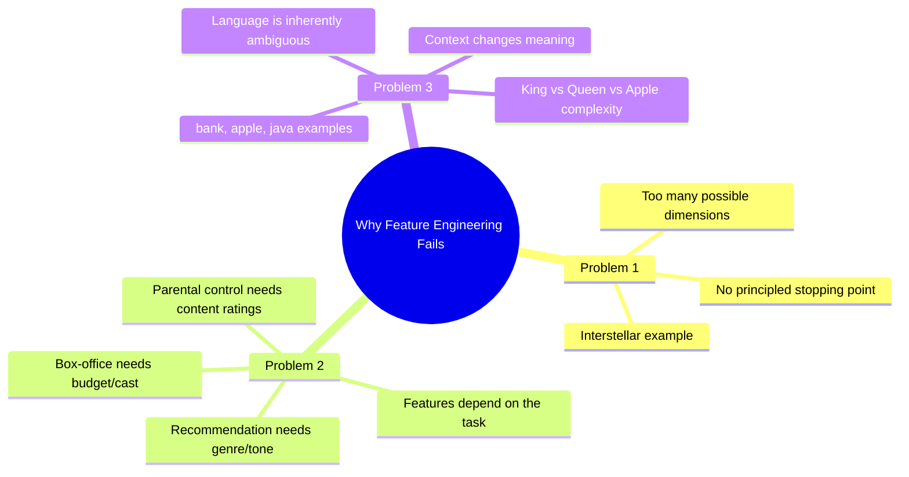
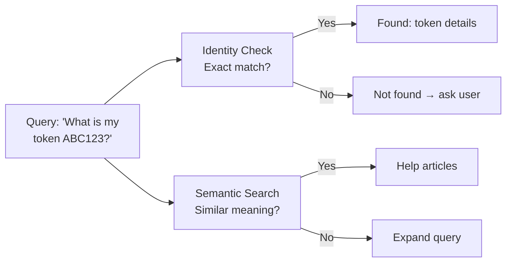
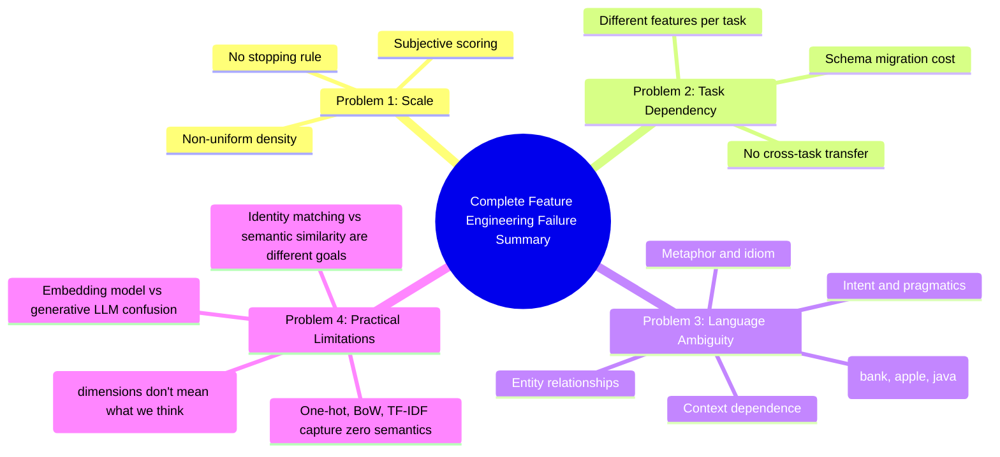

# Chapter 04: The Failure of Hand-Crafted Features

## Chapter Goal

Understand why manually designing vector dimensions (feature engineering) is fundamentally limited at scale. This chapter examines three core problems with hand-crafted features and builds the case for letting machines *learn* the right representations automatically.

---

## 4.1 The Setup: We Are Still Choosing the Dimensions

So far, every vector we've built was **manually designed**:

```js
// A human decided these are the right dimensions
const Batman = [
  9,  // action
  2,  // romance
  3,  // comedy
  9   // darkness
];
```

**Who decided** these four dimensions? → We did.

This is called **feature engineering** — the practice of manually defining which characteristics to measure.

> **Feature engineering can work extremely well... but it has severe limitations at scale.**

---

## 4.2 A Brief History: Feature Engineering in ML

Historically, a large portion of machine learning was about feature engineering:



For decades, teams of domain experts would spend months designing the right features for their specific problems. This approach had a ceiling. Deep learning's real contribution was not "bigger models" — it was **moving feature discovery from humans into optimisation**.

---

## 4.3 Problem 1 — How Many Dimensions Should We Create?

Consider the movie `Interstellar`. What features should represent it?

```
space?          ✓
science?        ✓
family?         ✓
fatherhood?     ✓
time travel?    ✓
love?           ✓
survival?       ✓
philosophy?     ✓
physics?        ✓
sadness?        ✓
adventure?      ✓
visual spectacle? ✓
hope?           ✓
sacrifice?      ✓
isolation?      ✓
duty?           ✓
grief?          ✓
curiosity?      ✓
scale?          ✓
mortality?      ✓
```

Different humans would describe the **same movie** using completely different characteristics. There could be **thousands** of meaningful properties, and humans must decide which ones matter.



### Three Unresolvable Sub-problems

| Sub-problem | Why It Is Unresolvable |
|:---|:---|
| **No stopping rule** | There is no principled point at which a concept list is "complete" |
| **Subjective scoring** | Two annotators disagree on whether Interstellar's "hope" is 7 or 9 |
| **Non-uniform density** | Some films need 3 dimensions, others need 30; a fixed schema over-serves and under-serves simultaneously |

And every dimension added costs ongoing work: define it, scale it, document it, backfill it across the entire catalogue, and keep annotators consistent.

> **Dimensionality is not free, and there is no natural boundary.** This is the first structural failure.

---

## 4.4 Problem 2 — Features Depend on the Task

The **same movie** requires completely different features depending on what you're trying to solve:



The same object. Three completely different feature sets. There is **no universally correct feature list** that works for all use cases.

| Task | Useful Dimensions | Useless Dimensions |
|:---|:---|:---|
| Recommendation | Tone, pace, genre, franchise | Budget, marketing spend |
| Box office | Budget, cast, release window | Tone, parental intensity |
| Parental controls | Violence, language, intensity | Budget, cast popularity |

This means:

1. **N tasks → N representation pipelines**, each with its own annotations, backfills, and drift.
2. **Cross-task transfer is impossible** — a recommendation vector cannot answer a compliance question.
3. **A schema change is a migration** — a new dimension means re-annotating the entire corpus.

> **A representation valid for only one task is a representation you must rebuild for every task.** This is the second structural failure.

---

## 4.5 Problem 3 — Language Makes Feature Engineering Nearly Impossible

### Words Have Many Meanings

Consider the word:

```
bank
```

```
"I deposited money at the bank."  → financial institution
"The fisherman sat on the river bank."  → edge of a river
```

Same word. Completely different meaning. Any static feature set for "bank" must somehow capture both meanings — or pick one and be wrong half the time.

### Words Change Meaning by Context

```
Apple  →  fruit (food context)
Apple  →  tech company (business context)

Java   →  programming language (developer context)
Java   →  island in Indonesia (geography context)
Java   →  coffee (cafe context)
```

A manually designed feature vector for "Apple" must include:

- fruit, food, red, sweet, round ← for food context
- technology, company, iPhone, software ← for tech context

These features can contradict each other, and their weights change completely depending on context.

### The King Example

```
King  → [human=1, male=1, royalty=1, authority=1, wealth=1, adult=1, leader=1, politics=1, power=1, ...]
Queen → [human=1, female=1, royalty=1, authority=1, wealth=1, adult=1, leader=1, politics=1, power=1, ...]
```

How many dimensions do we need? What's the "correct" gender score? What about gender-neutral monarchs? What about "queen" in chess? In music (Freddie Mercury)?



Natural language breaks the design process in five distinct ways:

| Failure Mode | Example | Why Static Features Fail |
|:---|:---|:---|
| **Polysemy** | `bank` (river / finance), `apple` (fruit / company), `java` (island / coffee / language) | One token would need multiple incompatible vectors |
| **Context dependence** | "The bank raised rates" vs "the bank was muddy" | Meaning is a function of surrounding tokens |
| **Metaphor and idiom** | "time is money", "break a leg" | Literal component words actively mislead |
| **Intent and pragmatics** | "Great, another outage." | Sentiment is opposite to the word's polarity |
| **Entity relationships** | "the CEO fired the CTO" | Roles and direction matter, not just word presence |

### The King / Queen / Apple Thought Experiment

To hand-encode just these three concepts you would need to decide, for each, values across royalty, gender, edibility, biology, authority, and thousands of unnamed interactions:

```
king   → royalty=high, gender=male,   edible=no,  alive=yes
queen  → royalty=high, gender=female, edible=no,  alive=yes
apple  → royalty=none, gender=none,   edible=yes, alive=no
```

Then someone asks about `crown` (royalty + object), `queen bee` (royalty + insect + female), or `Apple Inc.` (company, but written with an edible word). The schema never converges.

> **Language is not a fixed set of attributes; it is a system of relationships that shift with context.** This is the third structural failure.

---

## 4.6 One-Hot Encoding and Bag-of-Words — The Flat Baseline

Before learned embeddings, two classic approaches dominated NLP:

### One-Hot Encoding

| Encoding | Shape | What It Preserves | What It Breaks |
|:---|:---|:---|:---|
| Ordinal (`small=1`, `medium=2`, `large=3`) | 1 number | Genuine order | Only valid when property truly is ordered |
| One-hot (`cat=[1,0,0]`, `dog=[0,1,0]`) | V dimensions | Identity, zero false order | All items equidistant; no relatedness; enormous and sparse |

Because every pair has distance √2 and cosine 0, one-hot vectors cannot express that `cat` is more similar to `dog` than to `database`.

### Bag-of-Words (BoW)

Represents a document as a vector of word counts:

```
Document: "The cat sat on the mat"
BoW: [the:2, cat:1, sat:1, on:1, mat:1]
```

Pros:
- Simple to implement
- Preserves word identity (cat ≠ dog)
- Works surprisingly well for some classification tasks

Cons:
- **All items are equidistant** — every word has the same "distance" to every other word
- **No relatedness** — "cat" and "kitten" are treated as completely unrelated tokens
- **Sparsity** — vocabulary grows to tens of thousands; most entries are 0
- **No semantics** — "bank" (river) and "bank" (finance) are identical

### TF-IDF (Term Frequency-Inverse Document Frequency)

A refinement of BoW that down-weights common words:

```
tf-idf(t, d) = tf(t, d) × idf(t)
```

Where `tf` = how often term `t` appears in document `d`, and `idf` = log(total docs / docs containing t).

Pros:
- Reduces weight of stop words ("the", "a", "an")
- Highlights discriminative terms
- Still a **linear algebraic representation**, no semantics captured

Cons:
- **Still captures zero semantics** — TF-IDF vectors have no geometric meaning
- **Cannot express "cat is more similar to dog than to banana"** 
- **Vocabulary is fixed at training time** — cannot handle new words out-of-vocabulary

> **All three (one-hot, BoW, TF-IDF) are honest about what they represent: identity only. They explicitly capture nothing about meaning or relatedness.** They are useful baselines, but fundamentally insufficient for semantic tasks.



---

## 4.7 Limitations Summary Table

| Limitation | Description | Impact |
|:---|:---|:---|
| **Scale** | Too many possible dimensions to enumerate | Features always incomplete |
| **Task Specificity** | Right features depend on problem | Need new feature sets per task |
| **Ambiguity** | Same word, multiple meanings | Can't statically assign values |
| **Context** | Meaning shifts based on surrounding words | Static features can't adapt |
| **Subjectivity** | Different humans assign different values | Inconsistent representations |
| **Maintenance** | Features must be updated as language evolves | Extremely high ongoing cost |

---

## 4.8 The Question That Changes Everything

We know we want:

```
Batman       → vector
Superman     → vector
Titanic      → vector

king         → vector
queen        → vector
dog          → vector
```

And we want the resulting space to behave like this:

```
Batman ≈ Superman   (both superheroes)
dog    ≈ puppy      (same animal)
king   ≈ queen      (both royalty)

Batman ≠ banana     (completely unrelated)
dog    ≠ database   (completely unrelated)
```

But we do **not** want humans to manually design thousands of dimensions.

The only scalable solution is:



> **Instead of asking "Which dimensions should we create?", we ask "What task should the system learn to solve?" The correct representations emerge as a by-product of learning.**

---

## 4.9 Summary



Feature engineering is not *wrong* — it's just fundamentally limited for the scale and variety of real-world data. This limitation motivates the breakthrough concept explored in Chapter 05: **learning vector representations automatically through training**.

---

## 4.10 The Interpretability Trap — When Dimensions Don't Mean What We Think

A common assumption after building hand-crafted feature vectors is that **every dimension has a clear human label**:

```js
// Manually labeled dimensions — human-readable
const king = {
  royalty: 1.0,
  gender: "male",
  authority: 0.9
};
```

This feels intuitive when we define features ourselves. But in production systems with hundreds of dimensions, this assumption breaks down:

### The 100-Dimension Problem

Imagine a movie recommendation vector with 100 dimensions:
- Dimension 1–10: Action, Comedy, Romance, Darkness, Violence, etc.
- Dimension 11–50: Unknown or poorly documented features
- Dimension 51–100: Likely artifacts of data preprocessing, not meaningful features

When dimensions are human-labeled, we can debug and interpret the model. But in many real-world systems:

1. **Dimensions drift** — as data changes, a feature's meaning can shift without us noticing
2. **Hidden interactions** — dimension `i` may combine with dimension `j` in ways we didn't anticipate
3. **Dataset bias** — dimensions may capture spurious correlations from the training data

> **The interpretability trap:** We assume we understand what each dimension means, but in reality, the model may be using dimensions in ways we never explicitly designed. Never trust a high-dimensional vector's interpretation without extensive analysis.

### Cross-Lingual Example

```
Translation from English to Spanish may change which dimensions are "active"
A vector that was "high positivity" in English might map to a different\n combination of dimensions in Spanish
Without explicit cross-lingual alignment, the same semantic concept\n appears as different geometry in different languages
```

This is why learned embeddings — where the model discovers its own structure — often outperform hand-crafted systems. The model doesn't suffer from our blind spots about what "should" be a dimension.

---

## 4.11 Missing Topic: Embedding Model vs Generative LLM

| Aspect | Embedding Model | Generative LLM (e.g., GPT-4) |
|:---|:---|:---|
| **Primary Purpose** | Convert input to vector for similarity/search | Generate text/continuation/response |
| **Output** | Fixed-dimensional vector (e.g., 768, 1536 dims) | Unlimited-token text output |
| **Training Objective** | Predict next word / classify / retrieve | Next-token prediction with massive context |
| **Key Property** | **Geometry encodes semantics** — close vectors = similar meaning | **Language generation** — coherent text output |
| **Typical Use Cases** | Semantic search, RAG, recommendation, clustering | Chat, content creation, coding, analysis |
| **Cost** | Typically 10–100× cheaper per query | Typically 10–100× more expensive per token |
| **Determinism** | Same input → same output (deterministic) | Same input → different output (sampling) |
| **Vocabulary** | Fixed vocabulary learned during training | Subword tokenizer (e.g., tiktoken for GPT) |

**Crucial:** Embedding models and generative LLMs are often confused. The key distinction:

- **Embedding model**: `text-embedding-ada-002`, `BERT`, `MiniLM` — output is a **vector**; purpose is **similarity comparison**
- **Generative LLM**: `GPT-4`, `Claude`, `Llama` — output is **text**; purpose is **language generation**

You can use a generative LLM to generate embeddings (by pooling its hidden states), but that's rarely the most efficient approach. For semantic search and similarity, use a dedicated embedding model.

> **Confusion between these two is one of the most common production bugs:** Using GPT-4 embeddings for semantic search, or trying to get text generation from an embedding model. They are fundamentally different tools for different jobs.

---

## 4.12 Missing Topic: Identity Matching vs Semantic Similarity — Two Different Retrieval Goals

As discussed in Chapter 01, it is critical to distinguish between these two retrieval paradigms when designing an embedding-based system:

### Identity Matching in Embedding Space

Using embeddings to find **exact matches** or **near-identical** items:

```
Query: "What is my password reset token ABC123?"
Result: Exact match → "Your token ABC123 has expired"
```

Techniques:
- Exact equality check on token IDs or hashes
- Very high cosine similarity (>0.99) for near-duplicates
- Useful for: duplicate detection, exact lookups

### Semantic Similarity in Embedding Space

Using embeddings to find **meaningfully related** items:

```
Query: "I forgot my password"
Result: "How do I reset my login credentials?" (similarity: 0.94)
```

Techniques:
- Cosine similarity threshold (e.g., >0.8)
- Top-k retrieval
- Useful for: help articles, recommendation, RAG

### Why the Distinction Matters in Embedding Systems

| Decision | Identity Matching | Semantic Similarity |
|:---|:---|:---|
| **Similarity threshold** | >0.99 (very strict) | >0.7–0.8 (lenient) |
| **Top-k** | k=1 (the one match) | k=5–20 (ranked list) |
| **Index type** | Hash table, trie | HNSW, IVF, Annoy |
| **Evaluation metric** | Precision at k, exact match rate | Recall at k, MRR, nDCG |
| **Failure mode** | Misspelling → no result | Drift → wrong but similar result |

**Production systems often need BOTH:**
- Identity matching for user accounts, API keys, exact document lookups
- Semantic similarity for help content, recommendations, search results



> **A system designed only for identity matching fails when users describe needs in different words. A system designed only for semantic similarity fails when exact matches are required.** Most production systems implement both, choosing the right approach per use case.

---

## 4.13 Summary



Feature engineering is not *wrong* — it's just fundamentally limited for the scale and variety of real-world data. This limitation motivates the breakthrough concept explored in Chapter 05: **learning vector representations automatically through training**.