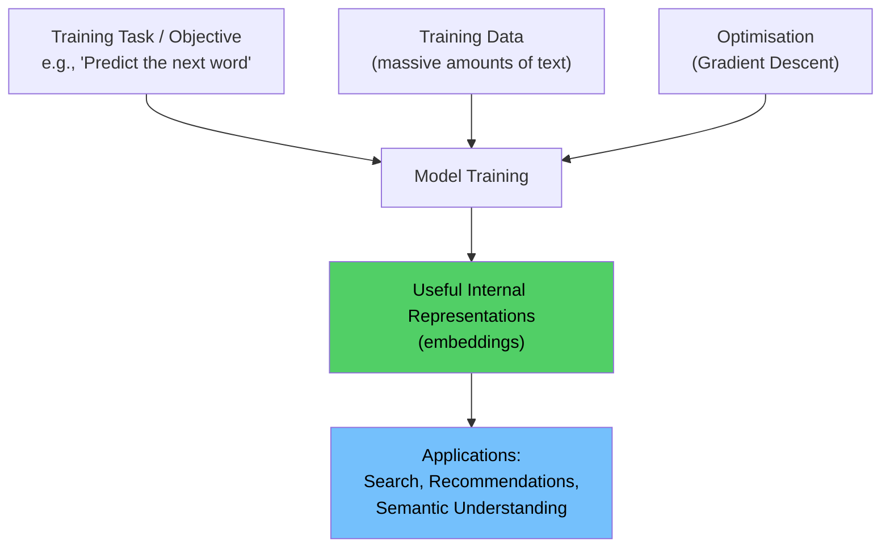
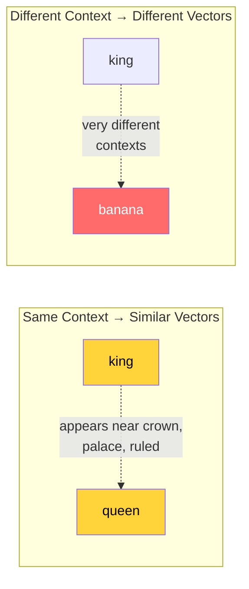
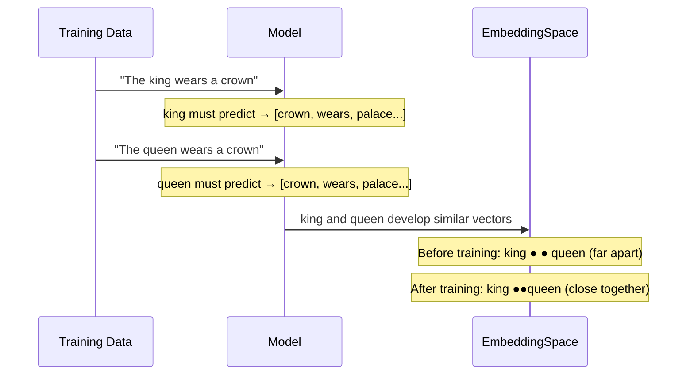
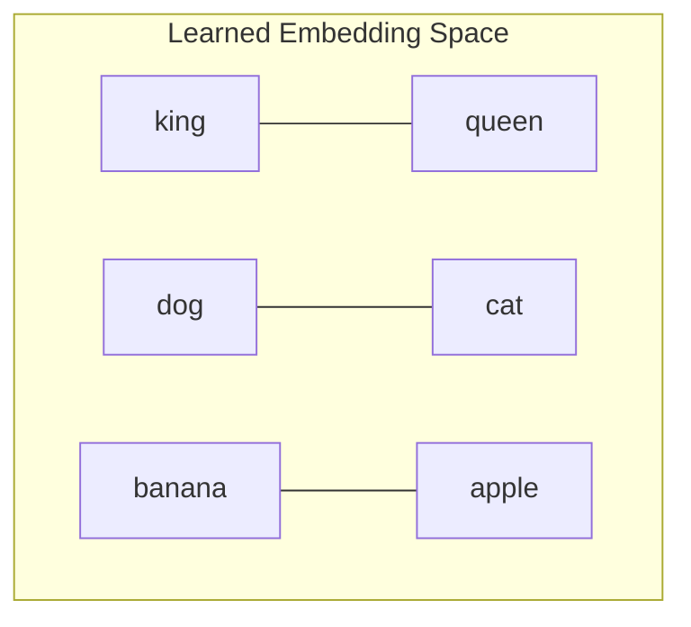
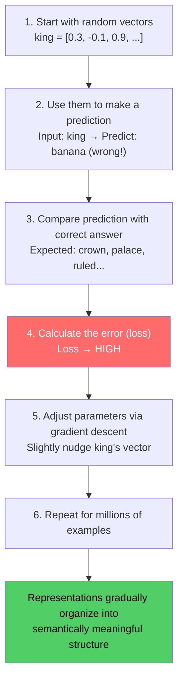
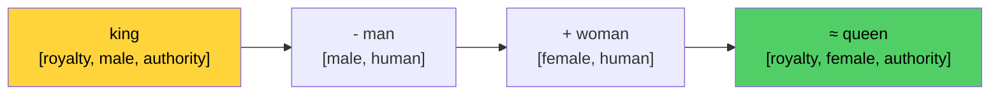
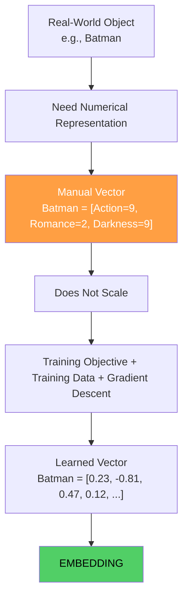
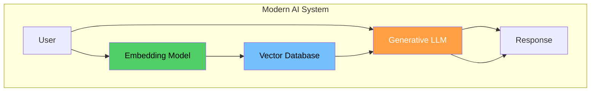
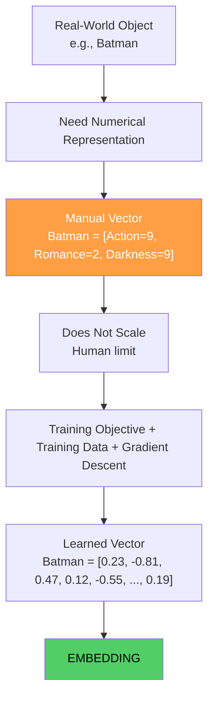
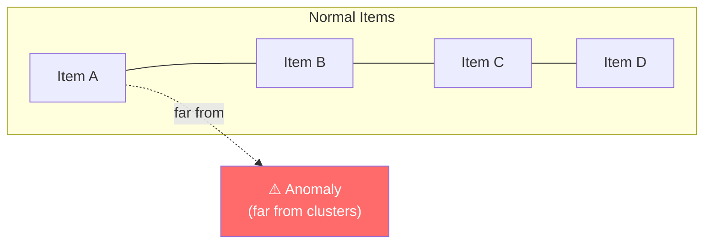

# Chapter 05: What Are Embeddings? Learning Representations

## Chapter Goal

Understand what embeddings are, how they differ from hand-crafted feature vectors, how training produces useful representations from data, and why the famous "king - man + woman = queen" arithmetic actually works. This is the core conceptual leap of the entire lecture.

---

## 5.1 The Key Insight: Let the Machine Learn

Instead of manually deciding what the dimensions mean, we flip the question:

```
OLD: "Which dimensions should we create?"
NEW: "What task should the model learn to solve?"
```

The correct internal representations **emerge as a consequence** of training on a useful task.

> **An embedding is a learned vector representation of an object in a continuous mathematical space — where geometric relationships encode semantic relationships.**

---

## 5.2 The Formal Definition

An **embedding model** is a function:

```
f(input) → ℝᵈ
```

Where:
- `input` = any real-world object (word, sentence, image, user, etc.)
- `ℝᵈ` = a d-dimensional continuous vector space
- `f` = a model with learned parameters (a neural network)

For example:

```
f("Batman is a dark superhero movie")
  ↓
Embedding Model
  ↓
[0.12, -0.37, 0.91, 0.44, 0.02, ..., 0.22]   (768 or 1536 dimensions)
```

If the model produces 768-dimensional embeddings:

```
f(text) → ℝ⁷⁶⁸
```

If 1536-dimensional:

```
f(text) → ℝ¹⁵³⁶
```

The **dimensionality is a design choice** of the particular embedding model.

---

## 5.3 How Does Training Know What to Learn?

A machine-learning model doesn't "understand" instructions like:

```
"Understand the English language."
```

Instead, it learns parameters that help it **perform some objective (task)**. Useful internal representations emerge as a *side-effect* of learning to do that task well.



The model is never explicitly told what "king" means, what "queen" means, or how they relate. It figures this out through patterns in the training data.

---

## 5.4 Meaning Through Context

Consider training data that repeatedly contains:

```
The king ruled the kingdom.
The queen ruled the kingdom.

The king lived in the palace.
The queen lived in the palace.

The king wore the crown.
The queen wore the crown.
```

And separately:

```
I ate a banana.
The banana is a fruit.

The apple is a fruit.
I ate an apple.
```

Notice what's happening:
- `king` and `queen` appear in **similar surrounding words**
- `banana` and `apple` appear in **similar surrounding words**
- `king` and `banana` appear in **very different contexts**

This pattern reflects a famous principle from linguistics:

> **"You shall know a word by the company it keeps."** — J.R. Firth (1957)

Words that appear in similar contexts tend to have **related meanings or roles**.



---

## 5.5 A Toy Training Objective — Predict Nearby Words

Imagine a simple task: **Given one word, predict nearby words** (this is roughly how Word2Vec works).

**Sentence:** `"The king wears a crown"`

```
Input: king
Nearby words: the, wears, a, crown
```

Now consider: `"The queen wears a crown"`

```
Input: queen
Nearby words: the, wears, a, crown
```

Since `king` and `queen` need to produce **similar predictions** to succeed at the task, it becomes useful for their internal representations to become **similar**.



Meanwhile, `banana` never appears near `crown`, `palace`, or `kingdom` — so its vector drifts to a completely different region of the space.

**The relationship emerges from patterns in data.** No human explicitly entered: `"king is similar to queen"`.

---

## 5.6 The Embedding Table

In a simple model, each word in the vocabulary gets its own vector stored in an **embedding table** (also called an embedding lookup table or embedding matrix):

| Word | d1 | d2 | d3 |
|:---|:---|:---|:---|
| king | 0.21 | -0.71 | 0.45 |
| queen | 0.19 | -0.68 | 0.49 |
| dog | -0.51 | 0.22 | 0.78 |
| cat | -0.48 | 0.19 | 0.73 |
| banana | 0.89 | 0.54 | -0.13 |
| apple | 0.84 | 0.57 | -0.09 |

Observations:
- `king` and `queen` have **very similar values** → they appear in similar contexts
- `dog` and `cat` have **very similar values** → they appear in similar contexts
- `banana` and `apple` have **very similar values** → they appear in similar contexts
- But `king` and `banana` are in **completely different regions** of the space



---

## 5.7 How Training Changes the Embeddings — Step by Step

The training cycle:



Over enormous numbers of training examples, the vectors that started **randomly scattered** gradually organize themselves:

```
BEFORE TRAINING (random):
  king                   banana
             dog
  queen                           apple
            cat

   ↓ millions of training examples ↓

AFTER TRAINING (meaningful):
  king ●●● queen

  dog  ●●● cat

  banana ●●● apple
```

---

## 5.8 The Famous King-Queen-Man-Woman Arithmetic

One of the most celebrated properties of well-trained word embeddings is **vector arithmetic**:

```
king - man + woman ≈ queen
```

### Why Does This Work?

If the embeddings capture underlying structure:

```
king  ≈ [royalty, male, authority, ...]
queen ≈ [royalty, female, authority, ...]
man   ≈ [male, human, adult, ...]
woman ≈ [female, human, adult, ...]
```

Then:

```
king - man  →  removes the "male" component  →  leaves [royalty, authority, ...]
+ woman     →  adds the "female" component   →  [royalty, female, authority, ...]
≈ queen
```



> **This arithmetic works because the embedding space encodes relationships as consistent geometric directions.** The "gender direction" in the vector space is the same for both king/queen and man/woman pairs.

### More Examples of Embedding Arithmetic

```
Paris - France + Germany ≈ Berlin
doctor - man + woman ≈ nurse
walking - walk + swim ≈ swimming
```

These are emergent properties — nobody programmed them. They arise from the statistical structure of language itself.

---

## 5.9 What the Model "Discovers" (With a Caveat)

In a manually designed vector, every dimension has a clear human label:

```js
// Manually labeled dimensions — human-readable
const king = {
  royalty: 1.0,
  gender: "male",
  authority: 0.9
};
```

In a learned embedding, the dimensions are **not human-labeled**:

```
king = [0.21, -0.71, 0.45, 0.88, -0.23, ...]
```

We **cannot directly read** what each dimension means. But some interpretable structure often emerges when we analyze the space. These learned internal characteristics are called:

- **Latent features** — features that influence the output but aren't directly observed
- **Latent factors** — in recommendation systems
- **Latent representations** — the general term

> **The model discovers useful structure. But we must be careful — it's not discovering human-interpretable "features." It's discovering whatever mathematical structure helps solve the training objective.**

---

## 5.10 Embeddings as Coordinates on a Map

Think of an embedding space like a map:
- Each object is a point
- Distance between points = semantic similarity
- Direction from one point to another = a relationship (e.g., "gender", "royalty")

The map itself is not labeled with human-readable axis names. But the geometry reveals structure:
- Countries cluster together
- Capitals cluster together
- The vector from "Paris" to "France" is parallel to "Berlin" to "Germany"

---

## 5.11 Latent Dimensions and Latent Space

**Latent dimensions** are the axes of the embedding space that are not directly human-interpretable but capture meaningful variation in the data. For example:
- Dimension 342 might capture "formality vs casualness" in text
- Dimension 891 might capture "positive vs negative sentiment"
- Dimension 12 might capture "physical vs abstract"

These dimensions emerge from training data patterns, not human design. They are "latent" because they are hidden variables that the model infers from observed patterns.

---

## 5.12 Summary



### Key Concepts Recap

| Concept | Description |
|:---|:---|
| **Embedding** | A learned position in a continuous vector space |
| **Embedding Table** | Lookup table of learned vectors per vocabulary item |
| **Training Objective** | The task the model is trained to solve (e.g., predict next word) |
| **Latent Features** | Learned internal structure, not human-readable |
| **Vector Arithmetic** | Semantic relationships encoded as geometric directions |
| **"Company it keeps"** | Words in similar contexts → similar vectors |

> **An embedding is not the meaning itself. It is a position inside a learned mathematical space where useful relationships in meaning or behavior become relationships in geometry.**

The next chapter (Chapter 06) answers: what can we actually *do* with these embeddings once we have them?

---

## 5.13 Missing Topic: The Interpretability Trap

As mentioned in Chapter 04, understanding what individual embedding dimensions mean is often impossible. The interpretability trap is the assumption that because we can inspect dimensions, we understand them.

**The reality:** In high-dimensional embedding spaces:
- **Dimensions are distributed** — meaning is spread across many dimensions
- **They are not human-labeled** — they emerge from mathematical optimization, not human design
- **Interpretation requires analysis of geometry** — distances, clusters, and directions, not individual coordinates

> **If you can interpret a dimension, you're likely overfitting to the training data rather than discovering true semantic structure.**

Common mistakes:
- Assuming dimension X = "gender", dimension Y = "formality"
- Trying to manually correct embedding behavior by tweaking individual dimensions
- Believing that human-interpretable features make embeddings "better"

The correct approach: analyze relationships **between** items, not contents **within** individual dimensions.

This is why techniques like PCA (projecting to 2D/3D for visualization) and linear probing (training classifiers on embeddings) are more useful than trying to read individual dimension values.

---

## 5.14 Missing Topic: Embedding Model vs Generative LLM (Expanded)

### Core Distinction (Reiterated)

**Embedding Model**: `text-embedding-ada-002`, `BERT-base`, `MiniLM`
- Output: Fixed-dimensional vector (e.g., `[0.23, -0.12, 0.45, ...]`)
- Purpose: **Similarity comparison** (find nearest neighbors)
- Use case: Semantic search, recommendation, RAG, clustering
- Cost: ~$0.0001 per 1K tokens
- Speed: Sub-millisecond latency

**Generative LLM**: `GPT-4`, `Claude`, `Llama`
- Output: Infinite text sequence
- Purpose: **Language generation** (answer, explain, write)
- Use case: Chat, content creation, code generation, analysis
- Cost: ~$0.03–0.08 per 1K tokens
- Speed: Hundreds of milliseconds per response

### When to Use Each

| Task | Use Embedding Model | Use Generative LLM |
|:---|:---|:---|
| Find similar documents | ✅ `embed() → cosine similarity` | ❌ Cannot score similarity |
| Answer a question | ✅ Embedding for retrieval → LLM for generation | ✅ Direct generation |
| Summarize text | ✅ Embedding for chunking → LLM for synthesis | ✅ Direct summarization |
| Classify documents | ✅ Embedding for features → classic ML classifier | ✅ Direct classification (few-shot) |

### System Architecture: The Pattern



**Optimal architecture:**
1. **Embedding Model**: Finds *what* information is relevant (similar items)
2. **Generative LLM**: Produces *how* to answer (natural language)
3. **Vector Database**: Stores embeddings efficiently
4. **Application Layer**: Orchestrates the flow, handles context management

> **Embedding models and LLMs solve different problems. Use them together for the best results.**

---

## 5.15 What Embeddings Enable That Manual Vectors Cannot

### Scalability

- **Manual**: Human teams manually define features for each word (impossible at scale)
- **Embeddings**: Model discovers features automatically from data

### Transfer Across Tasks

- **Manual**: Features designed for one task (e.g., sentiment) don't transfer to another (e.g., topic modeling)
- **Embeddings**: Single embedding space can serve multiple downstream tasks

### Cross-lingual Transfer

- **Manual**: Building comparable feature sets across languages is extremely difficult
- **Embeddings**: Models trained on multilingual data naturally align concepts across languages

### Context Sensitivity

- **Manual**: Static features cannot capture context-dependent meaning
- **Embeddings**: Contextual embeddings (BERT, etc.) produce different vectors for the same word in different contexts

### Emergence of Complex Relations

- **Manual**: Cannot easily program "king - man + woman = queen"
- **Embeddings**: Vector arithmetic emerges as a natural property of the embedding space

---

## 5.16 Summary



### Key Concepts Recap

| Concept | Description |
|:---|:---|
| **Embedding** | A learned position in a continuous vector space |
| **Embedding Table** | Lookup table of learned vectors per vocabulary item |
| **Training Objective** | The task the model is trained to solve |
| **Latent Features** | Learned internal structure, not human-readable |
| **Vector Arithmetic** | Semantic relationships encoded as geometric directions |
| **"Company it keeps"** | Words in similar contexts → similar vectors |
| **Interpretability Trap** | Don't assume individual dimensions have meaning |
| **Embedding vs LLM** | Two different jobs: similarity vs generation |
| **Cross-task Transfer** | Single embedding space serves multiple applications |
| **Scalability** | Automatic feature discovery from data |

> **An embedding is not the meaning itself. It is a position inside a learned mathematical space where useful relationships in meaning or behavior become relationships in geometry.**

The next chapter (Chapter 06) explores: what can we actually *do* with these embeddings once we have them?

---

## 5.17 Missing Topic: Anomaly Detection in Embedding Space

Anomaly detection: finding items that don't fit the normal pattern:



**Applications:**
- Fraud detection: transactions that don't match user's normal pattern
- Content moderation: posts that violate community standards
- System monitoring: unusual API usage patterns

> **Anomaly detection with embeddings works because "abnormal" becomes "far away" in the vector space.** The same cosine similarity that powers search also powers fraud detection.

The next chapter (Chapter 06) addresses: **Vector vs Embedding — Applications & Real-World Use Cases**.

> **Once you understand embeddings, the question is no longer "what can we compute?" but "what should we build?"** — and the answer is: virtually everything modern AI does.