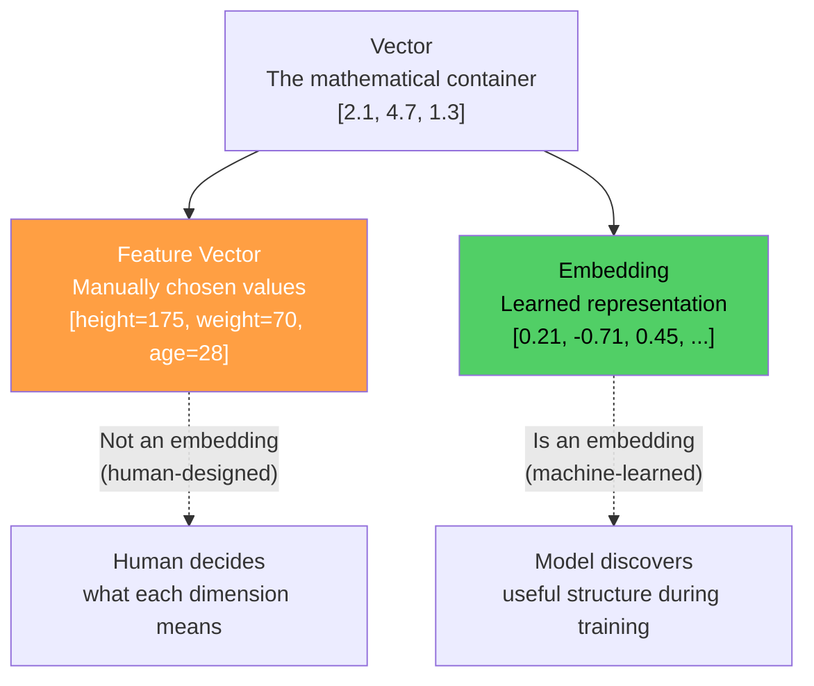
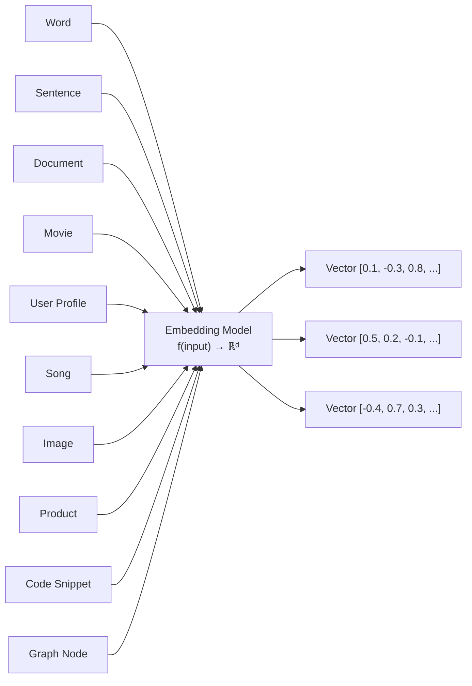
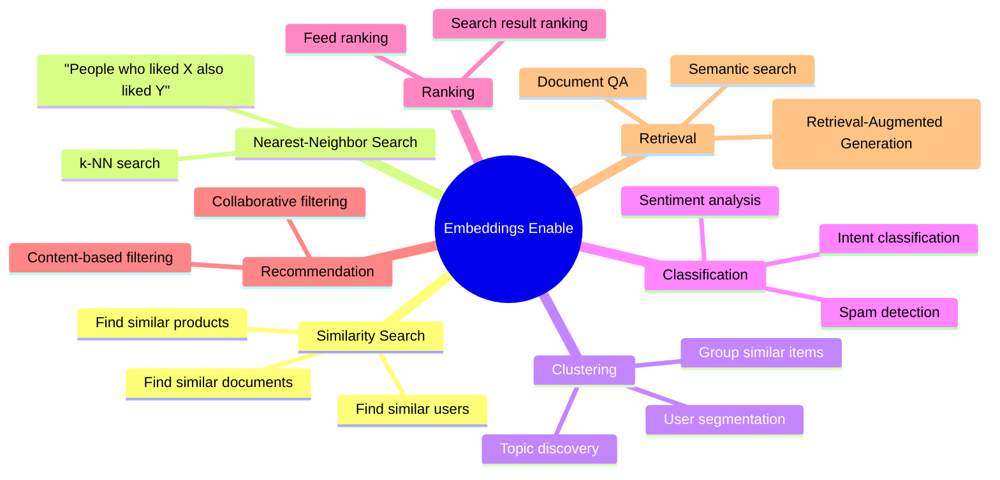
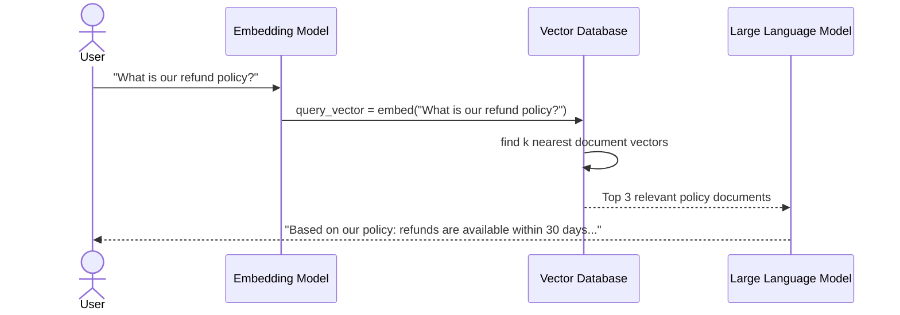
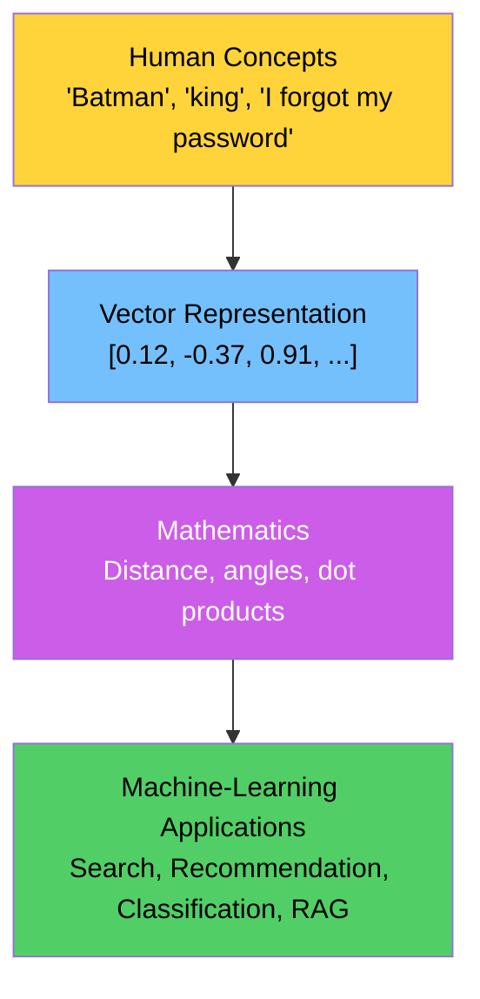
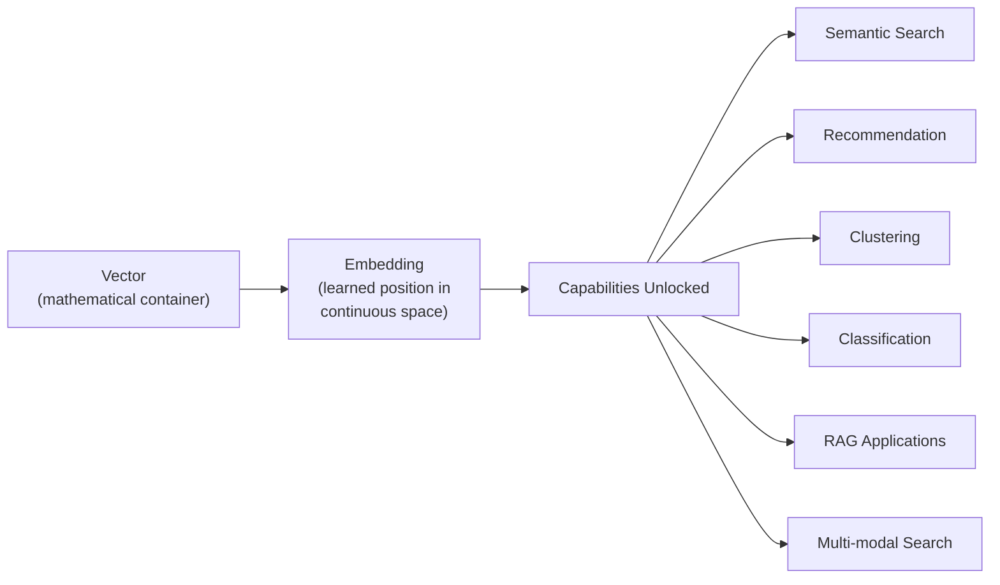
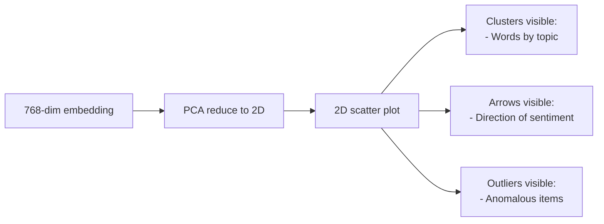
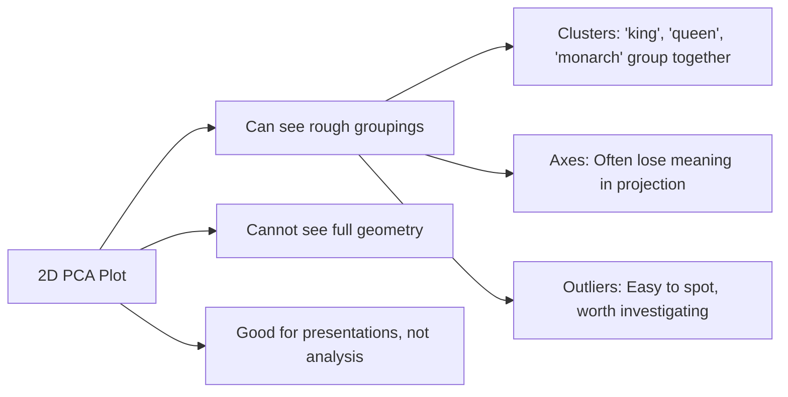
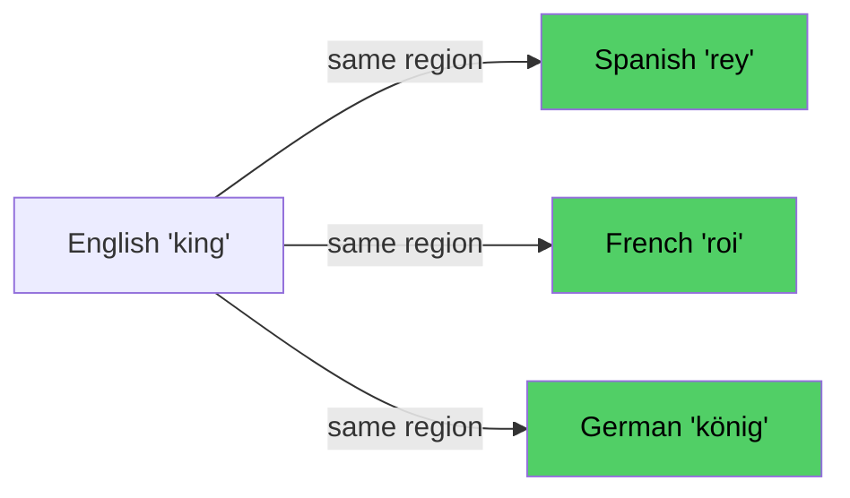
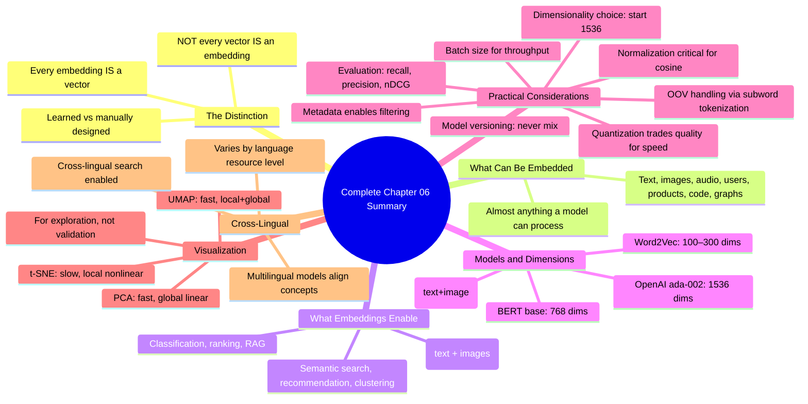

# Chapter 06: Vector vs Embedding — Applications & Real-World Use Cases

## Chapter Goal

Clarify the distinction between a raw vector and an embedding, understand what kinds of things can be embedded, and explore the full range of tasks that become possible once objects are represented as embeddings. This chapter connects theory to real-world AI applications.

---

## 6.1 The Critical Distinction: Vector vs Embedding

This distinction is extremely important and frequently confused.

### Vector

A **vector** is the mathematical container — simply an ordered list of numbers:

```
[2.1, 4.7, 1.3]
```

Any collection of numbers is a vector. If those numbers were **manually chosen** by a human to describe features, we typically call it a **feature vector**.

### Embedding

An **embedding** is a **learned representation** that places an object inside a **continuous vector space**:

```
king = [0.21, -0.71, 0.45, ...]
```

The key word is **learned** — the values were not manually assigned. They emerged from training on a large dataset.



### The Rule

```
Every embedding IS a vector.
NOT every vector IS an embedding.
```

| Type | Example | How Created |
|:---|:---|:---|
| Feature Vector | `[height, weight, age]` | Manually chosen dimensions |
| Embedding | `[0.21, -0.71, 0.45, ...]` | Learned during training |

---

## 6.2 Almost Anything Can Be Embedded

Embeddings are **not** limited to individual words. The embedding function can take **any input** that a model can process:



### Examples of Embeddings in Practice

| Object Type | What Gets Embedded | Use Case |
|:---|:---|:---|
| Word | "king", "queen" | NLP, search |
| Sentence | "I forgot my password" | Semantic search |
| Document | An entire news article | Document retrieval |
| Movie | Avengers metadata + reviews | Recommendation |
| User | Purchase history + behavior | Personalization |
| Song | Audio waveform features | Music recommendation |
| Image | Pixel values via CNN | Image search |
| Product | Description + attributes | E-commerce search |
| Code | Source code tokens | Code search, completion |
| Graph Node | Node + neighbors | Graph ML, recommendations |

The critical question for any embedding system:

> **"Can we learn a useful mathematical space in which relationships between these objects become accessible through geometry?"**

---

## 6.3 The Embedding Model as a Function

Formally, an embedding model is:

```
f : Input → ℝᵈ
```

Where `d` is the embedding **dimensionality** — a fixed design choice of the model.

### Text Example

```
Input: "Batman is a dark superhero movie"
         ↓
   Embedding Model
         ↓
[0.12, -0.37, 0.91, 0.44, 0.02, ..., 0.22]
               (768 dimensions)
```

### Multi-Modal Example (Vision-Language Models)

```
Input: Image of a cat
         ↓
   Embedding Model (CLIP, etc.)
         ↓
[0.55, -0.22, 0.18, ...]    ← same vector space as text embeddings!

Input: "A photo of a cat"
         ↓
   Embedding Model
         ↓
[0.53, -0.19, 0.21, ...]    ← geometrically close to the image vector
```

This is called a **shared embedding space** — different modalities (text and images) can be compared directly through their embeddings. This enables cross-modal search: searching for images with text, or searching for text with images.

---

## 6.4 What Can We Do With Embeddings?

Once real-world objects become vectors, an entire class of operations becomes possible:



### 1. Similarity Search

Given a query, find the most semantically similar items:

```
Query: "I forgot my password"
          ↓ embed
          ↓ find nearest vectors
Results:
  "How do I recover my login credentials?" (similarity: 0.94)
  "Reset account access" (similarity: 0.87)
  "Password recovery options" (similarity: 0.85)
```

String-matching approaches would return no results. Embedding search returns semantically relevant results.

### 2. Recommendation Systems

```js
// Pseudo code: Movie recommendation using embeddings
function recommendMovies(userId, allMovies) {
  const userVector = embed(getUserProfile(userId));

  return allMovies
    .map(movie => ({
      movie,
      similarity: cosineSimilarity(userVector, embed(movie))
    }))
    .sort((a, b) => b.similarity - a.similarity)
    .slice(0, 10);  // top 10 recommendations
}
```

### 3. Clustering

Group similar items without labels:

```
Documents about "sports" → cluster together
Documents about "finance" → cluster together
Documents about "technology" → cluster together
```

Use cases: topic discovery, user segmentation, anomaly detection.

### 4. Classification

Use vector position to assign categories:

```
Sentence → embed → vector → nearest class prototype → class label
```

Examples: sentiment analysis, spam detection, intent classification.

### 5. Ranking

Score items by similarity to a query, return top-k ranked list.

---

## 6.5 Retrieval-Augmented Generation (RAG)

The most important use case for modern LLM applications:



Without embeddings, this would require exact keyword matching — missing any document that uses slightly different wording.

---

## 6.6 The Bridge That Embeddings Create

Embeddings serve as a **bridge** between human concepts and machine-learning applications:



This bridge is why embeddings are considered **foundational** to modern AI systems.

---

## 6.7 Common Embedding Models and Dimensions

| Model | Dimensions | Type | Use Case |
|:---|:---:|:---|:---|
| `text-embedding-ada-002` (OpenAI) | 1536 | Text | General-purpose text |
| `text-embedding-3-small` (OpenAI) | 1536 | Text | Cost-effective text |
| `text-embedding-3-large` (OpenAI) | 3072 | Text | High-quality text |
| BERT (base) | 768 | Text | Classification, search |
| BERT (large) | 1024 | Text | Higher quality NLP |
| CLIP | 512 | Text + Image | Multi-modal search |
| Word2Vec | 100–300 | Word | Word-level embeddings |
| GloVe | 50–300 | Word | Pre-trained word vectors |

> **The dimensionality is a design choice — higher dimensions can capture more nuance but are more expensive to compute and store.**

---

## 6.8 Reference Workflow in Pseudo Code

```ts
// Pseudo code: Embedding workflow in a TypeScript/Node.js environment

// 1. Generate embeddings for a batch of documents
async function embedDocuments(texts: string[]): Promise<number[][]> {
  const response = await embeddingAPI.embed({
    model: "text-embedding-3-small",
    input: texts
  });
  return response.embeddings;  // array of float arrays
}

// 2. Store in a vector database
async function indexDocuments(documents: Document[]) {
  const texts = documents.map(d => d.content);
  const vectors = await embedDocuments(texts);

  await vectorDB.upsert(
    documents.map((doc, i) => ({
      id: doc.id,
      vector: vectors[i],
      metadata: { title: doc.title, url: doc.url }
    }))
  );
}

// 3. Query using semantic search
async function semanticSearch(query: string, topK: number = 5) {
  const queryVector = await embedDocuments([query]);

  const results = await vectorDB.query({
    vector: queryVector[0],
    topK,
    includeMetadata: true
  });

  return results.map(r => ({
    document: r.metadata,
    similarity: r.score
  }));
}
```

**Usage:**

```ts
const batman   = [9, 1];
const avengers = [10, 7];
const titanic  = [2, 1];
const hera     = [2, 10];

cosine(batman, avengers);    // ≈ 0.878 → similar direction
cosine(batman, titanic);     // ≈ 0.303 → nearly orthogonal
euclidean(batman, avengers); // ≈ 6.08  → nearest neighbour
```

---

## 6.9 Summary



**Key Points:**

1. **Every embedding is a vector, but not every vector is an embedding**
2. **Embeddings are learned** — not manually designed
3. **Almost anything can be embedded** — text, images, audio, users, products, code
4. **Embeddings unlock a full suite of ML operations** — search, recommendation, clustering, classification, RAG
5. **The embedding model is a function** mapping inputs to a fixed-dimensional continuous space
6. **The bridge** from human concepts → vectors → math → applications is why embeddings are foundational
7. **Multi-modal models** (like CLIP) can embed different data types into the same space

The final chapter (Chapter 07) ties everything together — showing the complete journey from a real-world object to an embedding, and the definitive definition of what an embedding truly is.

---

## 6.10 Missing Topic: Practical Considerations When Using Embeddings

### Dimensionality Choice

- **100–300 dimensions**: Word2Vec, GloVe — word-level, legacy systems
- **768 dimensions**: BERT base — text classification, general-purpose
- **1536 dimensions**: OpenAI text-embedding-3-small — cost-effective general purpose
- **3072 dimensions**: OpenAI text-embedding-3-large — best quality, higher cost
- **> 4096 dimensions**: Specialized models, multi-modal (CLIP), custom training

**Higher dimensions = better quality but more storage/computation.** A good rule: start with 1536 (ada-002/3-small), only increase if quality doesn't meet requirements.

### Normalization

- **Critical for cosine similarity**: Embeddings should be L2-normalized (‖v‖ = 1) before using cosine
- **One-time cost**: Normalize at write time; then use plain dot product at query time (2× faster than cosine)
- **Storage impact**: Store normalized vectors or re-normalize on read — either way, the metadata overhead is negligible compared to query speed gains

### Quantization

- **Float32**: Standard precision; 4 bytes per value
- **Float16**: Half precision; 2 bytes per value; ~8% quality loss typically acceptable
- **Int8 Quantization**: 1 byte per value; ~15–20% quality loss; significant speedup for inference
- **Product Quantization (PQ)**: Compresses vectors to ~8–16 bytes with ~5–10% recall loss; ideal for large-scale search

> **Always benchmark quality vs. cost before quantizing.** Some applications need exact similarity; others can tolerate approximation.

### Dimensionality Reduction (PCA)

- Reduce 768 → 128 or 300 → 50 for visualization or storage
- **Always preserve the top principal components** — first few dimensions capture most variance
- **Never reduce before similarity search** — the geometric relationships change
- **Reduce after retrieval** — find candidates in full space, then project and rerank

### Batch Size and Throughput

- Embedding APIs typically support batching 1–2K texts per request
- Larger batches = better throughput but higher per-request latency
- **Cost optimization**: Batch as many texts as your context window allows
- **Realtime requirements**: For <100ms latency, consider smaller batch sizes or model distillation

### Out-of-Vocabulary (OOV) Handling

- Most modern models use subword tokenization (BPE/WordPiece) — very few true OOV cases
- If a word is truly unknown, most models map it to the [UNK] token embedding
- **Best practice**: Pre-process text to ensure all tokens are in the model's vocabulary
- **Alternative**: Use character-level models or subword-aware tokenizers

### Query Formulation Best Practices

| Practice | Why It Matters |
|:---|:---|
| **Be specific** | "How do I reset my password?" > "password help" |
| **Include context** | "refund policy for faulty electronics" > "refund policy" |
| **Avoid stop words at start** | Models weight content words more heavily |
| **Keep it concise** | Shorter queries = less noise, faster retrieval |
| **Use natural language** | Don't keyword-stuff; models understand full sentences |

> **The query is the user's intent translated into text.** Write it as you would ask a colleague, and the embedding will capture the meaning.

### Metadata and Filtering

- Always store relevant metadata alongside each embedding (title, date, author, category, etc.)
- Filter **before** or **after** similarity scoring, depending on use case
- **Filter-aware indexes** (HNSW with payload filters) avoid scanning irrelevant vectors
- **Cross-lingual metadata**: Language tags enable multilingual search within the same index

### Drift and Retraining

- Embedding models can drift as data distribution changes over time
- **Monitor**: Track average similarity scores, retrieval quality metrics over time
- **Retrain/recalibrate**: Periodically retrain on fresh data or fine-tune on new domain data
- **Shadow model**: Run new model alongside existing one, compare results before switching

### Model Versioning and Consistency

- **Never mix embedding models** in the same pipeline — scores are not comparable across models
- A `0.82` similarity from model A and `0.82` from model B are from different universes
- **Always lock model version** in production; version-bump carefully with A/B testing
- **Use model aliases**: `text-embedding-3-small` → ensure consistent model version across deploys

### Evaluation Metrics for Embedding Quality

| Metric | What It Measures | Typical Range |
|:---|:---|:---|
| **Recall@k** | Fraction of relevant items in top-k results | 0.5–1.0 |
| **Precision@k** | Fraction of top-k that are relevant | 0.5–1.0 |
| **MRR (Mean Reciprocal Rank)** | How early the first relevant item appears | 0–1 |
| **nDCG (normalized Discounted CG)** | Ranking quality, considers position | 0–1 |
| **MAP (Mean Average Precision)** | Overall precision across all recall levels | 0–1 |
| **Similarity distribution** | Spread of similarity scores (separation) | Varies by dataset |

> **Never evaluate on a single metric alone.** A system can have high recall but poor precision, or good average scores but terrible outliers. Always report multiple metrics.

---

## 6.11 Missing Topic: Embedding Space Visualization and Exploration

### PCA (Principal Component Analysis)

The most common technique for reducing embedding dimensionality to 2D or 3D for visualization:



**What you can see:**
- **Clusters**: Words with similar meanings group together
- **Arrows**: Directional relationships (e.g., "king → queen" vector)
- **Outliers**: Items that don't fit the normal pattern

**What you CANNOT see:**
- Relationships beyond 3 dimensions
- Subtle semantic distinctions that require higher-dimensional geometry
- The full structure — PCA is a lossy projection

### t-SNE (t-Distributed Stochastic Neighbor Embedding)

Alternative to PCA that preserves local structure better:

- Good for visualizing fine-grained groupings
- Slower than PCA (O(N²) complexity)
- Results are stochastic (different runs give different plots)

### UMAP (Uniform Manifold Approximation and Projection)

Modern alternative that preserves both local and global structure:

- Faster than t-SNE
- Better global structure preservation
- becoming the default for embedding visualization

### What Visualization Actually Tells Us



> **Visualization is for communication and exploration, not validation.** A well-clustered 2D plot doesn't guarantee the 768D space is "correct" — it just shows some structure is preserved. Always validate with retrieval metrics.

### t-SNE vs UMAP vs PCA: Quick Guide

| Method | Speed | Structure Preserved | Best For |
|:---|:---:|:---:|:---|
| **PCA** | Very fast | Global linear | Fast prototyping, baseline |
| **t-SNE** | Slow | Local nonlinear | Exploring fine-grained clusters |
| **UMAP** | Fast | Local + global | Most use cases (default recommendation) |

### Practical Visualization Workflow

1. **Reduce to 2D/3D** with PCA (fast) or UMAP (better quality)
2. **Label points** with the top 5 nearest neighbors
3. **Identify clusters** and assign descriptive names
4. **Spot outliers** and investigate why they differ
5. **Validate with metrics** — recall@k, similarity scores, not just visual judgment

> **The 2D plot is a conversation starter, not a conclusion.** Use it to form hypotheses, then test them with proper evaluation.

---

## 6.12 Missing Topic: Cross-Lingual and Multilingual Embeddings

### Monolingual vs Multilingual Models

| Model Type | Example | Characteristics |
|:---|:---|:---|
| **Monolingual** | Word2Vec, GloVe (English only) | Trained on one language; vocab limited to that language |
| **Multilingual** | multilingual-BERT, XLM-R | Trained on 100+ languages; shared vocabulary across languages |

### Cross-Lingual Alignment

Multilingual models learn to map equivalent concepts across languages into **similar regions** of the embedding space:



This enables:

- **Cross-lingual search**: Query in English, find results in Spanish
- **Translation-invariant clustering**: Same topic clusters regardless of language
- **Multilingual RAG**: Retrieve documents in any language, generate in target language

### Language-Specific Considerations

- **Resource-rich languages** (English, Spanish, Chinese): Well-trained embeddings, large vocabularies
- **Resource-poor languages**: Limited training data; multilingual models help by sharing structure across related languages
- **Script differences**: Arabic, Devanagari, Cyrillic — models must handle character-level features
- **Dialects and registers**: Formal vs informal, regional variations may not be well-represented

### Evaluation for Cross-Lingual Search

| Metric | Cross-Lingual Specific |
|:---|:---|
| **Recall@k** | Same as monolingual |
| **Translation accuracy** | How well queries translate to relevant results |
| **Language coverage** | Percentage of queries that return results across languages |
| **Cross-lingual similarity** | Similarity score for translation-equivalent pairs |

> **Cross-lingual embeddings are one of the most powerful applications** of the embedding concept — they break the language barrier for information access.

---

## 6.13 Summary



**Key Takeaways:**

1. **Embeddings transform** any real-world object into a mathematical representation
2. **Geometry encodes meaning** — similarity = close in vector space
3. **Almost anything can be embedded** — the only limit is the model's capability
4. **A full suite of operations** becomes available: search, recommend, cluster, classify, rank
5. **Practical matters matter** — normalization, dimensionality, quantization, versioning
6. **Visualization aids exploration** but doesn't validate the full space
7. **Cross-lingual embeddings** break language barriers for information access

The final chapter (Chapter 07) provides the definitive synthesis: the complete journey from real-world object → embedding, and the core insight that **geometry encodes semantics**.

> **Once objects are embeddings, the question shifts from "what can we compute?" to "what should we build?" — and the answer encompasses virtually all modern AI applications.**