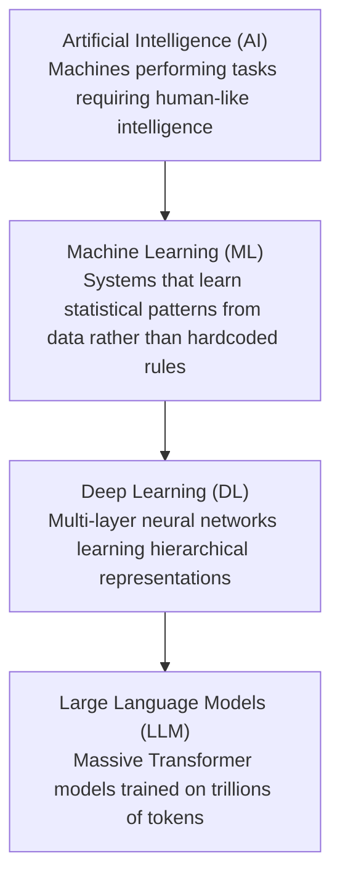
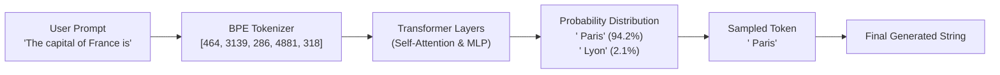

# Chapter 01 — What is AI and LLM?

> **Reference:** `langchain_langgraph-main/notes/chapter-1.md` · [LangChain Overview](https://docs.langchain.com/oss/javascript/langchain/overview)

---

## 1. Defining the Core Concepts

To build agentic systems, we must start with first principles and discard industry buzzwords.

| Term | Technical Definition | What It Does in Practice |
| :--- | :--- | :--- |
| **Artificial Intelligence (AI)** | Computational systems designed to perform tasks typically requiring human intelligence (vision, language, reasoning). | Broad umbrella covering everything from A* pathfinding and decision trees to neural networks. |
| **Machine Learning (ML)** | Algorithms that build mathematical models based on sample data to make predictions without explicit deterministic rules. | Classifies spam, predicts churn, clusters customer profiles. |
| **Large Language Model (LLM)** | Deep autoregressive Transformer neural networks trained on vast web-scale text corpora. | Reads, writes, translates, reasons, and predicts text sequences. |

---

## 2. How an LLM Works Under the Hood

At its core, an LLM is a **probabilistic next-token predictor**:

$$\mathbf{P}(w_{t} \mid w_{1}, w_{2}, \dots, w_{t-1})$$

1. **Prompt Ingestion**: You send an input prompt (question, code snippet, or instruction).
2. **Tokenization**: The raw text string is converted into a sequence of discrete integers (tokens) via Byte-Pair Encoding (BPE).
3. **Transformer Feed-Forward & Attention**: Multi-head self-attention computes relationships between all tokens across the context window.
4. **Next-Token Probability Distribution**: The model outputs logits across its vocabulary (e.g., 100k+ tokens), converted to probabilities via $\text{softmax}$.
5. **Autoregressive Sampling**: The model selects a token (via greedy decoding, top-$p$, or temperature) and appends it back to the input, repeating the cycle.

---

## 3. The Structural Limitations of a Standalone LLM

While modern LLMs (GPT-4o, Claude 3.7, Gemini 2.5) exhibit remarkable semantic understanding, a standalone foundation model suffers from five critical limitations:

1. **Static Weights / Knowledge Cutoff**: A model cannot know what happened five minutes ago or access private databases; its world ends at training cutoff.
2. **Statelessness**: Every inference call is independent. The model retains zero persistent memory between API calls.
3. **No Direct World Interaction**: An LLM cannot execute HTTP requests, run SQL queries, read local files, or click buttons.
4. **Hallucination Risk**: When missing information, the probabilistic nature of next-token prediction can fabricate plausible-sounding falsehoods.
5. **No Built-in Verification**: The model does not inherently verify the correctness of its outputs against deterministic systems.

---

## 4. The Foundational Equation for this Course

To make an LLM practical, robust, and capable in enterprise software, we wrap it in a software harness:

$$\mathbf{AI\ Agent} = \mathbf{Model\ (Brain)} + \mathbf{Harness\ (Body\ \&\ Infrastructure)}$$

- **The Model**: The LLM that reasons, comprehends, and synthesizes language.
- **The Harness**: The deterministic code, tools, prompts, loops, and middleware that provide context, execute side-effects, and enforce safety.
- **LangChain & LangGraph**: The industry-standard TypeScript/JavaScript harness frameworks that make foundation models productive in production applications.

---

## Key Takeaways

- An LLM is a next-token predictor, not an autonomous agent.
- Intelligence alone cannot query databases, call APIs, or remember users across sessions.
- Real-world AI applications require pairing the **Model** with a structured **Harness**.

