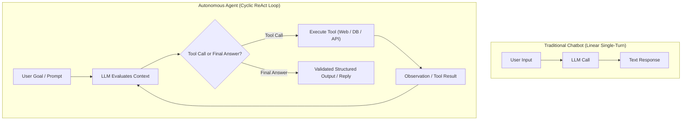
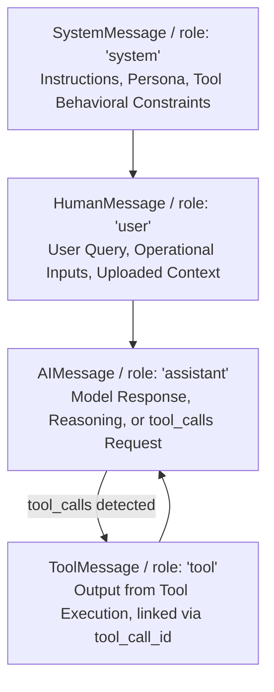

# 01 — LangChain Architecture, Harness & Provider Delivery (TS/JS)

> **Source:** [LangChain.js — Providers and Models](https://docs.langchain.com/oss/javascript/concepts/providers-and-models.md) · [Component Architecture](https://docs.langchain.com/oss/javascript/langchain/component-architecture.md) · [Tools](https://docs.langchain.com/oss/javascript/langchain/tools) · [Structured Output](https://docs.langchain.com/oss/javascript/langchain/structured-output) · [Messages](https://docs.langchain.com/oss/javascript/langchain/messages) · [Streaming](https://docs.langchain.com/oss/javascript/langchain/streaming) · Reference: `langchain_langgraph-main` (Chapters 1–6, 10–12).

---

## 1. Foundational Mental Model: Model vs. Harness

### The Fundamental Equation

$$\text{AI Agent} = \text{Foundation Model (Brain)} + \text{Harness (Body \& Infrastructure)}$$

At the core of modern agent engineering is a critical distinction:
- **The Model (LLM)**: A statistical prediction engine trained to generate tokens based on text probability. It has reasoning capability, pattern recognition, and semantic understanding, but **cannot take action, retain durable state, or access real-time environments on its own**.
- **The Harness**: All the code, protocols, execution loops, memory channels, tool registries, and guardrails built **around** the LLM. It supplies the model with the exact context it requires, parses its intent, executes real-world side effects, and feeds the outputs back.

```
┌────────────────────────────────────────────────────────────────────────┐
│                               AGENT                                    │
│                                                                        │
│  ┌──────────────────┐         ┌─────────────────────────────────────┐  │
│  │   MODEL (Brain)  │         │          HARNESS (Body)             │  │
│  │                  │         │                                     │  │
│  │  • GPT-4o        │ ◄─────► │  • System Prompt & Instructions     │  │
│  │  • Claude 3.7    │         │  • Message History & Context Window │  │
│  │  • Gemini 2.5    │         │  • Tool Registry & Execution Engine │  │
│  │                  │         │  • ReAct Decision Loop              │  │
│  │  Reasoning &     │         │  • Middleware & Guardrails          │  │
│  │  Token Synthesis │         │  • Streaming & Output Parsing (Zod) │  │
│  └──────────────────┘         └─────────────────────────────────────┘  │
└────────────────────────────────────────────────────────────────────────┘
```

> **The Context Engineering Thesis:**  
> When an agent fails, it is almost never because the underlying foundation model lacks intelligence. It is almost always because the **harness provided the wrong context, malformed tool schemas, incomplete history, or noisy observations** to the model at decision time.

---

## 2. Chatbots vs. AI Agents

| Dimension | Traditional Chatbot | Autonomous AI Agent |
| :--- | :--- | :--- |
| **Input** | A standalone question or turn | An objective or multi-step goal |
| **Output** | Single text reply | Sequences of actions, state mutations & synthesized answer |
| **Tool Execution** | None (pure text generation) | Reads external APIs, queries DBs, executes web searches |
| **Control Flow** | Single turn: `User -> LLM -> Reply` | Cyclic ReAct loop: `User -> LLM -> Action -> Env -> LLM...` |
| **State Scope** | Ephemeral or simple message array | Durable state channels, checkpoints, structured artifacts |
| **Termination** | Generates end-of-turn token | Evaluates completion criteria against the goal |



---

## 3. The Anatomy of LangChain Harness Architecture

Without a framework, building an agent requires hand-crafting:
1. Provider API adapters (different request schemas for OpenAI, Anthropic, Gemini).
2. Function calling parsers and JSON serialisation logic.
3. An execution loop that detects tool-call stops, triggers functions, and appends results.
4. Token limit monitoring, chat history truncation, and exponential-backoff retries.
5. Structured schema enforcement and type validation.

LangChain provides a standardised, modular harness that abstracts these components while remaining composable:

```
┌─────────────────────────────────────────────────────────────┐
│                       YOUR APPLICATION                      │
│                                                             │
│   LangChain Harness Layer (createAgent / LCEL / Tools)      │
│   ┌─────────────────────────────────────────────────────┐   │
│   │ • Universal Model Interface (initChatModel)         │   │
│   │ • Standard Message Protocols (System, Human, AI,    │   │
│   │   Tool)                                             │   │
│   │ • Tool Binding & Validation (@langchain/core/tools) │   │
│   │ • Execution Loop & State Channel Reducers           │   │
│   │ • Structured Output Strategies (Provider vs. Tool)  │   │
│   │ • Streaming Transports (Token / Update / Custom)    │   │
│   └─────────────────────────────────────────────────────┘   │
│                              │                              │
│                              ▼                              │
│   Orchestration & Runtime: LangGraph (StateGraph Engine)    │
│                              │                              │
│                              ▼                              │
│   Model Providers: OpenAI · Anthropic · Google · Bedrock    │
└─────────────────────────────────────────────────────────────┘
```

---

## 4. Message Objects: The Standard Communication Protocol

In LangChain, every conversation turn is an immutable message object adhering to standard schemas.

### The 4 Core Message Types



### Detailed Message Breakdown

| Role | Class | Purpose | Key Properties |
| :--- | :--- | :--- | :--- |
| `system` | `SystemMessage` | Directs the model's behavior, tone, guardrails, and role. | `content: string` |
| `user` | `HumanMessage` | Represents inputs sent by the human or orchestrator. | `content: string \| ContentBlock[]` |
| `assistant` | `AIMessage` | Output generated by the LLM. May contain text or tool calls. | `content`, `tool_calls: ToolCall[]`, `usage_metadata` |
| `tool` | `ToolMessage` | Carries the payload returned after executing a tool. | `content: string`, `tool_call_id: string` |

### Raw Dictionaries vs. Typed Message Classes

You can supply messages either as plain objects or class instances:

```typescript
// Approach A: Plain Object format
const messageA = { role: "user", content: "What is the capital of France?" };

// Approach B: LangChain Typed Classes
import { HumanMessage, AIMessage, SystemMessage, ToolMessage } from "@langchain/core/messages";

const messages = [
  new SystemMessage("You are an expert research assistant."),
  new HumanMessage("Summarize the latest trends in quantum computing."),
  new AIMessage({
    content: "",
    tool_calls: [
      {
        name: "web_search",
        args: { query: "quantum computing advances 2026" },
        id: "call_987abc",
      },
    ],
  }),
  new ToolMessage({
    tool_call_id: "call_987abc",
    content: JSON.stringify({ results: ["Breakthrough in topological qubits..."] }),
  }),
];
```

### Message Metadata & Token Accounting

Every `AIMessage` emitted by standard providers carries `usage_metadata` and `response_metadata`:

```typescript
const lastMsg = result.messages.at(-1);
console.log(lastMsg.usage_metadata);
/*
{
  input_tokens: 342,
  output_tokens: 88,
  total_tokens: 430
}
*/
```

---

## 5. Universal Provider Delivery Model (`initChatModel`)

LangChain unifies dozens of proprietary LLM APIs behind a single contract. You can configure and swap models dynamically without rewriting prompt logic, tool binders, or response parsers.

### The Two Delivery Paradigms

#### Pattern 1: Universal Provider Prefix (`initChatModel`)

The cleanest, most portable pattern in modern LangChain:

```typescript
import { initChatModel } from "langchain/chat_models/universal";

// 1. Instantiate via provider:model string
const gpt = await initChatModel("openai:gpt-4o-mini", {
  temperature: 0,
});

const claude = await initChatModel("anthropic:claude-3-7-sonnet-20250219", {
  temperature: 0.2,
});

const gemini = await initChatModel("google-genai:gemini-2.5-flash", {
  temperature: 0,
});

// Identical interface across all 3
const response = await gpt.invoke("Explain distributed consensus in 2 sentences.");
console.log(response.content);
```

#### Pattern 2: Direct Provider Class Instantiation

Use direct classes when configuring provider-specific capabilities such as private endpoints, proxy agents, or local servers (Ollama, vLLM):

```typescript
import { ChatOpenAI } from "@langchain/openai";

const localModel = new ChatOpenAI({
  modelName: "deepseek-r1-distill-qwen-32b",
  apiKey: "not-needed",
  configuration: {
    baseURL: "http://localhost:8000/v1",
  },
  temperature: 0,
});
```

### Provider Matrix and Package Ecosystem

```bash
npm install langchain @langchain/core zod
npm install @langchain/openai      # OpenAI models (GPT-4o, o3-mini)
npm install @langchain/anthropic   # Anthropic models (Claude 3.5, 3.7)
npm install @langchain/google-genai # Google Gemini models
npm install @langchain/community   # Community integrations (Tavily, Ollama, etc.)
```

Environment variables are loaded automatically:
- `OPENAI_API_KEY`
- `ANTHROPIC_API_KEY`
- `GEMINI_API_KEY`
- `TAVILY_API_KEY`

---

## 6. Defining and Executing Tools (`tool()`)

Tools enable the agent to bridge the gap between static training weights and dynamic world state.

### Anatomy of a Tool Definition

Every tool requires:
1. **Name**: Unique identifier sent to the LLM's function calling schema.
2. **Description**: The operational manual used by the model's planner to determine relevance.
3. **Schema**: Strict input validation using Zod. Each property must include `.describe()`.
4. **Execution Function**: An asynchronous function that performs the action and returns a string or serialisable object.

```typescript
import { tool } from "@langchain/core/tools";
import { tavily } from "@tavily/core";
import * as z from "zod";

const tvly = tavily({ apiKey: process.env.TAVILY_API_KEY });

// Tool 1: Live Web Search
export const webSearch = tool(
  async ({ query }) => {
    const data = await tvly.search(query, { maxResults: 5 });
    return JSON.stringify(data.results ?? []);
  },
  {
    name: "web_search",
    description: "Search Google/live web index for up-to-date facts, documentation, or news.",
    schema: z.object({
      query: z.string().describe("The search query keywords. Keep specific."),
    }),
  }
);

// Tool 2: Webpage Content Extractor
export const visitPage = tool(
  async ({ url }) => {
    const data = await tvly.extract([url], {
      extractDepth: "advanced",
      format: "markdown",
    });
    return data.results?.[0]?.rawContent ?? JSON.stringify(data);
  },
  {
    name: "visit_page",
    description: "Read, parse, and extract the complete clean markdown content of a webpage URL.",
    schema: z.object({
      url: z.string().url().describe("The fully qualified HTTP/HTTPS webpage URL to scrape."),
    }),
  }
);
```

### Tool Design Best Practices

1. **Single Responsibility**: Prefer discrete tools (`web_search` and `visit_page`) over monolithic multi-purpose functions (`do_everything`).
2. **Rich Zod Descriptions**: The LLM never sees your JavaScript source code; it only sees the JSON Schema generated from your Zod definition. Use `.describe()` on every field.
3. **Strings as Return Values**: LLMs consume text. Always stringify JSON or return markdown strings rather than raw memory pointers or circular objects.
4. **Resilient Failure Handling**: Return informative error strings (`"Error: HTTP 404 - Article not found"`) instead of throwing uncaught exceptions that crash the execution loop.

---

## 7. Building Agents with `createAgent`

LangChain's `createAgent` wires the model, system prompt, tool definitions, and ReAct loop into a high-level runnable:

```typescript
import { createAgent } from "langchain";
import { ChatOpenAI } from "@langchain/openai";
import { webSearch, visitPage } from "./tools.js";

const agent = createAgent({
  model: new ChatOpenAI({ model: "gpt-4o-mini", temperature: 0 }),
  tools: [webSearch, visitPage],
  systemPrompt: 
    "You are an expert technical researcher. Answer questions thoroughly and accurately. " +
    "When asked about current events or technical docs, use 'web_search' to find sources " +
    "and 'visit_page' to verify full documentation.",
});

const result = await agent.invoke({
  messages: [{ role: "user", content: "What is the newest feature in Bun 1.2?" }],
});

console.log("Final Answer:", result.messages.at(-1)?.content);
```

### Under the Hood: What `createAgent` Automates

1. Generates JSON Schema tool definitions and binds them to the model (`model.bindTools(tools)`).
2. Sends the conversation history (`messages`) along with the system prompt to the provider.
3. Checks if the provider returned an `AIMessage` with `tool_calls`.
4. If `tool_calls` exist, routes arguments to the matching TypeScript functions.
5. Packages function return values into `ToolMessage` instances with matching `tool_call_id`.
6. Appends `ToolMessage` to the conversation history and loops back to step 2 until the model terminates with a natural language response.

---

## 8. Real-time Output Streaming

Interactive applications cannot wait 15 seconds for a multi-step agent to finish reasoning before displaying output.

### Streaming Modes

| Mode | What is Streamed | Primary Use Case |
| :--- | :--- | :--- |
| `messages` | LLM token chunks as they arrive | Chat UI typing animations, live token feedback |
| `updates` | Graph state delta after each node / tool executes | Status bars, "Agent is searching the web..." badges |
| `custom` | User-defined signals emitted inside functions | Progress bars, custom telemetry |

### Implementing Token-by-Token Streaming

```typescript
import { createAgent } from "langchain";
import { ChatOpenAI } from "@langchain/openai";
import { webSearch } from "./tools.js";

const agent = createAgent({
  model: new ChatOpenAI({ model: "gpt-4o-mini", streaming: true }),
  tools: [webSearch],
  systemPrompt: "You are a concise AI assistant.",
});

const stream = await agent.stream(
  { messages: [{ role: "user", content: "Compare LangChain vs. LangGraph in 3 bullet points." }] },
  { streamMode: "messages" }
);

process.stdout.write("Agent: ");
for await (const [token] of stream) {
  // Filter for AI generated tokens only (ignoring internal tool call structures)
  if (token.type === "ai" && typeof token.content === "string") {
    process.stdout.write(token.content);
  }
}
console.log("\n");
```

---

## 9. Guaranteed Structured Output via Zod

In production pipelines, LLM outputs often feed directly into databases, APIs, or downstream deterministic software. Parsing free-form text or regex is fragile.

### Schema Definition

```typescript
import * as z from "zod";

export const MarketAnalysisSchema = z.object({
  company: z.string().describe("Name of the company analysed"),
  ticker: z.string().toUpperCase().describe("Stock ticker symbol"),
  sentiment: z.enum(["bullish", "bearish", "neutral"]).describe("Overall market sentiment"),
  keyFactors: z.array(z.string()).min(2).describe("Key catalysts or headwinds identified"),
  confidenceScore: z.number().min(0).max(1).describe("Confidence score between 0.0 and 1.0"),
});

export type MarketAnalysis = z.infer<typeof MarketAnalysisSchema>;
```

### Attaching Structured Output to `createAgent`

```typescript
import { createAgent } from "langchain";
import { ChatOpenAI } from "@langchain/openai";

const agent = createAgent({
  model: new ChatOpenAI({ model: "gpt-4o-mini", temperature: 0 }),
  tools: [webSearch],
  systemPrompt: "Research the requested company and provide structured financial intelligence.",
  responseFormat: MarketAnalysisSchema,
});

const result = await agent.invoke({
  messages: [{ role: "user", content: "Analyze Apple's current Q1 performance." }],
});

// Access the typed, runtime-validated JavaScript object directly:
const analysis: MarketAnalysis = result.structuredResponse;
console.log(`Company: ${analysis.company} (${analysis.ticker})`);
console.log(`Sentiment: ${analysis.sentiment} (Confidence: ${analysis.confidenceScore * 100}%)`);
console.log("Factors:", analysis.keyFactors);
```

### Provider Strategy vs. Tool Strategy

LangChain manages structured output through two primary mechanisms:
1. **Provider Strategy (`response_format: { type: "json_schema" }`)**: Native provider enforcement (OpenAI Structured Outputs, Gemini Schema). Guarantees 100% adherence to schema via constrained decoding at the logits level.
2. **Tool Strategy (`tool_choice`)**: Forces the model to call a dummy hidden tool whose input parameters match the schema. Used as a fallback when the underlying provider lacks native JSON Schema support.

---

## 10. Summary Cheat Sheet

| Feature | Key API / Syntax | Essential Note |
| :--- | :--- | :--- |
| **Model Init** | `await initChatModel("provider:model")` | Zero lock-in; switch models by changing the string prefix. |
| **Tool Definition** | `tool(async (args) => {...}, { name, description, schema })` | Always use Zod schemas with `.describe()` on every field. |
| **Agent Setup** | `createAgent({ model, tools, systemPrompt, responseFormat })` | Pre-built harness orchestrating the ReAct loop. |
| **Streaming** | `agent.stream({ messages }, { streamMode: "messages" })` | Model must have `streaming: true` enabled. |
| **Structured Output** | `result.structuredResponse` | Returns parsed, validated Zod object without manual `JSON.parse`. |
| **Message History** | `messages: [new HumanMessage("..."), ...]` | Append-only channel preserving the exact turn-by-turn context. |
