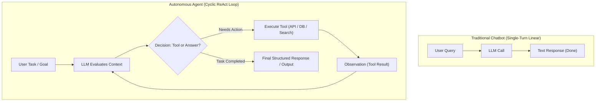
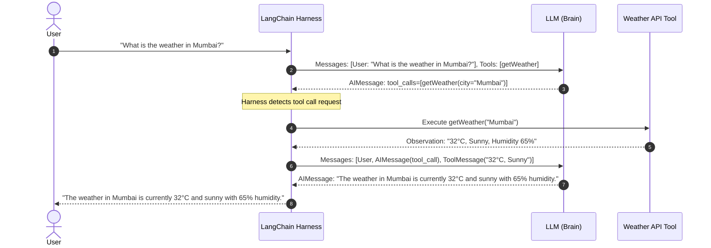

# Chapter 02 — What is an AI Agent? (Model + Harness)

> **Reference:** `langchain_langgraph-main/notes/chapter-2.md` · [LangChain Overview](https://docs.langchain.com/oss/javascript/langchain/overview)

---

## 1. From LLM to Agent

An **LLM** is the brain — it understands language, reasons through problems, and generates text. But an LLM alone cannot *act*.

An **AI Agent** goes significantly further: it is an autonomous system designed to **accomplish goals in dynamic environments**, not just reply with a single turn of text.

An agent:
1. **Understands a Goal**: Deconstructs high-level objectives (e.g., *"Find the cheapest flight from Mumbai to London for next Tuesday"*).
2. **Evaluates Context**: Reads instructions, past messages, and environment state.
3. **Decides Next Steps**: Determines whether it has enough knowledge to reply directly or needs an external action.
4. **Executes Tools**: Triggers APIs, queries databases, or searches the web.
5. **Observes Results & Loops**: Ingests tool outputs, reasons again, and continues until the completion criteria are satisfied.

```
Simple Analogy:
• A Chatbot is like asking a question to a person in a room and getting one immediate answer.
• An Agent is like hiring an executive assistant who can think, search files, call vendors, check calendars, and keep working until the job is done.
```

---

## 2. The Core Formula: Agent = Model + Harness

> $$\mathbf{Agent} = \mathbf{Model} + \mathbf{Harness}$$

| Component | What It Is | Role in System |
| :--- | :--- | :--- |
| **Model** | The Foundation LLM (GPT-4o, Claude 3.7, Gemini 2.5) | The **brain** — semantic reasoning, planning, and decision making. |
| **Harness** | The software infrastructure wrapped around the model | The **body, hands, and rules** — system prompts, tool executors, memory channels, retry loops, and safety middleware. |

From the official [LangChain documentation](https://docs.langchain.com/oss/javascript/langchain/overview):

> *"An agent is a model calling tools in a loop until a given task is complete."*  
> *"A harness is everything around that loop: the prompt, the tools, and any middleware that shapes the model's behavior."*

**One-line summary:**  
> The **model** thinks. The **harness** makes it useful, capable, and reliable in real-world applications.

---

## 3. Structural Comparison: Chatbot vs. Autonomous Agent

| Dimension | Traditional Chatbot | Autonomous AI Agent |
| :--- | :--- | :--- |
| **Input** | A standalone question or turn | A high-level goal or task |
| **Output** | Single text response | Action sequence + state mutations + final synthesized answer |
| **Tool Execution** | Usually None (text-only) | Reads live data, queries APIs, writes to databases |
| **Execution Loop** | Single-turn: `User -> LLM -> Reply` | Cyclic loop: `User -> LLM -> Tool -> LLM -> Tool -> Final Answer` |
| **Stopping Condition**| Model generates EOS (End of Sequence) token | Agent decides the goal is achieved or meets budget limit |
| **Failure Recovery** | Hallucinates or fails quietly | Inspects error message from tool and retries with alternative arguments |



---

## 4. How the ReAct Agent Loop Works

The fundamental loop powering modern agents follows the **ReAct (Reason + Act)** pattern:

```
1. User provides a goal or message.
2. The Model reads the prompt, instructions, and tool schemas.
3. The Model decides:
   ├─ "I have all information" ──► Generates final response.
   └─ "I need external data"   ──► Emits tool call request with structured arguments.
4. The Harness intercepts the tool call, executes the underlying function, and captures the result.
5. The Harness packages the result into a ToolMessage and appends it to the conversation.
6. The Model reads the new observation and decides the next step.
7. Repeats until termination.
```

### Concrete Trace: *"What is the weather in Mumbai?"*



---

## Key Takeaways

- An agent is defined by its ability to execute actions in an iterative loop toward a goal.
- `Agent = Model + Harness` separates cognitive intelligence from operational infrastructure.
- The harness controls tool dispatch, message history, safety boundaries, and termination conditions.

