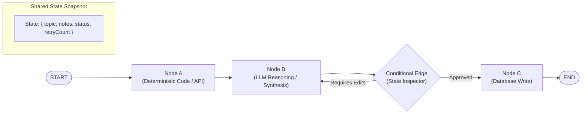
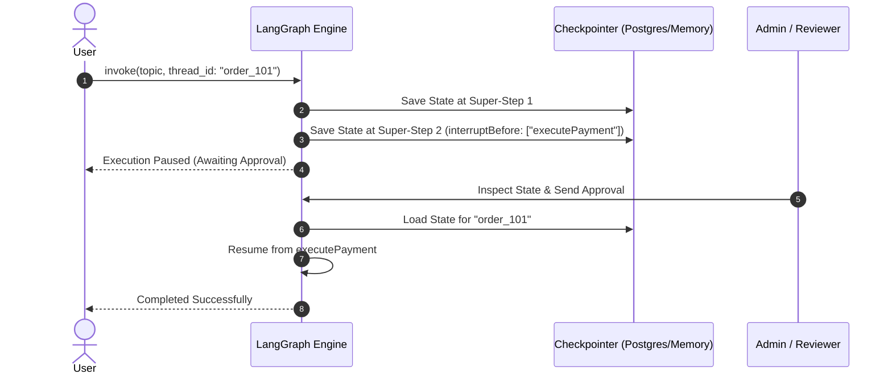

# 02 — LangGraph Orchestration & Stateful Workflows (TS/JS)

> **Source:** [LangGraph.js — Graph API Overview](https://docs.langchain.com/oss/javascript/langgraph/graph-api) · [StateGraph & Channels](https://docs.langchain.com/oss/javascript/langgraph/graph-states) · [Checkpointers & Persistence](https://docs.langchain.com/oss/javascript/langgraph/checkpointers) · [Runtime Context](https://docs.langchain.com/oss/javascript/langgraph/runtime-context) · Reference: `langchain_langgraph-main` (Chapters 7–9, 13–14, and `workflow/index.js`).

---

## 1. What is LangGraph & Why Do We Need It?

### The Ceiling of Standard Agent Loops

In simple agent frameworks (including LangChain's `createAgent`), execution is governed by a **fixed, hardcoded loop**:

$$\text{User} \longrightarrow \text{LLM} \longrightarrow \text{Tool Calls?} \longrightarrow \text{Execute Tools} \longrightarrow \text{LLM} \longrightarrow \text{Final Answer}$$

While this works well for open-ended chatbots, it breaks down in production enterprise software:
1. **Lack of Deterministic Control**: You cannot force the model to follow a strict sequential business process (e.g., Step 1: Scrape $\to$ Step 2: Extract JSON $\to$ Step 3: Human Approval $\to$ Step 4: Write to DB).
2. **Fragility of Multi-Agent Collaboration**: Orchestrating multiple specialized agents (e.g., a Researcher, a Writer, and a Critic) in a simple while-loop leads to state pollution and uncontrollable token consumption.
3. **Absence of Stateful Resumability**: If a server crashes or waits 24 hours for human approval, memory in a standard Node.js loop is lost.

### LangGraph: The Low-Level Orchestration Runtime

LangGraph is a **low-level orchestration framework and runtime** designed specifically for building **stateful, multi-actor, cyclic AI applications**.

```
┌────────────────────────────────────────────────────────┐
│               THE ORCHESTRATION SPECTRUM               │
│                                                        │
│  High-Level (Batteries Included)                       │
│  ▲  • Deep Agents (Autonomous filesystem & planning)   │
│  │  • LangChain createAgent() (Standard ReAct loop)    │
│  │                                                     │
│  │  Low-Level (Fine-Grained Runtime & Engine)          │
│  ▼  • LangGraph (StateGraph, Nodes, Edges, Reducers)   │
└────────────────────────────────────────────────────────┘
```

> **Mental Model:**  
> Think of LangGraph as a **state-machine board game**:
> - **State**: The shared board tracking game variables.
> - **Nodes**: Workers or players who read the board, execute an action, and modify the board.
> - **Edges**: Rules and arrows governing who moves next.
> - **Compile**: Locking in the game rules and attaching persistence before play.
> - **Invoke / Stream**: Playing the turns.

---

## 2. Core Concepts: The Anatomy of a `StateGraph`

Every LangGraph system is constructed from four fundamental primitives:



### 1. State (`StateSchema`)
The single source of truth across the graph. Defined using `StateSchema` and validated via `Zod`. It is partitioned into named **channels**, each with a specific update behavior (replacement vs. reducer).

### 2. Nodes
JavaScript/TypeScript functions that take the current state (and optional configuration) as input, perform work, and return a **partial state update**. Nodes can be deterministic code (REST calls, math, regex) or LLM invocations.

### 3. Edges
Routing arrows that connect nodes:
- **Normal Edges**: Direct, deterministic transitions (`NodeA -> NodeB`).
- **Conditional Edges**: Dynamic routing functions that examine state values and pick the next target node.

### 4. Special Sentinels: `START` and `END`
- `START`: The entry point where user input is injected into the graph.
- `END`: The terminal sentinel indicating the graph has completed execution.

---

## 3. Defining State & Reducer Channels

State in LangGraph is not a raw mutable object; nodes emit **partial updates** that LangGraph merges using channel rules.

### Channel Types & Reducers

| Channel Type | Merge Mechanism | Typical Use Case |
| :--- | :--- | :--- |
| **Last-Write-Wins (Default)** | The new value replaces the old value completely. | Status flags, topic strings, query parameters. |
| **`MessagesValue`** | Appends new messages; updates existing messages if IDs match. | Turn-by-turn chat history. |
| **`ReducedValue`** | Custom reducer function (e.g., array concatenation, counter addition). | Aggregating search results, audit logs. |
| **`UntrackedValue`** | Temporary scratchpad; not saved to checkpoints. | Transient API tokens or file buffers. |

### Code Example: Defining State with Channels

```typescript
import { StateSchema, MessagesValue, ReducedValue } from "@langchain/langgraph";
import * as z from "zod";

export const ResearchState = new StateSchema({
  // 1. Last-Write-Wins channels
  topic: z.string(),
  finalReport: z.string().default(""),
  isCompleted: z.boolean().default(false),

  // 2. Built-in Message Reducer
  messages: MessagesValue,

  // 3. Custom Array Reducer (Concatenation)
  sources: new ReducedValue(
    z.array(z.string()).default([]),
    {
      // Reducer function: receives (currentValue, updateValue)
      reducer: (current, update) => current.concat(update),
    }
  ),

  // 4. Counter Reducer
  iterationCount: new ReducedValue(
    z.number().default(0),
    {
      reducer: (current, increment) => current + increment,
    }
  ),
});

export type ResearchStateType = z.infer<typeof ResearchState>;
```

---

## 4. The Step-by-Step Graph Build Pipeline

Building an application with LangGraph follows a strict 5-stage lifecycle:

```
[1. Define StateSchema] ──► [2. Add Nodes] ──► [3. Add Edges] ──► [4. Compile] ──► [5. Invoke / Stream]
```

### Minimal End-to-End Implementation

```typescript
import { StateGraph, StateSchema, START, END } from "@langchain/langgraph";
import * as z from "zod";

// 1. Define State
const State = new StateSchema({
  count: z.number().default(0),
  log: z.string().default(""),
});

// 2. Define Node Functions
const incrementNode = async (state: typeof State.State) => {
  return {
    count: state.count + 1,
    log: `${state.log} -> Incremented to ${state.count + 1}`,
  };
};

const doubleNode = async (state: typeof State.State) => {
  return {
    count: state.count * 2,
    log: `${state.log} -> Doubled to ${state.count * 2}`,
  };
};

// 3. Assemble Graph
const workflow = new StateGraph(State)
  .addNode("increment", incrementNode)
  .addNode("double", doubleNode)
  .addEdge(START, "increment")
  .addEdge("increment", "double")
  .addEdge("double", END);

// 4. Compile Graph (Mandatory!)
const app = workflow.compile();

// 5. Invoke
const result = await app.invoke({ count: 5 });
console.log(result);
// Output: { count: 12, log: ' -> Incremented to 6 -> Doubled to 12' }
```

> **Why is `.compile()` mandatory?**  
> `compile()` is not boilerplate; it is an active compiler that:
> 1. Validates that every edge connects to an existing node and detects unreachable/orphaned branches.
> 2. Sets up runtime channels and reducer pipelines.
> 3. Attaches checkpointers, persistence layers, and breakpoint hooks for human-in-the-loop inspection.

---

## 5. Execution Model: Pregel Super-Steps

LangGraph evaluates graphs using a **Pregel-style message passing super-step architecture**:

```
Super-Step N:
┌────────────────────────────────────────────────────────┐
│ 1. All currently active nodes execute concurrently.    │
│ 2. Each node computes updates and emits partial state. │
│ 3. Runtime barrier synchronizes all parallel nodes.    │
│ 4. Reducers merge updates into the shared State channels.│
│ 5. Outgoing edges evaluate; next set of nodes activate.│
└────────────────────────────────────────────────────────┘
                          │
                          ▼
Super-Step N + 1: Next nodes execute.
```

### Deterministic vs. AI Nodes

A significant architectural strength of LangGraph is that **nodes do not have to be LLMs**:

| Node Category | Implementation | Why Use It |
| :--- | :--- | :--- |
| **Deterministic Code** | Pure JS/TS functions, REST APIs, SQL queries, Zod validation | 100% predictable, zero token cost, zero hallucination risk, ultra-fast. |
| **AI Synthesis** | LLM `invoke()` or `bindTools()` calls | Complex reasoning, content generation, classification, semantic translation. |

---

## 6. Advanced Edge Routing Patterns

### Pattern A: Conditional Edges (Dynamic Branching)

Conditional edges route execution based on runtime state inspection:

```typescript
import { StateGraph, StateSchema, START, END } from "@langchain/langgraph";
import * as z from "zod";

const EvaluationState = new StateSchema({
  essay: z.string(),
  qualityScore: z.number().default(0),
  revisionCount: z.number().default(0),
});

// Routing function: reads state and returns the key of the next node
function routeDecision(state: typeof EvaluationState.State): "refine" | "publish" {
  if (state.qualityScore >= 85 || state.revisionCount >= 3) {
    return "publish";
  }
  return "refine";
}

const graph = new StateGraph(EvaluationState)
  .addNode("evaluate", async (state) => {
    // LLM scores the text (e.g. 72)
    return { qualityScore: 72, revisionCount: state.revisionCount + 1 };
  })
  .addNode("refine", async (state) => {
    return { essay: `${state.essay} (Polished)` };
  })
  .addNode("publish", async (state) => {
    return { essay: `[FINAL] ${state.essay}` };
  })
  .addEdge(START, "evaluate")
  // Conditional Edge attaches to 'evaluate'
  .addConditionalEdges("evaluate", routeDecision, {
    refine: "refine",
    publish: "publish",
  })
  .addEdge("refine", "evaluate") // Loop back for re-evaluation!
  .addEdge("publish", END)
  .compile();
```

### Pattern B: Dynamic Entry Point Routing

Route directly from `START` based on input parameters:

```typescript
function chooseEntry(state: { mode: "fast" | "deep" }) {
  return state.mode === "fast" ? "quickSummary" : "deepResearch";
}

graph.addConditionalEdges(START, chooseEntry);
```

### Pattern C: The `Command` Primitive (Atomic Update + Routing)

When a node needs to **update state and declare the next destination atomically**, use `Command`:

```typescript
import { Command } from "@langchain/langgraph";

const supervisorNode = async (state: any) => {
  if (state.needsHumanEscalation) {
    return new Command({
      update: { status: "escalated" },
      goto: "human_review",
    });
  }
  return new Command({
    update: { status: "auto_approved" },
    goto: "automated_pipeline",
  });
};
```

---

## 7. Checkpointing, Persistence & Human-in-the-Loop (HITL)

### Why Checkpointers Matter

In production systems:
1. **Multi-turn memory**: Retaining full conversation state across independent HTTP requests.
2. **Crash recovery**: If an external API times out on Step 4 of 5, resume from Step 4 without paying tokens to rerun Steps 1–3.
3. **Human Approval**: Pausing execution before irreversible actions (sending emails, charging credit cards) and resuming once approved.



### Implementing `MemorySaver` & `thread_id`

```typescript
import { StateGraph, StateSchema, MemorySaver, START, END } from "@langchain/langgraph";
import * as z from "zod";

const State = new StateSchema({
  messages: z.array(z.string()).default([]),
});

const chatNode = async (state: typeof State.State) => {
  return { messages: [...state.messages, "AI response"] };
};

const checkpointer = new MemorySaver(); // For dev/testing (use Postgres for prod)

const workflow = new StateGraph(State)
  .addNode("chat", chatNode)
  .addEdge(START, "chat")
  .addEdge("chat", END)
  .compile({ checkpointer });

// Turn 1
const config = { configurable: { thread_id: "session_user_42" } };
await workflow.invoke({ messages: ["Hello!"] }, config);

// Turn 2: State persists automatically across calls with the same thread_id!
const response = await workflow.invoke({ messages: ["What was my first message?"] }, config);
console.log(response.messages);
```

### Human-in-the-Loop Breakpoints

```typescript
const app = workflow.compile({
  checkpointer,
  interruptBefore: ["dangerouslyDeleteDatabase"], // Pause execution before this node
});
```

---

## 8. Real-World Case Study 1: Automated Study Notes to Notion

> **Reference:** `langchain_langgraph-main/workflow/index.js`

### Objective
User inputs a topic $\longrightarrow$ Web research node queries Tavily API $\longrightarrow$ LLM synthesizes structured study notes in markdown $\longrightarrow$ Deterministic formatter splits content into Notion's 2000-character blocks $\longrightarrow$ Notion API writes the page.

### Architectural Diagram

```
┌────────────────────────────────────────────────────────────────────────┐
│                        NOTION WORKFLOW GRAPH                           │
│                                                                        │
│   [START]                                                              │
│      │                                                                 │
│      ▼                                                                 │
│   ┌────────────────────────────────────────────────────────────────┐   │
│   │ Node 1: writeNotes (AI + Tavily API)                           │   │
│   │ • tavily.search(state.topic) -> Fetches top 5 live results     │   │
│   │ • llm.invoke() -> Generates deep Markdown study notes          │   │
│   │ • Returns: { notes: reply.content }                            │   │
│   └────────────────────────────────────────────────────────────────┘   │
│      │                                                                 │
│      ▼                                                                 │
│   ┌────────────────────────────────────────────────────────────────┐   │
│   │ Node 2: saveToNotion (Deterministic API Client)                │   │
│   │ • Chunks notes into 2000-character paragraph blocks            │   │
│   │ • POST https://api.notion.com/v1/pages                         │   │
│   │ • Returns: { notionUrl: page.url }                             │   │
│   └────────────────────────────────────────────────────────────────┘   │
│      │                                                                 │
│      ▼                                                                 │
│   [END]                                                                │
└────────────────────────────────────────────────────────────────────────┘
```

### Complete Code Walkthrough

```typescript
import "dotenv/config";
import { tavily } from "@tavily/core";
import { ChatOpenAI } from "@langchain/openai";
import { StateGraph, StateSchema, START, END } from "@langchain/langgraph";
import * as z from "zod";

const llm = new ChatOpenAI({ model: "gpt-4o-mini", temperature: 0 });
const tvly = tavily({ apiKey: process.env.TAVILY_API_KEY });

// 1. Graph State Schema
const NotionWorkflowState = new StateSchema({
  topic: z.string(),
  notes: z.string().default(""),
  notionUrl: z.string().default(""),
});

// 2. Node 1: Web Research + Synthesis
async function writeNotes(state: typeof NotionWorkflowState.State) {
  const search = await tvly.search(state.topic, { maxResults: 5 });
  const research = JSON.stringify(search.results ?? []);

  const reply = await llm.invoke(
    `Write in-depth, structured study notes on: ${state.topic}\n\n` +
    `Web Research Sources:\n${research}\n\n` +
    `Structure using clear markdown headers, key takeaways, and code snippets where relevant.`
  );

  return { notes: reply.content as string };
}

// 3. Node 2: Deterministic Notion API Client
async function saveToNotion(state: typeof NotionWorkflowState.State) {
  // Notion API imposes a strict 2000-character limit per text block:
  const blocks = [];
  for (let i = 0; i < state.notes.length; i += 2000) {
    blocks.push({
      object: "block",
      type: "paragraph",
      paragraph: {
        rich_text: [
          { type: "text", text: { content: state.notes.slice(i, i + 2000) } },
        ],
      },
    });
  }

  const res = await fetch("https://api.notion.com/v1/pages", {
    method: "POST",
    headers: {
      Authorization: `Bearer ${process.env.NOTION_API_KEY}`,
      "Notion-Version": "2022-06-28",
      "Content-Type": "application/json",
    },
    body: JSON.stringify({
      parent: { page_id: process.env.NOTION_PAGE_ID },
      properties: {
        title: { title: [{ text: { content: state.topic } }] },
      },
      children: blocks,
    }),
  });

  const page = await res.json();
  return { notionUrl: page.url };
}

// 4. Assemble and Compile
export const notionWorkflow = new StateGraph(NotionWorkflowState)
  .addNode("writeNotes", writeNotes)
  .addNode("saveToNotion", saveToNotion)
  .addEdge(START, "writeNotes")
  .addEdge("writeNotes", "saveToNotion")
  .addEdge("saveToNotion", END)
  .compile();

// 5. Execution
const execution = await notionWorkflow.invoke({ topic: "LangGraph Architecture" });
console.log("Published Notion Page:", execution.notionUrl);
```

---

## 9. Real-World Case Study 2: Notion + Google Calendar Meeting Scheduler

> **Reference:** `langchain_langgraph-main/notes/chapter-14.md`

### Architecture & Routing

```
START ──► readNotionTasks (API) ──► parseTasks (LLM) ──► [Are there tasks?]
                                                               │
                           ┌───────────────────────────────────┴─────────────────┐
                           ▼                                                     ▼
                     [Zero Tasks]                                          [Tasks Found]
                           │                                                     │
                           ▼                                                     ▼
                         [END]                                         checkFreeSlots (Calendar API)
                                                                                 │
                                                                                 ▼
                                                                       proposeSlots (LLM)
                                                                                 │
                                                                                 ▼
                                                                               [END]
```

### State & Node Design

```typescript
const SchedulerState = new StateSchema({
  rawNotionData: z.string().default(""),
  tasks: z.array(z.object({ title: z.string(), priority: z.string() })).default([]),
  freeSlots: z.array(z.string()).default([]),
  proposals: z.string().default(""),
});

// Routing edge after LLM extraction
function checkTaskCount(state: typeof SchedulerState.State) {
  if (state.tasks.length === 0) {
    console.log("No pending tasks found. Exiting early.");
    return END;
  }
  return "checkFreeSlots";
}

const schedulerGraph = new StateGraph(SchedulerState)
  .addNode("readNotionTasks", async (state) => {/* Fetch from Notion API */ return {}; })
  .addNode("parseTasks", async (state) => {/* LLM structured output */ return {}; })
  .addNode("checkFreeSlots", async (state) => {/* Google Calendar Free/Busy API */ return {}; })
  .addNode("proposeSlots", async (state) => {/* LLM matches tasks to slots */ return {}; })
  .addEdge(START, "readNotionTasks")
  .addEdge("readNotionTasks", "parseTasks")
  .addConditionalEdges("parseTasks", checkTaskCount, {
    [END]: END,
    checkFreeSlots: "checkFreeSlots",
  })
  .addEdge("checkFreeSlots", "proposeSlots")
  .addEdge("proposeSlots", END)
  .compile();
```

---

## 10. Production Hardening: Limits & Context

### 1. Recursion Limits
To prevent runaway cycles or infinite loops, LangGraph enforces a hard `recursionLimit` (default is **25 super-steps**):

```typescript
// Configured at runtime via invoke options:
await graph.invoke(
  { topic: "Infinite Loop Check" },
  { recursionLimit: 50 } // Raises GraphRecursionError if exceeded
);
```

### 2. Runtime Context Injection
Pass dependencies (database pools, active user session, auth tokens) into nodes without polluting the graph's durable state:

```typescript
const ContextSchema = z.object({
  dbClient: z.any(),
  userId: z.string(),
});

const secureNode = async (state: any, config: any) => {
  const { dbClient, userId } = config.context;
  await dbClient.audit(userId, "Ran secure node");
  return {};
};

const app = new StateGraph(State, ContextSchema)
  .addNode("secureNode", secureNode)
  // ...
  .compile();

await app.invoke({ input: "data" }, { context: { dbClient: pool, userId: "usr_99" } });
```

---

## 11. Summary Cheat Sheet

| Primitive | API / Signature | Crucial Rule |
| :--- | :--- | :--- |
| **`StateSchema`** | `new StateSchema({ field: z.string(), ... })` | Must define all channels. Nodes return partial diffs. |
| **`addNode`** | `graph.addNode("name", async (state) => diff)` | Nodes can be deterministic JS or LLMs. |
| **`addEdge`** | `graph.addEdge("A", "B")` | Fixed transition from Node A to Node B. |
| **`addConditionalEdges`** | `graph.addConditionalEdges("A", (state) => "B")` | Dynamic runtime routing based on current state. |
| **`compile`** | `graph.compile({ checkpointer })` | Validates topology; binds checkpoints and interrupts. |
| **`MemorySaver`** | `new MemorySaver()` | Stores checkpoints in-memory; keyed by `thread_id`. |
| **`Command`** | `new Command({ update, goto })` | Bundles state update with routing target atomically. |
