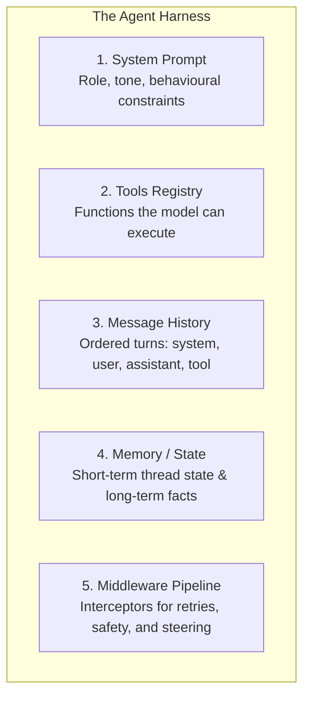

# Chapter 03 — What is a Harness? (Deep Dive)

> **Reference:** `langchain_langgraph-main/notes/chapter-3.md` · [LangChain Architecture](https://docs.langchain.com/oss/javascript/langchain/overview)

---

## 1. The Harness Defined

> $$\mathbf{Agent} = \mathbf{Model} + \mathbf{Harness}$$

A **harness** is the complete software scaffolding, runtime rules, message brokers, tool registries, and execution loops wrapped around a foundation model so it can function as an agent.

From the official [LangChain documentation](https://docs.langchain.com/oss/javascript/langchain/overview):

> *"A harness is everything around that loop: the prompt, the tools, and any middleware that shapes the model's behavior."*

### The Organizational Analogy

| Real-World Workplace | AI Engineering System |
| :--- | :--- |
| A brilliant employee (the brain) | Foundation LLM (GPT-4o, Claude 3.7) |
| Job title, role description, and corporate SOPs | **System Prompt & Instructions** |
| Laptop, terminal, software licenses, internal APIs | **Tools Registry** |
| Meeting transcripts and email threads | **Message History** |
| Personal notepad and CRM records | **Memory & State Store** |
| Manager oversight, compliance checks, and approval gates | **Middleware & Guardrails** |
| The productive employee producing business outcomes | **Autonomous Agent** |

A genius with no hands, no telephone, no computer, and zero memory of yesterday's meetings cannot accomplish enterprise work. The **harness** turns probabilistic text generation into **reliable, deterministic execution**.

---

## 2. The Primary Objective: Context Engineering

The harness exists to fulfill one central mandate:

> **Get the model the right context at the right time for the task.**

When an agent misbehaves or executes the wrong tool, beginners assume the foundation model is insufficiently intelligent. In reality:

> **The Context Engineering Thesis:**  
> When agents fail, it is almost never because the model's reasoning is too weak. More often than not, it is because the **harness passed ambiguous instructions, bloated message histories, unvalidated tool outputs, or conflicting rules** into the context window at decision time.

---

## 3. The 5 Core Pillars of an Agent Harness



### 1. System Prompt (Instructions)
Directs persona, operational boundaries, and formatting rules:
```typescript
systemPrompt: "You are an enterprise database auditor. Always generate read-only SQL queries. Never drop tables."
```

### 2. Tools (Actions)
Typed JavaScript functions declared with Zod schemas that the model can invoke to interact with outside services.

### 3. Messages (Conversation History)
The ordered ledger of communication turns (`SystemMessage`, `HumanMessage`, `AIMessage`, `ToolMessage`) representing conversation trajectory.

### 4. Memory / State (Persistence)
- **Short-Term Memory (Thread State)**: Retains messages and intermediate tool observations within an active session.
- **Long-Term Memory (Store)**: Cross-session persistent storage (user preferences, past interactions, episodic knowledge).

### 5. Middleware (Lifecycle Interceptors)
Hooks that execute before or after LLM/tool calls to govern behavior, retry failures, and sanitize inputs.

---

## 4. The 5 Categories of Middleware

Middleware gives developers fine-grained control over execution without modifying the underlying prompt or LLM:

| Category | Purpose | Real-World Implementation |
| :--- | :--- | :--- |
| **1. Context Management** | Prevents context window overflows and reduces token cost. | Summarizes conversations exceeding 10 turns; truncates large tool outputs. |
| **2. Fault Tolerance** | Recovers from transient provider and network errors. | Automatic exponential backoff on HTTP 429 (rate limits); model fallback (`gpt-4o` $\to$ `gpt-4o-mini`). |
| **3. Guardrails & Safety** | Prevents data exfiltration and harmful actions. | Regex/NER masking of PII (SSNs, credit cards); input injection filters; output toxic speech checks. |
| **4. Steering & HITL** | Requires human confirmation for high-stakes actions. | Pausing the loop before database writes or email dispatch until approved by an administrator. |
| **5. Planning & Decomposition**| Manages multi-step complexity. | Generates and updates a dynamic todo-list; dispatches sub-tasks to specialized subagents. |

---

## 5. Harness Spectrum in the LangChain Ecosystem

The LangChain ecosystem provides three tiers of harness abstractions depending on architectural complexity:

```
┌────────────────────────────────────────────────────────┐
│               THE HARNESS DESIGN SPECTRUM              │
│                                                        │
│  High-Level (Ready to Use)                             │
│  ▲  • LangChain createAgent()                          │
│  │    Configurable harness: model + tools + prompt     │
│  │                                                     │
│  │  Autonomous (Batteries Included)                    │
│  │  • Deep Agents                                      │
│  │    Built-in planning, sandboxed filesystem, tools   │
│  │                                                     │
│  │  Low-Level (Fine-Grained Runtime)                   │
│  ▼  • LangGraph                                        │
│       StateGraph, cyclic control, multi-agent routing  │
└────────────────────────────────────────────────────────┘
```

- **LangChain `createAgent()`**: Best for 80% of standard ReAct loops where a single agent coordinates tools.
- **Deep Agents**: Turn-key agents with integrated planning, bash execution, and file editing.
- **LangGraph**: Used when your application is a **custom state-machine workflow**, not just a single while-loop.

---

## 6. Minimal Harness Code Example

```typescript
import { createAgent } from "langchain";
import { tool } from "@langchain/core/tools";
import * as z from "zod";

// 1. Tool (Action capability)
const getWeather = tool(
  async ({ city }) => `32°C and sunny in ${city}`,
  {
    name: "get_weather",
    description: "Get current weather conditions for a city",
    schema: z.object({ city: z.string().describe("Target city name") }),
  }
);

// 2. Assembling Model + Harness
const agent = createAgent({
  // MODEL (Brain)
  model: "openai:gpt-4o-mini",

  // HARNESS (Everything below)
  systemPrompt: "You are a concise weather assistant. Answer in one sentence.",
  tools: [getWeather],
});

// 3. Invocation through the harness
const response = await agent.invoke({
  messages: [{ role: "user", content: "What is the weather in Mumbai?" }],
});

console.log(response.messages.at(-1)?.content);
// "The weather in Mumbai is currently 32°C and sunny."
```

### What the Harness Automated in this Call

1. Transformed the `getWeather` Zod schema into OpenAI JSON Schema.
2. Sent the message history and tool schemas to the model API.
3. Detected that the model returned `tool_calls` rather than text.
4. Executed `getWeather({ city: "Mumbai" })`.
5. Packaged the output into a `ToolMessage` with the correct `tool_call_id`.
6. Invoked the model a second time with the complete history.
7. Returned the validated final response.

---

## Key Takeaways

- The harness is the operational scaffolding that turns an LLM into an agent.
- Context engineering is the primary discipline of agent builders: feeding the right context at the right time.
- The 5 core parts of a harness are **System Prompt**, **Tools**, **Messages**, **Memory/State**, and **Middleware**.
- Middleware enforces safety, handles retries, and enables human-in-the-loop approvals.

