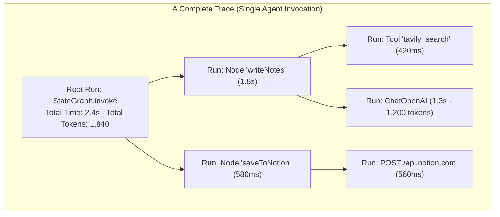
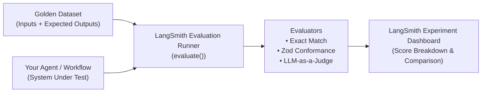

# 03 — LangSmith Observability, Tracing & Evaluation (TS/JS)

> **Source:** [LangSmith — Observability Quickstart](https://docs.langchain.com/langsmith/observability-quickstart) · [LangChain.js — Observability](https://docs.langchain.com/oss/javascript/langchain/observability) · [LangSmith — Evaluation](https://docs.langchain.com/langsmith/evaluation) · Reference: `langchain_langgraph-main` & Production GenAI Best Practices.

---

## 1. Why Observability is Non-Negotiable in GenAI

Traditional backend software behaves deterministically: given input $X$ and fixed logic, it produces output $Y$ in $Z$ milliseconds. Debugging requires standard stack traces and APM metrics (DataDog, Prometheus).

GenAI agents introduce **three new failure modes** that traditional APMs cannot diagnose:
1. **The "Black Box" Reasoning Loop**: When an agent takes 8 intermediate steps and outputs an incorrect answer, where did it go off track? Did the LLM pick the wrong tool? Did the tool return malformed data? Did a system prompt instruction conflict with the user's intent?
2. **Hidden Latency & Cost Spikes**: A single user query might trigger 4 LLM calls, 3 web searches, and 2 database lookups. Without granular tracing, identifying which node consumed 80% of latency or 90% of token cost is impossible.
3. **Prompt Regressions**: Changing one sentence in a system prompt to fix a bug in Feature A might subtly degrade the model's performance on Features B, C, and D.

**LangSmith** is an observability, tracing, debugging, and evaluation platform built specifically for LLM applications and agentic graphs.

```
┌────────────────────────────────────────────────────────────────────────┐
│                        THE LANGSMITH PLATFORM                          │
│                                                                        │
│   1. TRACING & OBSERVABILITY                                           │
│      • Complete execution waterfall (LLMs, Tools, Nodes, Retries)      │
│      • Token counts, per-call latencies, and dollar cost attribution   │
│      • State mutation tracking at every LangGraph super-step           │
│                                                                        │
│   2. EVALUATION & DATASETS                                             │
│      • Golden datasets of test cases and ground-truth answers          │
│      • Automated evaluators (Heuristic, Exact Match, LLM-as-a-Judge)   │
│      • Side-by-side experiment comparisons (Prompt A vs. Prompt B)     │
│                                                                        │
│   3. MONITORING & PRODUCTION TELEMETRY                                 │
│      • User feedback collection (thumbs up/down, user edits)           │
│      • Anomaly detection, error rate spikes, token burn monitoring     │
└────────────────────────────────────────────────────────────────────────┘
```

---

## 2. Core Concepts: Traces, Runs & Datasets



### The Primitives

| Primitive | What It Is | Purpose |
| :--- | :--- | :--- |
| **Run** | A single unit of execution. | Captures inputs, outputs, start/end time, token usage, errors, and metadata for one function call (LLM, tool, chain, node). |
| **Trace** | A directed acyclic tree of nested Runs. | Represents the complete lifecycle of one user request from trigger to final response. |
| **Project** | A namespace / bucket for traces. | Isolates environments (e.g., `agent-prod`, `agent-staging`, `eval-suite-v1`). |
| **Dataset** | A collection of input/output examples. | Serves as the benchmark "golden dataset" for regression testing. |
| **Feedback** | Key-value metrics attached to a Run. | Records quantitative scores (`correctness: 0.95`), boolean flags (`thumbs_up: true`), or human review tags. |

---

## 3. Zero-Code Instrumentation

The most powerful feature of the LangChain / LangGraph ecosystem is that **tracing requires zero modifications to your business logic**.

### Environment Configuration

Set these environment variables in your `.env` or deployment shell:

```bash
# 1. Enable tracing engine
export LANGSMITH_TRACING=true

# 2. Your personal or team API key from smith.langchain.com
export LANGSMITH_API_KEY="lsv2_pt_..."

# 3. Destination project name (defaults to 'default' if omitted)
export LANGSMITH_PROJECT="lecture-32-production"

# 4. Optional: Custom endpoint (for enterprise private-cloud deployments)
# export LANGSMITH_ENDPOINT="https://api.smith.langchain.com"
```

> **Compatibility Note:** Older documentation referenced `LANGCHAIN_TRACING_V2=true` and `LANGCHAIN_API_KEY`. In modern runtimes, `LANGSMITH_TRACING` and `LANGSMITH_API_KEY` are the standard, though legacy names remain backwards-compatible.

### Automatic Capture in Action

When `LANGSMITH_TRACING=true` is set, every LangChain or LangGraph call automatically dispatches telemetry asynchronously in the background without blocking the main event loop:

```typescript
import "dotenv/config";
import { initChatModel } from "langchain/chat_models/universal";

const model = await initChatModel("openai:gpt-4o-mini");

// This call is intercepted, wrapped in a Run, and streamed to LangSmith:
const response = await model.invoke("What are the advantages of event-driven architectures?");
console.log(response.content);
```

---

## 4. How LangGraph Workflows Appear in LangSmith

When you run a LangGraph `StateGraph`, LangSmith visualizes the graph topology and state transitions at every super-step:

```
Run Tree Hierarchy in LangSmith UI:
▼ StateGraph (Root Run)
  ├── ⚙️ __start__ (Channels initialized)
  ▼ 📦 Node: writeNotes
    ├── 🛠️ Tool: web_search (args: { query: "Bun 1.2 features" })
    │   └── Output: { results: [...] }
    ▼ 🧠 ChatOpenAI (model: "gpt-4o-mini")
        ├── Input: System prompt + User message + Tool results
        ├── Output: "Here are the core updates..."
        └── Metadata: { prompt_tokens: 850, completion_tokens: 220, cost: $0.00034 }
  ▼ 📦 Node: saveToNotion
    └── 🌐 HTTP POST: api.notion.com/v1/pages (Status: 200 OK)
```

### What You Can Inspect in the Trace Waterfall

1. **State Mutation Diffs**: Click on any node to see the exact state payload before and after the node's execution.
2. **Exact Raw Prompts**: View the verbatim text sent over the wire to the provider, including system instructions, few-shot examples, and injected context.
3. **Tool Arguments & Serialization**: Verify whether the model generated valid JSON parameters matching your Zod schema.
4. **Latency Bottlenecks**: Identify which step is responsible for slow response times (e.g., Tavily search: 420ms vs. LLM token generation: 1,800ms).

---

## 5. Programmatic Instrumentation & Custom Spans

If your application includes custom non-LangChain code (e.g., raw database queries, custom authentication checks, third-party APIs), you can instrument them using LangSmith's `@traceable` wrapper or programmatic tracer.

### Using the `traceable` Wrapper

```typescript
import { traceable } from "langsmith/traceable";

// Wrap any asynchronous function:
export const customDatabaseLookup = traceable(
  async (userId: string) => {
    // Simulated DB query
    await new Promise((r) => setTimeout(r, 120));
    return { userId, tier: "enterprise", quotaRemaining: 15000 };
  },
  {
    name: "UserQuotaDatabaseLookup",
    run_type: "retriever",
    metadata: { table: "users_v2", region: "us-east-1" },
  }
);

// When called, customDatabaseLookup automatically attaches as a child Run
const userProfile = await customDatabaseLookup("usr_9981");
```

### Attaching Tags & Metadata at Runtime

Tags and metadata enable filtering and slicing traces in the LangSmith dashboard (e.g., filter by customer tier, feature flag, or release version):

```typescript
import { initChatModel } from "langchain/chat_models/universal";

const model = await initChatModel("openai:gpt-4o-mini");

const response = await model.invoke(
  "Generate a summary of Q3 performance.",
  {
    tags: ["feature:financial_summary", "env:production"],
    metadata: {
      userId: "usr_9981",
      organizationId: "org_alpha",
      gitCommit: "9f3c8a1",
    },
  }
);
```

---

## 6. Offline Evaluation with LangSmith

Evaluation is the systematic process of validating that your agent or pipeline meets accuracy, safety, and performance standards before deploying to production.



### Stage 1: Creating a Dataset Programmatically

```typescript
import { Client } from "langsmith";

const client = new Client({ apiKey: process.env.LANGSMITH_API_KEY });

const datasetName = "qa-factual-benchmark-v1";

// Create dataset container
const dataset = await client.createDataset(datasetName, {
  description: "Test cases for verifying agent factual precision",
});

// Seed test cases (inputs and ground-truth reference outputs)
await client.createExamples({
  datasetId: dataset.id,
  inputs: [
    { question: "What year was LangChain released?" },
    { question: "Does LangGraph support cyclical workflows?" },
  ],
  outputs: [
    { answer: "LangChain was released in October 2022." },
    { answer: "Yes, LangGraph is explicitly designed for cyclic architectures." },
  ],
});
```

### Stage 2: Defining Evaluators & Running the Benchmark

An evaluator is a function that receives the system's output and the reference ground truth, returning a numerical score and an optional explanation:

```typescript
import { evaluate } from "langsmith";
import { initChatModel } from "langchain/chat_models/universal";

// 1. Target Pipeline to Evaluate
async function targetAgent(input: { question: string }) {
  const model = await initChatModel("openai:gpt-4o-mini", { temperature: 0 });
  const reply = await model.invoke(input.question);
  return { answer: reply.content as string };
}

// 2. Evaluator A: Keyword / Fact Matcher
function keywordEvaluator({ run, example }: any) {
  const prediction = (run.outputs?.answer ?? "").toLowerCase();
  const groundTruth = (example.outputs?.answer ?? "").toLowerCase();

  const isPassing = prediction.includes("2022") || prediction.includes("cyclic");
  return {
    key: "keyword_conformance",
    score: isPassing ? 1 : 0,
    comment: isPassing ? "Key terms identified" : "Missing required keywords",
  };
}

// 3. Evaluator B: LLM-as-a-Judge (Semantic Correctness)
async function llmJudgeEvaluator({ run, example }: any) {
  const judgeModel = await initChatModel("openai:gpt-4o", { temperature: 0 });
  
  const prompt = `
You are an impartial judge evaluating AI accuracy.
Question: ${example.inputs.question}
Ground Truth: ${example.outputs.answer}
Candidate Prediction: ${run.outputs.answer}

Respond with JSON: { "score": 1 | 0, "reason": "concise explanation" }
`;

  const verdict = await judgeModel.invoke(prompt);
  const parsed = JSON.parse(verdict.content as string);

  return {
    key: "semantic_correctness",
    score: parsed.score,
    comment: parsed.reason,
  };
}

// 4. Trigger the Evaluation Run
await evaluate(targetAgent, {
  data: "qa-factual-benchmark-v1",
  evaluators: [keywordEvaluator, llmJudgeEvaluator],
  experimentPrefix: "gpt-4o-mini-baseline",
  maxConcurrency: 2,
});
```

---

## 7. User Feedback & Production Monitoring

### Collecting Online Human Feedback

In production, you can capture end-user feedback (e.g., when a user clicks thumbs-up or thumbs-down in your UI) and bind it directly to the exact LangSmith Run ID:

```typescript
import { Client } from "langsmith";

const client = new Client();

export async function submitUserFeedback(runId: string, isPositive: boolean, comment?: string) {
  await client.createFeedback(runId, "user_rating", {
    score: isPositive ? 1.0 : 0.0,
    comment: comment ?? "User rating from web client",
    value: isPositive ? "thumbs_up" : "thumbs_down",
  });
}
```

### Production Best Practices

1. **Namespace Projects**: Use separate projects for `local-dev`, `staging-evals`, and `production`. Never pollute production metrics with local development scratch runs.
2. **PII Masking & Privacy**: If your application processes healthcare records, credit cards, or passwords, use LangSmith's masking rules to prevent sensitive payload values from leaving your compliance perimeter.
3. **Sampling for Cost Management**: In high-throughput consumer applications (e.g., millions of requests/day), configure trace sampling so that only 5–10% of successful runs (plus 100% of errors) are captured.

---

## 8. Summary Cheat Sheet

| Capability | Key Command / Code | Notes |
| :--- | :--- | :--- |
| **Enable Tracing** | `export LANGSMITH_TRACING=true` | Zero-code setup; works automatically across LangChain & LangGraph. |
| **Set Project** | `export LANGSMITH_PROJECT="project-name"` | Namespaces your traces cleanly in the web UI. |
| **Tags & Metadata** | `model.invoke(prompt, { tags: [...], metadata: {...} })` | Allows searching, filtering, and cost breakdown in dashboard. |
| **Custom Spans** | `traceable(async () => {...}, { name: "..." })` | Instruments non-LangChain TypeScript functions. |
| **Datasets** | `client.createDataset(name)` + `createExamples(...)` | Benchmark suites for regression testing and CI/CD gates. |
| **Evaluations** | `evaluate(targetAgent, { data, evaluators })` | Automated testing using heuristic checks and LLM-as-a-judge. |
| **Feedback** | `client.createFeedback(runId, "score_name", { score: 1 })` | Binds human ratings to specific execution traces. |
