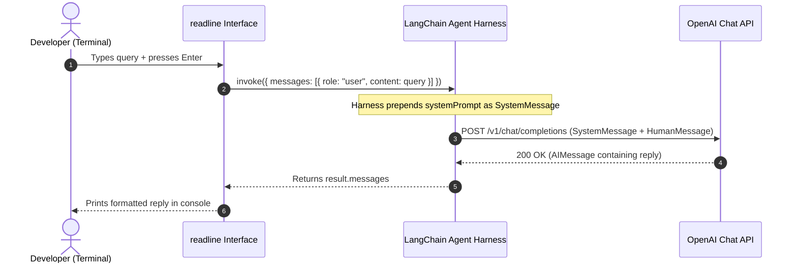

# Chapter 05 — Build a CLI Chat Agent (System Prompt Engineering)

> **Reference:** `langchain_langgraph-main/notes/chapter-5.md` · [LangChain Quickstart](https://docs.langchain.com/oss/javascript/langchain/quickstart)

---

## 1. Goal: Interactive Terminal Agent

In this chapter, we build an interactive, command-line chat agent from scratch using Node.js/TypeScript and LangChain. 

Before adding complex tools or multi-actor graphs, we establish the baseline:
- Foundation model instantiation.
- Interactive terminal input/output loop using Node's standard `readline/promises`.
- Directing model behavior, personality, and operational rules using **System Prompts**.

---

## 2. What is a System Prompt?

In language model architectures, the **system prompt** (or system message) is a privileged set of instructions injected at the very beginning of the context window:

> **System Prompt** = The immutable behavioral constitution the model sees before reading any user queries or conversational history.

```
┌─────────────────────────────────────────────────────────────┐
│                    THE CONTEXT WINDOW                       │
│                                                             │
│  [SYSTEM PROMPT]                                            │
│  "You are a senior DevOps SRE. You explain root causes      │
│   using incident post-mortem terminology. Be concise."      │
│                                                             │
│  [USER MESSAGE]                                             │
│  "Why did our service run out of memory?"                   │
│                                                             │
│  [AI RESPONSE]                                              │
│  (Generated under the framing of the system prompt)         │
└─────────────────────────────────────────────────────────────┘
```

### Common System Prompt Archetypes

| Archetype | Sample Instruction | Behavioral Impact |
| :--- | :--- | :--- |
| **Concise Technical** | `"You are an expert engineer. Answer in 2 sentences or less. Provide code without pleasantries."` | Eliminates filler tokens, reduces latency, saves cost. |
| **Domain Specialist** | `"You are a tax advisor specializing in UK VAT laws. Always cite the relevant HMRC guidelines."` | Restricts domain scope, increases citation behavior. |
| **Safety & Scoping** | `"You are an internal customer support assistant. Only answer questions about our SaaS platform. Politely decline general knowledge queries."` | Reduces off-topic responses and user distraction. |

---

## 3. Implementing the Interactive CLI Chat Agent

Here is the complete implementation matching `src/index.js` from the course reference:

```typescript
import "dotenv/config";
import readline from "node:readline/promises";
import { stdin as input, stdout as output } from "node:process";
import { createAgent } from "langchain";
import { ChatOpenAI } from "@langchain/openai";

// 1. Initialize the Foundation Model
const model = new ChatOpenAI({
  model: "gpt-4o-mini",
  temperature: 0.2, // Low temperature for focused, deterministic replies
});

// 2. Configure the Agent with a System Prompt
const agent = createAgent({
  model,
  systemPrompt: 
    "You are a helpful and concise software architecture assistant. " +
    "Explain technical concepts clearly and prioritize engineering trade-offs. " +
    "Keep replies brief unless asked for a deep dive.",
});

// 3. Set up the Terminal Readline Interface
const rl = readline.createInterface({ input, output });

console.log("==================================================");
console.log("🤖 Technical Chat Agent Initialized");
console.log("Type your question below, or type 'exit' to quit.");
console.log("==================================================\n");

// 4. The Interactive Event Loop
while (true) {
  const userInput = await rl.question("You: ");

  // Check exit condition
  if (userInput.trim().toLowerCase() === "exit") {
    console.log("\nGoodbye!");
    break;
  }

  // Skip empty inputs
  if (!userInput.trim()) continue;

  try {
    // 5. Invoke the Agent Harness
    const result = await agent.invoke({
      messages: [{ role: "user", content: userInput }],
    });

    const reply = result.messages.at(-1)?.content;
    console.log(`\nAgent: ${reply}\n`);
  } catch (error) {
    console.error("\n❌ Error communicating with model:", error);
  }
}

rl.close();
```

---

## 4. Architectural Breakdown: What Happens on Each Turn



### Notice the Statelessness
In this minimal loop, each call sends only `[{ role: "user", content: userInput }]`. This means the agent does not yet remember previous turns in the terminal session. (In Chapter 06 and Chapter 13, we introduce message chaining and checkpointer persistence).

---

## 5. System Prompt Engineering Best Practices

1. **Be Explicit About Format**: If you need markdown bullet points, state `"Format your answer with bullet points and bold key technical terms."`
2. **Define Negative Constraints**: State what the model must *not* do: `"Do not apologize. Do not include markdown code block formatting for single-line shell commands."`
3. **Assign a Role**: Prompting with `"You are an experienced Staff Systems Engineer..."` grounds the vocabulary and nuance of the responses far better than generic instructions.
4. **Important Security Caveat**: The system prompt is **operational guidance, not a security boundary**. As covered in Lecture 31 (Security & Guardrails), an adversarial user prompt can still override or bypass system prompt instructions via prompt injection. For enterprise boundaries, use deterministic code-level guardrails.

---

## Key Takeaways

- System prompts direct the agent's persona, scope, tone, and operational boundaries.
- `node:readline/promises` provides a clean native async/await interface for interactive CLI agents.
- In `createAgent()`, `systemPrompt` is automatically formatted and prepended as the initial `SystemMessage`.
- System prompts guide behavior, but cannot replace deterministic security controls.

