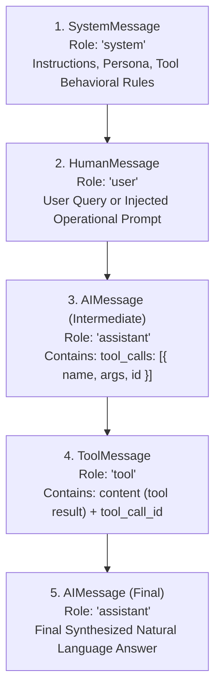

# Chapter 06 — Message Objects, Roles, Content & Metadata

> **Reference:** `langchain_langgraph-main/notes/chapter-6.md` · [LangChain Messages Docs](https://docs.langchain.com/oss/javascript/langchain/messages)

---

## 1. What is a Message?

In modern LLM and agent architectures, communication does not occur via unstructured blobs of text. Instead, conversations are modeled as an ordered array of **discrete message objects**.

Every message has three essential components:

| Component | Technical Role | Example |
| :--- | :--- | :--- |
| **Role** | Identifies the speaker / originator of the message. | `system`, `user` (human), `assistant` (AI), `tool` |
| **Content** | The semantic payload or text data. | `"What is the latency of HNSW search?"` |
| **Metadata** | Operational headers, telemetry, and link identifiers. | Token usage, execution timestamps, `tool_call_id` |

> **One-line summary:**  
> Messages are the immutable conversation ledger that the foundation model reads and writes on every turn.

---

## 2. The 4 Core Message Types

```
┌─────────────────────────────────────────────────────────────┐
│                    CONVERSATION LEDGER                      │
│                                                             │
│  1. system    ──► Instructions, boundaries & rules          │
│  2. user      ──► The input sent by the human/application   │
│  3. assistant ──► The response or tool-call from the model  │
│  4. tool      ──► Observation payload returned by a tool    │
└─────────────────────────────────────────────────────────────┘
```



### Detailed Breakdown of Roles

#### 1. System Message (`role: "system"`)
The prompt directing the agent's behavior. In `createAgent()`, this is usually set via the `systemPrompt` option.

#### 2. User Message (`role: "user"` / `HumanMessage`)
The query or command sent by the human or upstream orchestrator:
```json
{ "role": "user", "content": "Fetch Q3 revenue from the analytics database." }
```

#### 3. Assistant Message (`role: "assistant"` / `AIMessage`)
The output emitted by the model. Crucially, an assistant message can contain **either**:
- Natural language text meant for the user.
- A request to invoke tools via the `tool_calls` array:
```json
{
  "role": "assistant",
  "content": "",
  "tool_calls": [
    {
      "name": "sql_query",
      "args": { "query": "SELECT sum(revenue) FROM sales WHERE quarter='Q3'" },
      "id": "call_abc123"
    }
  ]
}
```

#### 4. Tool Message (`role: "tool"` / `ToolMessage`)
The result generated after the harness executes the requested tool. It is linked back to the exact invocation using `tool_call_id`:
```json
{
  "role": "tool",
  "content": "{\"total_revenue\": 4820000}",
  "tool_call_id": "call_abc123"
}
```

---

## 3. The Full Agent Loop Expressed as Messages

Every step in an agent's lifecycle maps directly to message transitions:

| Turn | Role | Content / Attributes | Significance |
| :---: | :--- | :--- | :--- |
| **1** | `user` | `"What's the weather in Mumbai?"` | User initiates task. |
| **2** | `assistant` | `tool_calls: [getWeather(city="Mumbai")]` | Model reasons it lacks real-time facts; issues tool call. |
| **3** | `tool` | `"32°C, sunny"` (linked to call ID) | Harness runs tool and injects real-world observation. |
| **4** | `assistant` | `"The weather in Mumbai is 32°C and sunny."` | Model synthesizes observation into final answer. |

---

## 4. Two Syntaxes: Dictionaries vs. Typed Classes

LangChain supports both plain JavaScript object literals and strongly-typed classes:

### Syntax A: Plain Dictionary / Object Format
Simplest and lightweight for quick scripts:
```typescript
const history = [
  { role: "system", content: "You are a concise assistant." },
  { role: "user", content: "Hello!" },
  { role: "assistant", content: "How can I help you today?" },
];
```

### Syntax B: Strongly-Typed LangChain Classes
Recommended for production TypeScript codebases with strict type safety:
```typescript
import { SystemMessage, HumanMessage, AIMessage, ToolMessage } from "@langchain/core/messages";

const messages = [
  new SystemMessage("You are a concise assistant."),
  new HumanMessage("Fetch stock data for AAPL."),
  new AIMessage({
    content: "",
    tool_calls: [
      {
        name: "get_stock_quote",
        args: { symbol: "AAPL" },
        id: "call_stock_99",
      },
    ],
  }),
  new ToolMessage({
    tool_call_id: "call_stock_99",
    content: JSON.stringify({ price: 232.50, change: "+1.2%" }),
  }),
  new AIMessage("Apple (AAPL) is currently trading at $232.50 (+1.2%)."),
];
```

---

## 5. Message Metadata & Token Accounting

Every `AIMessage` returned by standard model providers includes a `usage_metadata` object, which is essential for tracking token consumption and cost:

```typescript
const lastMessage = result.messages.at(-1);

console.log(lastMessage.usage_metadata);
/* Output:
{
  input_tokens: 412,
  output_tokens: 58,
  total_tokens: 470
}
*/

console.log(lastMessage.response_metadata);
/* Output:
{
  tokenUsage: { ... },
  finish_reason: "stop",
  model_name: "gpt-4o-mini-2024-07-18",
  system_fingerprint: "fp_5491a2"
}
*/
```

---

## 6. Multimodal Message Content

While `content` is typically a simple `string`, modern models support **multimodal content blocks** (text, images, audio):

```typescript
import { HumanMessage } from "@langchain/core/messages";

const visualPrompt = new HumanMessage({
  content: [
    { type: "text", text: "Analyze the architecture diagram in this image:" },
    {
      type: "image_url",
      image_url: {
        url: "https://example.com/system-architecture.png",
      },
    },
  ],
});
```

---

## 7. Inspecting the Complete Message Trajectory

When debugging agents, print the full serialized messages array to observe the exact reasoning path:

```typescript
const result = await agent.invoke({
  messages: [{ role: "user", content: "What is the newest Bun version?" }],
});

// Print the entire reasoning trajectory
console.log(JSON.stringify(result.messages, null, 2));
```

You will see the complete chain: `user` $\longrightarrow$ `assistant` (with `tool_calls`) $\longrightarrow$ `tool` (with API results) $\longrightarrow$ `assistant` (with final answer).

---

## Key Takeaways

- Messages are the universal data structure of language models.
- The 4 roles are `system`, `user`, `assistant`, and `tool`.
- An assistant message triggers tools by emitting a `tool_calls` array.
- The tool result must be fed back as a `ToolMessage` with a matching `tool_call_id`.
- `usage_metadata` provides accurate input and output token counts for cost accounting.

