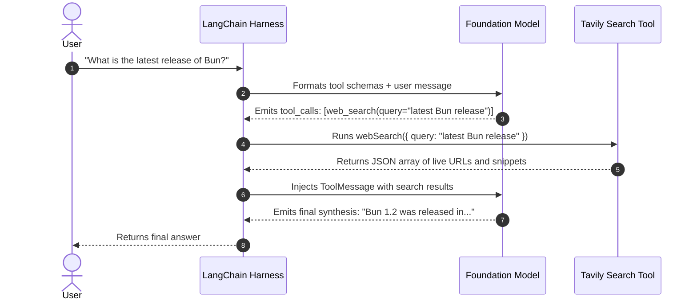

# Chapter 07 — Tool Calling, Web Search & Extraction

> **Reference:** `langchain_langgraph-main/notes/chapter-10.md` · `src/tools/index.js` · [LangChain Tools Docs](https://docs.langchain.com/oss/javascript/langchain/tools)

---

## 1. What is Tool Calling?

**Tools** are functions the foundation model can decide to invoke to **take real-world action** — searching the live web, querying a database, invoking an external microservice, or reading files.

```
Without Tools:
The model only knows what was contained in its pre-training weights.

With Tools:
The model becomes an active agent capable of retrieving live real-time ground truth.
```

In the agent loop:
$$\text{User asks} \longrightarrow \text{Model decides} \longrightarrow \text{Calls tool} \longrightarrow \text{Reads result} \longrightarrow \text{Synthesizes final answer}$$

---

## 2. Defining Tools with `tool()` and Zod

LangChain provides the `tool()` helper to wrap any asynchronous TypeScript function into an LLM-compatible tool.

### The 3 Core Fields of a Tool

| Field | Purpose | Critical Rule |
| :--- | :--- | :--- |
| **`name`** | Identifier the model uses in its `tool_calls` payload. | Snake_case, descriptive (e.g., `web_search`, `get_weather`). |
| **`description`** | Instructions explaining to the model **when and why** to invoke it. | Be explicit. The model's planner uses this to determine relevance. |
| **`schema`** | A Zod schema validating input arguments. | Always attach `.describe()` to every parameter. |

```typescript
import { tool } from "@langchain/core/tools";
import * as z from "zod";

export const calculateMortgage = tool(
  async ({ principal, annualInterestRate, years }) => {
    const monthlyRate = annualInterestRate / 100 / 12;
    const numberOfPayments = years * 12;
    const monthlyPayment =
      (principal * monthlyRate * Math.pow(1 + monthlyRate, numberOfPayments)) /
      (Math.pow(1 + monthlyRate, numberOfPayments) - 1);

    return JSON.stringify({
      monthlyPayment: monthlyPayment.toFixed(2),
      totalPaid: (monthlyPayment * numberOfPayments).toFixed(2),
    });
  },
  {
    name: "calculate_mortgage",
    description: "Calculate monthly mortgage payments based on loan amount, interest rate, and term.",
    schema: z.object({
      principal: z.number().describe("The total loan amount in dollars"),
      annualInterestRate: z.number().describe("Annual interest rate percentage (e.g. 6.5 for 6.5%)"),
      years: z.number().int().describe("Loan duration in years (e.g. 15 or 30)"),
    }),
  }
);
```

---

## 3. Real-World Web Tools: Tavily Search & Extraction

In real applications, agents need live web search and deep page scraping. In `src/tools/index.js`, we use Tavily (`@tavily/core`), an AI-native search engine designed for LLM context windows.

```bash
npm install @tavily/core
```

### Complete Implementation (`src/tools/index.ts`)

```typescript
import { tavily } from "@tavily/core";
import { tool } from "@langchain/core/tools";
import * as z from "zod";

const tvly = tavily({ apiKey: process.env.TAVILY_API_KEY });

// Tool 1: Live Web Search (Queries Google/web index)
export const webSearch = tool(
  async ({ query }) => {
    const data = await tvly.search(query, { maxResults: 5 });
    // Stringify array of results for model consumption
    return JSON.stringify(data.results ?? []);
  },
  {
    name: "web_search",
    description: "Search the web for current facts, news, documentation, and technical updates.",
    schema: z.object({
      query: z.string().describe("The search query. Be specific and concise."),
    }),
  }
);

// Tool 2: Deep Webpage Extractor (Extracts full markdown from a URL)
export const visitPage = tool(
  async ({ url }) => {
    const data = await tvly.extract([url], {
      extractDepth: "advanced",
      format: "markdown",
    });
    // Return markdown text directly
    return data.results?.[0]?.rawContent ?? JSON.stringify(data);
  },
  {
    name: "visit_page",
    description: "Read and extract the complete clean markdown content of a specific webpage URL.",
    schema: z.object({
      url: z.string().url().describe("The HTTP or HTTPS URL to read."),
    }),
  }
);
```

---

## 4. Registering Tools with `createAgent`

Pass the tool instances into the `tools` array of `createAgent`:

```typescript
import { createAgent } from "langchain";
import { ChatOpenAI } from "@langchain/openai";
import { webSearch, visitPage } from "./tools/index.js";

const agent = createAgent({
  model: new ChatOpenAI({ model: "gpt-4o-mini", temperature: 0 }),
  tools: [webSearch, visitPage],
  systemPrompt:
    "You are an expert technical researcher. Answer questions thoroughly and accurately. " +
    "Use 'web_search' for broad discovery and 'visit_page' to verify full documentation.",
});

const result = await agent.invoke({
  messages: [{ role: "user", content: "What are the key changes introduced in React 19?" }],
});

console.log("Agent:", result.messages.at(-1)?.content);
```

### What the Harness Automates Behind the Scenes



---

## 5. Logging Tool Calls During Execution

To inspect which tools your agent invoked during an execution run, traverse the message history:

```typescript
const result = await agent.invoke({
  messages: [{ role: "user", content: "What is on https://example.com?" }],
});

for (const message of result.messages) {
  if (message.tool_calls && message.tool_calls.length > 0) {
    for (const call of message.tool_calls) {
      console.log(`🔧 Tool Invoked: ${call.name}(${JSON.stringify(call.args)})`);
      console.log(`   Call ID: ${call.id}`);
    }
  }
}
```

---

## 6. The 5 Principles of Production Tool Design

1. **Single Responsibility**: Create discrete, focused tools (`web_search` and `visit_page`), never a catch-all mega-tool.
2. **Explicit Descriptions**: The model does not see your TypeScript function body; it only reads the `description`. Explain what the tool does, when to use it, and what data it returns.
3. **Always Use `.describe()` on Zod Fields**: Helps the model populate arguments accurately without guessing.
4. **Always Return Strings**: LLMs process text. Serialize structured payloads with `JSON.stringify(data)`.
5. **Fail Gracefully**: Catch internal API exceptions inside the tool function and return error strings (`"Error: Failed to reach external server"`). Throwing uncaught exceptions will crash the entire agent loop.

---

## Key Takeaways

- Tools bridge the gap between static foundation models and live environments.
- Use `tool()` with Zod schemas to guarantee type validation of model arguments.
- The harness handles tool dispatch, schema binding, and observation injection automatically.
- Tavily provides fast, AI-optimized web search and markdown extraction.

