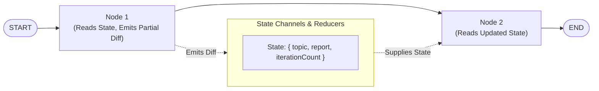

# Chapter 11 — StateGraph, StateSchema & Channel Reducers

> **Reference:** `langchain_langgraph-main/notes/chapter-9.md` · [LangGraph Graph States](https://docs.langchain.com/oss/javascript/langgraph/graph-states)

---

## 1. What is StateGraph?

**`StateGraph`** is the core foundational class in LangGraph used to construct workflows. It is parameterized by a user-defined **State** schema that tracks application memory across all steps.

From the official [LangGraph documentation](https://docs.langchain.com/oss/javascript/langgraph/graph-api):

> *"The `StateGraph` class is the main graph class to use. This is parameterized by a user-defined `State` object."*

```
The Board Game Analogy:
• State = The current state of the board (pieces, scores, turns).
• Nodes = The board spaces where players take specific actions.
• Edges = The directional arrows indicating allowed moves.
• compile() = Locking in the rulebook before the game begins.
• invoke() = Playing through a round of the game.
```

---

## 2. The 3 Pillars of Every StateGraph

```
1. STATE   ──► The shared typed snapshot flowing through the graph.
2. NODES   ──► Functions that read current state and emit partial updates.
3. EDGES   ──► Rules determining which node executes next.
```



---

## 3. The 4-Stage Lifecycle of a Graph

Every LangGraph application follows four distinct, sequential steps:

```
[Step 1: Define StateSchema] ──► [Step 2: Add Nodes] ──► [Step 3: Add Edges] ──► [Step 4: Compile]
```

1. **Step 1: Define State (`StateSchema`)**: Declare all channels and their merge behaviors using Zod.
2. **Step 2: Add Nodes (`.addNode(name, fn)`)**: Register functions that perform deterministic work or LLM reasoning.
3. **Step 3: Add Edges (`.addEdge()` / `.addConditionalEdges()`)**: Connect the nodes with routing paths.
4. **Step 4: Compile (`.compile()`)**: Verify graph structure and attach checkpointers. **You cannot invoke a graph without compiling it first.**

---

## 4. Special Sentinels: `START` and `END`

LangGraph defines two reserved sentinels to mark the boundaries of graph execution:

| Sentinel | Meaning | How to Use |
| :--- | :--- | :--- |
| **`START`** | The entry point where user input enters the graph. | `.addEdge(START, "firstNode")` |
| **`END`** | The terminal exit point where execution finishes. | `.addEdge("lastNode", END)` |

```typescript
import { StateGraph, START, END } from "@langchain/langgraph";

const graph = new StateGraph(MyState)
  .addNode("step1", step1Fn)
  .addNode("step2", step2Fn)
  .addEdge(START, "step1")
  .addEdge("step1", "step2")
  .addEdge("step2", END);
```

---

## 5. Defining State & Channel Types (`StateSchema`)

In LangGraph, state is organized into **channels**. Each channel holds a value and defines how updates emitted by nodes merge into that value.

```typescript
import { StateSchema, MessagesValue, ReducedValue } from "@langchain/langgraph";
import * as z from "zod";

export const ApplicationState = new StateSchema({
  // 1. Last-Write-Wins Channel (Default):
  // When a node returns { status: "processing" }, the old status is replaced.
  status: z.string().default("idle"),
  currentQuery: z.string(),

  // 2. MessagesValue Channel:
  // Automatically handles conversation turns: appends new messages and updates existing by ID.
  messages: MessagesValue,

  // 3. Custom ReducedValue Channel:
  // Uses a custom reducer function to merge updates (e.g. array concatenation or counter addition).
  collectedUrls: new ReducedValue(
    z.array(z.string()).default([]),
    {
      // Reducer: (currentValue, incomingUpdate) => mergedValue
      reducer: (current, update) => current.concat(update),
    }
  ),

  retryCount: new ReducedValue(
    z.number().default(0),
    {
      reducer: (current, increment) => current + increment,
    }
  ),
});
```

### Channel Behavior Comparison

| Channel Type | Merge Mechanism | Typical Use Case |
| :--- | :--- | :--- |
| **Default (Last-Write-Wins)** | Overwrites existing value with the new value. | Status flags, user IDs, current topics. |
| **`MessagesValue`** | Appends new messages; updates existing messages if IDs match. | Turn-by-turn chat history. |
| **`ReducedValue`** | Custom reducer function (concatenation, summation, set union). | Audit logs, scraped URL lists, counters. |
| **`UntrackedValue`** | Ephemeral scratchpad; excluded from persistent checkpoints. | File buffers, short-lived tokens. |

---

## 6. How Nodes Update State: Partial Diffs

A critical architectural rule of LangGraph:

> **Nodes do NOT return the full state. Nodes return partial updates (diffs).**

```typescript
// ❌ INCORRECT: Do not reconstruct and return the full state
const badNode = async (state: any) => {
  return {
    status: "done",
    currentQuery: state.currentQuery,
    collectedUrls: state.collectedUrls, // Redundant!
  };
};

// ✅ CORRECT: Return ONLY the fields you modified
const goodNode = async (state: any) => {
  return {
    status: "done",
    collectedUrls: ["https://example.com/new-article"], // Automatically merged by reducer!
  };
};
```

LangGraph intercepts the returned partial diff and passes it through the channel's reducer.

---

## 7. Why `.compile()` is Mandatory

In LangGraph, you **must call `.compile()`** before invoking or streaming:

```typescript
const app = graph.compile({ checkpointer: new MemorySaver() });
```

### What Compilation Actually Does

1. **Topology Validation**: Detects orphaned nodes (nodes with no incoming edges) and dead ends (nodes with no outgoing path to `END`).
2. **Channel Initialization**: Configures memory channels and binds reducer functions.
3. **Checkpointer Binding**: Attaches persistence layers (`MemorySaver`, Postgres) and serialization adapters.
4. **Breakpoint Arming**: Registers human-in-the-loop interruption rules (`interruptBefore` / `interruptAfter`).

---

## 8. The Execution Engine: Pregel Super-Steps

LangGraph executes graphs in discrete cycles called **super-steps** (inspired by Google's Pregel distributed graph processing architecture):

```
Super-Step 1:
┌────────────────────────────────────────────────────────┐
│ 1. All currently active nodes execute concurrently.    │
│ 2. Each node computes its logic and emits partial diffs.│
│ 3. Barrier Synchronization: engine waits for all nodes.│
│ 4. Reducers merge diffs into state channels.           │
│ 5. Outgoing edges evaluate; next nodes are queued.     │
└────────────────────────────────────────────────────────┘
                          │
                          ▼
Super-Step 2: Next batch of active nodes executes.
```

- **Concurrency**: If Node A and Node B both branch from `START`, they execute in parallel within the same super-step.
- **Isolation**: No node sees dirty or intermediate updates from peer nodes during its execution turn.

---

## Key Takeaways

- `StateGraph` is parameterized by a typed `StateSchema`.
- Nodes emit partial state updates; channel reducers merge them into shared state.
- `MessagesValue` handles chat history; `ReducedValue` allows custom array or counter mergers.
- `.compile()` validates topology and binds checkpointers before execution.
- Workflows advance in discrete Pregel super-steps with synchronized barrier merges.

