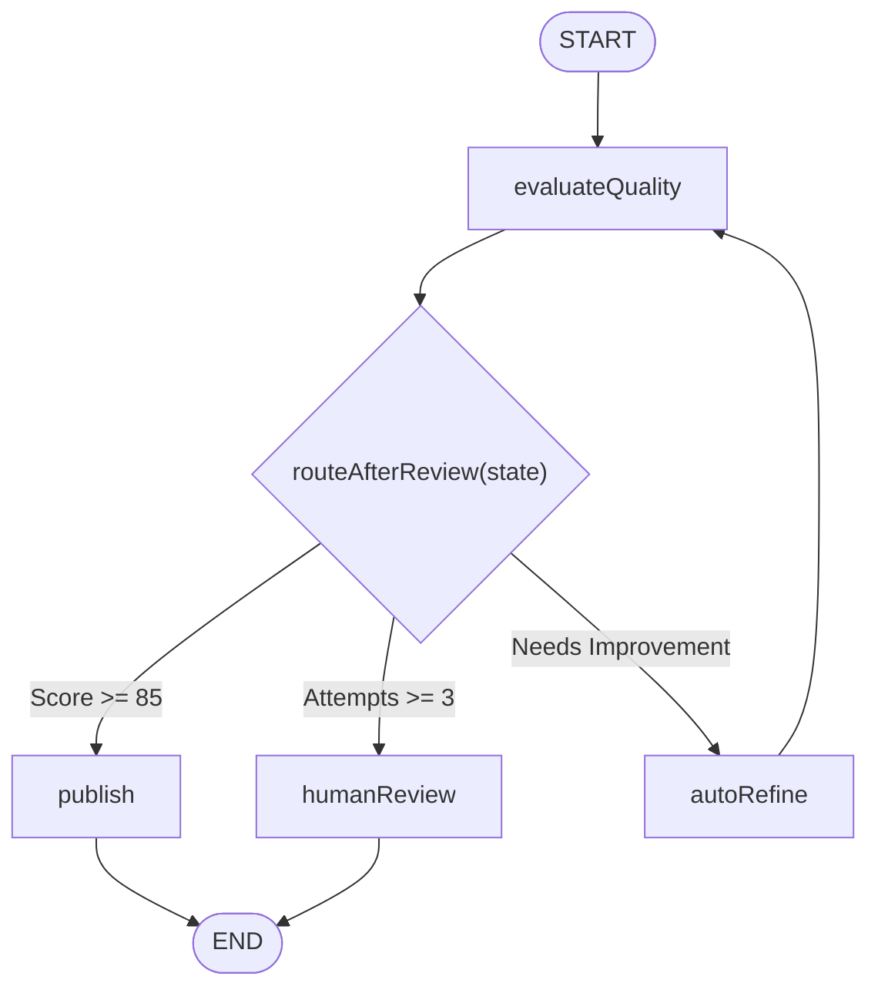

# Chapter 12 — Nodes, Edges & Conditional Routing

> **Reference:** `langchain_langgraph-main/notes/chapter-13.md` · [LangGraph Graph API](https://docs.langchain.com/oss/javascript/langgraph/graph-api)

---

## 1. Nodes: The Units of Work

In LangGraph, a **node** is a JavaScript/TypeScript function that performs work. It receives the current snapshot of **state** (and optional runtime config), executes its logic, and returns a **partial update**.

From the official [LangGraph documentation](https://docs.langchain.com/oss/javascript/langgraph/graph-api):

> *"Nodes and edges are nothing more than functions — they can contain an LLM or just good ol' code."*

### Nodes Can Be:
1. **Deterministic Code**: Database queries, REST API requests, JSON formatting, or math.
2. **LLM Calls**: Classification, summarization, entity extraction, or structured generation.
3. **Hybrid Actions**: Calling an external search API and feeding the result directly to an LLM.

```typescript
// Example 1: Deterministic Node (Pure JavaScript)
async function sanitizeInputNode(state: { rawText: string }) {
  return {
    cleanText: state.rawText.trim().toLowerCase(),
  };
}

// Example 2: AI Node (LLM Call)
async function draftSummaryNode(state: { cleanText: string }) {
  const reply = await llm.invoke(`Summarize the following text in 2 bullets:\n${state.cleanText}`);
  return {
    summary: reply.content,
  };
}
```

Register nodes using `.addNode(name, fn)`:

```typescript
graph
  .addNode("sanitize", sanitizeInputNode)
  .addNode("summarize", draftSummaryNode);
```

---

## 2. Normal Edges: Fixed Deterministic Paths

An **edge** defines the flow of control from one node to the next. A **normal edge** always transitions to the same destination node unconditionally:

```typescript
import { START, END } from "@langchain/langgraph";

graph
  .addEdge(START, "sanitize")
  .addEdge("sanitize", "summarize")
  .addEdge("summarize", END);
```

```
[START] ──► [sanitize] ──► [summarize] ──► [END]
```

Use normal edges for fixed, sequential multi-step pipelines where execution order never changes.

---

## 3. Conditional Edges: Dynamic State-Based Routing

In complex enterprise systems, execution paths depend on runtime evaluations (e.g. quality scores, user roles, or error conditions).

A **conditional edge** invokes a routing function that inspects the current state and returns the name of the next node:

```typescript
import { StateGraph, StateSchema, START, END } from "@langchain/langgraph";
import * as z from "zod";

const DocumentReviewState = new StateSchema({
  documentText: z.string(),
  qualityScore: z.number().default(0),
  revisionAttempts: z.number().default(0),
});

// Routing function: returns target node key
function routeAfterReview(state: typeof DocumentReviewState.State): "humanReview" | "publish" | "autoRefine" {
  if (state.qualityScore >= 85) {
    return "publish";
  }
  if (state.revisionAttempts >= 3) {
    return "humanReview"; // Escalate after 3 failed attempts
  }
  return "autoRefine";
}

const graph = new StateGraph(DocumentReviewState)
  .addNode("evaluateQuality", async (state) => {
    // LLM scores document
    return { qualityScore: 78, revisionAttempts: state.revisionAttempts + 1 };
  })
  .addNode("autoRefine", async (state) => ({ documentText: `${state.documentText} (Refined)` }))
  .addNode("humanReview", async (state) => ({ status: "Awaiting Human Review" }))
  .addNode("publish", async (state) => ({ status: "Published Successfully" }))
  .addEdge(START, "evaluateQuality")
  
  // Attach Conditional Edge:
  .addConditionalEdges("evaluateQuality", routeAfterReview, {
    publish: "publish",
    autoRefine: "autoRefine",
    humanReview: "humanReview",
  })
  
  // Cyclical Loop: refined document goes back for re-evaluation!
  .addEdge("autoRefine", "evaluateQuality")
  .addEdge("humanReview", END)
  .addEdge("publish", END)
  .compile();
```

### Visualizing the Cyclical Routing



---

## 4. Conditional Entry-Point Routing

You can route directly from `START` to launch completely different execution paths based on input parameters:

```typescript
function routeInputMode(state: { mode: "fast" | "deep" }) {
  return state.mode === "fast" ? "quickCacheLookup" : "deepWebCrawler";
}

graph.addConditionalEdges(START, routeInputMode);
```

---

## 5. Parallel Execution (Fan-Out & Fan-In)

When multiple outgoing edges depart from a single node, LangGraph executes the downstream nodes **in parallel within the same super-step**:

```typescript
graph
  .addEdge(START, "initiateResearch")
  // Fan-out: both nodes run concurrently!
  .addEdge("initiateResearch", "fetchNewsApi")
  .addEdge("initiateResearch", "queryInternalVectorDb")
  // Fan-in: both nodes route to the synthesis step
  .addEdge("fetchNewsApi", "synthesizeReport")
  .addEdge("queryInternalVectorDb", "synthesizeReport")
  .addEdge("synthesizeReport", END);
```

```
                     ┌──► [fetchNewsApi] ────────┐
[initiateResearch] ──┤                           ├──► [synthesizeReport] ──► [END]
                     └──► [queryInternalVectorDb] ┘
```

Both `fetchNewsApi` and `queryInternalVectorDb` execute concurrently. LangGraph's barrier synchronization ensures `synthesizeReport` only executes after both parallel branches complete.

---

## 6. The `Command` Primitive: Atomic State Update + Routing

In advanced architectures, a node may need to **update state and specify the next destination atomically**. Instead of separating logic across a node and a conditional edge, return a `Command`:

```typescript
import { Command } from "@langchain/langgraph";

const moderatorNode = async (state: any) => {
  const isToxic = checkToxicity(state.userMessage);

  if (isToxic) {
    return new Command({
      update: { status: "rejected", refusalReason: "Policy violation detected" },
      goto: "sendRejectionNotice", // Overrides default edges!
    });
  }

  return new Command({
    update: { status: "approved" },
    goto: "processTransaction",
  });
};
```

---

## 7. Comparison: Nodes vs. Edges

| Feature | Node | Edge |
| :--- | :--- | :--- |
| **Primary Duty** | Does work, fetches data, reasons, transforms. | Decides which node runs next. |
| **Return Value** | Partial state update: `{ field: newValue }`. | Destination node string or routing signal. |
| **Can Invoke LLMs?** | Yes (frequent). | No (routing logic only). |
| **Side Effects** | Permitted (API calls, DB writes). | None permitted (must be pure functions). |

---

## Key Takeaways

- Nodes execute tasks and emit partial diffs.
- Normal edges connect nodes deterministically (`START -> nodeA -> nodeB -> END`).
- Conditional edges dynamically branch based on state inspection.
- Parallel edges trigger concurrent execution within a single super-step.
- The `Command` primitive allows nodes to update state and declare routing targets atomically.

