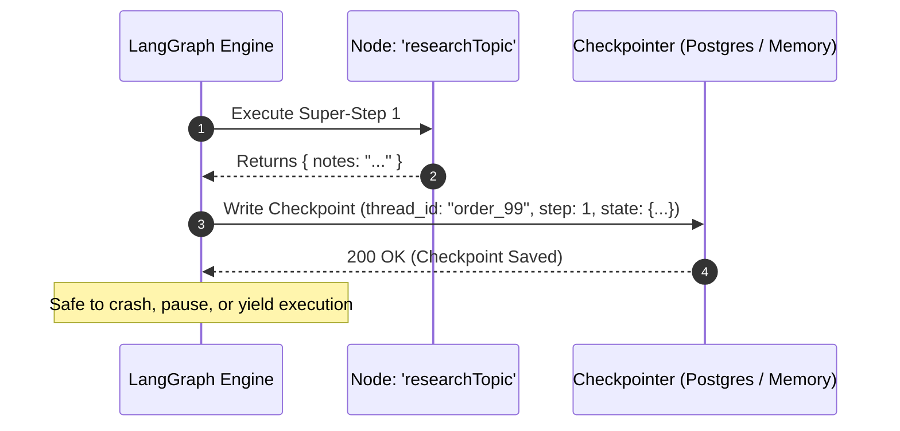

# Chapter 13 — Checkpointers, Persistence & Human-in-the-Loop

> **Reference:** `langchain_langgraph-main/notes/chapter-14.md` · [LangGraph Checkpointers](https://docs.langchain.com/oss/javascript/langgraph/checkpointers) · [Human-in-the-Loop Guide](https://docs.langchain.com/oss/javascript/langgraph/human-in-the-loop)

---

## 1. Why Persistence Matters in Production

In toy demos, agents run in a single Node.js process memory space. In production enterprise architectures, this fails for three reasons:

1. **Stateless Web Services**: In a REST or GraphQL server, every user request arrives on a different HTTP request, often handled by different serverless instances or Kubernetes pods. Memory inside a process variable is lost.
2. **Crash Resilience**: If an agent is on Step 7 of a 10-step indexing pipeline and the container crashes or runs out of memory, rerunning from Step 1 burns thousands of unnecessary tokens and repeats external API side-effects.
3. **Human-in-the-Loop (HITL)**: If an agent requires human sign-off before charging a credit card or dropping a database table, the workflow must be able to **pause for hours or days**, release CPU/memory resources, and **resume seamlessly** when approval arrives.

```
Without Checkpointer:
Server Crash or Wait ──► Execution State Lost ❌

With Checkpointer:
Super-Step N Completes ──► State Serialized to DB ──► Safe to Pause, Restart, or Resume ✅
```

---

## 2. Checkpointer Architecture

A **checkpointer** intercepts graph execution at the boundary of every Pregel super-step. It serializes the active state channels, the super-step index, and pending node tasks into a persistent datastore:



### Checkpointer Implementations

| Implementation | Package | Recommended Environment |
| :--- | :--- | :--- |
| **`MemorySaver`** | `@langchain/langgraph` | Local development, unit testing, automated CI/CD suites. |
| **`PostgresSaver`** | `@langchain/langgraph-checkpoint-postgres` | Production enterprise deployments, multi-replica Kubernetes clusters. |
| **`SqliteSaver`** | `@langchain/langgraph-checkpoint-sqlite` | Edge computing, embedded devices, local CLI tools. |

---

## 3. Session Isolation via `thread_id`

State persistence is partitioned using a unique **`thread_id`**. Passing the same `thread_id` across distinct invocations automatically loads and resumes the corresponding conversation state:

```typescript
import { StateGraph, StateSchema, MemorySaver, START, END } from "@langchain/langgraph";
import * as z from "zod";

const ChatState = new StateSchema({
  messages: z.array(z.string()).default([]),
});

const appendMessageNode = async (state: typeof ChatState.State) => {
  return {
    messages: [...state.messages, "Assistant: Acknowledged."],
  };
};

const checkpointer = new MemorySaver();

const app = new StateGraph(ChatState)
  .addNode("chat", appendMessageNode)
  .addEdge(START, "chat")
  .addEdge("chat", END)
  .compile({ checkpointer });

// Config defining the user's isolated session thread:
const userConfig = {
  configurable: { thread_id: "user_session_alpha_101" },
};

// Turn 1
await app.invoke({ messages: ["User: My favorite language is TypeScript."] }, userConfig);

// Turn 2: State persists automatically across separate calls!
const turn2 = await app.invoke({ messages: ["User: What is my favorite language?"] }, userConfig);

console.log(turn2.messages);
/* Output:
[
  "User: My favorite language is TypeScript.",
  "Assistant: Acknowledged.",
  "User: What is my favorite language?",
  "Assistant: Acknowledged."
]
*/
```

---

## 4. Human-in-the-Loop (HITL) Workflows

LangGraph allows you to set **breakpoints** that halt execution immediately before or after specific nodes:

```typescript
const appWithApproval = graph.compile({
  checkpointer,
  // Pause execution immediately before executing this high-risk node:
  interruptBefore: ["executeFinancialTransfer"],
});
```

### The 4-Stage HITL Lifecycle

```
[1. User Initiates] ──► [2. Graph Pauses at Breakpoint] ──► [3. Human Reviews/Edits State] ──► [4. Resume]
```

```typescript
const session = { configurable: { thread_id: "wire_transfer_994" } };

// Stage 1: Trigger the workflow
console.log("Initiating transfer workflow...");
await appWithApproval.invoke({ amount: 50000, recipient: "Acme Corp" }, session);

// Stage 2: Inspect paused state
const stateSnapshot = await appWithApproval.getState(session);
console.log("Current Status:", stateSnapshot.values);
console.log("Next Node to Run:", stateSnapshot.next); // ["executeFinancialTransfer"]

// Stage 3: Human reviews and modifies state (e.g. adding approval flag)
await appWithApproval.updateState(session, {
  isApprovedByManager: true,
  managerNotes: "Approved by VP of Finance via dashboard",
});

// Stage 4: Resume execution by invoking with null input
console.log("Resuming execution after human sign-off...");
const finalResult = await appWithApproval.invoke(null, session);
console.log("Workflow Complete:", finalResult);
```

---

## 5. Recursion Limits: Guarding Against Runaway Cycles

When working with cyclical graphs, an infinite loop can drain your API budget within minutes. LangGraph enforces a hard safety limit:

```typescript
// Set recursionLimit in invocation config (default is 25 super-steps):
await app.invoke(
  { topic: "Iterative Refinement" },
  {
    configurable: { thread_id: "task_1" },
    recursionLimit: 50, // Throws GraphRecursionError if exceeded!
  }
);
```

---

## Key Takeaways

- Checkpointers capture state snapshots after every super-step.
- `thread_id` isolates concurrent conversations and enables multi-turn memory.
- `interruptBefore` pauses workflows at critical junctures for human authorization.
- `getState()` and `updateState()` enable inspection and mutation of paused state before resumption.
- `recursionLimit` prevents runaway cycles from consuming unlimited tokens.

