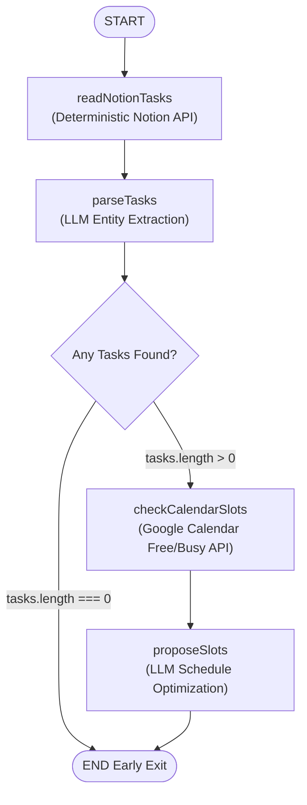

# Chapter 14 — Production Workflows: Notion & Google Calendar Case Studies

> **Reference:** `langchain_langgraph-main/notes/chapter-14.md` · `workflow/index.js` · [LangGraph Workflows](https://docs.langchain.com/oss/javascript/langgraph/graph-api)

---

## 1. Why Workflows Instead of Free-Form Loops?

While conversational chatbots use free-form loops, production enterprise applications frequently require **structured, multi-stage pipelines**:

- Research a technical topic $\longrightarrow$ Synthesize markdown notes $\longrightarrow$ Format blocks $\longrightarrow$ Save to Notion database.
- Read pending action items from Notion $\longrightarrow$ Query Google Calendar for free slots $\longrightarrow$ Match tasks $\longrightarrow$ Draft calendar invites.
- Ingest customer inquiry $\longrightarrow$ Retrieve CRM records $\longrightarrow$ Classify sentiment $\longrightarrow$ Route to human support or auto-reply.

LangGraph's `StateGraph` is engineered specifically for this: each phase is a distinct **node**, and the execution order and branching logic are enforced by **edges**.

---

## 2. Architectural Principle: Deterministic vs. AI Nodes

A fundamental engineering principle of LangGraph is that **you should only use LLMs where probabilistic language intelligence is strictly required**:

| Workflow Step | Optimal Implementation | Why |
| :--- | :--- | :--- |
| **API Calls (Notion, Google Calendar, SQL)** | Pure JavaScript / TypeScript | Deterministic, exact error codes, 0 token cost, 0% hallucination risk. |
| **Data Chunking & Text Slicing** | Pure JavaScript | Mathematical operations must be 100% precise. |
| **Web Research Ingestion** | Specialized API Client (Tavily) | Optimized for clean text extraction and fast latency. |
| **Study Note Synthesis & Summarization**| Foundation LLM (`gpt-4o-mini`) | Requires semantic comprehension, formatting, and synthesis. |
| **Task Extraction from Raw Text** | Foundation LLM with Zod Schema | Unstructured text to structured JSON extraction. |

---

## 3. Case Study 1: End-to-End Notion Study Notes Workflow

> **Source Code:** `langchain_langgraph-main/workflow/index.js`

### Objective
A user enters a research topic in the terminal. The graph automatically searches the live web via Tavily, synthesizes deep markdown study notes via an LLM, chunks the text to satisfy Notion's character limits, and publishes a new page to a Notion workspace.

### Graph Architecture

```
[START]
   │
   ▼
[Node 1: writeNotes] ────► Searches web via Tavily (5 sources) + Synthesizes Markdown via LLM
   │
   ▼
[Node 2: saveToNotion] ──► Chunks text into 2000-char blocks + Posts to Notion API
   │
   ▼
 [END]
```

### Complete Implementation

```typescript
import "dotenv/config";
import readline from "node:readline/promises";
import { stdin, stdout } from "node:process";
import { tavily } from "@tavily/core";
import { ChatOpenAI } from "@langchain/openai";
import { StateGraph, StateSchema, START, END } from "@langchain/langgraph";
import * as z from "zod";

// 1. Initialize Clients
const llm = new ChatOpenAI({ model: "gpt-4o-mini", temperature: 0 });
const tvly = tavily({ apiKey: process.env.TAVILY_API_KEY });

// 2. Define the Graph State Schema
const NotionState = new StateSchema({
  topic: z.string(),
  notes: z.string().default(""),
  notionUrl: z.string().default(""),
});

// 3. Node 1: Web Research + LLM Synthesis
async function writeNotes(state: typeof NotionState.State) {
  console.log(`\n🔍 Searching the web for: "${state.topic}"...`);
  const search = await tvly.search(state.topic, { maxResults: 5 });
  const research = JSON.stringify(search.results ?? []);

  console.log("🧠 Synthesizing study notes with LLM...");
  const reply = await llm.invoke(
    `Write in-depth, structured study notes on: ${state.topic}\n\n` +
    `Web research:\n${research}\n\n` +
    `Format using markdown with clear headings, bullet points, and key takeaways.`
  );

  return { notes: reply.content as string };
}

// 4. Node 2: Deterministic Notion API Client
async function saveToNotion(state: typeof NotionState.State) {
  console.log("📝 Publishing page to Notion...");

  // CRITICAL GOTCHA: Notion API limits paragraph blocks to 2,000 characters maximum!
  // We deterministically slice the notes into 2,000 character chunks:
  const blocks = [];
  for (let i = 0; i < state.notes.length; i += 2000) {
    blocks.push({
      object: "block",
      type: "paragraph",
      paragraph: {
        rich_text: [
          { type: "text", text: { content: state.notes.slice(i, i + 2000) } },
        ],
      },
    });
  }

  const res = await fetch("https://api.notion.com/v1/pages", {
    method: "POST",
    headers: {
      Authorization: `Bearer ${process.env.NOTION_API_KEY}`,
      "Notion-Version": "2022-06-28",
      "Content-Type": "application/json",
    },
    body: JSON.stringify({
      parent: { page_id: process.env.NOTION_PAGE_ID },
      properties: {
        title: { title: [{ text: { content: state.topic } }] },
      },
      children: blocks,
    }),
  });

  const page = await res.json();
  return { notionUrl: page.url };
}

// 5. Build and Compile the StateGraph
const workflow = new StateGraph(NotionState)
  .addNode("writeNotes", writeNotes)
  .addNode("saveToNotion", saveToNotion)
  .addEdge(START, "writeNotes")
  .addEdge("writeNotes", "saveToNotion")
  .addEdge("saveToNotion", END)
  .compile();

// 6. Interactive Terminal Runner
const rl = readline.createInterface({ input: stdin, output: stdout });
console.log("=========================================");
console.log("🚀 LangGraph Notion Notes Workflow Ready");
console.log('Enter a topic to generate study notes, or type "exit" to quit.\n');

while (true) {
  const topic = await rl.question("Topic: ");
  if (topic.trim().toLowerCase() === "exit") break;
  if (!topic.trim()) continue;

  const result = await workflow.invoke({ topic });
  console.log("\n✅ Success! Notion Page Published:");
  console.log(result.notionUrl, "\n");
}

rl.close();
```

---

## 4. Case Study 2: Notion + Google Calendar Meeting Scheduler

### Objective
Fetch project task descriptions from a Notion database $\longrightarrow$ Extract required hours and deadlines using an LLM $\longrightarrow$ If zero actionable tasks exist, terminate early $\longrightarrow$ If tasks exist, query Google Calendar Free/Busy API $\longrightarrow$ Propose optimal meeting and focus blocks.

### Graph Architecture with Conditional Early Exit



### State Schema & Conditional Edge Implementation

```typescript
const SchedulerState = new StateSchema({
  rawNotes: z.string().default(""),
  tasks: z.array(z.object({
    title: z.string(),
    durationMinutes: z.number(),
    priority: z.enum(["high", "medium", "low"]),
  })).default([]),
  freeSlots: z.array(z.string()).default([]),
  finalSchedule: z.string().default(""),
});

// Routing function: dynamically skips calendar checks if no tasks exist
function routeAfterParsing(state: typeof SchedulerState.State) {
  if (state.tasks.length === 0) {
    console.log("⚠️ No pending tasks identified. Exiting early.");
    return END;
  }
  return "checkCalendarSlots";
}

const schedulerGraph = new StateGraph(SchedulerState)
  .addNode("readNotionTasks", async (state) => { /* Fetch Notion blocks */ return {}; })
  .addNode("parseTasks", async (state) => { /* LLM extracts Zod task list */ return {}; })
  .addNode("checkCalendarSlots", async (state) => { /* Query Google Calendar API */ return {}; })
  .addNode("proposeSlots", async (state) => { /* LLM matches tasks to slots */ return {}; })
  
  .addEdge(START, "readNotionTasks")
  .addEdge("readNotionTasks", "parseTasks")
  
  // Conditional Edge:
  .addConditionalEdges("parseTasks", routeAfterParsing, {
    [END]: END,
    checkCalendarSlots: "checkCalendarSlots",
  })
  
  .addEdge("checkCalendarSlots", "proposeSlots")
  .addEdge("proposeSlots", END)
  .compile();
```

---

## 5. Production Hardening Checklist for Workflows

1. **Isolate API Calls in Dedicated Nodes**: Never bundle Notion or Calendar API calls inside an LLM node. If the API fails with a network glitch, you can retry the node without paying tokens to re-run the LLM.
2. **Deterministic Pre-Validation**: Slice strings and validate payload sizes (such as Notion's 2,000 character paragraph block limit) with pure code.
3. **Attach Checkpointers**: When orchestrating multi-service pipelines, always compile with a checkpointer so transient failures can resume from the last completed node.
4. **Trace Every Step with LangSmith**: Verify exactly how long each third-party API call took versus LLM token generation.

---

## Key Takeaways

- Workflows model business processes as directed graphs of state, nodes, and edges.
- Reserve LLMs for reasoning and text generation; use deterministic code for external APIs and data formatting.
- Conditional edges allow pipelines to exit early when inputs do not meet operational thresholds.
- Always chunk text deterministically when interacting with downstream SaaS APIs that enforce block size limits.

