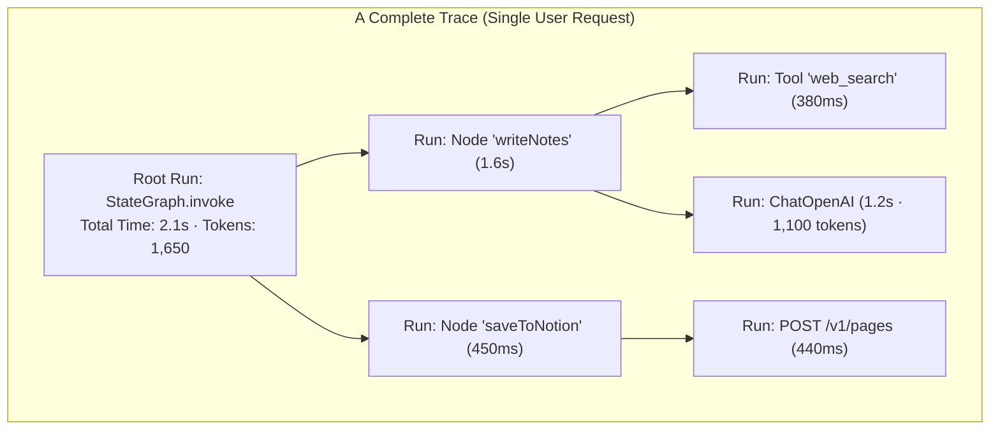
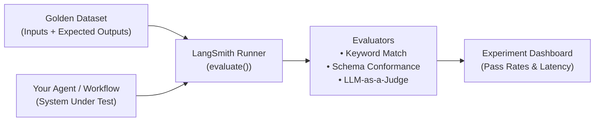

# Chapter 15 — LangSmith Observability, Tracing & Offline Evaluation

> **Reference:** [LangSmith Observability Quickstart](https://docs.langchain.com/langsmith/observability-quickstart) · [LangSmith Evaluation](https://docs.langchain.com/langsmith/evaluation) · Enterprise Observability Patterns

---

## 1. Why Observability is Non-Negotiable in GenAI

Traditional software fails predictably: an unhandled exception produces a stack trace with an exact file name and line number. 

AI agents introduce **stochastic failure modes** that traditional Application Performance Monitoring (APM) tools (Datadog, New Relic) cannot debug:

1. **The "Black Box" Loop Problem**: When an agent executes 6 tool calls and outputs an incorrect answer, where did the reasoning derail? Did the LLM pick the wrong tool? Did the tool return malformed data? Did a system prompt instruction conflict with the user's input?
2. **Hidden Latency & Cost Spikes**: A single user query might trigger 4 LLM calls, 3 web searches, and 2 database lookups. Without granular tracing, identifying which step caused an 8-second latency spike or a $0.05 token burn is impossible.
3. **Prompt Regressions**: Changing one sentence in a system prompt to fix Bug A might subtly degrade the model's performance on Features B, C, and D.

**LangSmith** is an observability, tracing, debugging, and evaluation platform purpose-built for LLM applications and agentic graphs.

```
┌────────────────────────────────────────────────────────────────────────┐
│                        THE LANGSMITH PLATFORM                          │
│                                                                        │
│   1. TRACING & OBSERVABILITY                                           │
│      • Full execution waterfalls (LLM calls, Tools, Graph Nodes)       │
│      • Token accounting (prompt, completion, cached) and dollar cost   │
│      • State channel diff inspection at every Pregel super-step        │
│                                                                        │
│   2. EVALUATION & BENCHMARKING                                         │
│      • Golden datasets of test cases and ground-truth answers          │
│      • Automated evaluators (Heuristic, Exact Match, LLM-as-a-Judge)   │
│      • Side-by-side experiment comparisons (Prompt A vs. Prompt B)     │
│                                                                        │
│   3. PRODUCTION MONITORING                                             │
│      • User feedback collection (thumbs up/down, user corrections)     │
│      • Online anomaly detection and cost burn alerts                   │
└────────────────────────────────────────────────────────────────────────┘
```

---

## 2. Core Concepts: Traces, Runs, and Projects



| Primitive | What It Is | Purpose |
| :--- | :--- | :--- |
| **Run** | A single unit of execution. | Captures inputs, outputs, start/end timestamps, token counts, and errors for one step (an LLM call, a tool execution, or a graph node). |
| **Trace** | A directed acyclic tree of nested Runs. | Represents the complete journey of a single user invocation from start to finish. |
| **Project** | A logical namespace / bucket. | Isolates environments (e.g. `lecture-13-dev`, `agent-staging`, `production`). |
| **Dataset** | A versioned collection of test examples. | Benchmark "golden dataset" containing inputs and reference ground truths for regression testing. |
| **Feedback** | Key-value metric attached to a Run. | User ratings (`thumbs_up: true`), latency scores, or human annotations. |

---

## 3. Zero-Code Instrumentation

The core feature of the LangChain / LangGraph ecosystem is that **tracing requires zero modifications to your business logic**.

### Environment Setup

Set these variables in your `.env` or deployment shell:

```bash
# Enable the background tracing engine
export LANGSMITH_TRACING=true

# Your API key from https://smith.langchain.com
export LANGSMITH_API_KEY="lsv2_pt_..."

# Destination project name (defaults to 'default' if omitted)
export LANGSMITH_PROJECT="lecture-13-agent"
```

Once exported, any call to `model.invoke()`, `agent.invoke()`, or `graph.invoke()` automatically dispatches telemetry asynchronously in the background without adding latency to the main event loop:

```typescript
import "dotenv/config";
import { initChatModel } from "langchain/chat_models/universal";

const model = await initChatModel("openai:gpt-4o-mini");

// This call is intercepted, wrapped in a Run, and streamed to LangSmith:
const response = await model.invoke("Explain distributed consensus in 2 sentences.");
console.log(response.content);
```

---

## 4. How LangGraph Graphs Appear in the LangSmith UI

When you run a LangGraph workflow with tracing enabled, LangSmith visualizes the exact graph topology and channel transitions at every super-step:

```
Run Tree Waterfall:
▼ StateGraph (Root Trace)
  ├── ⚙️ __start__ (Channels initialized)
  ▼ 📦 Node: writeNotes
    ├── 🛠️ Tool: web_search (args: { query: "LangGraph architecture" })
    │   └── Output: { results: [...] }
    ▼ 🧠 ChatOpenAI (model: "gpt-4o-mini")
        ├── Raw Input: System prompt + User message + Tool observation
        ├── Raw Output: "Here are the study notes..."
        └── Token Usage: { input: 890, output: 210, cost: $0.00032 }
  ▼ 📦 Node: saveToNotion
    └── 🌐 REST Request: api.notion.com/v1/pages (Status: 200 OK)
```

### What You Can Inspect in the Trace View

1. **Exact State Diffs**: Click on any node to view the state payload before and after execution.
2. **Exact Wire Prompts**: View the verbatim text sent to the provider, including system instructions and tool schemas.
3. **Tool Arguments & Serialization**: Inspect whether the model generated valid JSON matching your Zod schema.
4. **Latency Waterfalls**: Pinpoint bottlenecks (e.g. distinguishing between a 400ms web search and a 2,000ms LLM generation).

---

## 5. Programmatic Instrumentation with `@traceable`

For non-LangChain code (e.g. database lookups, third-party REST APIs, custom math), wrap functions using LangSmith's `@traceable` utility:

```typescript
import { traceable } from "langsmith/traceable";

// Wrap any asynchronous function:
export const queryCustomerDatabase = traceable(
  async (customerId: string) => {
    // Simulated DB query
    await new Promise((r) => setTimeout(r, 120));
    return { customerId, tier: "enterprise", creditBalance: 8500 };
  },
  {
    name: "CustomerDatabaseQuery",
    run_type: "retriever",
    metadata: { table: "customers_v2", region: "us-east-1" },
  }
);

// When called, it automatically renders as a child Run inside the active trace!
const customer = await queryCustomerDatabase("cust_101");
```

---

## 6. Offline Evaluation with LangSmith

Evaluation is the systematic process of validating that prompt changes or model upgrades do not degrade performance before deploying to production.



### Stage 1: Creating a Dataset Programmatically

```typescript
import { Client } from "langsmith";

const client = new Client({ apiKey: process.env.LANGSMITH_API_KEY });
const datasetName = "agent-factual-qa-v1";

// 1. Create dataset container
const dataset = await client.createDataset(datasetName, {
  description: "Test cases validating agent factual precision",
});

// 2. Add test cases (inputs and ground-truth references)
await client.createExamples({
  datasetId: dataset.id,
  inputs: [
    { question: "What year was LangChain released?" },
    { question: "Does LangGraph support cyclical graphs?" },
  ],
  outputs: [
    { answer: "LangChain was released in October 2022." },
    { answer: "Yes, LangGraph is explicitly designed for cyclical workflows." },
  ],
});
```

### Stage 2: Defining Evaluators & Running the Benchmark

```typescript
import { evaluate } from "langsmith";
import { initChatModel } from "langchain/chat_models/universal";

// 1. Target function under test
async function targetAgent(input: { question: string }) {
  const model = await initChatModel("openai:gpt-4o-mini", { temperature: 0 });
  const reply = await model.invoke(input.question);
  return { answer: reply.content as string };
}

// 2. Evaluator A: Exact / Keyword Matcher (Deterministic)
function keywordEvaluator({ run, example }: any) {
  const prediction = (run.outputs?.answer ?? "").toLowerCase();
  const groundTruth = (example.outputs?.answer ?? "").toLowerCase();

  const isPassing = prediction.includes("2022") || prediction.includes("cyclical");
  return {
    key: "keyword_conformance",
    score: isPassing ? 1 : 0,
    comment: isPassing ? "Matched core facts" : "Missing required keywords",
  };
}

// 3. Evaluator B: LLM-as-a-Judge (Semantic Correctness)
async function llmJudgeEvaluator({ run, example }: any) {
  const judge = await initChatModel("openai:gpt-4o", { temperature: 0 });
  
  const prompt = `
You are an impartial evaluator grading AI answer accuracy.
Question: ${example.inputs.question}
Ground Truth: ${example.outputs.answer}
Candidate Answer: ${run.outputs.answer}

Respond in JSON: { "score": 1 | 0, "reason": "concise explanation" }
`;

  const verdict = await judge.invoke(prompt);
  const parsed = JSON.parse(verdict.content as string);

  return {
    key: "semantic_correctness",
    score: parsed.score,
    comment: parsed.reason,
  };
}

// 4. Run the Evaluation Suite
await evaluate(targetAgent, {
  data: "agent-factual-qa-v1",
  evaluators: [keywordEvaluator, llmJudgeEvaluator],
  experimentPrefix: "gpt-4o-mini-baseline",
  maxConcurrency: 2,
});
```

---

## 7. Capturing Real-World User Feedback

In production web applications, attach user ratings (thumbs-up / thumbs-down) directly to the corresponding LangSmith Run ID:

```typescript
import { Client } from "langsmith";

const client = new Client();

export async function recordUserRating(runId: string, isThumbsUp: boolean, userComment?: string) {
  await client.createFeedback(runId, "user_rating", {
    score: isThumbsUp ? 1.0 : 0.0,
    value: isThumbsUp ? "thumbs_up" : "thumbs_down",
    comment: userComment ?? "Direct feedback from client application",
  });
}
```

---

## Key Takeaways

- Observability is essential to diagnose non-deterministic loops, token costs, and prompt regressions.
- Setting `LANGSMITH_TRACING=true` provides zero-code, zero-overhead tracing across LangChain and LangGraph.
- The UI exposes full run trees, exact raw prompts, tool argument payloads, and state channel diffs.
- Custom functions outside LangChain can be traced with `@traceable`.
- `evaluate()` enables automated offline regression testing using golden datasets and LLM-as-a-judge.

