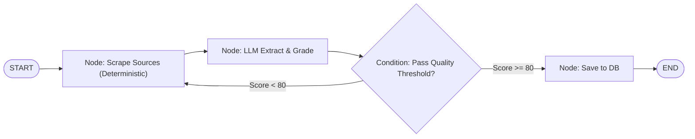

# Lecture 13 — LangChain, LangGraph & LangSmith: Complete Consolidated Notes

## The Whole Lecture on One Reference

> **This document is an architectural synthesis, not a shallow summary.** It consolidates the three pillars of the LangChain TypeScript/JavaScript ecosystem — **LangChain** (model abstraction & harness), **LangGraph** (stateful graph orchestration & durability), and **LangSmith** (observability, tracing & offline evaluation) — into a cohesive, production-grade guide.
>
> **Source References:**  
> - Official Documentation: [docs.langchain.com](https://docs.langchain.com/) (JavaScript/TypeScript Section)
> - Course Curriculum Reference: `langchain_langgraph-main` (Chapters 1–14, `src/index.js`, `src/tools/index.js`, `workflow/index.js`)

---

## How to Use This Document

| If you want to… | Go to | Deep-Dive Chapter |
| :--- | :--- | :--- |
| First principles of AI, LLMs & limitations | [Part 1: The LangChain Harness Layer](#part-1--the-langchain-harness-layer) | [01_What_is_AI_and_LLM.md](file:///home/aminul/development/learn/GEN%20AI/FDE-and-GenAI-Mastery/Lecture%2013%20-%20LangChain%20LangGraph%20LangSmith/notes/01_What_is_AI_and_LLM.md) |
| Understand the **Model + Harness** equation | [Part 1: The LangChain Harness Layer](#part-1--the-langchain-harness-layer) | [02_What_is_an_AI_Agent_Model_and_Harness.md](file:///home/aminul/development/learn/GEN%20AI/FDE-and-GenAI-Mastery/Lecture%2013%20-%20LangChain%20LangGraph%20LangSmith/notes/02_What_is_an_AI_Agent_Model_and_Harness.md) |
| Deep dive into **Harness pillars & middleware** | [Part 1: The LangChain Harness Layer](#part-1--the-langchain-harness-layer) | [03_What_is_a_Harness_Deep_Dive.md](file:///home/aminul/development/learn/GEN%20AI/FDE-and-GenAI-Mastery/Lecture%2013%20-%20LangChain%20LangGraph%20LangSmith/notes/03_What_is_a_Harness_Deep_Dive.md) |
| Master **LangChain framework & universal models** | [Part 1: The LangChain Harness Layer](#part-1--the-langchain-harness-layer) | [04_Introduction_to_LangChain.md](file:///home/aminul/development/learn/GEN%20AI/FDE-and-GenAI-Mastery/Lecture%2013%20-%20LangChain%20LangGraph%20LangSmith/notes/04_Introduction_to_LangChain.md) |
| Build **interactive CLI chat agents & prompts** | [Part 1: The LangChain Harness Layer](#part-1--the-langchain-harness-layer) | [05_Build_a_CLI_Chat_Agent_System_Prompt.md](file:///home/aminul/development/learn/GEN%20AI/FDE-and-GenAI-Mastery/Lecture%2013%20-%20LangChain%20LangGraph%20LangSmith/notes/05_Build_a_CLI_Chat_Agent_System_Prompt.md) |
| Inspect **Message objects, roles & metadata** | [Part 1: The LangChain Harness Layer](#part-1--the-langchain-harness-layer) | [06_Message_Objects_Roles_Content_Metadata.md](file:///home/aminul/development/learn/GEN%20AI/FDE-and-GenAI-Mastery/Lecture%2013%20-%20LangChain%20LangGraph%20LangSmith/notes/06_Message_Objects_Roles_Content_Metadata.md) |
| Wire **tool calling (`tool()`) with Tavily search** | [Part 2: Tools, Streaming & Structured Output](#part-2--tools-streaming--structured-output) | [07_Tool_Calling_Web_Search_and_Extraction.md](file:///home/aminul/development/learn/GEN%20AI/FDE-and-GenAI-Mastery/Lecture%2013%20-%20LangChain%20LangGraph%20LangSmith/notes/07_Tool_Calling_Web_Search_and_Extraction.md) |
| Implement **live token & update streaming** | [Part 2: Tools, Streaming & Structured Output](#part-2--tools-streaming--structured-output) | [08_Streaming_Output_Tokens_and_Updates.md](file:///home/aminul/development/learn/GEN%20AI/FDE-and-GenAI-Mastery/Lecture%2013%20-%20LangChain%20LangGraph%20LangSmith/notes/08_Streaming_Output_Tokens_and_Updates.md) |
| Enforce **guaranteed structured output (Zod)** | [Part 2: Tools, Streaming & Structured Output](#part-2--tools-streaming--structured-output) | [09_Structured_Output_with_Zod.md](file:///home/aminul/development/learn/GEN%20AI/FDE-and-GenAI-Mastery/Lecture%2013%20-%20LangChain%20LangGraph%20LangSmith/notes/09_Structured_Output_with_Zod.md) |
| Understand **LangGraph & state-machine runtimes** | [Part 3: LangGraph Stateful Orchestration](#part-3--langgraph-stateful-orchestration) | [10_What_is_LangGraph_and_Why_Use_It.md](file:///home/aminul/development/learn/GEN%20AI/FDE-and-GenAI-Mastery/Lecture%2013%20-%20LangChain%20LangGraph%20LangSmith/notes/10_What_is_LangGraph_and_Why_Use_It.md) |
| Build **StateGraph with typed StateSchema** | [Part 3: LangGraph Stateful Orchestration](#part-3--langgraph-stateful-orchestration) | [11_StateGraph_StateSchema_and_Channels.md](file:///home/aminul/development/learn/GEN%20AI/FDE-and-GenAI-Mastery/Lecture%2013%20-%20LangChain%20LangGraph%20LangSmith/notes/11_StateGraph_StateSchema_and_Channels.md) |
| Route dynamically with **conditional edges & Command** | [Part 3: LangGraph Stateful Orchestration](#part-3--langgraph-stateful-orchestration) | [12_Nodes_Edges_and_Conditional_Routing.md](file:///home/aminul/development/learn/GEN%20AI/FDE-and-GenAI-Mastery/Lecture%2013%20-%20LangChain%20LangGraph%20LangSmith/notes/12_Nodes_Edges_and_Conditional_Routing.md) |
| Master **persistence, checkpointers & HITL** | [Part 4: Persistence, Channels & Super-Steps](#part-4--persistence-channels--super-steps) | [13_Checkpointers_Persistence_and_HITL.md](file:///home/aminul/development/learn/GEN%20AI/FDE-and-GenAI-Mastery/Lecture%2013%20-%20LangChain%20LangGraph%20LangSmith/notes/13_Checkpointers_Persistence_and_HITL.md) |
| Implement **Notion & Google Calendar workflows** | [Part 5: Production Workflows Case Studies](#part-5--production-workflows-case-studies) | [14_Production_Workflows_Notion_and_Google_Calendar.md](file:///home/aminul/development/learn/GEN%20AI/FDE-and-GenAI-Mastery/Lecture%2013%20-%20LangChain%20LangGraph%20LangSmith/notes/14_Production_Workflows_Notion_and_Google_Calendar.md) |
| Instrument apps with **LangSmith tracing & evals** | [Part 6: LangSmith Observability & Evals](#part-6--langsmith-observability--evaluation) | [15_LangSmith_Observability_Tracing_and_Evals.md](file:///home/aminul/development/learn/GEN%20AI/FDE-and-GenAI-Mastery/Lecture%2013%20-%20LangChain%20LangGraph%20LangSmith/notes/15_LangSmith_Observability_Tracing_and_Evals.md) |
| Compare **Static vs. Adaptive Graph Topologies (`Send()`)** | [Part 7: Comparison Matrix & Cheat Sheet](#part-7--comparative-matrix--cheat-sheet) | [16_Static_vs_Adaptive_Graph_Topologies.md](file:///home/aminul/development/learn/GEN%20AI/FDE-and-GenAI-Mastery/Lecture%2013%20-%20LangChain%20LangGraph%20LangSmith/notes/16_Static_vs_Adaptive_Graph_Topologies.md) |
| Review the **Architectural Comparison & Cheat Sheets** | [Part 7: Comparison Matrix & Cheat Sheet](#part-7--comparative-matrix--cheat-sheet) | Summary Tables |

---

## Executive Summary: The Modern AI Agent Stack

```
┌────────────────────────────────────────────────────────────────────────┐
│                        THE COMPLETE 3-TIER STACK                       │
│                                                                        │
│  TIER 1: THE HARNESS & INTERFACE (LangChain)                           │
│  • Universal Provider Abstraction: initChatModel("provider:model")     │
│  • Immutable Message Types: SystemMessage, HumanMessage, AIMessage     │
│  • Tool Definitions & Zod Schemas: tool()                             │
│  • Structured Outputs & Constrained Logit Decoding                     │
│                                                                        │
│  TIER 2: THE STATEFUL ORCHESTRATION ENGINE (LangGraph)                 │
│  • StateGraph with typed StateSchema and Channel Reducers              │
│  • Execution via BSP (Pregel) Super-Steps                              │
│  • Deterministic vs. AI Nodes with Dynamic Conditional Edges           │
│  • Durable Execution & Checkpointers: MemorySaver, Sqlite, Postgres    │
│  • Human-in-the-Loop: Interrupts, Breakpoints & Resumable Threads      │
│                                                                        │
│  TIER 3: OBSERVABILITY, TRACING & EVALS (LangSmith)                    │
│  • Zero-overhead, zero-code instrumentation via environment variables  │
│  • Nested Trace Waterfall: Token cost, latency, prompts & tool diffs   │
│  • Offline Evaluation: Golden datasets & LLM-as-a-judge benchmarking   │
└────────────────────────────────────────────────────────────────────────┘
```

---

## Part 1 — The LangChain Harness Layer

### 1. The Foundational Equation

$$\mathbf{Agent} = \mathbf{Model} + \mathbf{Harness}$$

- **The Model (LLM)**: A statistical token prediction engine. It provides semantic intelligence and reasoning, but cannot call APIs, persist across reboots, or enforce business rules on its own.
- **The Harness**: The software layer wrapping the brain. It manages system prompts, formats conversation history, translates tool schemas, executes functions, captures streaming tokens, and handles retries.

> **Key Rule of Agent Engineering:** When an agent takes an erroneous action, it is rarely due to the model's fundamental IQ; it is almost always caused by an **unfocused harness** passing incomplete, malformed, or noisy context to the prompt window.

### 2. Message Objects as the Universal Language

LangChain establishes a strict communication protocol across all models:

```
┌─────────────────────────────────────────────────────────────┐
│                      MESSAGE CHAIN                          │
│                                                             │
│  1. SystemMessage   ──► Sets persona, guardrails, rules     │
│  2. HumanMessage    ──► User query / operational goal       │
│  3. AIMessage       ──► Model output (text or tool_calls)   │
│  4. ToolMessage     ──► Execution payload linked by ID      │
│  5. AIMessage       ──► Model synthesized final answer      │
└─────────────────────────────────────────────────────────────┘
```

```typescript
import { HumanMessage, AIMessage, ToolMessage } from "@langchain/core/messages";

// AIMessage requesting a tool execution:
const assistantStep = new AIMessage({
  content: "",
  tool_calls: [
    {
      name: "web_search",
      args: { query: "Next.js 15 features" },
      id: "call_001_xyz",
    },
  ],
});

// ToolMessage feeding observation back to the model:
const toolObservation = new ToolMessage({
  tool_call_id: "call_001_xyz",
  content: JSON.stringify({ results: ["React 19 support", "Async Request APIs"] }),
});
```

### 3. Universal Model Delivery: `initChatModel`

Instead of coupling application code to vendor-specific SDK classes, modern LangChain uses universal provider string prefixes:

```typescript
import { initChatModel } from "langchain/chat_models/universal";

// 1. OpenAI
const openai = await initChatModel("openai:gpt-4o-mini");

// 2. Anthropic
const claude = await initChatModel("anthropic:claude-3-7-sonnet-20250219");

// 3. Google Gemini
const gemini = await initChatModel("google-genai:gemini-2.5-flash");

// All models share the exact same interface: invoke, stream, bindTools, withStructuredOutput
const reply = await openai.invoke("Summarize event-driven architecture.");
```

---

## Part 2 — Tools, Streaming & Structured Output

### 1. Defining Tools with `tool()` & Zod

Tools are typed JavaScript functions made available to the LLM's function calling engine:

```typescript
import { tool } from "@langchain/core/tools";
import { tavily } from "@tavily/core";
import * as z from "zod";

const tvly = tavily({ apiKey: process.env.TAVILY_API_KEY });

export const webSearchTool = tool(
  async ({ query }) => {
    const data = await tvly.search(query, { maxResults: 5 });
    return JSON.stringify(data.results ?? []);
  },
  {
    name: "web_search",
    description: "Search live Google/web index for technical docs and current facts.",
    schema: z.object({
      query: z.string().describe("Specific search keywords or technical terms."),
    }),
  }
);
```

### 2. Live Token-by-Token Streaming

To prevent long user wait times during multi-step reasoning, stream output incrementally:

```typescript
import { createAgent } from "langchain";
import { ChatOpenAI } from "@langchain/openai";
import { webSearchTool } from "./tools.js";

const agent = createAgent({
  model: new ChatOpenAI({ model: "gpt-4o-mini", streaming: true }),
  tools: [webSearchTool],
  systemPrompt: "You are an accurate technical assistant.",
});

const stream = await agent.stream(
  { messages: [{ role: "user", content: "Explain vector embeddings simply." }] },
  { streamMode: "messages" }
);

for await (const [token] of stream) {
  if (token.type === "ai" && typeof token.content === "string") {
    process.stdout.write(token.content);
  }
}
```

### 3. Guaranteed Structured Outputs

Enforce predictable JSON outputs by binding Zod schemas directly to the harness:

```typescript
import * as z from "zod";

const QAResultSchema = z.object({
  answer: z.string().describe("The comprehensive answer text."),
  confidence: z.enum(["high", "medium", "low"]).describe("Model confidence."),
  sourcesUsed: z.array(z.string()).describe("List of URLs or source names."),
});

const agent = createAgent({
  model: new ChatOpenAI({ model: "gpt-4o-mini", temperature: 0 }),
  tools: [webSearchTool],
  responseFormat: QAResultSchema,
});

const result = await agent.invoke({
  messages: [{ role: "user", content: "What is LangSmith?" }],
});

// Parsed, validated TypeScript object:
console.log(result.structuredResponse.confidence); // "high"
```

---

## Part 3 — LangGraph Stateful Orchestration

While LangChain's `createAgent` provides an out-of-the-box ReAct loop, **LangGraph** provides a low-level state-machine runtime for building custom, cyclic, multi-actor workflows.



### 1. The Core Primitives

1. **State (`StateSchema`)**: A centralized snapshot of application memory.
2. **Nodes**: JavaScript functions that accept state and emit **partial diffs**.
3. **Edges**: Deterministic paths (`addEdge`) or conditional branchers (`addConditionalEdges`).
4. **Sentinels**: `START` (entry point) and `END` (termination).
5. **Compilation (`compile()`)**: Mandatory step that verifies topology and binds checkpointers.

### 2. State Channels & Reducers

Channels define how state updates merge. LangGraph does not overwrite state blindly:

```typescript
import { StateSchema, MessagesValue, ReducedValue } from "@langchain/langgraph";
import * as z from "zod";

export const WorkflowState = new StateSchema({
  // Last-Write-Wins (Replacement):
  currentTopic: z.string(),
  isFinished: z.boolean().default(false),

  // Message Reducer (Appends new messages, updates existing by ID):
  messages: MessagesValue,

  // Custom Array Reducer (Concatenation):
  discoveredUrls: new ReducedValue(
    z.array(z.string()).default([]),
    {
      reducer: (current, update) => current.concat(update),
    }
  ),
});
```

---

## Part 4 — Persistence, Channels & Super-Steps

### 1. The BSP / Pregel Super-Step Architecture

LangGraph executes graphs in discrete **super-steps**:

$$\text{Active Nodes Run in Parallel} \longrightarrow \text{Emit Partial Updates} \longrightarrow \text{Barrier Sync} \longrightarrow \text{Reducers Merge} \longrightarrow \text{Evaluate Edges}$$

- Nodes scheduled on the same super-step execute concurrently.
- No node reads dirty or partially updated state during its execution turn.

### 2. Persistence with `MemorySaver` and `thread_id`

To retain conversation memory across separate API calls, attach a checkpointer:

```typescript
import { StateGraph, MemorySaver, START, END } from "@langchain/langgraph";

const checkpointer = new MemorySaver();

const graph = new StateGraph(WorkflowState)
  .addNode("agentStep", async (state) => ({ /* partial update */ }))
  .addEdge(START, "agentStep")
  .addEdge("agentStep", END)
  .compile({ checkpointer });

// Turn 1
await graph.invoke(
  { currentTopic: "Distributed Systems" },
  { configurable: { thread_id: "session_abc123" } }
);

// Turn 2: Automatically restores previous state based on thread_id
await graph.invoke(
  { currentTopic: "Fault Tolerance" },
  { configurable: { thread_id: "session_abc123" } }
);
```

### 3. Human-in-the-Loop (HITL) Breakpoints

Pause execution prior to high-risk nodes (e.g., executing transactions or modifying cloud infra):

```typescript
const productionApp = graph.compile({
  checkpointer,
  interruptBefore: ["executeFinancialTransaction"],
});
```

---

## Part 5 — Production Workflows Case Studies

### Case Study 1: End-to-End Notion Study Notes Workflow

> **Source:** `langchain_langgraph-main/workflow/index.js`

```typescript
import "dotenv/config";
import { tavily } from "@tavily/core";
import { ChatOpenAI } from "@langchain/openai";
import { StateGraph, StateSchema, START, END } from "@langchain/langgraph";
import * as z from "zod";

const llm = new ChatOpenAI({ model: "gpt-4o-mini", temperature: 0 });
const tvly = tavily({ apiKey: process.env.TAVILY_API_KEY });

// 1. Schema
const NotionState = new StateSchema({
  topic: z.string(),
  notes: z.string().default(""),
  notionUrl: z.string().default(""),
});

// 2. Node: Research + LLM Synthesis
async function writeNotes(state: typeof NotionState.State) {
  const search = await tvly.search(state.topic, { maxResults: 5 });
  const research = JSON.stringify(search.results ?? []);

  const reply = await llm.invoke(
    `Write deep study notes on: ${state.topic}\n\nSources:\n${research}\n\nUse clear markdown.`
  );
  return { notes: reply.content as string };
}

// 3. Node: Deterministic Notion API Client (with 2,000 char block chunking)
async function saveToNotion(state: typeof NotionState.State) {
  const blocks = [];
  for (let i = 0; i < state.notes.length; i += 2000) {
    blocks.push({
      object: "block",
      type: "paragraph",
      paragraph: {
        rich_text: [{ type: "text", text: { content: state.notes.slice(i, i + 2000) } }],
      },
    });
  }

  const res = await fetch("https://api.notion.com/v1/pages", {
    method: "POST",
    headers: {
      Authorization: `Bearer ${process.env.NOTION_API_KEY}`,
      "Notion-Version": "2022-06-28",
      "Content-Type": "application/json",
    },
    body: JSON.stringify({
      parent: { page_id: process.env.NOTION_PAGE_ID },
      properties: { title: { title: [{ text: { content: state.topic } }] } },
      children: blocks,
    }),
  });

  const page = await res.json();
  return { notionUrl: page.url };
}

// 4. Graph Construction
export const notionWorkflow = new StateGraph(NotionState)
  .addNode("writeNotes", writeNotes)
  .addNode("saveToNotion", saveToNotion)
  .addEdge(START, "writeNotes")
  .addEdge("writeNotes", "saveToNotion")
  .addEdge("saveToNotion", END)
  .compile();
```

---

## Part 6 — LangSmith Observability & Evaluation

### 1. Zero-Code Setup

Enable tracing in any Node.js environment without modifying code:

```bash
export LANGSMITH_TRACING=true
export LANGSMITH_API_KEY="lsv2_pt_..."
export LANGSMITH_PROJECT="lecture-13-production"
```

### 2. What LangSmith Automatically Captures

```
StateGraph Execution Tree:
▼ StateGraph (Root Trace)
  ├── ⚙️ START (Input State Merged)
  ▼ 📦 Node: writeNotes
    ├── 🛠️ Tool: web_search (args: { query: "..." }, duration: 380ms)
    ▼ 🧠 ChatOpenAI (1,150 tokens, $0.00021, duration: 1.4s)
  ▼ 📦 Node: saveToNotion
    └── 🌐 REST Request: api.notion.com (Status: 200 OK)
```

### 3. Running Automated Offline Evaluations

```typescript
import { evaluate, Client } from "langsmith";
import { initChatModel } from "langchain/chat_models/universal";

const client = new Client();

// 1. Target function to evaluate
async function testAgent(input: { question: string }) {
  const model = await initChatModel("openai:gpt-4o-mini");
  const res = await model.invoke(input.question);
  return { answer: res.content as string };
}

// 2. Custom Evaluator (Heuristic & Fact Matching)
function factEvaluator({ run, example }: any) {
  const prediction = (run.outputs?.answer ?? "").toLowerCase();
  const groundTruth = (example.outputs?.expected ?? "").toLowerCase();
  const pass = prediction.includes(groundTruth);

  return {
    key: "exact_fact_match",
    score: pass ? 1 : 0,
    comment: pass ? "Matched expected fact" : "Failed to include expected term",
  };
}

// 3. Run Benchmark Suite
await evaluate(testAgent, {
  data: "production-golden-dataset",
  evaluators: [factEvaluator],
  experimentPrefix: "benchmark-v2-eval",
});
```

---

## Part 7 — Comparative Matrix & Cheat Sheet

### Framework Comparison Matrix

| Capability | LangChain (`createAgent`) | LangGraph (`StateGraph`) | LangSmith |
| :--- | :--- | :--- | :--- |
| **Primary Abstraction** | Agent Harness | Stateful Workflow Graph | Telemetry & Eval Platform |
| **Execution Flow** | Standard while-loop (ReAct) | Cyclic, branching, parallel graphs | Execution waterfall & trees |
| **State Handling** | Message list | Typed channels with reducers | Trace run history & checkpoints |
| **Deterministic Steps** | Difficult (everything is LLM) | Native (combine JS functions & LLMs) | Monitors external API latencies |
| **Durability / HITL** | Basic checkpointer | Full interrupt/breakpoint engine | Inspect & replay state in UI |
| **Primary Use Case** | Quick agents & chatbots | Enterprise multi-step workflows | Production monitoring & evals |

### Universal Syntax Quick Reference

```typescript
// 1. Init Universal Model
const model = await initChatModel("openai:gpt-4o-mini");

// 2. Define Tool
const myTool = tool(async (input) => { ... }, { name, description, schema: z.object(...) });

// 3. Build LangChain Agent
const agent = createAgent({ model, tools: [myTool], systemPrompt: "..." });

// 4. Build LangGraph Workflow
const graph = new StateGraph(MyStateSchema)
  .addNode("stepA", stepAFn)
  .addEdge(START, "stepA")
  .addConditionalEdges("stepA", routeFn)
  .compile({ checkpointer: new MemorySaver() });

// 5. Enable LangSmith Tracing
// process.env.LANGSMITH_TRACING = "true";
```

---

## Self-Check Questions for Mastery

1. **Why is an AI agent defined as `Model + Harness` rather than just `Model`?**  
   *Answer:* The model is only a token predictor. The harness provides the real-world infrastructure: memory, tools, execution loops, safety middleware, and parsing.
2. **What is the difference between a normal edge and a conditional edge in LangGraph?**  
   *Answer:* A normal edge always routes unconditionally to a single destination. A conditional edge executes a routing function that inspects current state and dynamically returns the target node name.
3. **What is a Pregel super-step?**  
   *Answer:* A discrete synchronization cycle where all currently active nodes run concurrently, emit partial updates, reach a barrier, and merge diffs into state via reducers before evaluating the next edges.
4. **Why is `.compile()` required on a `StateGraph`?**  
   *Answer:* It validates graph topology (checking for orphaned nodes or broken paths), initializes channel reducers, and attaches checkpointers and breakpoints.
5. **How does LangSmith trace LangGraph without modifying graph code?**  
   *Answer:* LangGraph natively emits telemetry events on its internal event buses. When `LANGSMITH_TRACING=true` is set, background tracers automatically listen and ship execution trees to LangSmith asynchronously.
6. **When do you use `Send()` fan-out instead of a static edge, and why is a reducer required on fan-in?** *(Chapter 16)*  
   *Answer:* Use `Send(nodeName, payload)` when the number of parallel worker branches is only known at runtime. Because all parallel workers finish in the same Pregel super-step, an append/merge reducer is required on the fan-in state channel so results are combined instead of overwritten.

