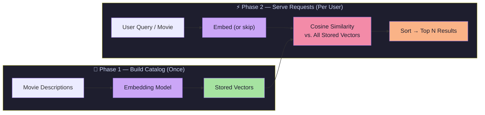

# Lecture 13 — Semantic Search & Movie Recommendation Project

> **Phase:** 4 · Embeddings · **Level:** 🟡 Intermediate
> **Source:** `FDE L08` — `Forward-Deployed-Engineer/Lecture 08/notes/01…07`

---

## Chapter Index

| # | Chapter | Core Question Answered |
|---|---------|----------------------|
| [01](./notes/01_embeddings_and_the_problem_of_meaning.md) | Embeddings & The Problem of Meaning | What are embeddings and why do we need them? |
| [02](./notes/02_why_embeddings_beat_llm_for_search.md) | Why Embeddings Beat LLM for Search | When is an embedding better than an LLM? |
| [03](./notes/03_precomputation_engineering_insight.md) | Precomputation — The Key Engineering Insight | How do we make the system efficient at scale? |
| [04](./notes/04_semantic_search_and_recommendation.md) | Semantic Search & Movie Recommendation | What features does this system provide? |
| [05](./notes/05_cosine_similarity_measuring_closeness.md) | Cosine Similarity — Measuring Closeness | How do we mathematically measure similarity? |
| [06](./notes/06_represent_store_compare_rank_mental_model.md) | Core Mental Model: REPRESENT → STORE → COMPARE → RANK | What is the universal pattern behind all embedding systems? |
| [07](./notes/07_complete_system_design.md) | Complete System Design & Production Considerations | How does everything fit together in production? |
| [**Complete**](./notes/Lecture_13_Complete_Notes.md) | **Complete Consolidated Notes** | All 7 chapters synthesized into one reference with cheat sheet, failure modes, and production guidance |

---

## The Big Idea in One Diagram



---

## Key Concepts Quick Reference

| Concept | One-Line Definition |
|---------|---------------------|
| **Embedding** | Text converted to a fixed-size numerical vector that encodes meaning |
| **Embedding Model** | A neural network that transforms text → vector (not a chatbot) |
| **Cosine Similarity** | Measures the angle between two vectors; ignores magnitude |
| **Precomputation** | Process stable data once; cache results for reuse |
| **Content-Based Filtering** | Recommend based on *what* a movie is about |
| **Collaborative Filtering** | Recommend based on *what other users* watched |
| **Semantic Search** | Find results by meaning, not keyword matching |
| **RAG** | Search with embeddings → provide results as context to LLM |

---

## The Four-Step Mental Model

```
REPRESENT → Convert meaning into numbers (text → vector)
STORE     → Save those vectors for reuse (precomputation)
COMPARE   → Measure closeness (cosine similarity)
RANK      → Sort by score, return top N results
```

This pattern applies to: movies, products, documents, code, support tickets, job listings, images — any domain where you need to find "the most semantically similar items."

---

## Notes Sources

- 📄 [`Forward-Deployed-Engineer/Lecture 08/notes/01...07`](../../../Forward-Deployed-Engineer/Lecture%2008/notes/) — Original chapter notes
- 🖼️ [`Excalidraw-Notes.svg`](../../../Forward-Deployed-Engineer/Lecture%2008/notes/Excalidraw-Notes.svg) — Handwritten visual notes
- 📄 [`Lecture_08_Complete_Notes.md`](../../../Forward-Deployed-Engineer/Lecture%2008/notes/Lecture_08_Complete_Notes.md) — Source consolidated notes