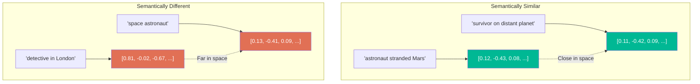
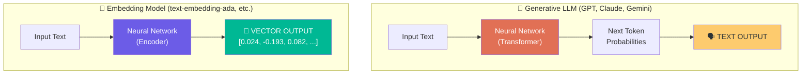
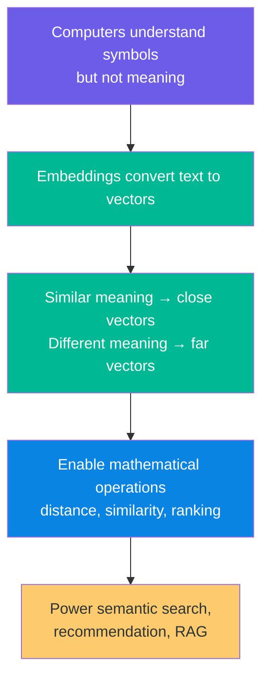

# Chapter 01: Embeddings and The Problem of Meaning

> **Goal:** Understand *why* computers cannot work directly with language meaning, how embeddings bridge the gap between human language and machine math, and what makes two pieces of text "similar" from a machine's perspective.

---

## 1.1 The Fundamental Challenge: Symbols vs Meaning

### The Computer's Limitation with Language

Computers excel at processing **symbols** (bytes, characters, tokens) but lack inherent **understanding of meaning**. This creates a fundamental gap:

| Human | Computer |
|-------|----------|
| Sees "astronaut on Mars" and knows it relates to survival in space | Sees characters 'a', 's', 'p', 'r', 'o', 'n', 'a', 'u', 't' |
| Instantly recognizes semantic similarity | Performs exact character matching |

### A Concrete Example

Consider these movie descriptions:

```
A: "An astronaut is stranded on Mars."
B: "A man must survive alone on another planet."
C: "A detective investigates a murder in London."
```

As a human, you recognize:
- **A ≈ B** (same underlying theme: survival on an alien world)
- **A is very different from C** (completely different genre)

But comparing literally:

| Word in A | Word in B | Match? |
|-----------|-----------|--------|
| astronaut | man | ❌ |
| stranded  | survive   | ❌ |
| Mars      | planet    | ❌ |

**Zero literal overlap** despite nearly identical meaning!

---

## 1.2 Why We Need Embeddings

### The Mathematical Requirement

Machine learning operates on **numbers**, not text:

```
❌ distance("An astronaut on Mars", "A man surviving on another planet")
✅ distance([0.12, -0.43, ...], [0.11, -0.42, ...])
```

With numerical representations, we can compute:

| Operation | Enables |
|-----------|---------|
| Subtraction / Distance | How far apart two things are |
| Dot Product | How aligned two vectors are |
| Cosine Similarity | Directional similarity |
| Sorting | Ranking by relevance |

### The Transformation Pipeline


---

## 1.3 What Exactly Is an Embedding?

An **embedding** is a fixed-size array of numbers that represents the semantic meaning of text:

```
Text: "An astronaut is stranded on Mars."
  ↓ Embedding Model
Vector: [0.014, -0.031, 0.087, 0.221, -0.045, ...] (e.g., 1536 dimensions)
```

**Key Properties:**
- Similar meanings → vectors close together
- Different meanings → vectors far apart
- Fixed dimension regardless of input text length



---

## 1.4 Embedding vs Generative LLM

These are fundamentally different tools:



| Property | Generative LLM | Embedding Model |
|----------|---------------|-----------------|
| **Goal** | Generate text | Represent meaning |
| **Output** | Tokens (text) | Vector (numbers) |
| **Usage** | Summarize, write, chat | Search, compare, rank |
| **Statelessness** | No — builds token by token | Yes — single forward pass |

### Can an Embedding Answer Questions?

Sending `"What is the capital of India?"` to an embedding model:

```
Input: "What is the capital of India?"
Output: [0.023, -0.193, 0.082, ...]
```

**Not "New Delhi"!** This is by design. The embedding model's job is to *represent* the question, not *answer* it.

---

## 1.5 The Universal Question: How Do We Measure Closeness?

Once we have vectors, we need to answer:

```
How close is vector A to vector B?
```

Common approaches:
- **Euclidean Distance**: Straight-line distance
- **Cosine Similarity**: Angle between vectors (ignores magnitude)
- **Dot Product**: Raw alignment measure

For text embeddings, **cosine similarity** is typically preferred because:
1. It ignores vector magnitude (length)
2. It focuses on semantic direction
3. It produces intuitive 0-1 scores for similar texts

---

## 1.6 Summary



---

## 1.7 Key Takeaway

> **The embedding model is not a chatbot — it is a machine that converts meaning into coordinates.**

Once meaning is represented as vectors, mathematical operations (cosine similarity, ranking) become the engine for semantic search, recommendation systems, and other embedding-powered applications.

**Next Chapter:** We'll explore why simply asking an LLM for recommendations fails at scale, and why embeddings are the right engineering solution.