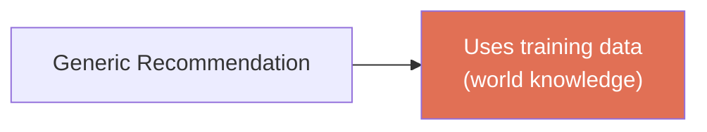
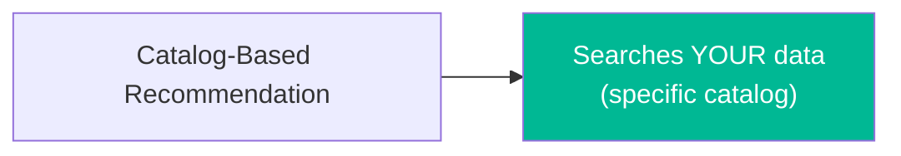
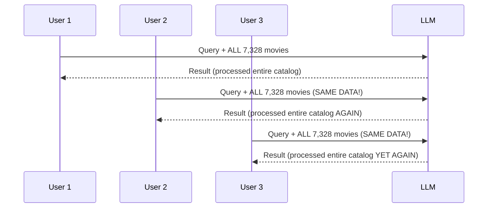
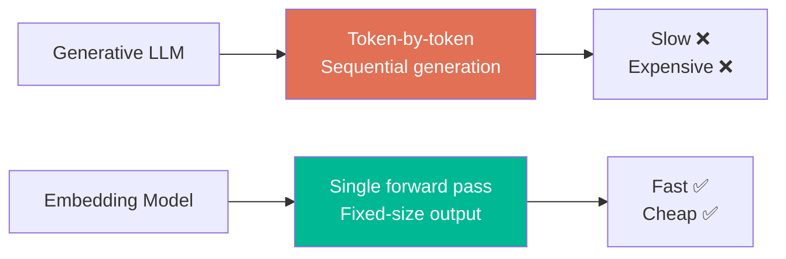
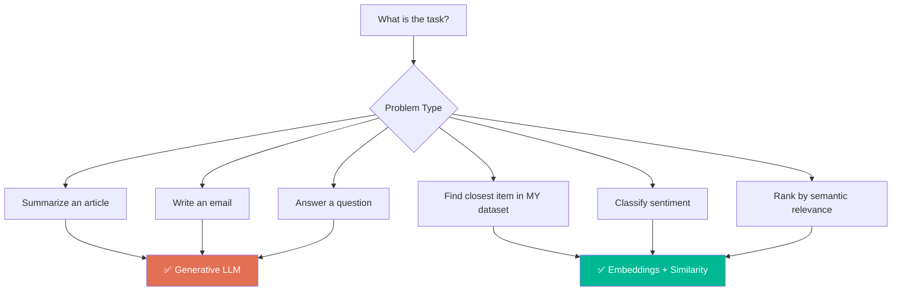
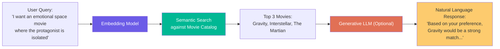

# Chapter 02: Why Not Just Use an LLM for Recommendations?

> **Goal:** Understand the critical engineering distinction between *knowledge/generation* (LLMs' strength) and *searching your own data* (embeddings' strength). Learn why naive LLM-based recommendation fails at scale and motivates the embedding-based approach.

---

## 2.1 The Two Types of Recommendation Problems

### Problem Type 1: Generic Recommendation (LLM Works Well)

```
User: "I loved Interstellar. Recommend three similar movies."

LLM: "Based on your love of Interstellar, here are three similar films:
      1. Arrival — cerebral sci-fi about first contact
      2. The Martian — survival on Mars
      3. Gravity — survival in space"
```

LLMs have general knowledge from training data → **knowledge/generation problem** → LLMs are the right tool.



### Problem Type 2: Your Specific Catalog (LLM Fails)

```
Your platform: CoderArmyFlix (7,328 movies)

Your catalog includes:
- New releases (added after LLM training cutoff)
- Regional films (not internationally known)
- Independent productions (not in major databases)
- Internal/exclusive content (platform only)
- Obscure titles (LLM doesn't know)

Requirement: "Recommend 3 movies ONLY from our catalog"
```

This is a **retrieval/search problem**, not generation. The LLM's training data cannot help here.



---

## 2.2 The Naive LLM Approach and Its Four Fatal Problems

### Naive Attempt: Stuff Everything Into the Prompt

```js
// Pseudo-code - DON'T DO THIS
async function naiveRecommendation(userQuery, allMovies) {
  const prompt = `
    Here are my ${allMovies.length} movies:
    ${allMovies.map(m => `${m.id}: "${m.title}" — ${m.description}`).join('\n')}
    
    The user likes: ${userQuery}
    Recommend three movies.
  `;
  
  return await llm.generate(prompt);  // ❌
}
```

This creates **four serious engineering problems**:

---

### Problem 1: Context Window Overflow

```
┌─────────────────────────────────────────────────────────────┐
│                    CONTEXT WINDOW LIMIT                     │
├─────────────────────────────────────────────────────────────┤
│  10 movies      → Manageable ✅                             │
│  10,000 movies  → Context Overflow ❌                       │
│  100,000 items  → Impossible ❌                             │
│  5 million docs → Impossible ❌                             │
└─────────────────────────────────────────────────────────────┘
```

Even with growing context windows (128k, 1M tokens), sending millions of items per request is never efficient.

---

### Problem 2: Repeated and Wasted Work



**With 1M users/day: 7.3 BILLION movie-processings per day!** The catalog barely changes — this is massively wasteful.

> **Engineering Principle:** If something expensive doesn't change often, calculate it once and reuse it.

---

### Problem 3: We Don't Need Generation — We Need Ranking

```
WHAT THE LLM PRODUCES (unnecessary):
"The Martian would be an excellent choice because its themes of 
scientific ingenuity and survival in an isolated, hostile environment 
closely mirror the existential perseverance depicted in Interstellar..."

WHAT WE ACTUALLY NEED:
Movie A → 0.87
Movie B → 0.81
Movie C → 0.42
```

We need **ranking** — not a paragraph. Once we have similarity scores, we sort and return top N.

---

### Problem 4: Cost and Latency



| Aspect | Generative LLM | Embedding + Search |
|--------|---------------|-------------------|
| Latency | Sequential (token-by-token) | Single forward pass |
| Cost | Per output token | Per embedding call |
| Output | Text (we don't need) | Vector (what we need) |
| Determinism | Non-deterministic | Deterministic |

---

## 2.3 The Right Question: Match Tool to Problem



---

## 2.4 Can We Combine Both? Yes — The RAG Pattern



**Each system does what it's BEST at:**
- **Embedding Model → SEARCH** (find relevant items)
- **LLM → GENERATION** (explain, narrate, respond naturally)

This **Search → Generate** pattern is the foundation of **Retrieval-Augmented Generation (RAG)**.

---

## 2.5 Summary Comparison

| Naive LLM Approach Problem | Embedding Solution |
|---------------------------|-------------------|
| Context window limits | Only embed the query (tiny) |
| Repeated processing of same data | Precompute vectors once |
| Generation not needed (just rank) | Pure mathematical comparison |
| High cost and latency | Fast vector math, no generation |

---

## 2.6 Key Takeaway

> **The decision is architectural: use the right tool for the right job.**
> 
> For finding closest meaning in YOUR OWN dataset → **Embeddings + Similarity** (not LLM generation)

**Next Chapter:** How precomputation makes this approach scalable and efficient.