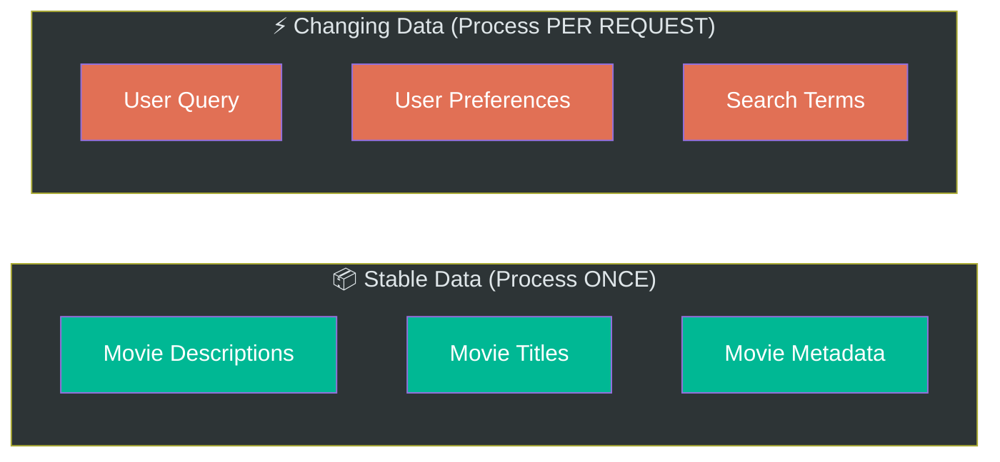
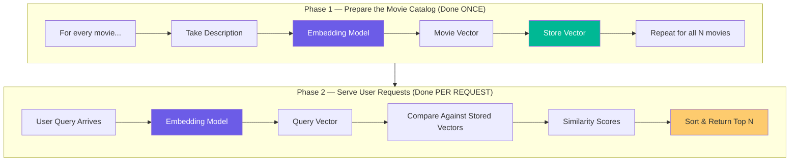
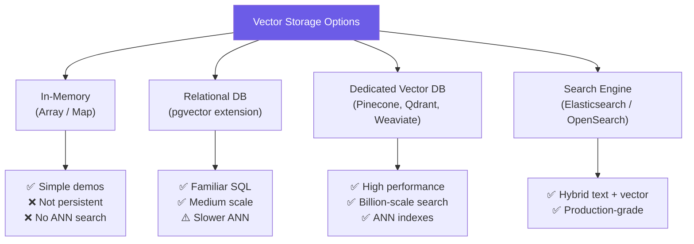
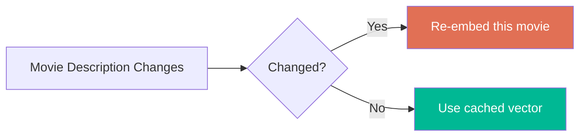
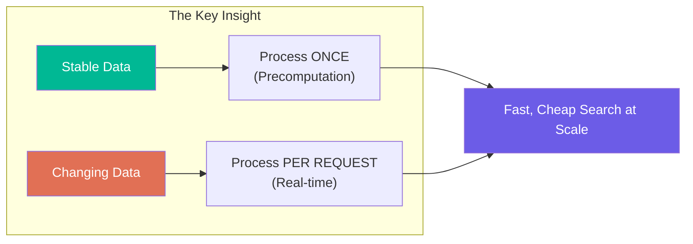

# Chapter 03: Precomputation — The Key Engineering Insight

> **Goal:** Understand the principle of precomputation — computing expensive operations once and reusing results — and how it transforms the architecture of an embedding-based recommendation system.

---

## 3.1 The First-Principles Question

Before writing any code, a good engineer asks:

```
"Which part of the system changes frequently?"
```

### Stable vs Changing Data in Our Movie System

| Data | Changes? | Frequency |
|------|----------|-----------|
| Movie descriptions | Rarely | Stable |
| Movie titles | Rarely | Stable |
| Movie metadata | Rarely | Stable |
| User queries | Constantly | Per user |
| User preferences | Often | Per session |
| Search terms | Constantly | Per request |



> **Core Engineering Principle:** If something expensive does not change often, calculate it **once** and **reuse** it.

---

## 3.2 Applying Precomputation to Embeddings

### Stable Data → Precompute (Offline)

```
Movie Description ("An astronaut is stranded on Mars.")
     ↓ Embedding Model (called ONCE per movie)
     [0.12, -0.43, 0.08, ...]
     ↓ Store for reuse
```

Tomorrow, if the description hasn't changed — use the **same vector**. No new API call needed.

### Changing Data → Process On Demand (Online)

```
User Query ("space survival movie")
     ↓ Embedding Model (called PER REQUEST)
     Query Vector [0.11, 0.41, ...]
     ↓ Compare against pre-saved movie vectors
```

---

## 3.3 The Two-Phase Architecture



---

## 3.4 What Precomputation Buys Us (Cost Math)

### Without Precomputation (Naive)

```
Per Request Cost:
  - 7,328 movie descriptions → LLM context
  - 1 user query → LLM
  - Sequential generation waiting

With 1,000,000 users/day:
  - 1,000,000 × (7,328 movies processed) = 7,328,000,000 operations
```

### With Precomputation (Smart)

```
Offline (done once):
  - 7,328 movies × 1 embedding each = 7,328 embedding calls (TOTAL, ever)

Per Request (real-time):
  - 1 embedding call (query only)
  - 7,328 vector comparisons (fast math, no AI)

With 1,000,000 users/day:
  - 1,000,000 × 1 embedding call = 1,000,000 calls
  - vs 7,328,000,000 without precomputation
```

```mermaid
bar
    title API Calls Per Day (1M users, 7,328 movies)
    "Without Precomputation" : 7328000000
    "With Precomputation" : 1000000
```

**Savings: thousands of times fewer API calls.**

---

## 3.5 Pseudo-Code: Precomputing the Movie Catalog (Offline)

```js
// Phase 1: Build the Movie Vector Catalog — run once (or when catalog updates)

interface Movie {
  id: string;
  title: string;
  description: string;
  vector?: number[];          // populated during precomputation
  metadata?: Record<string, any>;
}

const movieCatalog: Movie[] = [
  { id: "1", title: "Interstellar", description: "A team of astronauts travels through a wormhole..." },
  { id: "2", title: "The Martian",  description: "An astronaut becomes stranded on Mars..." },
  // ... 7,326 more movies
];

async function precomputeMovieVectors(movies: Movie[]): Promise<void> {
  for (const movie of movies) {
    // Embed description once — expensive call
    movie.vector = await embeddingModel.embed(movie.description);
    // Persist to storage (in-memory, database, or vector store)
    await vectorStore.save(movie.id, movie.vector, movie.metadata);
  }
}

// Call once at deployment time or when catalog changes
await precomputeMovieVectors(movieCatalog);
```

> **Key:** This runs once offline, not on every user request.

---

## 3.6 Pseudo-Code: Serving a Real-Time Query (Online)

```js
// Phase 2: Answer a user search query — runs per request

async function searchMovies(userQuery: string, topN: number = 5): Promise<Movie[]> {
  // Step 1: Embed the user's query — ONE API call only
  const queryVector = await embeddingModel.embed(userQuery);

  // Step 2: Load all precomputed movie vectors from storage
  const moviesWithVectors = await vectorStore.getAll();

  // Step 3: Compare query vector against all stored vectors
  const scored = moviesWithVectors.map(movie => ({
    movie,
    score: cosineSimilarity(queryVector, movie.vector)
  }));

  // Step 4: Sort by similarity (descending)
  scored.sort((a, b) => b.score - a.score);

  // Step 5: Return top N results
  return scored.slice(0, topN).map(s => s.movie);
}
```

**The key insight: no generative LLM involved in the response — only fast vector math.**

---

## 3.7 Where to Store Precomputed Vectors



| Storage | Best For | Trade-off |
|---------|----------|-----------|
| In-Memory | Demos, prototypes | No persistence |
| pgvector | Medium scale | Familiar SQL, slower ANN |
| Dedicated Vector DB | Production | ANN indexes, billion-scale |
| Search Engine | Hybrid search | More complex setup |

**For this lecture's project:** In-memory storage (`List<Movie>`) is sufficient.

---

## 3.8 When to Re-Compute Vectors

Precomputed vectors become stale when source data changes:

| Trigger | Action |
|---------|--------|
| Movie description updated | Re-embed that specific movie |
| New movie added | Embed the new movie |
| Embedding model version upgraded | Re-embed entire catalog |
| Batch of new movies added overnight | Run batch embedding job |



This is exactly like **caching**: invalidate when source data changes.

---

## 3.9 The Broader Principle: Compute Once, Query Many Times

| System | Precomputed | Why |
|--------|-------------|-----|
| Search engine | Inverted index | Index once, query fast |
| DNS | IP address cache | Resolve once, reuse |
| Database indexes | B-tree structures | Build once, query fast |
| CDN | Static assets cached globally | Serve once, deliver locally |
| **Embedding system** | Movie vectors | Embed once, compare fast |

---

## 3.10 Summary



| Concept | Takeaway |
|---------|----------|
| Stable vs changing | Process stable data once; process changing data live |
| Precompute movie vectors | Run once offline; reuse for all future queries |
| Per-request work | Only embed the user query |
| Storage | In-memory for demos; vector DB for production |
| Invalidation | Re-embed when descriptions change |

**Next Chapter:** How similarity between vectors is actually measured mathematically — cosine similarity.