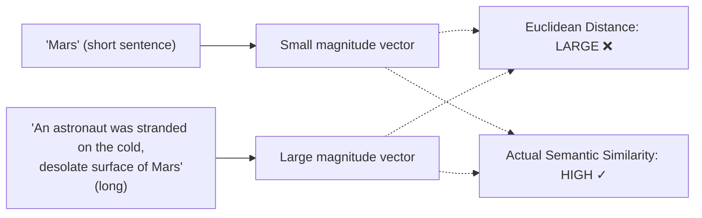
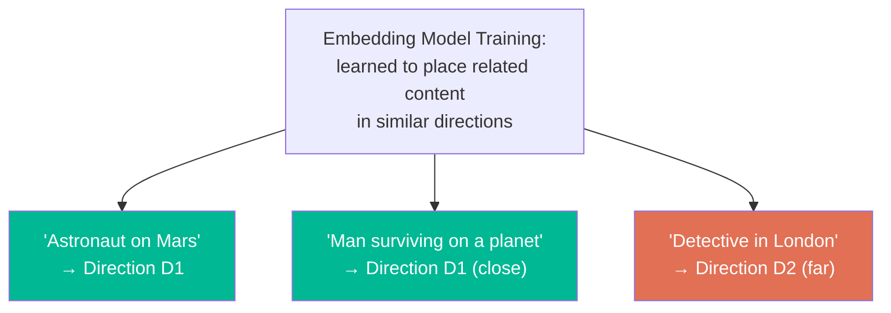
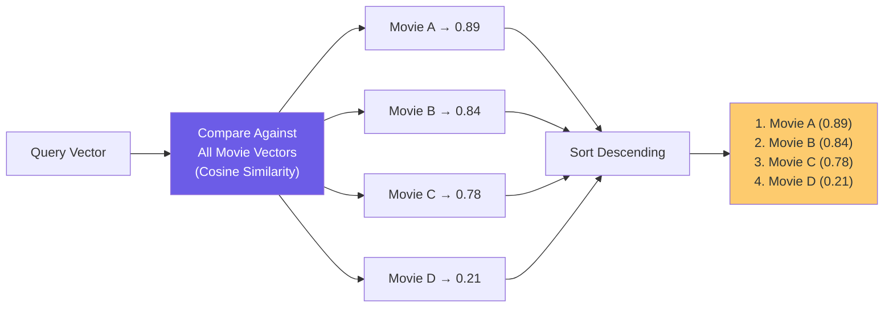

# Chapter 05: Cosine Similarity — How We Measure Closeness

> **Goal:** Understand how vector similarity is measured mathematically, why cosine similarity is preferred for text embeddings, and how it compares to Euclidean distance.

---

## 5.1 The Core Question

After converting movie descriptions and user queries into vectors, the key question:

```
"How close is THIS vector to EVERY OTHER vector?"
```

We need a **mathematical definition of closeness** between two high-dimensional vectors.

**Two main options:**
1. **Euclidean Distance** — straight-line distance between points
2. **Cosine Similarity** — angle between vectors (direction comparison)

---

## 5.2 Euclidean Distance and Its Limitations for Text

### The Formula

```
distance = √((x₂ − x₁)² + (y₂ − y₁)²)        // 2D
distance = √(Σ(vᵢ − uᵢ)²)                    // N-dimensions
```

### Why It's Not Ideal for Text Embeddings



The magnitude problem:
```
"Mars" → short, compact embedding
"An astronaut was stranded on Mars..." → longer embedding

Euclidean distance → LARGE (because magnitudes differ)
Actual semantic similarity → SHOULD BE HIGH
```

---

## 5.3 Cosine Similarity — Comparing Direction, Not Magnitude

### The Formula

```
cosine_similarity(A, B) = (A · B) / (|A| × |B|)
```

Where:
- `A · B` = dot product (sum of element-wise products)
- `|A|` = magnitude of vector A
- `|B|` = magnitude of vector B

### Score Interpretation

| Value | Interpretation |
|-------|----------------|
| `1.0` | Identical direction — perfectly similar |
| `0.5` | Moderately similar |
| `0.0` | Completely unrelated (90° apart) |
| `-1.0` | Opposite meaning (180° apart) |

---

## 5.4 Worked Example (Simplified — Text Embeddings Are High-Dimensional)

Suppose we have simplified 3D vectors (real embeddings are ~1536 dimensions):

```
The Martian    → [0.8, 0.6, 0.1]   (high space, high survival, low romance)
Interstellar   → [0.7, 0.5, 0.2]   (high space, moderate survival, low romance)
Titanic        → [0.1, 0.2, 0.9]   (low space, low survival, high romance)
```

### Computing Cosine Similarity:

**The Martian vs. Interstellar:**
```
dot product = (0.8 × 0.7) + (0.6 × 0.5) + (0.1 × 0.2) = 0.88
|A| = √(0.64 + 0.36 + 0.01) ≈ 1.005
|B| = √(0.49 + 0.25 + 0.04) ≈ 0.883

cosine_similarity = 0.88 / (1.005 × 0.883) ≈ 0.991 → Very similar ✅
```

**The Martian vs. Titanic:**
```
dot product = (0.8 × 0.1) + (0.6 × 0.2) + (0.1 × 0.9) = 0.29
|A| ≈ 1.005, |C| = √(0.01 + 0.04 + 0.81) ≈ 0.927

cosine_similarity = 0.29 / (1.005 × 0.927) ≈ 0.31 → Very different ✅
```

---

## 5.5 Pseudo-Code Implementation

```js
// Cosine similarity between two vectors
function cosineSimilarity(vectorA: number[], vectorB: number[]): number {
  // Step 1: Compute dot product
  const dotProduct = vectorA.reduce(
    (sum, value, index) => sum + value * vectorB[index],
    0
  );

  // Step 2: Compute magnitudes (L2 norm)
  const magnitudeA = Math.sqrt(vectorA.reduce((sum, val) => sum + val * val, 0));
  const magnitudeB = Math.sqrt(vectorB.reduce((sum, val) => sum + val * val, 0));

  // Step 3: Guard against zero vectors
  if (magnitudeA === 0 || magnitudeB === 0) {
    return 0;
  }

  // Step 4: Return cosine similarity
  return dotProduct / (magnitudeA * magnitudeB);
}
```

---

## 5.6 Euclidean vs Cosine: Which for Text?

```mermaid
flowchart TD
    A["Comparing Two Embeddings"] --> B{"What matters?"}
    B --> C["Vector magnitude?"}
    B --> D["Vector direction?"}
    C --> E["Use Euclidean Distance\n❌ Not recommended for text"]
    D --> F["Use Cosine Similarity\n✅ Recommended for text"]
    style E fill:#e17055,color:#fff
    style F fill:#00b894,color:#fff
```

| Metric | Considers Magnitude | Considers Direction | Good for Text? |
|--------|--------------------|--------------------|----------------|
| Euclidean Distance | Yes | Yes | ❌ Often not |
| Cosine Similarity | No (normalized) | Yes | ✅ Yes |
| Dot Product | Yes | Yes | Depends |

> **Rule of thumb:** For text embeddings, use **cosine similarity** unless you have a specific reason not to.

---

## 5.7 Similarity Score Interpretation Guide

| Score Range | Semantic Relationship |
|-------------|----------------------|
| 0.90 – 1.00 | Nearly identical meaning (paraphrases) |
| 0.75 – 0.90 | Very similar (e.g., "astronaut on Mars" vs "stranded in space") |
| 0.50 – 0.75 | Related topic (e.g., "space survival" vs "mountain survival") |
| 0.25 – 0.50 | Loosely related (e.g., "science fiction" vs "thriller") |
| 0.00 – 0.25 | Unrelated (e.g., "astronaut" vs "romantic comedy") |
| < 0.00 | Opposite/contradictory (rare for general text embeddings) |

> **Note:** Exact thresholds depend on the embedding model — always calibrate against your own data.

---

## 5.8 Why Cosine Similarity Works: The Training Magic

The reason cosine similarity works well for text embeddings comes from how they are trained — the model learns to place **semantically related content in similar directions**.



This **directional property** is exactly what cosine similarity measures.

---

## 5.9 Ranking Pipeline



**The movies with the highest similarity appear first.**

---

## 5.10 Pseudo-Code: Complete Ranking Function

```js
interface ScoredMovie {
  movie: Movie;
  score: number;
}

function rankMoviesBySimilarity(
  queryVector: number[],
  movies: Movie[]
): ScoredMovie[] {
  // Score every movie
  const scored: ScoredMovie[] = movies.map(movie => ({
    movie,
    score: cosineSimilarity(queryVector, movie.vector)
  }));

  // Sort by score descending (most similar first)
  scored.sort((a, b) => b.score - a.score);
  return scored;
}

function getTopN(queryVector: number[], movies: Movie[], topN = 5): Movie[] {
  const ranked = rankMoviesBySimilarity(queryVector, movies);
  return ranked.slice(0, topN).map(item => item.movie);
}
```

---

## 5.11 Summary

| Concept | Key Takeaway |
|---------|-------------|
| Euclidean distance | Straight-line; affected by vector magnitude |
| Cosine similarity | Angle-based; ignores magnitude; better for text |
| Output range | -1 to +1 (in practice ~0 to 1 for positive text embeddings) |
| Implementation | Dot product divided by product of magnitudes |
| Ranking | Sort by score descending; highest = most similar |

**Next Chapter:** The universal mental model — REPRESENT → STORE → COMPARE → RANK. This four-step framework applies to ALL embedding-powered systems.