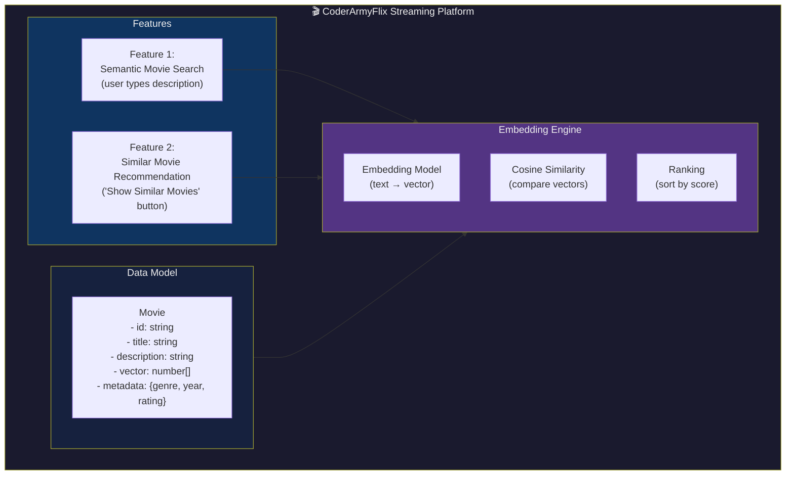
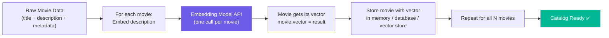
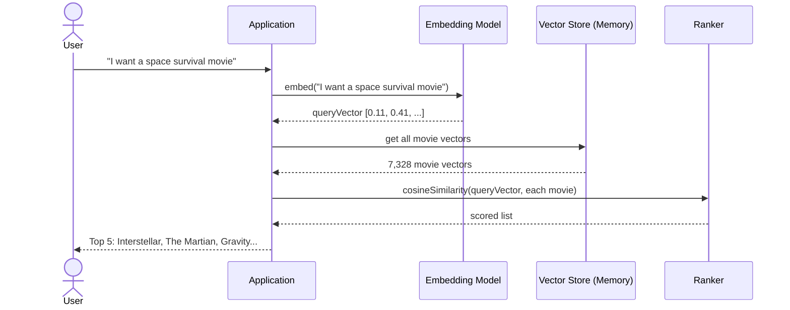
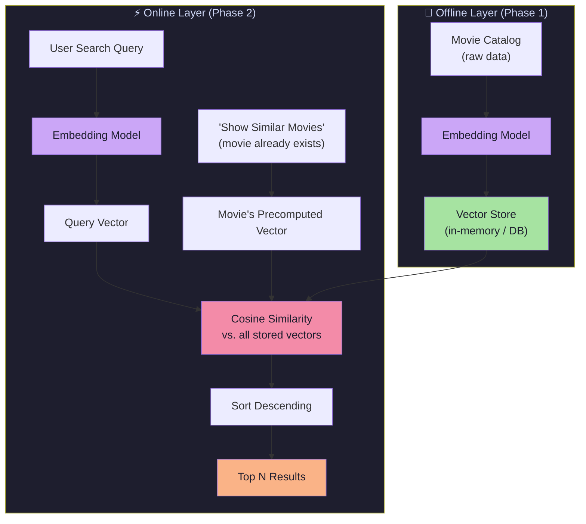
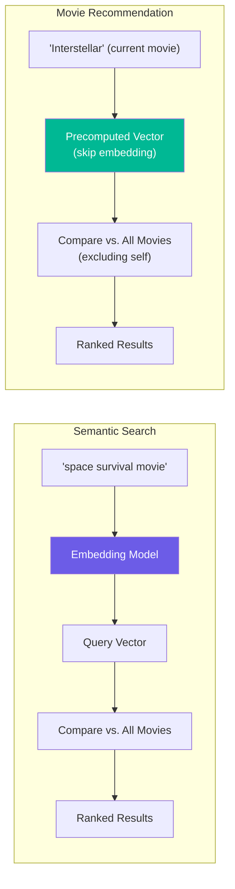
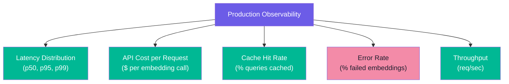
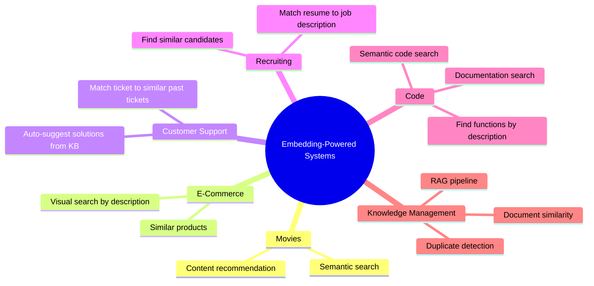
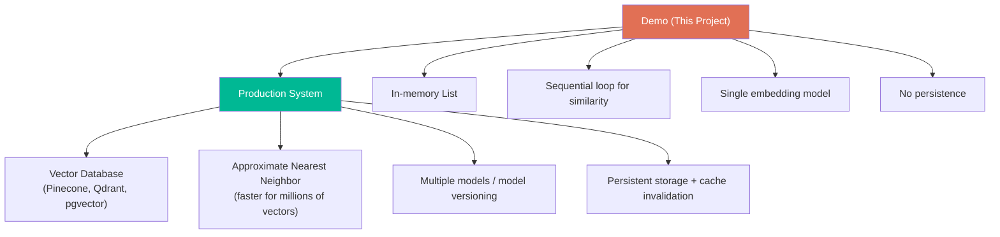
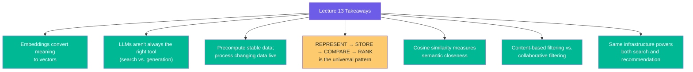

# Chapter 07: Complete System Design & Production Considerations

> **Goal:** Put all pieces together into a complete system design. Cover architecture, the data model, the two operational phases, production concerns (scaling, monitoring, failure modes), and where this pattern applies beyond movies.

---

## 7.1 What We Are Building — Full Picture

A movie recommendation engine for a streaming platform with two features:



---

## 7.2 The Complete Data Model

Each movie in the system has both **user-facing** and **internal** properties:

```ts
interface Movie {
  id: string;                  // Unique identifier
  title: string;               // Display name: "Interstellar"
  description: string;         // Plot summary: "A team of astronauts..."
  vector?: number[];           // Precomputed embedding (internal)
  metadata?: {                 // Optional metadata for filtering
    genres: string[];
    year: number;
    rating: number;
  };
}
```

### Example Data

| id | title | description (summary) | vector |
|----|-------|----------------------|--------|
| 1 | Interstellar | "A team of astronauts travels through a wormhole..." | [0.11, 0.42, ...] |
| 2 | The Martian | "An astronaut becomes stranded on Mars..." | [0.12, 0.39, ...] |
| 3 | Gravity | "Two astronauts work together to survive..." | [0.10, 0.45, ...] |
| 4 | Arrival | "A linguist works with the military..." | [0.08, 0.31, ...] |
| 5 | Titanic | "A seventeen-year-old aristocrat falls in love..." | [0.02, 0.11, ...] |

Notice: The first four cluster together (space/survival themes); Titanic does not.

---

## 7.3 Phase 1 — Build the Movie Catalog (Offline)

This runs **once** (or whenever the catalog changes):



### Key Points About the Offline Phase

| Aspect | Detail |
|--------|--------|
| **Cost driver** | N embedding API calls (one per movie) |
| **When to run** | At deployment, or whenever catalog updates |
| **How to run** | Batch job, not inline per request |
| **Batching** | Group requests for efficiency (e.g., 100 movies per API batch) |
| **Failure handling** | Retry individual failures; skip and retry later |
| **Result** | Every movie has a precomputed vector |

---

## 7.4 Phase 2 — Serving User Requests (Online)

Once the catalog is ready, every user request follows this flow:



**Cost per user request:**
- 1 embedding API call (for the query)
- N cosine similarity calculations (fast local math)
- 0 additional LLM calls

---

## 7.5 Architecture at a Glance



---

## 7.6 Search vs Recommendation: Side-by-Side



| Aspect | Semantic Search | Movie Recommendation |
|--------|-----------------|---------------------|
| Starting vector | Embed user query | Movie's precomputed vector |
| Embedding call per request | Yes (1 call) | No (vector already exists) |
| Exclude self? | N/A | Yes (don't recommend itself) |
| Output | Most relevant movies | Most similar movies |

---

## 7.7 Critical Production Considerations

### 7.7.1 Vector Normalization

Cosine similarity is mathematically equivalent to **dot product on normalized vectors**. Normalizing once (unit vectors) means we can use the cheaper dot-product comparison:

```js
// Normalize once during storage
function normalize(v: number[]): number[] {
  const magnitude = Math.sqrt(v.reduce((sum, val) => sum + val * val, 0));
  if (magnitude === 0) return v;
  return v.map(val => val / magnitude);
}

// Then dot product = cosine similarity (faster!)
const similarity = dotProduct(queryVector, movieVector);  // O(d) vs cosine's 3 passes
```

### 7.7.2 Linear Scan vs ANN Search

For small catalogs (< 100k vectors), a **linear scan** (brute-force comparison against all vectors) is acceptable. For millions of vectors, this becomes the bottleneck:

```
Linear scan cost: O(N × d) per query
  - N = number of items (e.g., 7,328 movies)
  - d = vector dimension (e.g., 1536)

For 1M vectors: O(1,000,000 × 1536) = 1.5 billion operations per query ❌
```

**Production solution: Approximate Nearest Neighbour (ANN) indexes** like HNSW or IVF (see Lecture 14-15).

### 7.7.3 Batching Embedding Requests

Instead of embedding one query at a time, batch requests for efficiency:

```js
// Pseudo-code: batched embedding for efficiency
async function embedQueries(queries: string[]): Promise<number[][]> {
  // Most embedding APIs support batch requests
  const batchSize = 100;  // API limit
  const batches = chunk(queries, batchSize);
  const results = await Promise.all(
    batches.map(b => embeddingAPI.embed(b))
  );
  return results.flat();
}
```

### 7.7.4 Caching Query Embeddings

Repeated or popular queries can be cached to avoid re-embedding:

```js
// Pseudo-code: LRU cache for query embeddings
const queryEmbeddingCache = new LRUCache({
  max: 10_000,           // cache up to 10k embeddings
  ttl: 3600_000          // expire after 1 hour
});

async function getQueryVector(query: string): Promise<number[]> {
  const cached = queryEmbeddingCache.get(query);
  if (cached) return cached;

  const vector = await embeddingModel.embed(query);
  queryEmbeddingCache.set(query, vector);
  return vector;
}
```

### 7.7.5 Filtering by Metadata

Content-based recommendations often need metadata filters:

```js
function recommendWithFilters(
  movie: Movie,
  filters?: { genre?: string; yearMin?: number; ratingMin?: number }
): ScoredMovie[] {
  const candidates = movieCatalog.filter(m => {
    if (m.id === movie.id) return false;
    if (filters?.genre && !m.metadata?.genres.includes(filters.genre)) return false;
    if (filters?.yearMin && (m.metadata?.year || 0) < filters.yearMin) return false;
    if (filters?.ratingMin && (m.metadata?.rating || 0) < filters.ratingMin) return false;
    return true;
  });

  return findRelatedMovies(movie.vector, candidates, { topN: 10 });
}
```

---

## 7.8 Quality Metrics & Monitoring

### 7.8.1 Result Quality Metrics

| Metric | Formula | Purpose |
|--------|---------|---------|
| **Mean Similarity Score** | avg of top-k scores | Detect degenerate results |
| **Score Distribution** | histogram of all scores | Find if scores cluster too tightly |
| **Coverage** | % of catalog ever recommended | Ensure diversity |
| **Intra-list similarity** | avg pairwise similarity between top-k results | Detect redundancy |

### 7.8.2 System Health Metrics



### 7.8.3 A/B Testing Embeddings

When upgrading embedding models, compare old vs new:

```js
// Pseudo-code: offline A/B test comparing model versions
const testPairs = [
  { query: "space survival movie", expected: ["The Martian", "Interstellar", "Gravity"] },
  // ... more test cases
];

for (const pair of testPairs) {
  const oldResults = searchWithModel(pair.query, oldModel);
  const newResults = searchWithModel(pair.query, newModel);
  // Compare relevance, latency, cost
}
```

---

## 7.9 Common Failure Modes

| Failure | Cause | Mitigation |
|---------|-------|------------|
| **Degenerate results** (all movies identical) | Vectors collapsed during normalization | Add variance checks; log score distributions |
| **Low diversity** (same genre repeated) | Embedding model biased toward popular themes | Add diversity re-ranking; penalize intra-list similarity |
| **Stale vectors** (wrong recommendations) | Catalog updated but vectors not re-embedded | Version vectors with model version; invalidate on data change |
| **Slow at scale** (latency spike) | Linear scan on millions of vectors | Use ANN index (HNSW); shard the vector store |
| **API failures** (no results) | Embedding API down | Fallback to keyword search; cache recent results |
| **Truncated text** (poor vectors) | Descriptions too long for embedding | Truncate/preserve key sentences before embedding |

---

## 7.10 Where This Pattern Applies

The same **REPRESENT → STORE → COMPARE → RANK** pattern is used across many domains:



### Universal Pattern

```
Whenever the problem is:
  "Find the items in my dataset whose meaning is closest to this input."

The architecture is:
  REPRESENT → STORE → COMPARE → RANK
```

---

## 7.11 Design Decisions Recap

| Decision | Choice | Reason |
|----------|--------|--------|
| Precompute or generate live? | Precompute | Movie descriptions rarely change; saves cost and time |
| Storage (demo) | In-memory array | Simple for demo; easily swapped for production DB |
| Storage (production) | Vector DB (Qdrant, Pinecone) | ANN search, persistence, scalability |
| Similarity metric | Cosine Similarity | Ignores magnitude; better for text embeddings |
| Recommendation type | Content-Based | No user behavior data required |
| LLM for recommendation? | Not required | Pure math (cosine + rank) is sufficient |
| LLM for explanation? | Optional layer | Better UX; but optional — search works without it |
| Vector normalization | Normalize once on store | Enables faster dot-product comparison |

---

## 7.12 Moving Toward Production



### Production Upgrades

| Component | Demo | Production |
|-----------|------|-----------|
| **Storage** | In-memory array | Vector DB with persistence |
| **Search** | Linear scan | ANN index (HNSW, IVF) |
| **Embedding** | Single API call per item | Batch processing + retries |
| **Caching** | None | LRU cache for query embeddings |
| **Monitoring** | Console logs | Metrics, traces, alerts |
| **Scaling** | Single instance | Horizontal with sharding |

---

## 7.13 Complete Flow (Both Features)

```
=== FEATURE 1: SEMANTIC SEARCH ===

User types: "space survival movie where protagonist is alone"
    ↓
Embed query → [0.11, 0.41, -0.07, ...]
    ↓
Compare against all 7,328 stored movie vectors (cosine similarity)
    ↓
Score every movie
    ↓
Sort by score descending
    ↓
Return top 5:
  1. The Martian       (0.91)
  2. Interstellar      (0.88)
  3. Gravity           (0.85)
  4. Life              (0.72)
  5. Apollo 13         (0.68)


=== FEATURE 2: SIMILAR MOVIE RECOMMENDATION ===

User is watching: Interstellar
User clicks: "Show Similar Movies"
    ↓
Use precomputed Interstellar vector → [0.11, 0.42, -0.09, ...]
    ↓
Compare against all OTHER movie vectors (exclude Interstellar itself)
    ↓
Sort by score descending
    ↓
Return top 5:
  1. The Martian       (0.94)
  2. Gravity           (0.91)
  3. Arrival           (0.87)
  4. Life              (0.74)
  5. Ad Astra          (0.71)
```

---

## 7.14 Summary — Lecture Takeaways



### What Comes Next

| Topic | Description |
|-------|-------------|
| **Vector Databases** | Pinecone, Qdrant — production-scale storage |
| **ANN Search Algorithms** | HNSW, IVF — fast approximate nearest neighbor |
| **RAG** | Search with embeddings → provide context to LLM |
| **Hybrid Search** | Combine keyword + semantic search |
| **Chunking Strategies** | For long documents beyond movie descriptions |

---

## 7.15 Final Mental Model

> **Do not think of the embedding model as a chatbot.**
>
> **Think of it as a machine that converts meaning into coordinates.**
>
> **Once you have coordinates, mathematics answers the questions:**
> - Which movies are close to Interstellar?
> - Which documents are closest to this question?
> - Which products are semantically related?
>
> **REPRESENT → STORE → COMPARE → RANK**