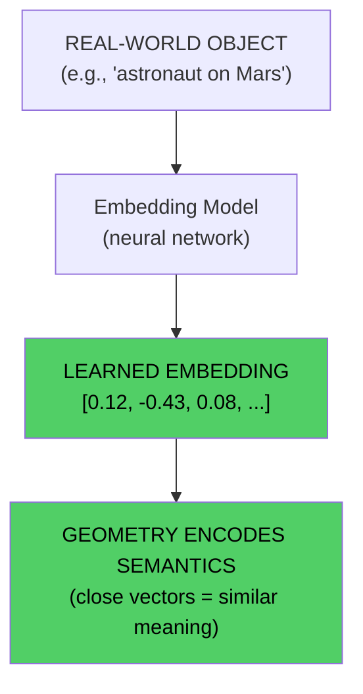
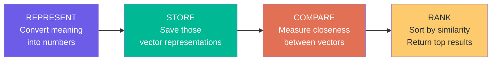
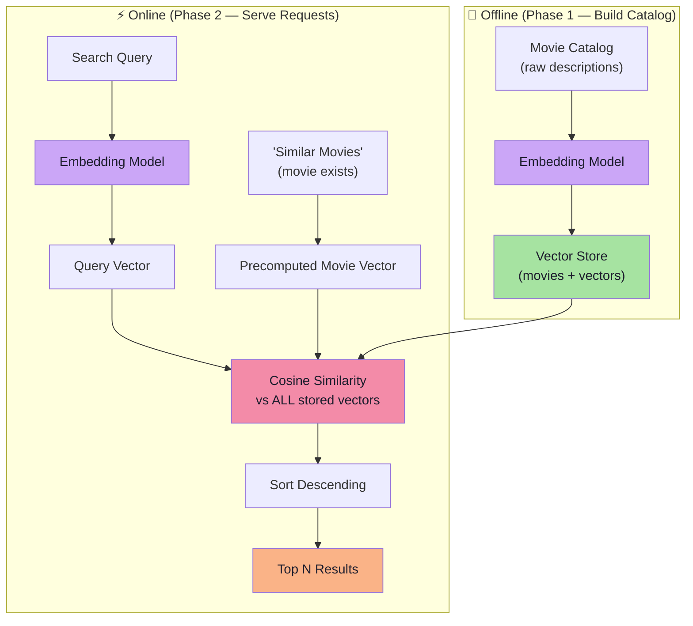
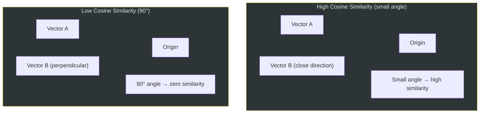
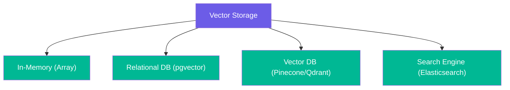
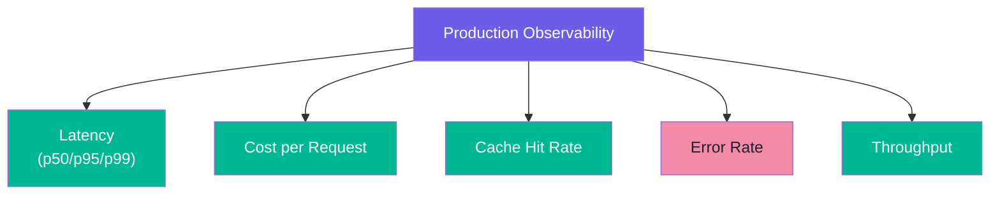
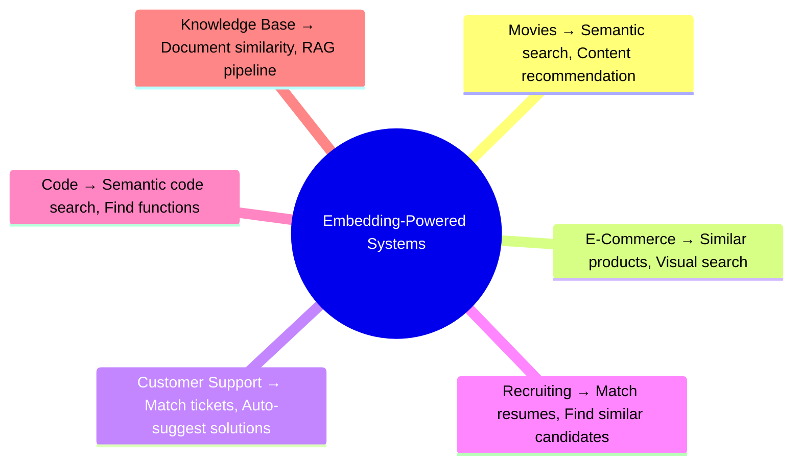
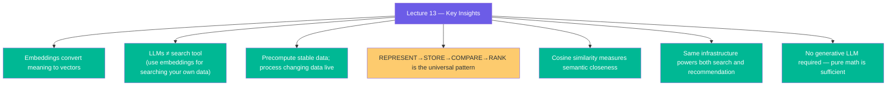

# Lecture 13: Embeddings Project (Semantic Search & Movie Recommendation) — Complete Notes

> **Phase:** 4 · Embeddings · **Level:** 🟡 Intermediate
> **Source:** `FDE L08` — `Forward-Deployed-Engineer/Lecture 08/notes/01…07`

---

## Overview

**Lecture Goal:** Turn embedding theory into a working retrieval product. Understand why embeddings (not LLM generation) are the right tool for searching your own data, how precomputation makes the system scalable, and how cosine similarity enables semantic search and content-based recommendation.

This 7-chapter journey covers:

| Ch | Topic | What You'll Learn |
|----|-------|------------------|
| 1 | Embeddings & the Problem of Meaning | Why meaning ≠ symbols; how embeddings bridge the gap |
| 2 | Why Not Just Use an LLM? | The 4 failure modes of naive LLM-based search |
| 3 | Precomputation | How precomputing stable data makes systems scalable |
| 4 | Semantic Search & Recommendation | Two features, one shared infrastructure |
| 5 | Cosine Similarity | The math behind measuring closeness |
| 6 | The Mental Model | REPRESENT → STORE → COMPARE → RANK (universal pattern) |
| 7 | Complete System Design | Architecture, production considerations, failure modes |

**For detailed explanations of any section, see the relevant chapter file in `notes/`.**

---

## The Core Insight

> **An embedding is a transformation of text into a vector of numbers such that semantically similar inputs produce vectors that are close together in mathematical space.**

```
Human Language
    ↓  Embedding Model
Vector Space (numbers, coordinates)
    ↓  Mathematics
Distance, Cosine Similarity, Ranking
    ↓  Result
Relevant Items
```



**The embedding model is NOT a chatbot — it is a machine that converts meaning into coordinates.**

Once meaning has coordinates, mathematics answers questions like:
- Which movies are semantically close to "Interstellar"?
- Which documents are closest to my query?
- Which products are semantically related?

---

## The Four-Step Mental Model (Universal Pattern)



| Step | What Happens | When It Runs |
|------|--------------|--------------|
| **REPRESENT** | Text → Embedding Model → Vector | Offline (catalog), Online (queries) |
| **STORE** | Save vectors for reuse | Offline (build catalog) |
| **COMPARE** | Cosine similarity between vectors | Online (per request) |
| **RANK** | Sort by score, return top N | Online (per request) |

> **This pattern applies to: movies, products, documents, code, support tickets, job listings, knowledge bases — any domain where you need to find semantically similar items.** Details in Chapter 06.

---

## Architecture Summary



### Two-Phase Design

| Phase | Runs When | Cost |
|-------|-----------|------|
| **Offline** | Catalog updated / deployment | N embeddings (once) |
| **Online** | Per user request | 1 embedding (query) + N comparisons (fast math) |

**Precomputation saves thousands of times the API calls** — movie descriptions are embedded once; only user queries are embedded per request. See Chapter 03 for the cost math.

---

## The Two Core Features

### Feature 1: Semantic Movie Search

```
User: "I want something about survival on a distant planet"
    ↓ Embed query
    [0.11, -0.42, 0.09, ...]
    ↓ Compare ALL movie vectors (cosine similarity)
    ↓ Sort descending
Results: The Martian, Interstellar, Gravity, ...
```

**Solves keyword matching limitation:** "person trying to survive on Mars" matches "astronaut stranded on Mars" even with zero word overlap.

### Feature 2: Similar Movie Recommendation

```
User watching: Interstellar (vector already exists)
    ↓ Retrieve precomputed vector
    [0.11, 0.42, -0.09, ...]
    ↓ Compare ALL other movie vectors
    ↓ Sort descending (exclude self)
Results: The Martian, Gravity, Arrival, ...
```

**Key insight:** No embedding call needed — the movie already has a vector.

Both features share the **same infrastructure** (similarity function + vector store). See Chapter 04.

---

## Cosine Similarity

The mathematical measure of closeness between two vectors:

```
cosine_similarity(A, B) = (A · B) / (|A| × |B|)
```

- **Range:** -1 (opposite) to +1 (identical). For text embeddings, typically 0 to 1.
- **Why preferred for text:** Ignores vector magnitude; focuses on direction.
- **Implementation:** Dot product divided by product of magnitudes.



| Score Range | Meaning |
|-------------|---------|
| 0.90–1.00 | Nearly identical |
| 0.75–0.90 | Very similar |
| 0.50–0.75 | Related topic |
| 0.25–0.50 | Loosely related |
| <0.25 | Unrelated |

See Chapter 05 for worked examples and pseudo-code.

---

## Content-Based vs Collaborative Filtering

| Aspect | Content-Based (Ours) | Collaborative Filtering |
|--------|---------------------|------------------------|
| **Data source** | Movie description/content | User behavior history |
| **Cold start (new movies)** | Handles well ✅ | Struggles ❌ |
| **Requires user data** | No | Yes |
| **Explainability** | High (based on content) | Lower |
| **Privacy** | No user data needed | Requires tracking |

> **Production note:** Real systems (Netflix, Spotify) combine both approaches plus many other signals. Our demo intentionally isolates the content-based embedding approach for clarity. See Chapter 04.

---

## Production Engineering Considerations

### Storage Options



| Storage | Best For | Key Trade-off |
|---------|----------|---------------|
| In-Memory | Demos, prototypes | No persistence |
| pgvector | Medium scale | Familiar SQL, slower ANN |
| Vector DB | Production | ANN indexes, billion-scale |
| Search Engine | Hybrid search | More complex setup |

### Critical Optimizations

1. **Vector normalization** — Normalize to unit vectors on store; then dot product = cosine similarity (faster).
2. **ANN search** — For millions of vectors, use HNSW/IVF indexes instead of linear scan (`O(N×d)` per query).
3. **Batching** — Batch embedding requests (e.g., 100 per call).
4. **Query caching** — LRU cache repeated queries to avoid re-embedding.

### Quality & Monitoring



**Quality metrics:** Mean similarity score, score distribution, coverage %, intra-list similarity.

### Common Failure Modes

| Failure | Mitigation |
|---------|-----------|
| Degenerate results (identical vectors) | Variance checks; log score distributions |
| Low diversity in results | Add diversity re-ranking |
| Stale vectors after data updates | Version vectors with model version |
| Linear scan too slow at scale | Switch to ANN index |
| API failures | Fallback to keyword search |
| Poor vectors from truncated text | Truncate/preserve key sentences |

See Chapter 07 for full details.

---

## Where This Pattern Applies



**Universal rule:**
> Whenever the problem is *"find the items in my dataset whose meaning is closest to this input"*, the architecture is:
> **REPRESENT → STORE → COMPARE → RANK**

---

## What Comes Next

| Topic | Next Lecture |
|-------|-------------|
| **Vector Databases & ANN** | Lecture 14-15 (HNSW, IVF, Qdrant, Pinecone, pgvector) |
| **RAG** | Lecture 16 (Retrieval-Augmented Generation) |
| **Hybrid Search** | Lecture 17 (keyword + semantic fusion) |
| **Multi-modal Embeddings** | Lecture 24 (embedding images, code, beyond text) |

---

## Key Takeaways



1. **Meaning ≠ symbols.** Embeddings convert text into fixed-size vectors where semantic similarity becomes geometric proximity.
2. **Tool ≠ task.** For *finding closest meaning in your own data*, embeddings beat generative LLMs on cost, latency, and determinism.
3. **Precompute is the lever.** Embedding stable data (catalog) once and only embedding changing data (queries) per request saves orders of magnitude in cost.
4. **Four steps win.** REPRESENT → STORE → COMPARE → RANK is the universal skeleton of every embedding-powered system.
5. **Cosine wins for text.** It ignores vector magnitude and measures direction — what semantics live in.
6. **One infrastructure, two features.** The same vector store and similarity function serve both semantic search and content-based recommendation.

---

## Chapter Reference

For deep dives on each topic, read the individual chapter notes:

| Chapter | File | Core Question |
|---------|------|---------------|
| 01 | `01_embeddings_and_the_problem_of_meaning.md` | Why do we need embeddings? |
| 02 | `02_why_embeddings_beat_llm_for_search.md` | When is an embedding better than an LLM? |
| 03 | `03_precomputation_engineering_insight.md` | How do we make the system efficient at scale? |
| 04 | `04_semantic_search_and_recommendation.md` | What features does this system provide? |
| 05 | `05_cosine_similarity_measuring_closeness.md` | How do we measure similarity mathematically? |
| 06 | `06_represent_store_compare_rank_mental_model.md` | What is the universal pattern? |
| 07 | `07_complete_system_design.md` | How does everything fit together in production? |