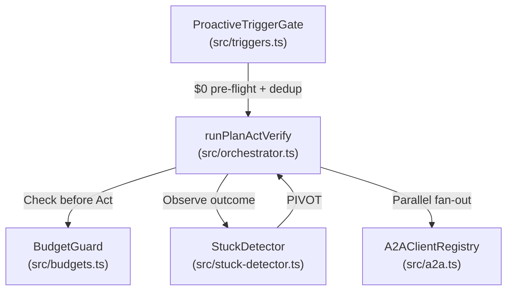

# Chapter 00: Overview, Architecture & File Structure

> **Chapter goal:** understand *what* this codebase is, how a bounded `Plan-Act-Verify` + `A2A` request flows through it, and which file maps to which notes chapter before reading the code.

---

## 0.1 What this codebase is

This is the **minimum working TypeScript engine** that proves the Lecture 14 notes:
- Every module has one clear responsibility (budgets, stuck detection, proactive triggers, A2A delegation, orchestrator).
- All external LLM/network calls are cleanly abstracted behind typed interfaces so the entire release-gate suite runs deterministically offline in `< 1 second`.

| File | Responsibility | Notes Chapter |
| :--- | :--- | :---: |
| `package.json` & `tsconfig.json` | ESM + strict TypeScript setup (`tsx`, `@types/node`) | — |
| `src/types.ts` | Shared contracts for PAV steps, budgets, stuck decisions, and A2A tasks | 01–07 |
| `src/budgets.ts` | 4-dimensional budget guard (`maxSteps`, `maxTokens`, `maxCostUsd`, `maxDurationMs`) + tool permission tiers | 02 |
| `src/stuck-detector.ts` | Exact-repeat, oscillation, and zero-progress heuristics; Retry / Pivot / Escalate state machine | 04 |
| `src/triggers.ts` | Proactive trigger gate (`$0` pre-flight filter, idempotency keys, cooldowns) | 03 |
| `src/a2a.ts` | A2A Agent Card registry, capability discovery, `Promise.allSettled` fan-out & veto synthesis | 06–07 |
| `src/orchestrator.ts` | Bounded `Plan-Act-Verify` loop wiring budgets, permissions, stuck detection, and A2A | 01, 05 |
| `src/index.ts` | Runnable end-to-end demo | 01–07 |
| `src/release-gate.test.ts` | 5 automated release-gate assertions (`node:test`) | All |

---

## 0.2 Architecture



---

## 0.3 Commands

```bash
cd "Lecture 14 - Loop Engineering and A2A Protocol/code/Basic Code"
npm install
npm run typecheck
npm start
npm test
```

