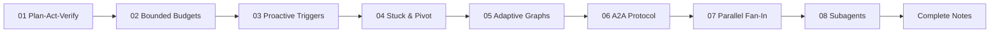

# Lecture 14 — Chapter Index

**Advanced Loop Engineering, Adaptive Topologies & A2A Protocol**
Phase 3 · Agency, Graphs & Loop Engineering · 🟠 Advanced · **8 chapters**

> Source of truth for topics, goal, build task and gate: **[../roadmap-v1.md](../roadmap-v1.md)** → *"Lecture 14"*.
> Source mapping: `FDE S05 & S06`.

---

## 📚 Chapters

| # | Chapter | One-line summary | File |
| :---: | :--- | :--- | :--- |
| 01 | **Beyond ReAct: Plan-Act-Verify Loops** | Raw ReAct failure modes (goal drift, premature victory), Plan-Act-Verify separation of concerns, deterministic-first verification | [01_Beyond_ReAct_Plan_Act_Verify_Loops.md](./notes/01_Beyond_ReAct_Plan_Act_Verify_Loops.md) |
| 02 | **Bounded Goal Loops & Budget Enforcement** | 4D loop budgets (`maxSteps`, `maxTokens`, `maxCostUsd`, `maxDurationMs`), tool permission boundaries, graceful degradation | [02_Bounded_Goal_Loops_and_Budget_Enforcement.md](./notes/02_Bounded_Goal_Loops_and_Budget_Enforcement.md) |
| 03 | **Proactive Triggers: Heartbeat, Cron & Events** | Heartbeat, cron schedules, event-driven webhooks, `$0` deterministic pre-flight filters, idempotency & cooldowns | [03_Proactive_Triggers_Heartbeat_Cron_and_Events.md](./notes/03_Proactive_Triggers_Heartbeat_Cron_and_Events.md) |
| 04 | **Stuck Detection, Retry, Pivot & Escalation** | Exact-repeat, oscillation, and zero-progress heuristics; transient Retry vs. structural Pivot; structured human escalation packets | [04_Stuck_Detection_Retry_Pivot_and_Escalation.md](./notes/04_Stuck_Detection_Retry_Pivot_and_Escalation.md) |
| 05 | **Static vs. Adaptive Agent Graph Topologies** | Compile-time DAGs vs. runtime fan-out/fan-in, Supervisor/Hierarchical/P2P topologies, `maxFanOut` & `maxDepth` caps | [05_Static_vs_Adaptive_Agent_Graph_Topologies.md](./notes/05_Static_vs_Adaptive_Agent_Graph_Topologies.md) |
| 06 | **The A2A (Agent-to-Agent) Protocol** | MCP vs. A2A, Agent Cards (`/.well-known/agent.json`), capability discovery, stateful task lifecycle, opaque peer execution | [06_The_A2A_Agent_to_Agent_Protocol.md](./notes/06_The_A2A_Agent_to_Agent_Protocol.md) |
| 07 | **Parallel Delegation & Fan-In Synthesis** | `Promise.allSettled` fan-out, per-branch timeouts, `required` vs. `best_effort`, veto precedence reconciliation, cost roll-up | [07_Parallel_Delegation_and_Fan_In_Synthesis.md](./notes/07_Parallel_Delegation_and_Fan_In_Synthesis.md) |
| 08 | **Subagent Architectures: Context Isolation & Delegation** | Context quarantine, **LangChain DeepAgents**, **Claude Code** `.claude/agents/*.md`, **Antigravity SDK** (`inherit`/`share`/`branch`, reactive wakeup), Subagents vs. A2A | [08_Subagent_Architectures_Context_Isolation_and_Delegation.md](./notes/08_Subagent_Architectures_Context_Isolation_and_Delegation.md) |

---

## 📄 Complete notes

A single consolidated document with the executive summary, architecture diagram, cheat sheet, and self-check questions:

👉 **[Lecture_14_Complete_Notes.md](./notes/Lecture_14_Complete_Notes.md)**

---

## 🔗 Related

- **[./code/Basic Code](./code/Basic%20Code)** — runnable TypeScript Plan-Act-Verify + Stuck Detection + A2A demo, release-gate tests, and chapter-wise `implementations guide/`
- **[./Assignment/task.md](./Assignment/task.md)** — hands-on assignment & release gate checklist
- **[./README.md](./README.md)** — lecture objectives, phase, level, source mapping and checklist
- **[../roadmap-v1.md](../roadmap-v1.md)** — complete topic list, goal, build task and completion gate

---

## 🧭 Reading order

