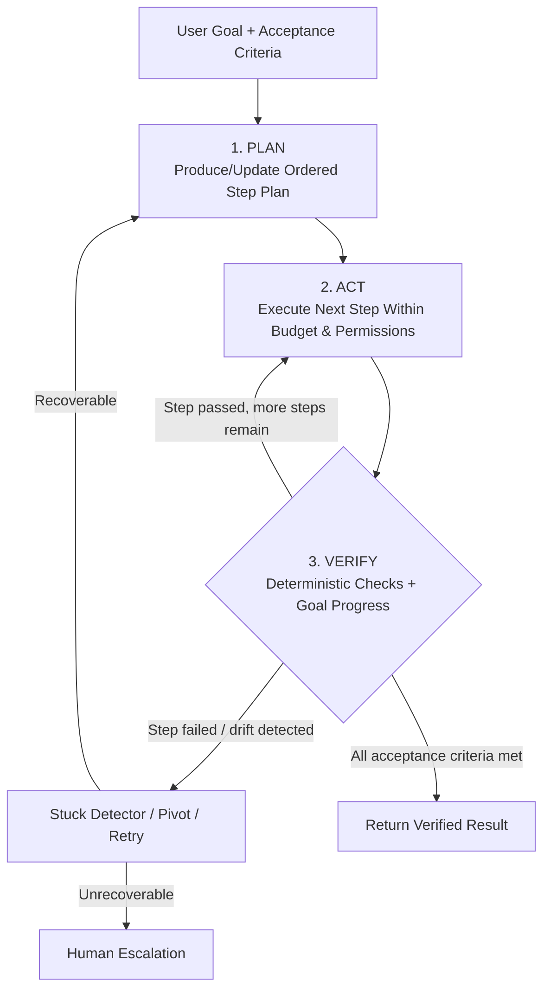

# Chapter 01 — Beyond ReAct: Plan-Act-Verify Loops

> **Lecture 14 · Chapter 01 of 07** · Level: 🟠 Advanced · Phase 3 — Agency, Graphs & Loop Engineering
> **Source:** `FDE S05` · **Roadmap Reference:** [`roadmap-v1.md`](../../roadmap-v1.md#lecture-14--advanced-loop-engineering-adaptive-topologies--a2a-protocol)
> **Cross-reference:** Extends the basic ReAct loop from [Lecture 09](../../Lecture%2009%20-%20Tool%20Calling/) and [Lecture 13](../../Lecture%2013%20-%20LangChain%20LangGraph%20LangSmith/).
> **Roadmap topics:** Raw ReAct failure modes · Plan-Act-Verify separation of concerns · explicit plan artifacts · deterministic vs. semantic verification · goal drift prevention.

---

## 01.0 What this chapter is for

In [Lecture 09](../../Lecture%2009%20-%20Tool%20Calling/) you built a **ReAct** loop (`Reason → Act → Observe → Repeat`). ReAct is great for 2–3 step lookups, but in long-running production workflows (10–30 steps), raw ReAct suffers from **goal drift**, **premature termination**, and **unverified side effects**.

**Plan-Act-Verify (PAV)** fixes this by breaking every iteration into three explicit, auditable phases with separate responsibilities.

By the end of this chapter you should be able to:

1. Diagnose the three failure modes of raw ReAct in multi-step production workflows.
2. Architect a **Plan-Act-Verify** loop with typed state transitions.
3. Distinguish **action verification** (did the tool succeed?) from **goal verification** (is the user's requirement actually satisfied?).
4. Decide when raw ReAct is sufficient vs. when PAV is mandatory.

---

## 01.1 Why raw ReAct breaks at scale

In raw ReAct, the model improvises its next tool call from the entire conversation history on every turn:

| Failure Mode | What Happens in Raw ReAct | Why It Happens |
| :--- | :--- | :--- |
| **Goal Drift** | After 8 tool errors or noisy web results, the agent forgets the original objective and chases a tangent. | No explicit, immutable **Plan** artifact anchors the loop. |
| **Premature Victory** | The agent sees `200 OK` from one API and tells the user *"Done!"*, skipping 3 remaining steps. | No dedicated **Verify** phase checks the post-condition against the acceptance criteria. |
| **Action-Verification Blindness** | The model assumes an edit or DB write worked without reading back the state. | Observation is treated as passive text rather than an assertion gate. |

---

## 01.2 The Plan-Act-Verify (PAV) architecture

### Responsibilities of each phase

1. **PLAN (`PlanNode`):**
   - Outputs a structured list of atomic steps (`Step[]`), each with an `id`, `toolOrAction`, and `expectedPostCondition`.
   - Only re-runs when the initial plan is created or when **Verify / Stuck Detection** triggers a **pivot**.
2. **ACT (`ActNode`):**
   - Executes **one** step (or a bounded parallel batch) using typed tool contracts, enforcing **token/step budgets** and **permission boundaries** (Chapter 02).
3. **VERIFY (`VerifyNode`):**
   - Checks two things independently:
     - **Step Post-Condition (Deterministic):** Did the tool return valid schema, non-empty data, and expected status?
     - **Goal Progress (Semantic / Gate):** Are all acceptance criteria satisfied, or are we spinning in place?

---

## 01.3 Verification hierarchy: Deterministic first, semantic second

Never spend LLM tokens to verify something a `zod` schema, HTTP status code, or unit test can check in `< 1 ms`:

| Check Layer | Examples | Cost | Latency |
| :--- | :--- | :---: | :---: |
| **1. Schema & Exit Code** | `JSON.parse`, Zod validation, `exitCode === 0`, HTTP `2xx` | `$0` | `< 1 ms` |
| **2. State Read-Back** | Query DB/file after write to confirm mutation persisted | `$0` | `5–50 ms` |
| **3. Semantic / Judge** | LLM checks whether final summary actually answers all parts of the user goal | `$$` | `400–1500 ms` |

---

## 01.4 Raw ReAct vs. Plan-Act-Verify

| Dimension | Raw ReAct | Plan-Act-Verify (PAV) |
| :--- | :--- | :--- |
| **Planning** | Implicit inside free-text `Thought:` | Explicit structured `Plan` state |
| **Mid-flight pivoting** | Ad-hoc; often repeats the same broken call | Triggered explicitly when `Verify` fails |
| **Observability** | Flat message list | Clear step-by-step progress (`pending` / `passed` / `failed`) |
| **Best for** | 1–4 step Q&A, quick tool lookups | 5–30 step workflows, code generation, multi-system ops |

---

## 01.5 Key takeaways

1. **Separate planning, execution, and verification** so noisy tool outputs cannot hijack the agent's objective.
2. **Verify post-conditions deterministically first** before invoking an LLM verifier.
3. **Re-plan only on failure or pivot** — keeping the active plan stable preserves prompt prefix caching and prevents drift.

---

**Next:** [Chapter 02 — Bounded Goal Loops & Budget Enforcement](./02_Bounded_Goal_Loops_and_Budget_Enforcement.md)

