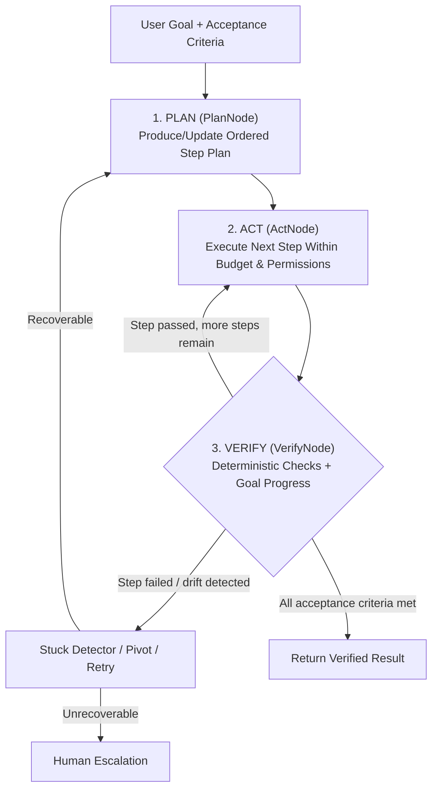
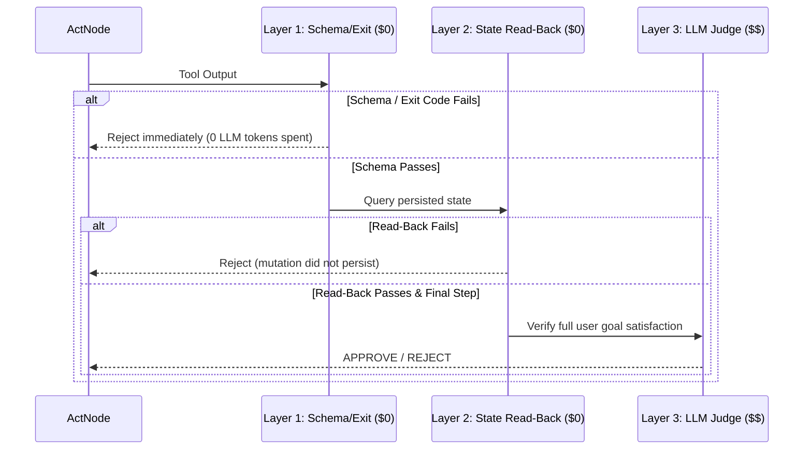

# Chapter 01 — Beyond ReAct: Plan-Act-Verify Loops

> **Lecture 14 · Chapter 01 of 07** · Level: 🟠 Advanced · Phase 3 — Agency, Graphs & Loop Engineering
> **Source:** `FDE S05` · **Roadmap Reference:** [`roadmap-v1.md`](../../roadmap-v1.md#lecture-14--advanced-loop-engineering-adaptive-topologies--a2a-protocol)
> **Cross-reference:** Extends the basic ReAct loop from [Lecture 09](../../Lecture%2009%20-%20Tool%20Calling/) and [Lecture 13](../../Lecture%2013%20-%20LangChain%20LangGraph%20LangSmith/).
> **Roadmap topics:** Raw ReAct failure modes · Plan-Act-Verify separation of concerns · explicit plan artifacts · deterministic vs. semantic verification · goal drift prevention.

---

## 01.0 What this chapter is for

In [Lecture 09](../../Lecture%2009%20-%20Tool%20Calling/) you built a **ReAct** loop (`Reason → Act → Observe → Repeat`). ReAct is great for 2–3 step lookups, but in long-running production workflows (10–30 steps), raw ReAct suffers from **goal drift**, **premature termination**, and **unverified side effects**.

**Plan-Act-Verify (PAV)** fixes this by breaking every iteration into three explicit, auditable phases with separate responsibilities — turning an improvised chat loop into a stateful engineering state machine.

By the end of this chapter you should be able to:

1. Diagnose the three failure modes of raw ReAct in multi-step production workflows.
2. Architect a **Plan-Act-Verify** loop with typed state transitions and an explicit `Plan` artifact.
3. Distinguish **action verification** (did the tool call succeed?) from **goal verification** (is the user's acceptance criterion actually satisfied?).
4. Apply the **deterministic-first verification hierarchy** to keep verification fast and cheap.
5. Decide when raw ReAct is sufficient vs. when PAV is mandatory.

---

## 01.1 Why raw ReAct breaks at scale

In raw ReAct, the model improvises its next tool call from an ever-growing conversation history on every turn. As tool outputs accumulate, the original goal gets buried in the middle of the context window:

| Failure Mode | What Happens in Raw ReAct | Why It Happens |
| :--- | :--- | :--- |
| **Goal Drift** | After 8 tool errors or noisy web/SQL results, the agent forgets the original objective and chases a tangent. | No explicit, immutable **Plan** artifact anchors the loop. |
| **Premature Victory** | The agent sees `200 OK` from one API and tells the user *"Done!"*, skipping 3 remaining steps. | No dedicated **Verify** phase checks the post-condition against the acceptance criteria. |
| **Action-Verification Blindness** | The model assumes an edit or DB write worked without reading back the state. | Observation is treated as passive text rather than an assertion gate. |

---

## 01.2 The Plan-Act-Verify (PAV) architecture



### Responsibilities of each phase

1. **PLAN (`PlanNode`):**
   - Outputs a structured list of atomic steps (`Step[]`), each with an `id`, `toolOrAction`, and `expectedPostCondition`.
   - Only re-runs when the initial plan is created or when **Verify / Stuck Detection** triggers a **pivot**.
2. **ACT (`ActNode`):**
   - Executes **one** step (or a bounded parallel batch) using typed tool contracts, enforcing **token/step budgets** and **permission boundaries** (Chapter 02).
3. **VERIFY (`VerifyNode`):**
   - Checks two things independently:
     - **Step Post-Condition (Deterministic):** Did the tool return valid schema, non-empty data, and expected status?
     - **Goal Progress (Semantic / Gate):** Are all acceptance criteria satisfied, or are we spinning in place?

```typescript
export interface PlanStep {
  id: string;
  action: string;
  postCondition: string;
  status: "pending" | "passed" | "failed";
}

export interface PavState {
  goal: string;
  plan: PlanStep[];
  currentStepIndex: number;
  pivotsUsed: number;
}
```

> [!IMPORTANT]
> **Keep the `Plan` outside the noisy tool-output stream.** Store `plan` as a structured state field rendered cleanly at the end of the prompt (or in a dedicated state header), while keeping the static system prompt + tools untouched at the top for prefix caching.

---

## 01.3 Verification hierarchy: Deterministic first, semantic second

Never spend LLM tokens to verify something a `zod` schema, HTTP status code, or SQL `COUNT(*)` query can check in `< 1 ms`:

| Check Layer | Examples | Cost | Latency |
| :--- | :--- | :---: | :---: |
| **1. Schema & Exit Code** | `JSON.parse`, Zod validation, `exitCode === 0`, HTTP `2xx` | `$0` | `< 1 ms` |
| **2. State Read-Back** | Query DB/file after write to confirm mutation persisted | `$0` | `5–50 ms` |
| **3. Semantic / Judge** | LLM checks whether final summary actually answers all parts of the user goal | `$$` | `400–1,500 ms` |



---

## 01.4 Worked Example: Raw ReAct vs. PAV on a Database Migration

Suppose the user asks: *"Add `tenant_id` to `invoices`, backfill existing rows, and verify zero NULLs remain."*

- **Raw ReAct:** Runs `ALTER TABLE`, sees `200 OK` with 40 lines of Postgres notice warnings, forgets the backfill because the warning distracted the next `Thought:`, and tells the user *"Done!"* — leaving **50,000 NULL rows in production**.
- **Plan-Act-Verify (PAV):**
  1. **PLAN:** Emits 3 explicit steps:
     - `step_1`: `alter_table` $\rightarrow$ `postCondition: "column_exists('tenant_id')"`
     - `step_2`: `backfill_rows` $\rightarrow$ `postCondition: "rows_updated > 0"`
     - `step_3`: `count_nulls` $\rightarrow$ `postCondition: "null_count === 0"`
  2. **ACT + VERIFY:**
     - Executes `step_1` $\rightarrow$ `VerifyNode` runs `SELECT column_name FROM information_schema...` $\rightarrow$ passes.
     - Executes `step_2` $\rightarrow$ `VerifyNode` checks `rows_updated > 0` $\rightarrow$ passes.
     - Executes `step_3` $\rightarrow$ `VerifyNode` asserts `null_count === 0` before allowing the loop to transition to `Done`!

### Cost & Reliability Comparison (15-step workflow)

- **Raw ReAct (re-reasoning every step on System-2):** `15` System-2 calls $\approx \$0.30$ and `~45%` completion rate on 10+ step migrations.
- **PAV (1 System-2 Plan + 14 System-1 Act/Verify steps):** `1` System-2 call (`$0.02`) + `14` System-1/deterministic steps (`$0.015`) = **\$0.035** (**88% cheaper**) and `> 90%` completion rate.

---

## 01.5 Raw ReAct vs. Plan-Act-Verify

| Dimension | Raw ReAct | Plan-Act-Verify (PAV) |
| :--- | :--- | :--- |
| **Planning** | Implicit inside free-text `Thought:` | Explicit structured `Plan` state |
| **Mid-flight pivoting** | Ad-hoc; often repeats the same broken call | Triggered explicitly when `Verify` fails |
| **Observability** | Flat message list | Clear step-by-step progress (`pending` / `passed` / `failed`) |
| **Best for** | 1–4 step Q&A, quick tool lookups | 5–30 step workflows, code generation, multi-system ops |

### Traps: Where PAV breaks if misconfigured

| Trap | What Happens | Fix |
| :--- | :--- | :--- |
| **Re-planning on every single turn** | Burns System-2 tokens and breaks prefix caching | Only run `PlanNode` at start or when `VerifyNode` triggers a pivot. |
| **Using an LLM for every `Verify` step** | Doubles token cost and latency | Use deterministic Layer 1 & 2 checks for per-step post-conditions; save LLM judge for final goal check. |

---

## 01.6 Common mistakes

| # | Common Mistake | Why It Hurts | What To Do Instead |
| :---: | :--- | :--- | :--- |
| 1 | **Using raw ReAct for 10+ step production workflows** | Goal drift and premature victory cause silent partial failures | Use **Plan-Act-Verify** with explicit `postCondition` assertions per step. |
| 2 | **Equating HTTP `200 OK` with goal completion** | Tool may have succeeded on step 1 while steps 2–4 were skipped | Verify both **action post-conditions** and **overall goal acceptance criteria**. |
| 3 | **Re-running `PlanNode` after every `ActNode` turn** | Wastes reasoning tokens and destabilizes the step index | Keep the active plan fixed until all steps finish or a step fails verification. |
| 4 | **Skipping state read-back after mutations** | Agent assumes a file edit or DB write persisted when it silently failed | Add a cheap `$0` read-back check in `VerifyNode` for every write operation. |

---

## 01.7 Key takeaways

1. **Separate planning, execution, and verification** so noisy tool outputs cannot hijack the agent's objective.
2. **Verify post-conditions deterministically first** (schema, exit code, state read-back) before invoking an LLM verifier.
3. **Re-plan only on failure or pivot** — keeping the active plan stable preserves prompt prefix caching and prevents drift.
4. **Use raw ReAct only for short 1–4 step lookups**; use PAV for anything that mutates state or spans 5+ steps.

---

**Next:** [Chapter 02 — Bounded Goal Loops & Budget Enforcement](./02_Bounded_Goal_Loops_and_Budget_Enforcement.md)
