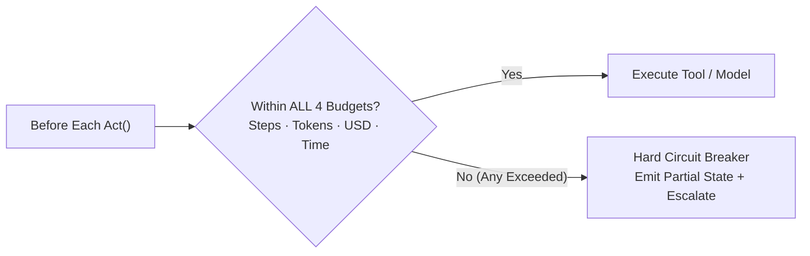

# Chapter 02 — Bounded Goal Loops & Budget Enforcement

> **Lecture 14 · Chapter 02 of 07** · Level: 🟠 Advanced · Phase 3 — Agency, Graphs & Loop Engineering
> **Source:** `FDE S05` · **Roadmap Reference:** [`roadmap-v1.md`](../../roadmap-v1.md#lecture-14--advanced-loop-engineering-adaptive-topologies--a2a-protocol)
> **Roadmap topics:** Bounded goal loops · step caps · token/dollar circuit breakers · wall-clock timeouts · tool permission boundaries (read vs. write vs. forbidden).

---

## 02.0 What this chapter is for

An unbounded `while (!done)` agent loop in production is a **denial-of-wallet vulnerability**. A single malformed API response or ambiguous prompt can cause an agent to burn 500,000 tokens, issue 200 duplicate writes, or hang a worker thread for 20 minutes.

Every production agent loop must be **strictly bounded** across four dimensions and **capability-scoped** at the tool boundary.

By the end of this chapter you should be able to:

1. Enforce hard **four-dimensional budgets** (`maxSteps`, `maxTokens`, `maxCostUsd`, `maxDurationMs`) before every Act step.
2. Distinguish **soft warnings** (compact context / switch to fast model) from **hard circuit breakers** (halt and escalate).
3. Implement **tool permission boundaries** (`READ_ONLY`, `SCOPED_WRITE`, `APPROVAL_REQUIRED`, `FORBIDDEN`) inside the harness, not the prompt.

---

## 02.1 The four-dimensional loop budget

A loop terminates immediately if **any** of the four ceilings is reached:

| Budget Dimension | Typical Interactive Cap | Typical Background Cap | Why It Exists |
| :--- | :---: | :---: | :--- |
| **`maxSteps`** | `8 – 15` | `25 – 50` | Prevents infinite tool-call ping-pong |
| **`maxTokens`** | `25,000 – 60,000` | `150,000 – 300,000` | Caps total prefill + decode consumption |
| **`maxCostUsd`** | `$0.10 – $0.50` | `$1.00 – $5.00` | Protects unit economics when System-2 models are invoked |
| **`maxDurationMs`** | `30,000 ms` | `300,000 ms` | Prevents hung external APIs from starving worker pools |



> [!IMPORTANT]
> **Check budgets *before* dispatching the next model or tool call, and reserve headroom.** If `remainingTokens < 2,000`, do not start a new System-2 reasoning call that could overshoot the cap mid-stream — halt cleanly and summarize progress.

---

## 02.2 Tool permission boundaries (Capability Scoping)

Prompt instructions like *"Please don't delete production tables"* are **suggestions, not security controls**. The **harness** must enforce tool permissions deterministically before any tool function executes:

| Permission Tier | Allowed Actions | Execution Policy |
| :--- | :--- | :--- |
| **`READ_ONLY`** | `searchDocs`, `getOrderStatus`, `readFile` | Auto-execute within step budget |
| **`SCOPED_WRITE`** | `createDraft`, `updateScratchFile`, `postInternalNote` | Auto-execute only within allowed path/tenant scope |
| **`APPROVAL_REQUIRED`** | `refundPayment`, `mergePR`, `deleteRecord` | Pause loop (`HITL` interrupt); require signed human approval |
| **`FORBIDDEN`** | `dropDatabase`, `readEnvSecrets`, `rawShellRoot` | Reject immediately with `PermissionDeniedError` |

```typescript
export type PermissionLevel = "READ_ONLY" | "SCOPED_WRITE" | "APPROVAL_REQUIRED" | "FORBIDDEN";

export interface ToolPolicy {
  name: string;
  permission: PermissionLevel;
  maxCallsPerRun: number;
}
```

Notice `maxCallsPerRun`: even a `READ_ONLY` tool like `webSearch` needs a per-run call cap (e.g., `5`) so a stuck agent cannot spam an external paid API.

---

## 02.3 Worked Example: Headroom Check & Graceful Degradation

Suppose `maxCostUsd = $0.25` and `maxSteps = 10`:
- Steps 1–4 (System-1 searches & edits) spend `$0.08` total.
- Step 5 fails a unit test; the router wants to escalate to a System-2 model whose average call costs `$0.18`.
- **Headroom check:** `currentCost ($0.08) + estimatedNextCall ($0.18) = $0.26 > $0.25`!
- Instead of starting the call and overshooting `$0.25`, the harness trips the circuit breaker **before** calling System-2 and returns:

```json
{
  "status": "BUDGET_EXCEEDED",
  "completedSteps": ["step_1_locate_file", "step_2_apply_patch", "step_3_run_tests"],
  "pendingSteps": ["step_4_fix_edge_case", "step_5_final_gate"],
  "totalTokensUsed": 18400,
  "totalCostUsd": 0.08
}
```

A human or higher-budget batch worker can resume directly from `step_4_fix_edge_case`—zero wasted work.

---

## 02.4 Key takeaways

1. **Every loop needs four hard caps:** steps, tokens, dollars, and wall-clock time.
2. **Prompts are not security boundaries:** enforce `READ_ONLY` / `SCOPED_WRITE` / `APPROVAL_REQUIRED` / `FORBIDDEN` and per-tool call caps in harness code.
3. **Fail gracefully with state:** a budget-halted loop should return its completed steps and exact remaining work for human or batch resumption.

---

**Next:** [Chapter 03 — Proactive Triggers: Heartbeat, Cron & Events](./03_Proactive_Triggers_Heartbeat_Cron_and_Events.md)

