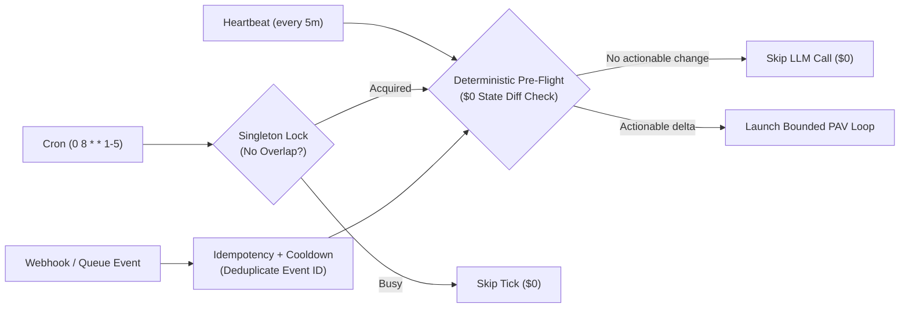
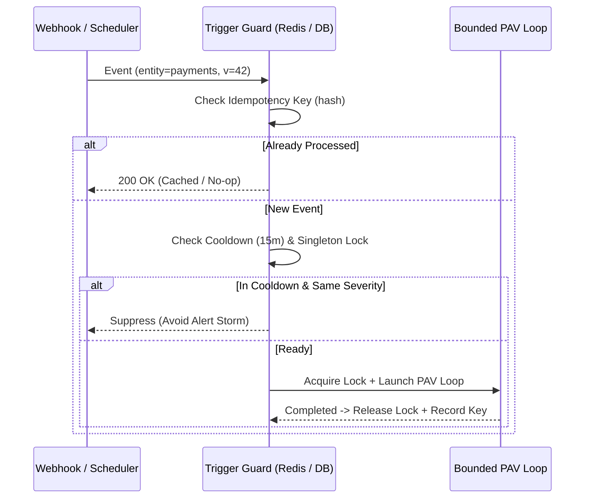

# Chapter 03 — Proactive Triggers: Heartbeat, Cron & Events

> **Lecture 14 · Chapter 03 of 07** · Level: 🟠 Advanced · Phase 3 — Agency, Graphs & Loop Engineering
> **Source:** `FDE S05` · **Roadmap Reference:** [`roadmap-v1.md`](../../roadmap-v1.md#lecture-14--advanced-loop-engineering-adaptive-topologies--a2a-protocol)
> **Roadmap topics:** Reactive chat vs. proactive agents · heartbeat loops · cron schedules · event-driven triggers (webhooks/queues) · idempotency & deduplication · quiet-hours / noise suppression.

---

## 03.0 What this chapter is for

Chatbots are **reactive**: they sit idle until a human types a message. Production agents are increasingly **proactive**: they monitor repositories, watch incident queues, reconcile invoices every morning, and wake up on webhooks.

Running an agent without a human in the loop introduces new failure modes: **idle polling waste**, **duplicate webhook triggers**, **alert storms**, and **overlapping cron runs**.

By the end of this chapter you should be able to:

1. Compare the three proactive trigger patterns: **Heartbeat**, **Cron Schedule**, and **Event-Driven (Webhook/Queue)**.
2. Implement **`$0` deterministic pre-flight filters** so an agent wakes up *only* when state has actually changed.
3. Calculate the exact cost savings of pre-flight gating on high-frequency heartbeat monitors.
4. Prevent duplicate or overlapping executions using **idempotency keys**, **per-entity cooldowns**, and **singleton locks**.
5. Suppress noisy alerts with **quiet-hours** and severity-escalation rules.

---

## 03.1 Reactive vs. Proactive trigger taxonomy

| Trigger Pattern | How It Fires | Best Use Case | Primary Risk |
| :--- | :--- | :--- | :--- |
| **1. Heartbeat** | Fixed short interval (e.g., every `5m`) polling a lightweight state check | Long-running task health monitoring, stalled PR/CI watchdogs | Wasting LLM tokens on "nothing changed" ticks |
| **2. Cron Schedule** | Calendar expression (e.g., `0 8 * * 1-5` for 8:00 AM weekdays) | Daily digests, overnight code audits, weekly FinOps reports | Timezone drift & overlapping runs if previous job is slow |
| **3. Event-Driven** | External webhook, CDC stream, or message queue (`pr.opened`, `alert.fired`) | Instant incident triage, PR review bots, support ticket routing | Event storms / webhook retries triggering duplicate agent runs |



---

## 03.2 The "$0 Pre-Flight Filter" rule

**Never invoke an LLM on a heartbeat or cron tick just to discover there is nothing to do.**

Every proactive trigger must run a deterministic `$0` pre-flight check first:
- **PR Monitor:** Check `git ls-remote` or GitHub `ETag`; if no new commits since `lastSeenSha`, exit in `5 ms` with `$0` cost.
- **Incident Watchdog:** Query `error_rate > 0.05`; if metrics are green, do not wake the System-2 root-cause agent.
- **Inbox Triage:** Check `unreadCount > 0`; if `0`, skip.

### Worked Cost Math: Why `$0` Pre-Flight Saves 99%+

Suppose a Heartbeat PR Monitor runs every **5 minutes** (`288` ticks/day per repo), and each LLM check costs `$0.03`:
- **Without Pre-Flight (LLM checks every tick):**
  $$288 \times \$0.03 = \mathbf{\$8.64/\text{day}} \quad (\mathbf{\$259.20/\text{month}}\text{ per repo just to say "nothing changed"!})$$
  Across 50 repos, that is **\$12,960/month** wasted on idle polling.
- **With `$0` Pre-Flight (`git ls-remote` / ETag):**
  Only `2` ticks/day actually have new commits:
  $$2 \times \$0.03 = \mathbf{\$0.06/\text{day}} \quad (\mathbf{\$1.80/\text{month}}\text{ per repo — }\mathbf{99.3\%\text{ cost reduction}})$$

> [!IMPORTANT]
> **Separate the Sensor from the Reasoner.** The heartbeat/cron scheduler is a cheap deterministic sensor. The LLM is an expensive reasoner that should only be woken up when the sensor detects a non-empty state delta.

---

## 03.3 Idempotency, cooldowns, and concurrency locks

Proactive triggers fail loudly when two ticks overlap or a webhook delivers the same payload twice:



```typescript
export interface TriggerEvent {
  triggerType: "heartbeat" | "cron" | "webhook";
  entityId: string;
  eventVersion: string;
  severity: "info" | "warn" | "critical";
  nowMs: number;
}

export class TriggerGuard {
  private seenKeys = new Set<string>();
  private lastAlertMs = new Map<string, number>();

  shouldLaunch(ev: TriggerEvent, cooldownMs = 15 * 60_000): { run: boolean; reason: string } {
    const key = `${ev.triggerType}:${ev.entityId}:${ev.eventVersion}`;
    if (this.seenKeys.has(key)) {
      return { run: false, reason: "DUPLICATE_IDEMPOTENCY_KEY" };
    }
    const last = this.lastAlertMs.get(ev.entityId);
    if (last !== undefined && ev.nowMs - last < cooldownMs && ev.severity !== "critical") {
      return { run: false, reason: "COOLDOWN_ACTIVE" };
    }
    this.seenKeys.add(key);
    this.lastAlertMs.set(ev.entityId, ev.nowMs);
    return { run: true, reason: "AUTHORIZED" };
  }
}
```

### Quiet hours & noise suppression

For non-critical notifications (e.g., daily digests or low-severity drift alerts), enforce a **quiet-hours policy** (e.g., suppress Slack/PagerDuty pings between `22:00` and `07:00` local time, batching them into the morning digest) while still allowing `critical` severity to page immediately.

### Traps: Where proactive agents break

| Trap | What Happens | Fix |
| :--- | :--- | :--- |
| **Webhook retry storm** | Downstream takes 6s; webhook sender times out at 5s and retries 5× | Return `202 Accepted` immediately, enqueue event, and deduplicate by `idempotencyKey`. |
| **Cron overlap** | An 8-minute audit overlaps with a 5-minute schedule, corrupting shared state | Acquire a distributed **singleton lock** per `entityId` with a lease TTL. |

---

## 03.4 Common mistakes

| # | Common Mistake | Why It Hurts | What To Do Instead |
| :---: | :--- | :--- | :--- |
| 1 | **Waking the LLM on every heartbeat tick** | Burns 99% of tokens confirming that nothing changed | Gate every heartbeat/cron with a `$0` deterministic pre-flight diff check. |
| 2 | **Processing webhooks synchronously without idempotency keys** | Retries trigger duplicate agent runs and duplicate side effects | Ack fast (`202`), deduplicate on `hash(triggerType + entityId + version)`. |
| 3 | **No per-entity cooldown window** | Flapping metrics trigger 20 identical incident-triage runs in 10 minutes | Enforce a `cooldownMs` window unless severity escalates to `critical`. |
| 4 | **Skipping singleton locks on cron jobs** | Slow runs overlap and race on the same workspace or database rows | Hold a per-entity lock for the duration of the run. |

---

## 03.5 Key takeaways

1. **Three proactive triggers:** Heartbeat (polling), Cron (calendar), and Event-Driven (webhooks/queues).
2. **Gate every trigger with a `$0` deterministic pre-flight check** so idle ticks cost zero tokens.
3. **Enforce idempotency keys, singleton locks, and cooldowns** to survive webhook retries and prevent alert storms.
4. **Always launch proactive work inside a bounded PAV loop** (Chapters 01–02) so unattended runs cannot overspend.

---

**Next:** [Chapter 04 — Stuck Detection, Retry, Pivot & Escalation](./04_Stuck_Detection_Retry_Pivot_and_Escalation.md)
