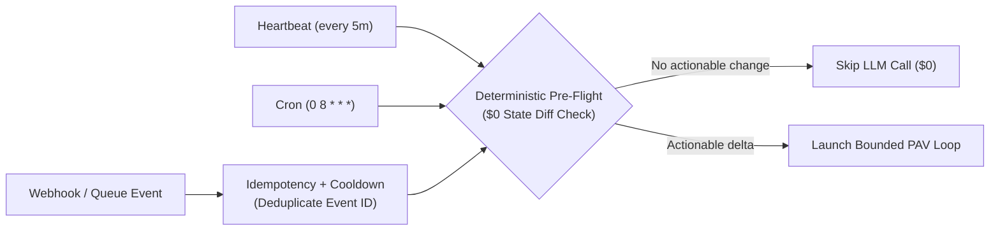

# Chapter 03 — Proactive Triggers: Heartbeat, Cron & Events

> **Lecture 14 · Chapter 03 of 07** · Level: 🟠 Advanced · Phase 3 — Agency, Graphs & Loop Engineering
> **Source:** `FDE S05` · **Roadmap Reference:** [`roadmap-v1.md`](../../roadmap-v1.md#lecture-14--advanced-loop-engineering-adaptive-topologies--a2a-protocol)
> **Roadmap topics:** Reactive chat vs. proactive agents · heartbeat loops · cron schedules · event-driven triggers (webhooks/queues) · idempotency & deduplication · quiet-hours / noise suppression.

---

## 03.0 What this chapter is for

Chatbots are **reactive**: they sit idle until a human types a message. Production agents are increasingly **proactive**: they monitor repositories, watch incident queues, reconcile invoices every morning, and wake up on webhooks.

Running an agent without a human in the loop introduces new failure modes: **duplicate triggers**, **alert fatigue**, and **runaway background spend**.

By the end of this chapter you should be able to:

1. Compare the three proactive trigger patterns: **Heartbeat**, **Cron Schedule**, and **Event-Driven (Webhook/Queue)**.
2. Implement **cheap pre-flight filters** so an agent wakes up *only* when deterministic state actually changed.
3. Prevent duplicate executions using **idempotency keys** and **cooldown windows**.

---

## 03.1 Reactive vs. Proactive trigger taxonomy

| Trigger Pattern | How It Fires | Best Use Case | Primary Risk |
| :--- | :--- | :--- | :--- |
| **1. Heartbeat** | Fixed short interval (e.g., every `5m`) polling a lightweight state check | Long-running task health monitoring, stalled PR/CI watchdogs | Wasting LLM tokens on "nothing changed" ticks |
| **2. Cron Schedule** | Calendar expression (e.g., `0 8 * * 1-5` for 8:00 AM weekdays) | Daily digests, overnight code audits, weekly FinOps reports | Timezone drift & overlapping runs if previous job is slow |
| **3. Event-Driven** | External webhook, CDC stream, or message queue (`pr.opened`, `alert.fired`) | Instant incident triage, PR review bots, support ticket routing | Event storms / webhook retries triggering duplicate agent runs |

---

## 03.2 The "$0 Pre-Flight Filter" rule

**Never invoke an LLM on a heartbeat or cron tick just to discover there is nothing to do.**

Every proactive trigger must run a deterministic `$0` pre-flight check first:
- **PR Monitor:** Check `git ls-remote` or GitHub `ETag`; if no new commits since `lastSeenSha`, exit in `5 ms` with `$0` cost.
- **Incident Watchdog:** Query `error_rate > 0.05`; if metrics are green, do not wake the System-2 root-cause agent.
- **Inbox Triage:** Check `unreadCount > 0`; if `0`, skip.

---

## 03.3 Idempotency, cooldowns, and concurrency locks

Proactive triggers fail loudly when two ticks overlap or a webhook delivers the same payload twice:

1. **Idempotency Key:** Derive `key = hash(triggerType + entityId + eventVersion)`. If `key` was already processed, return the cached result immediately.
2. **Per-Entity Cooldown:** After an agent alerts or acts on `service-payments`, suppress re-triggering for `cooldownMs` (e.g., `15 minutes`) unless severity escalates.
3. **Singleton Lock:** Ensure a slow 8-minute cron run does not overlap with the next 5-minute heartbeat on the same entity.

---

## 03.4 Key takeaways

1. **Three proactive triggers:** Heartbeat (polling), Cron (calendar), and Event-Driven (webhooks/queues).
2. **Gate every trigger with a `$0` deterministic pre-flight check** so idle ticks cost zero tokens.
3. **Enforce idempotency keys and cooldowns** to survive webhook retries and prevent alert storms.

---

**Next:** [Chapter 04 — Stuck Detection, Retry, Pivot & Escalation](./04_Stuck_Detection_Retry_Pivot_and_Escalation.md)

