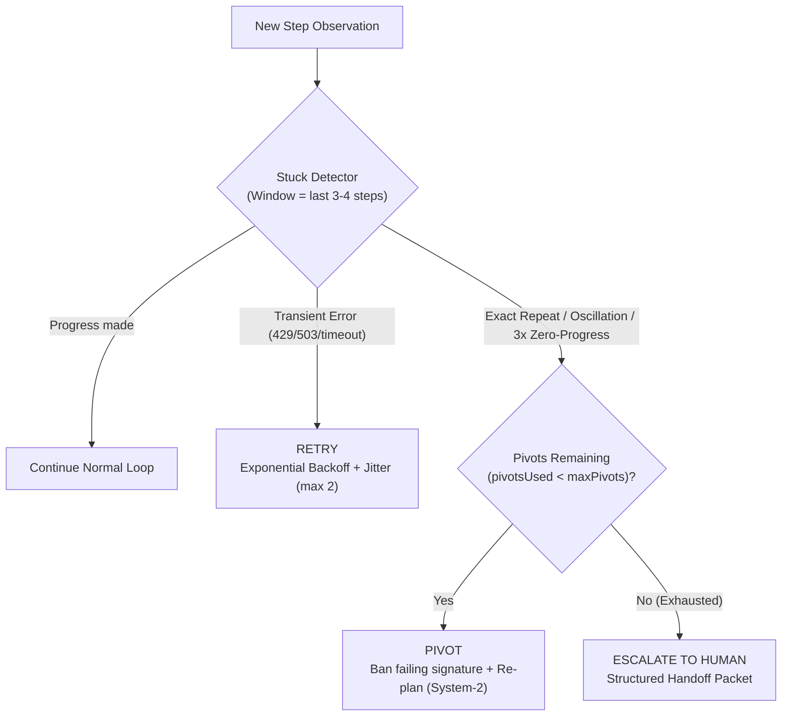

# Chapter 04 — Stuck Detection, Retry, Pivot & Escalation

> **Lecture 14 · Chapter 04 of 07** · Level: 🟠 Advanced · Phase 3 — Agency, Graphs & Loop Engineering
> **Source:** `FDE S05` · **Roadmap Reference:** [`roadmap-v1.md`](../../roadmap-v1.md#lecture-14--advanced-loop-engineering-adaptive-topologies--a2a-protocol)
> **Roadmap topics:** Stuck detection heuristics (exact repeat, semantic oscillation, zero-progress) · Retry with jitter vs. Pivot · strategy switching · structured human escalation.

---

## 04.0 What this chapter is for

Even with bounded budgets (Chapter 02), waiting until `maxSteps = 25` to discover that an agent has been calling `readFile("config.json")` with the exact same broken arguments 12 times in a row wastes time, money, and user trust.

A **stuck detector** inspects the loop's recent execution trajectory and intervenes **within 2–4 iterations**, choosing between **Retry** (transient infra error), **Pivot** (structural failure), or **Human Escalation** (pivots exhausted).

By the end of this chapter you should be able to:

1. Implement three deterministic **stuck-detection heuristics**: exact-call repetition, A-B-A-B oscillation, and zero-progress error streaks.
2. Distinguish **transient failures** (worth a **Retry** with exponential backoff + jitter) from **structural failures** (require an immediate **Pivot**).
3. Design a **Pivot** mechanism that bans the failing signature and forces a different tool, model tier, or plan decomposition.
4. Emit a structured **Human Escalation** handoff packet when pivots are exhausted.

---

## 04.1 Three stuck-detection heuristics

Track a sliding window of recent step signatures `sig = hash(toolName + normalizedArgs + errorClass)`:

| Heuristic | Pattern Detected | Detection Window | Example |
| :--- | :--- | :---: | :--- |
| **1. Exact Repeat** | Identical `(tool, args)` called `>= 2`–`3` times consecutively | `2–3` steps | Calling `sqlQuery("SELECT * FROM users")` 3 times after `403 Forbidden` |
| **2. Oscillation (A-B-A-B)** | Alternating between two states without net progress | `4` steps | `edit(file, A)` $\rightarrow$ test fails $\rightarrow$ `edit(file, B)` $\rightarrow$ test fails $\rightarrow$ `edit(file, A)` |
| **3. Zero-Progress Streak** | `N` consecutive steps produce errors or zero state change (`completedSteps` unchanged) | `3` steps | Trying 3 different bad regexes that all return `0 matches` |



```typescript
export interface StepTrace {
  signature: string;       // e.g. "edit:router.ts:tsc_error"
  progressed: boolean;     // true if completedSteps increased
}

export type StuckDiagnosis = "OK" | "EXACT_REPEAT" | "OSCILLATION" | "ZERO_PROGRESS";

export function detectStuck(history: StepTrace[]): StuckDiagnosis {
  const n = history.length;
  if (n >= 2 && history[n - 1].signature === history[n - 2].signature) {
    return "EXACT_REPEAT";
  }
  if (
    n >= 4 &&
    history[n - 1].signature === history[n - 3].signature &&
    history[n - 2].signature === history[n - 4].signature
  ) {
    return "OSCILLATION";
  }
  if (n >= 3 && history.slice(-3).every((s) => !s.progressed)) {
    return "ZERO_PROGRESS";
  }
  return "OK";
}
```

---

## 04.2 Retry vs. Pivot vs. Escalate

| Recovery Action | When to Use | What Changes |
| :--- | :--- | :--- |
| **Retry** | Transient infra error (`429 Rate Limit`, `503`, network timeout) | Nothing in the plan; wait with exponential backoff + jitter and re-run the same call (`maxRetries = 2`). |
| **Pivot** | Structural failure (`400 Bad Request`, `403`, `404`, logic bug, exact repeat, oscillation) | **Ban** the failing `(tool, args)` signature for this run, escalate to System-2 if on System-1, and force **PlanNode** to pick an alternative strategy (e.g., use `grep` instead of `readFile`, or delegate to a specialist A2A agent). |
| **Escalate** | Pivots exhausted (`maxPivots = 2`), `APPROVAL_REQUIRED` boundary hit, or budget near cap | Halt loop cleanly and hand off a structured diagnostic packet to a human operator. |

> [!WARNING]
> **Never retry a deterministic `400`, `403`, or `PermissionDenied` error.** Retrying the exact same invalid arguments 3 times is the #1 cause of stuck loops. Classify errors into `transient` vs. `structural` before deciding between Retry and Pivot.

### Concrete Trace: Catching an A-B-A-B Oscillation on Step 4

```mermaid
sequenceDiagram
    participant Act as ActNode
    participant SD as Stuck Detector
    participant Plan as PlanNode (System-2)

    Act->>SD: Step 1: edit(router.ts, named import) -> tsc fail (sigA)
    Act->>SD: Step 2: edit(router.ts, default import) -> tsc fail (sigB)
    Act->>SD: Step 3: edit(router.ts, named import) -> tsc fail (sigA)
    Act->>SD: Step 4: edit(router.ts, default import) -> tsc fail (sigB)
    SD-->>Plan: OSCILLATION [sigA, sigB, sigA, sigB] detected!
    Plan->>Act: PIVOT: Ban import guesses; run bash("cat package.json") first
```

In Step 4, the stuck detector catches `[sigA, sigB, sigA, sigB]` immediately instead of letting the agent flip between named and default imports for 20 more steps. Running `cat package.json` reveals `zod` was never installed in `dependencies`!

### Cost math: Early stuck detection vs. budget-cap termination

If a loop's `maxSteps` is `25` and each System-1/2 step averages `$0.015`:
- **Waiting for `maxSteps = 25`:** Burns `25 × $0.015 = $0.375` and `~60 s` before halting.
- **Catching stuck state at Step 3 (`EXACT_REPEAT`) + 1 Pivot:** Burns `3 × $0.015 = $0.045` (**88% less waste**) and recovers on Step 4.

---

## 04.3 The Human Escalation Handoff Packet

When escalating, never dump a raw 40-message transcript on an on-call engineer. Emit a compact, actionable handoff:

```typescript
export interface EscalationPacket {
  reason: "STUCK_MAX_PIVOTS" | "BUDGET_EXCEEDED" | "APPROVAL_REQUIRED";
  goal: string;
  completedSteps: string[];
  failingSignature: string;
  lastError: string;
  suggestedHumanAction: string;
}
```

### Traps: Where stuck detection breaks

| Trap | What Happens | Fix |
| :--- | :--- | :--- |
| **Hashing raw timestamps/IDs in `signature`** | `sig` looks unique every time even though the agent is repeating the same call | Normalize volatile fields before hashing `(toolName, normalizedArgs, errorClass)`. |
| **Pivoting without banning the failing signature** | `PlanNode` generates the exact same broken step again | Maintain a `bannedSignatures: Set<string>` in state and reject banned calls in `ActNode`. |

---

## 04.4 Common mistakes

| # | Common Mistake | Why It Hurts | What To Do Instead |
| :---: | :--- | :--- | :--- |
| 1 | **Retrying `400` / `403` / `404` errors with backoff** | Deterministic errors never self-heal; wastes steps and time | Classify errors: `transient` $\rightarrow$ Retry; `structural` $\rightarrow$ Pivot immediately. |
| 2 | **Relying only on `maxSteps` to stop loops** | Burns 20+ steps of tokens before halting | Run `detectStuck()` after every step using a 2–4 step sliding window. |
| 3 | **Not checking for A-B-A-B oscillation** | Agent alternates between two broken edits indefinitely | Check `h[n-1] === h[n-3] && h[n-2] === h[n-4]` in `detectStuck()`. |
| 4 | **Dumping raw chat logs on human escalation** | Operator takes 10 minutes to figure out what failed | Emit a structured `EscalationPacket` with `completedSteps`, `lastError`, and `suggestedHumanAction`. |

---

## 04.5 Key takeaways

1. **Detect stuck states in $\le 4$ iterations** using exact-repeat, A-B-A-B oscillation, and zero-progress heuristics.
2. **Retry only transient errors; Pivot on structural errors** by banning the failing signature and forcing a fresh plan.
3. **Escalate with a structured diagnostic packet** rather than an infinite loop or a silent failure.

---

**Next:** [Chapter 05 — Static vs. Adaptive Agent Graph Topologies](./05_Static_vs_Adaptive_Agent_Graph_Topologies.md)
