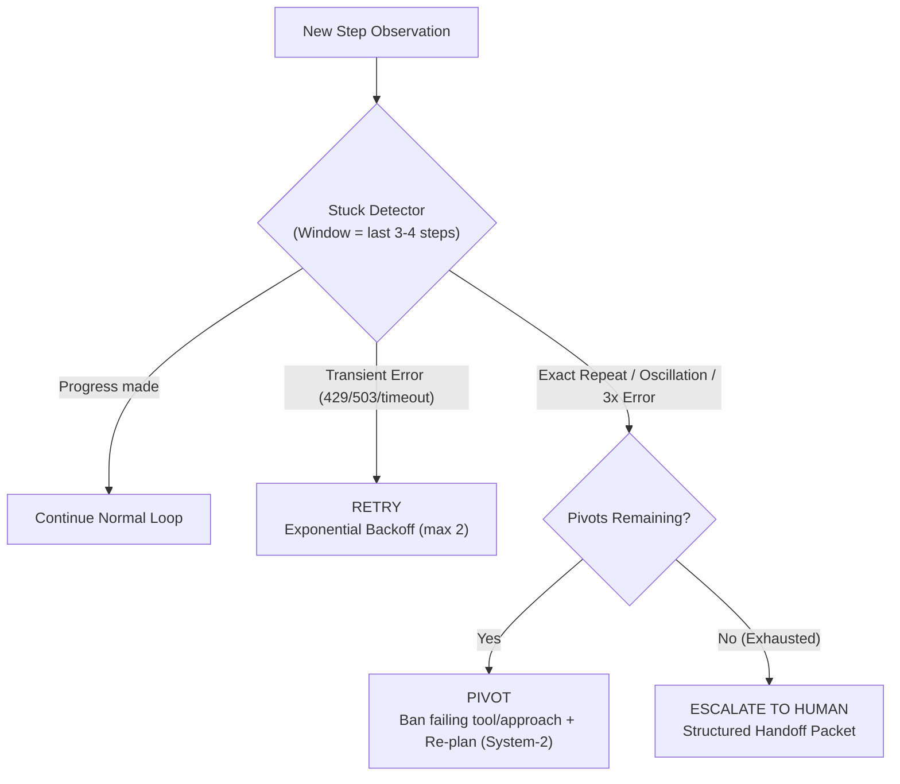

# Chapter 04 — Stuck Detection, Retry, Pivot & Escalation

> **Lecture 14 · Chapter 04 of 07** · Level: 🟠 Advanced · Phase 3 — Agency, Graphs & Loop Engineering
> **Source:** `FDE S05` · **Roadmap Reference:** [`roadmap-v1.md`](../../roadmap-v1.md#lecture-14--advanced-loop-engineering-adaptive-topologies--a2a-protocol)
> **Roadmap topics:** Stuck detection heuristics (exact repeat, semantic oscillation, zero-progress) · Retry with jitter vs. Pivot · strategy switching · structured human escalation.

---

## 04.0 What this chapter is for

Even with bounded budgets (Chapter 02), waiting until `maxSteps = 25` to discover that an agent has been calling `readFile("config.json")` with the exact same broken arguments 12 times in a row wastes time, money, and user trust.

A **stuck detector** inspects the loop's recent execution trajectory and intervenes **within 2–3 iterations**, choosing between **Retry**, **Pivot**, or **Human Escalation**.

By the end of this chapter you should be able to:

1. Implement three deterministic **stuck-detection heuristics**: exact-call repetition, A-B-A-B oscillation, and zero-progress error streaks.
2. Distinguish **transient failures** (worth a **Retry**) from **structural failures** (require a **Pivot**).
3. Design a **Pivot** mechanism that forces a different tool, model tier, or plan decomposition.
4. Emit a structured **Human Escalation** payload when pivots are exhausted.

---

## 04.1 Three stuck-detection heuristics

Track a sliding window of recent step signatures `sig = hash(toolName + normalizedArgs + errorClass)`:

| Heuristic | Pattern Detected | Detection Window | Example |
| :--- | :--- | :---: | :--- |
| **1. Exact Repeat** | Identical `(tool, args)` called `>= 2`–`3` times consecutively | `2–3` steps | Calling `sqlQuery("SELECT * FROM users")` 3 times after `403 Forbidden` |
| **2. Oscillation (A-B-A-B)** | Alternating between two states without net progress | `4` steps | `edit(file, A)` $\rightarrow$ test fails $\rightarrow$ `edit(file, B)` $\rightarrow$ test fails $\rightarrow$ `edit(file, A)` |
| **3. Zero-Progress Streak** | `N` consecutive steps produce errors or zero state change (`completedSteps` unchanged) | `3` steps | Trying 3 different bad regexes that all return `0 matches` |



---

## 04.2 Retry vs. Pivot vs. Escalate

| Recovery Action | When to Use | What Changes |
| :--- | :--- | :--- |
| **Retry** | Transient infra error (`429 Rate Limit`, `503`, network timeout) | Nothing in the plan; wait with jitter and re-run the same call (`maxRetries = 2`). |
| **Pivot** | Structural failure (`400 Bad Request`, `404 Not Found`, logic bug, exact repeat) | **Ban** the failing `(tool, args)` signature for this run, escalate to System-2 if on System-1, and force **PlanNode** to pick an alternative strategy (e.g., use `grep` instead of `readFile`, or delegate to a specialist A2A agent). |
| **Escalate** | Pivots exhausted (`maxPivots = 2`), `APPROVAL_REQUIRED` boundary hit, or budget near cap | Halt loop cleanly and hand off a structured diagnostic packet to a human operator. |

> [!WARNING]
> **Never retry a deterministic `400` or `PermissionDenied` error.** Retrying the exact same invalid arguments 3 times is the #1 cause of stuck loops. Classify errors into `transient` vs. `structural` before deciding between Retry and Pivot.

---

## 04.3 The Human Escalation Handoff Packet

When escalating, never dump a raw 40-message transcript on an on-call engineer. Emit a compact, actionable handoff:

```typescript
export interface EscalationPacket {
  reason: "STUCK_MAX_PIVOTS" | "BUDGET_EXCEEDED" | "APPROVAL_REQUIRED";
  goal: string;
  completedSteps: string[];
  failingSignature: string;
  lastError: string;
  suggestedHumanAction: string;
}
```

---

## 04.4 Key takeaways

1. **Detect stuck states in $\le 3$ iterations** using exact-repeat, oscillation, and zero-progress heuristics.
2. **Retry only transient errors; Pivot on structural errors** by banning the failing signature and forcing a fresh plan.
3. **Escalate with a structured diagnostic packet** rather than an infinite loop or a silent failure.

---

**Next:** [Chapter 05 — Static vs. Adaptive Agent Graph Topologies](./05_Static_vs_Adaptive_Agent_Graph_Topologies.md)

