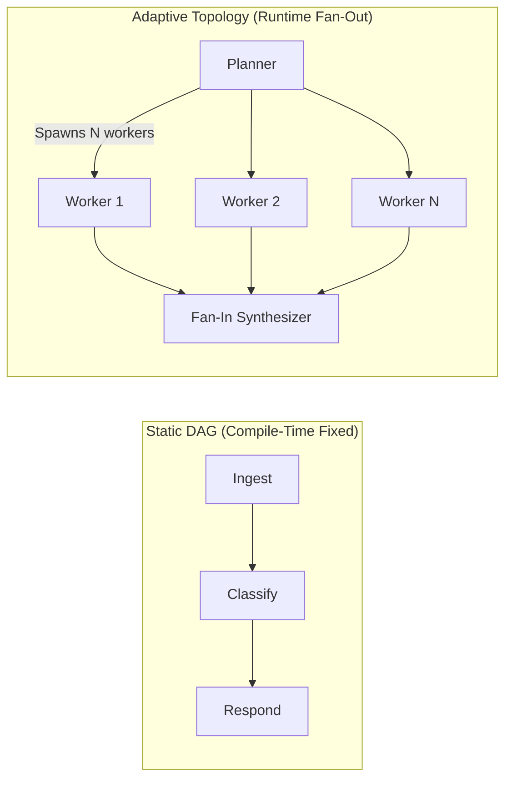
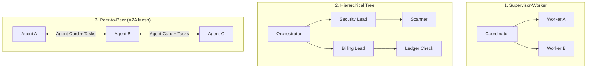

# Chapter 05 — Static vs. Adaptive Agent Graph Topologies

> **Lecture 14 · Chapter 05 of 07** · Level: 🟠 Advanced · Phase 3 — Agency, Graphs & Loop Engineering
> **Source:** `FDE S05 & S06` · **Roadmap Reference:** [`roadmap-v1.md`](../../roadmap-v1.md#lecture-14--advanced-loop-engineering-adaptive-topologies--a2a-protocol)
> **Cross-reference:** Builds on LangGraph `StateGraph` from [Lecture 13](../../Lecture%2013%20-%20LangChain%20LangGraph%20LangSmith/).
> **Roadmap topics:** Static deterministic DAGs · adaptive/dynamic agent graphs · runtime `Send()` fan-out · supervisor vs. peer-to-peer topologies · depth & breadth caps.

---

## 05.0 What this chapter is for

In [Lecture 13](../../Lecture%2013%20-%20LangChain%20LangGraph%20LangSmith/), you built **static graphs**: every node and conditional edge is wired at compile time (`Fetch -> Summarize -> Save`). Static graphs are predictable, easy to test, and ideal for fixed workflows — **until the number of sub-tasks is unknown until runtime** (e.g., *"research all 7 competitors found in this search"* or *"fix every failing test file in this PR"*).

By the end of this chapter you should be able to:

1. Contrast **static DAGs** with **adaptive graph topologies** across predictability, latency, and blast radius.
2. Design **runtime fan-out / fan-in** patterns (such as LangGraph's `Send()` or `Promise.allSettled` worker pools) where the graph shape adapts to input data.
3. Compare **Supervisor-Worker**, **Hierarchical Tree**, and **Peer-to-Peer (A2A) Mesh** multi-agent topologies.
4. Bound adaptive topologies with **max fan-out (`maxWidth`)**, **max recursion (`maxDepth`)**, and a **shared budget ledger** to prevent fork bombs.
5. Choose the simplest topology that solves a given production problem without over-engineering.

---

## 05.1 Static DAGs vs. Adaptive Topologies

| Dimension | Static Graph (Fixed Topology) | Adaptive Graph (Dynamic Topology) |
| :--- | :--- | :--- |
| **Structure** | Fixed nodes & edges defined at compile time | Nodes/branches spawned dynamically at runtime based on intermediate state |
| **Predictability** | High — exact execution paths are enumerable | Medium — branching factor depends on task complexity |
| **Cost & Latency** | Bounded by graph path length | Can explode unless `maxWidth`, `maxDepth`, and shared budgets are enforced |
| **Best Use Case** | Fixed ETL, approval workflows, deterministic pipelines | Multi-document research, dynamic PR review across $N$ files, multi-domain triage |



---

## 05.2 Three multi-agent topology patterns



| Topology | How Coordination Works | Strengths | Failure Mode |
| :--- | :--- | :--- | :--- |
| **1. Supervisor-Worker** | Central coordinator decomposes goal, spawns $N$ workers (often System-1), and synthesizes outputs | Clean single point of budget & conflict control | Coordinator becomes a bottleneck if $N$ is huge |
| **2. Hierarchical Tree** | Top-level orchestrator delegates to domain leads (*Security*, *Billing*), each managing sub-loops | Scales to large enterprise domains with distinct tools | Deep trees amplify latency and risk **fork bombs** |
| **3. Peer-to-Peer / A2A Mesh** | Independent agents discover each other via **Agent Cards** (Chapter 06) and delegate over HTTP/JSON-RPC | Works across teams, languages, and org boundaries | Harder to trace end-to-end without distributed trace IDs |

> [!TIP]
> **Start with a Static DAG; upgrade to Supervisor-Worker only when $N$ is dynamic.** Many teams jump straight to a 5-agent mesh when a 3-node static `StateGraph` would be 5× faster, cheaper, and easier to debug.

---

## 05.3 Bounding adaptive topologies (Stopping Fork Bombs)

Dynamic spawning without limits creates exponential blowup: if a planner spawns `5` workers, and each worker spawns `5` sub-workers at depth `3`, you just launched:

$$5^3 = \mathbf{125}\text{ concurrent LLM loops from a single user prompt!}$$

At `$0.05` per sub-loop, one prompt costs `125 × $0.05 = $6.25` and hits provider `429 Rate Limit` walls immediately.

Always enforce three hard caps in the topology runtime:

```typescript
export interface TopologyGuards {
  maxFanOut: number;     // e.g., 5 workers per node
  maxDepth: number;      // e.g., 2 levels deep (0 = root)
  remainingBudgetUsd: number;
}

export function planSafeFanOut<T>(
  subTasks: T[],
  currentDepth: number,
  guards: TopologyGuards
): T[] {
  if (currentDepth >= guards.maxDepth) {
    throw new Error(`TopologyError: maxDepth (${guards.maxDepth}) reached; cannot spawn sub-workers.`);
  }
  if (guards.remainingBudgetUsd <= 0) {
    throw new Error("TopologyError: shared budget exhausted before fan-out.");
  }
  // Cap width to maxFanOut so a planner cannot spawn 50 branches
  return subTasks.slice(0, guards.maxFanOut);
}
```

1. **`maxFanOut` (Width Cap):** e.g., `maxWorkers = 5`. If a planner proposes 20 sub-tasks, batch or prioritize the top 5.
2. **`maxDepth` (Recursion Cap):** e.g., `maxDepth = 2`. A spawned worker at depth 2 must execute directly using its own tools rather than spawning more sub-workers.
3. **Shared Budget Pool:** All spawned branches deduct atomically from the **parent run's** `maxTokens` and `maxCostUsd` ledger.

> [!WARNING]
> **Never give spawned workers an independent budget.** If each worker gets its own fresh `$0.50` cap, `5` workers × `5` sub-workers = `$12.50` total spend on a `$0.50` parent request.

---

## 05.4 Traps: Where adaptive topologies break

| Trap | What Happens | Fix |
| :--- | :--- | :--- |
| **Unbounded recursive delegation** | Worker A delegates to Worker B, which delegates back to Worker A | Pass `depth + 1` and `visitedAgents[]` in every delegation header; reject cycles. |
| **Overwriting shared state during parallel fan-out** | Two parallel workers write to `state.summary` simultaneously, losing one result | Write each branch to a keyed slot `results[branchId]` and merge deterministically in Fan-In. |

---

## 05.5 Common mistakes

| # | Common Mistake | Why It Hurts | What To Do Instead |
| :---: | :--- | :--- | :--- |
| 1 | **Using an adaptive multi-agent graph for a fixed 3-step workflow** | Adds unnecessary planner latency, cost, and non-determinism | Use a compile-time **Static DAG** whenever steps are known upfront. |
| 2 | **Spawning workers without `maxFanOut` or `maxDepth`** | One broad prompt triggers an exponential fork bomb and `429` rate limits | Enforce `maxFanOut` (width) and `maxDepth` (recursion) in code before spawning. |
| 3 | **Giving child workers separate unlinked budgets** | Total run cost exceeds parent `maxCostUsd` by $N \times$ | Deduct all child token/dollar usage from one shared parent **Budget Ledger**. |
| 4 | **Allowing cycles in peer-to-peer delegation** | Agent A $\rightarrow$ Agent B $\rightarrow$ Agent A loops until timeout | Track `callStack` / `visitedAgents` and forbid re-entrant delegation. |

---

## 05.6 Key takeaways

1. **Default to static DAGs** when the workflow steps are known upfront; use **adaptive topologies** when sub-task count is data-dependent.
2. **Always cap `maxFanOut`, `maxDepth`, and shared token budgets** so adaptive graphs cannot fork-bomb your wallet.
3. **Isolate parallel worker outputs by key** and merge them in a dedicated Fan-In step.
4. **Adaptive sub-tasks that cross team or service boundaries** should use the **A2A protocol** (Chapter 06).

---

**Next:** [Chapter 06 — The A2A (Agent-to-Agent) Protocol](./06_The_A2A_Agent_to_Agent_Protocol.md)
