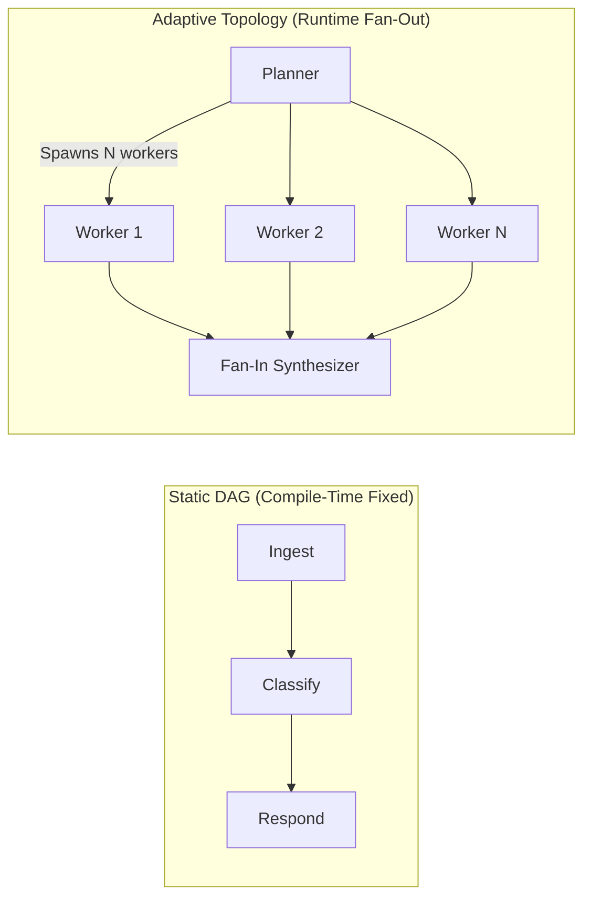

# Chapter 05 — Static vs. Adaptive Agent Graph Topologies

> **Lecture 14 · Chapter 05 of 07** · Level: 🟠 Advanced · Phase 3 — Agency, Graphs & Loop Engineering
> **Source:** `FDE S05 & S06` · **Roadmap Reference:** [`roadmap-v1.md`](../../roadmap-v1.md#lecture-14--advanced-loop-engineering-adaptive-topologies--a2a-protocol)
> **Cross-reference:** Builds on LangGraph `StateGraph` from [Lecture 13](../../Lecture%2013%20-%20LangChain%20LangGraph%20LangSmith/).
> **Roadmap topics:** Static deterministic DAGs · adaptive/dynamic agent graphs · runtime `Send()` fan-out · supervisor vs. peer-to-peer topologies · depth & breadth caps.

---

## 05.0 What this chapter is for

In [Lecture 13](../../Lecture%2013%20-%20LangChain%20LangGraph%20LangSmith/), you built **static graphs**: every node and conditional edge is wired at compile time (`Fetch -> Summarize -> Save`). Static graphs are predictable, easy to test, and ideal for fixed workflows — **until the number of sub-tasks is unknown until runtime** (e.g., *"research all 7 competitors found in this search"* or *"fix every failing test file in this PR"*).

By the end of this chapter you should be able to:

1. Contrast **static DAGs** with **adaptive graph topologies** across predictability, latency, and blast radius.
2. Design **runtime fan-out / fan-in** patterns (such as LangGraph's `Send()` or `Promise.all` worker pools) where the graph shape adapts to input data.
3. Compare **Supervisor**, **Hierarchical**, and **Peer-to-Peer (A2A)** multi-agent topologies.
4. Bound adaptive topologies with **max fan-out (`maxWidth`)** and **max recursion (`maxDepth`)** guards.

---

## 05.1 Static DAGs vs. Adaptive Topologies

| Dimension | Static Graph (Fixed Topology) | Adaptive Graph (Dynamic Topology) |
| :--- | :--- | :--- |
| **Structure** | Fixed nodes & edges defined at compile time | Nodes/branches spawned dynamically at runtime based on intermediate state |
| **Predictability** | High — exact execution paths are enumerable | Medium — branching factor depends on task complexity |
| **Cost & Latency** | Bounded by graph path length | Can explode unless `maxWidth` and `maxDepth` are enforced |
| **Best Use Case** | Fixed ETL, approval workflows, deterministic pipelines | Multi-document research, dynamic PR review across $N$ files, multi-domain triage |

---

## 05.2 Three multi-agent topology patterns

1. **Supervisor-Worker:** A central coordinator decomposes a goal, spawns $N$ workers (often System-1), and synthesizes their outputs. Best when tasks are independent and need unified formatting.
2. **Hierarchical Tree:** A top-level orchestrator delegates to domain leads (e.g., *Security Lead*, *Billing Lead*), each managing their own sub-loops. Best for large enterprise domains.
3. **Peer-to-Peer / A2A Mesh:** Independent agents discover each other via **Agent Cards** and delegate tasks over a standard protocol (Chapter 06) without sharing internal memory or frameworks.

---

## 05.3 Bounding adaptive topologies (Stopping Fork Bombs)

Dynamic spawning without limits creates exponential blowup: if a planner spawns `5` workers, and each worker spawns `5` sub-workers at depth `3`, you just launched $5^3 = \mathbf{125}$ concurrent LLM loops from one user prompt!

Always enforce three hard caps:
- **`maxFanOut` (Width Cap):** e.g., `maxWorkers = 5`. If a planner proposes 20 sub-tasks, batch or prioritize top 5.
- **`maxDepth` (Recursion Cap):** e.g., `maxDepth = 2`. A spawned worker cannot recursively spawn sub-workers indefinitely.
- **Shared Budget Pool:** All spawned branches deduct atomically from the **parent run's** `maxTokens` and `maxCostUsd` ledger.

---

## 05.4 Key takeaways

1. **Default to static DAGs** when the workflow steps are known upfront; use **adaptive topologies** when sub-task count is data-dependent.
2. **Always cap `maxFanOut`, `maxDepth`, and shared token budgets** so adaptive graphs cannot fork-bomb your wallet.
3. **Adaptive sub-tasks that cross team or service boundaries** should use the **A2A protocol** (Chapter 06).

---

**Next:** [Chapter 06 — The A2A (Agent-to-Agent) Protocol](./06_The_A2A_Agent_to_Agent_Protocol.md)

