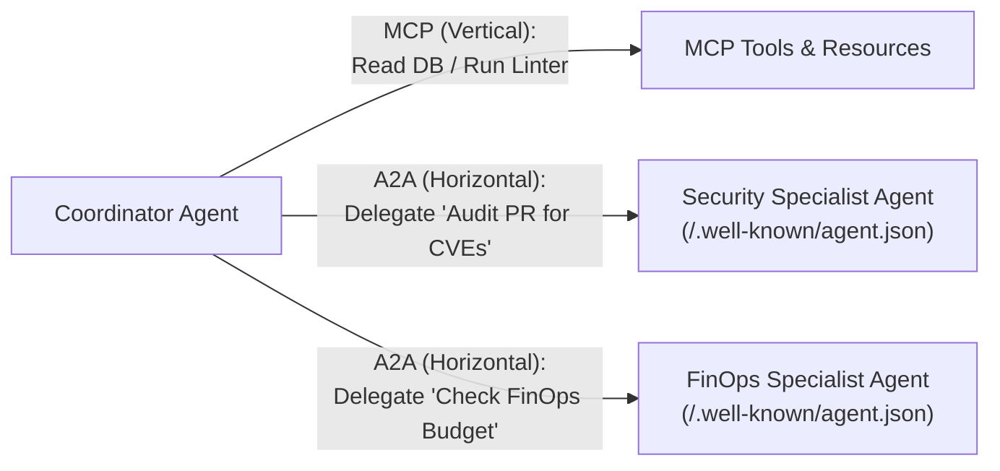
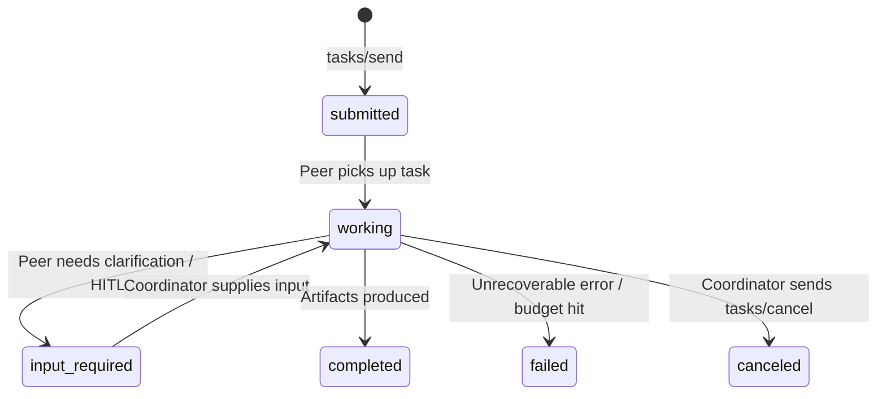

# Chapter 06 — The A2A (Agent-to-Agent) Protocol

> **Lecture 14 · Chapter 06 of 07** · Level: 🟠 Advanced · Phase 3 — Agency, Graphs & Loop Engineering
> **Source:** `FDE S06` · **Roadmap Reference:** [`roadmap-v1.md`](../../roadmap-v1.md#lecture-14--advanced-loop-engineering-adaptive-topologies--a2a-protocol)
> **External Standard:** [Google A2A (Agent2Agent) Protocol](https://google.github.io/A2A/)
> **Roadmap topics:** MCP vs. A2A · Agent Cards (`/.well-known/agent.json`) · capability discovery · A2A Task Lifecycle (`submitted` $\rightarrow$ `working` $\rightarrow$ `completed`/`failed`/`input-required`) · opaque peer execution.

---

## 06.0 What this chapter is for

**MCP (Model Context Protocol)** connects an agent to **tools and data** (vertical integration). **A2A (Agent-to-Agent)** connects an agent to **other autonomous agents** across framework, team, and organizational boundaries (horizontal integration).

A LangGraph agent in TypeScript should be able to delegate a security audit to a Python CrewAI agent or a remote SaaS compliance agent **without knowing how the peer is implemented internally**.

By the end of this chapter you should be able to:

1. Distinguish **MCP (Agent $\leftrightarrow$ Tool)** from **A2A (Agent $\leftrightarrow$ Agent)**.
2. Author an **Agent Card** (`/.well-known/agent.json`) advertising skills, endpoints, and auth requirements.
3. Trace the **A2A Task Lifecycle** (`submitted`, `working`, `input-required`, `completed`, `failed`, `canceled`).
4. Implement **capability discovery** and **opaque task delegation** between a coordinator and a specialist peer agent.

---

## 06.1 MCP vs. A2A: Complementary protocols

| Dimension | MCP (Model Context Protocol) | A2A (Agent-to-Agent Protocol) |
| :--- | :--- | :--- |
| **Relationship** | Agent $\leftrightarrow$ **Tool / Resource** | Agent $\leftrightarrow$ **Autonomous Peer Agent** |
| **Execution model** | Synchronous/short tool call (`tools/call`) | Long-running, stateful **Task** with artifacts & status updates |
| **Internal visibility** | Tool schema is exposed; tool has no independent reasoning loop | **Opaque** — peer runs its own internal loop, memory, and tools |
| **Discovery** | `tools/list` on connected MCP server | **Agent Card** at `/.well-known/agent.json` |



---

## 06.2 The Agent Card (`/.well-known/agent.json`)

Every A2A-compliant server publishes a JSON **Agent Card** describing its identity, endpoint, capabilities, and skills:

```json
{
  "name": "SecurityAuditAgent",
  "description": "Scans code diffs and dependency manifests for vulnerabilities.",
  "url": "https://agents.internal/security",
  "version": "1.0.0",
  "capabilities": {
    "streaming": true,
    "pushNotifications": false
  },
  "skills": [
    {
      "id": "cve-diff-scan",
      "name": "CVE & Secret Diff Scan",
      "description": "Inspects a git diff for leaked credentials and vulnerable dependencies.",
      "tags": ["security", "cve", "secrets"]
    }
  ]
}
```

A coordinator discovers specialists by **fetching/querying Agent Cards** and matching the required sub-task tag or skill ID — decoupling the caller from hardcoded URLs or prompt templates.

---

## 06.3 The A2A Task Lifecycle

Unlike a stateless HTTP RPC, an A2A delegation creates a **Task** that moves through a well-defined state machine:



Each `completed` task returns structured **Artifacts** (text, JSON, or files) plus optional **usage metadata** so the coordinator can track total cost across agent boundaries.

---

## 06.4 Key takeaways

1. **Use MCP for tools/data; use A2A for peer agents** that own their own reasoning loops and private memory.
2. **Agent Cards (`/.well-known/agent.json`)** enable dynamic capability discovery without tight coupling.
3. **A2A Tasks are stateful** (`submitted` $\rightarrow$ `working` $\rightarrow$ `completed` / `failed` / `input-required`), supporting both quick delegations and multi-minute background jobs.

---

**Next:** [Chapter 07 — Parallel Delegation & Fan-In Synthesis](./07_Parallel_Delegation_and_Fan_In_Synthesis.md)

