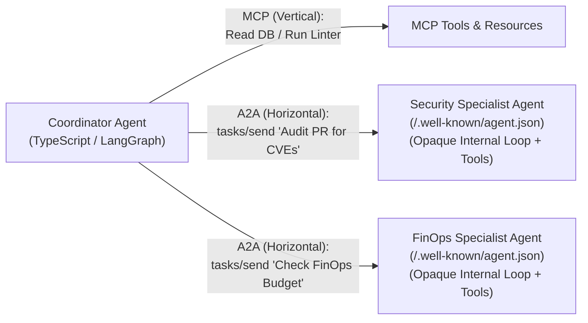
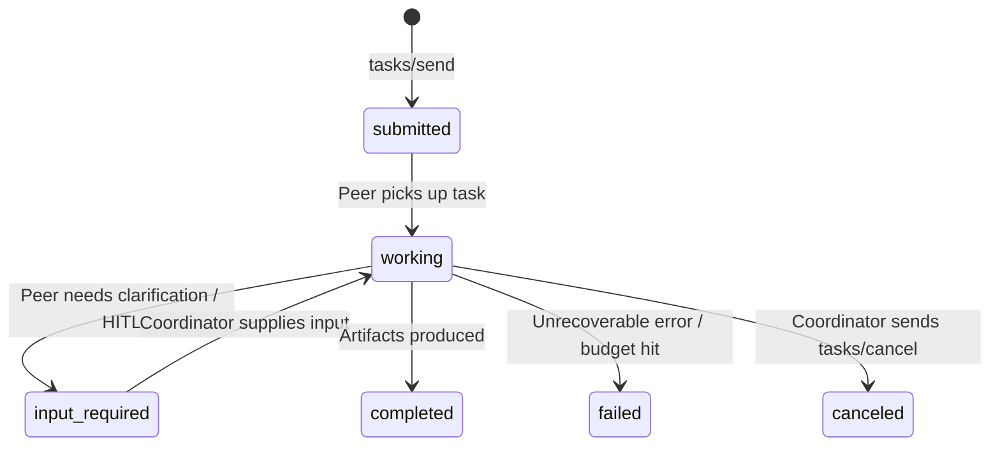

# Chapter 06 — The A2A (Agent-to-Agent) Protocol

> **Lecture 14 · Chapter 06 of 07** · Level: 🟠 Advanced · Phase 3 — Agency, Graphs & Loop Engineering
> **Source:** `FDE S06` · **Roadmap Reference:** [`roadmap-v1.md`](../../roadmap-v1.md#lecture-14--advanced-loop-engineering-adaptive-topologies--a2a-protocol)
> **External Standard:** [Google A2A (Agent2Agent) Protocol](https://google.github.io/A2A/)
> **Roadmap topics:** MCP vs. A2A · Agent Cards (`/.well-known/agent.json`) · capability discovery · A2A Task Lifecycle (`submitted` $\rightarrow$ `working` $\rightarrow$ `completed`/`failed`/`input-required`) · opaque peer execution.

---

## 06.0 What this chapter is for

**MCP (Model Context Protocol)** connects an agent to **tools and data** (vertical integration). **A2A (Agent-to-Agent)** connects an agent to **other autonomous agents** across framework, team, and organizational boundaries (horizontal integration).

A LangGraph agent in TypeScript should be able to delegate a security audit to a Python CrewAI agent or a remote SaaS compliance agent **without knowing how the peer is implemented internally** — and without sharing raw conversation history or private database credentials.

By the end of this chapter you should be able to:

1. Distinguish **MCP (Agent $\leftrightarrow$ Tool)** from **A2A (Agent $\leftrightarrow$ Peer Agent)** and explain why production systems use both.
2. Author an **Agent Card** (`/.well-known/agent.json`) advertising identity, capabilities, skills, and auth requirements.
3. Trace the **A2A Task Lifecycle** (`submitted`, `working`, `input-required`, `completed`, `failed`, `canceled`).
4. Implement **capability discovery** and **opaque task delegation** (`tasks/send`) between a coordinator and a specialist peer agent.
5. Design safe **cost and trace propagation** across opaque A2A boundaries.

---

## 06.1 MCP vs. A2A: Complementary protocols

| Dimension | MCP (Model Context Protocol) | A2A (Agent-to-Agent Protocol) |
| :--- | :--- | :--- |
| **Relationship** | Agent $\leftrightarrow$ **Tool / Resource** (Vertical) | Agent $\leftrightarrow$ **Autonomous Peer Agent** (Horizontal) |
| **Execution model** | Synchronous/short tool call (`tools/call`) | Long-running, stateful **Task** with artifacts & status updates |
| **Internal visibility** | Tool schema is exposed; tool has no independent reasoning loop | **Opaque** — peer runs its own internal loop, memory, and tools |
| **Discovery** | `tools/list` on connected MCP server | **Agent Card** at `/.well-known/agent.json` |



> [!IMPORTANT]
> **Opaque execution is A2A's superpower.** The coordinator never sees the Security Agent's internal system prompt, chain-of-thought, or private vulnerability-DB credentials — it only sees the published **Agent Card** and the returned **Artifacts**.

---

## 06.2 The Agent Card (`/.well-known/agent.json`)

Every A2A-compliant server publishes a JSON **Agent Card** describing its identity, endpoint, capabilities, and skills:

```json
{
  "name": "SecurityAuditAgent",
  "description": "Scans code diffs and dependency manifests for vulnerabilities.",
  "url": "https://agents.internal/security",
  "version": "1.0.0",
  "capabilities": {
    "streaming": true,
    "pushNotifications": false
  },
  "skills": [
    {
      "id": "cve-diff-scan",
      "name": "CVE & Secret Diff Scan",
      "description": "Inspects a git diff for leaked credentials and vulnerable dependencies.",
      "tags": ["security", "cve", "secrets"]
    }
  ]
}
```

A coordinator discovers specialists by **fetching Agent Cards** and matching the required sub-task tag or skill ID — decoupling the caller from hardcoded prompts or framework-specific SDKs:

```typescript
export interface AgentSkill {
  id: string;
  name: string;
  tags: string[];
}

export interface AgentCard {
  name: string;
  url: string;
  skills: AgentSkill[];
}

export function selectPeerForTag(cards: AgentCard[], requiredTag: string): AgentCard | undefined {
  return cards.find((card) =>
    card.skills.some((skill) => skill.tags.includes(requiredTag))
  );
}
```

---

## 06.3 The A2A Task Lifecycle

Unlike a stateless HTTP RPC, an A2A delegation creates a stateful **Task** that moves through a well-defined state machine:



Each `completed` task returns structured **Artifacts** (text, JSON, or files) plus optional **usage metadata** so the coordinator can track total cost across agent boundaries.

### Concrete `tasks/send` Request & `completed` Response

```json
// Coordinator -> SecurityAuditAgent (POST /a2a)
{
  "jsonrpc": "2.0",
  "id": "req-42",
  "method": "tasks/send",
  "params": {
    "id": "task_cve_901",
    "message": {
      "role": "user",
      "parts": [{ "type": "text", "text": "Audit PR #412 diff for CVEs and leaked secrets." }]
    }
  }
}

// SecurityAuditAgent -> Coordinator (Completed Artifact)
{
  "jsonrpc": "2.0",
  "id": "req-42",
  "result": {
    "id": "task_cve_901",
    "status": { "state": "completed" },
    "artifacts": [
      {
        "parts": [
          { "type": "data", "data": { "verdict": "REJECT", "findings": ["Hardcoded Stripe key in src/pay.ts:14"] } }
        ]
      }
    ],
    "metadata": { "tokensUsed": 2150, "costUsd": 0.0084 }
  }
}
```

> [!TIP]
> **Propagate `traceId` and `maxCostUsd` in A2A task metadata.** Even though the peer's internal loop is opaque, passing a budget ceiling lets the peer fail fast (`status: "failed"`) instead of overspending the parent coordinator's budget.

### Traps: Where A2A integrations break

| Trap | What Happens | Fix |
| :--- | :--- | :--- |
| **Wrapping a simple deterministic API as an A2A agent** | Adds LLM latency and non-determinism to a 10 ms DB lookup | Use **MCP** for deterministic tools/data; reserve **A2A** for autonomous reasoning peers. |
| **Ignoring `input-required` state** | Coordinator treats `input-required` as `failed` or hangs forever | Handle `input-required` explicitly by supplying context or escalating to HITL. |

---

## 06.4 Common mistakes

| # | Common Mistake | Why It Hurts | What To Do Instead |
| :---: | :--- | :--- | :--- |
| 1 | **Using A2A when MCP is enough** | Wrapping stateless tools as A2A agents adds unnecessary orchestration overhead | Use MCP for tools/resources; use A2A only for peer agents with their own loops. |
| 2 | **Coupling coordinator prompts to peer implementation details** | Breaks whenever the peer team changes frameworks or internal prompts | Discover capabilities via `/.well-known/agent.json` Agent Cards and skill tags. |
| 3 | **Assuming every `tasks/send` finishes synchronously in 1 HTTP call** | Long-running tasks time out on HTTP gateways | Support polling (`tasks/get`), SSE streaming, and `input-required` / `canceled` states. |
| 4 | **Not returning `metadata` (`tokensUsed`, `costUsd`) from peers** | Coordinator loses visibility into total multi-agent spend | Include usage metadata in completed/failed A2A task responses. |

---

## 06.5 Key takeaways

1. **Use MCP for tools/data; use A2A for peer agents** that own their own reasoning loops and private memory.
2. **Agent Cards (`/.well-known/agent.json`)** enable dynamic capability discovery without tight coupling.
3. **A2A Tasks are stateful** (`submitted` $\rightarrow$ `working` $\rightarrow$ `completed` / `failed` / `input-required`), supporting both quick delegations and multi-minute background jobs.
4. **Propagate trace IDs and budget ceilings** across A2A boundaries so opaque peers remain observable and bounded.

---

**Next:** [Chapter 07 — Parallel Delegation & Fan-In Synthesis](./07_Parallel_Delegation_and_Fan_In_Synthesis.md)
