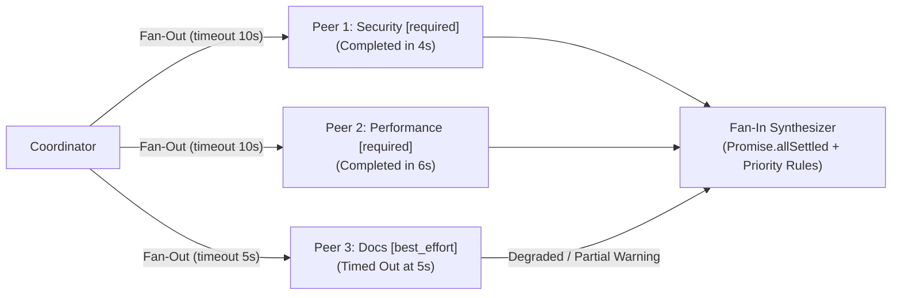
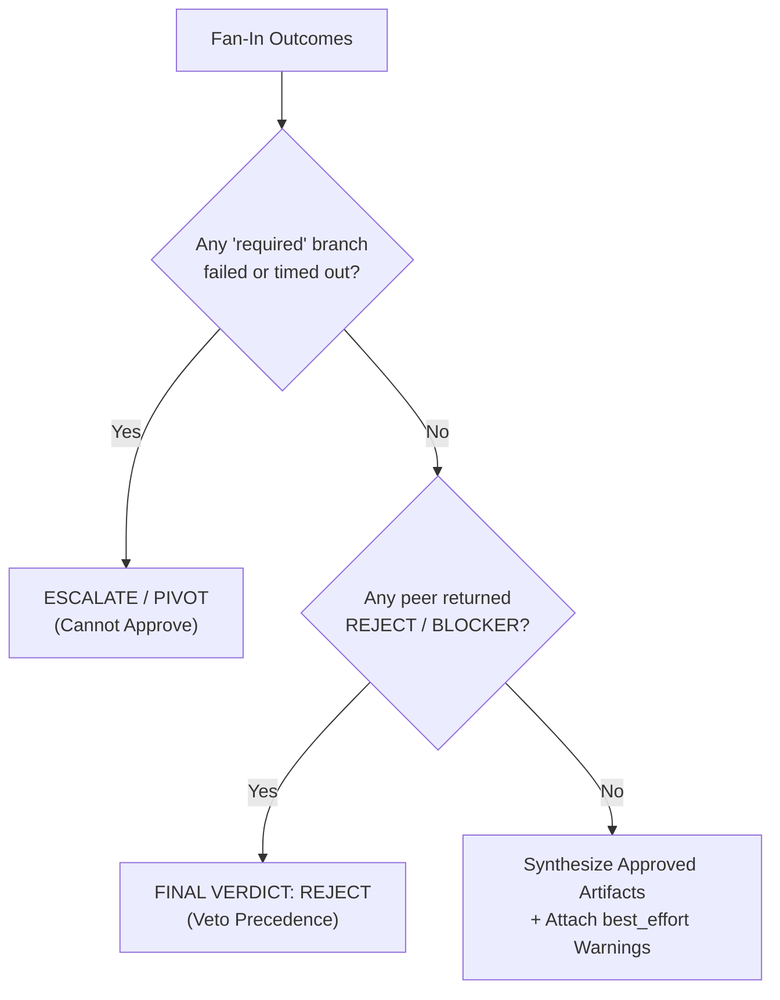

# Chapter 07 — Parallel Delegation & Fan-In Synthesis

> **Lecture 14 · Chapter 07 of 07** · Level: 🟠 Advanced · Phase 3 — Agency, Graphs & Loop Engineering
> **Source:** `FDE S06` · **Roadmap Reference:** [`roadmap-v1.md`](../../roadmap-v1.md#lecture-14--advanced-loop-engineering-adaptive-topologies--a2a-protocol)
> **Roadmap topics:** Parallel A2A fan-out · partial-failure handling (`Promise.allSettled`) · per-branch timeouts · fan-in synthesis & conflict reconciliation · end-to-end cost/trace aggregation.

---

## 07.0 What this chapter is for

When a coordinator decomposes a goal into independent sub-tasks (e.g., *Security Audit*, *Performance Analysis*, and *Cost Estimation*), running them sequentially multiplies wall-clock latency by $N$. **Parallel A2A delegation** dispatches all $N$ tasks concurrently and synthesizes their artifacts in a **Fan-In** step — cutting wall-clock latency to $\max(\text{branch latencies})$.

Parallelism introduces two production challenges: **partial failures** (2 of 3 peers succeed, 1 times out) and **conflicting recommendations** (Security says *"block"*, Performance says *"ship"*).

By the end of this chapter you should be able to:

1. Dispatch parallel A2A tasks with **per-branch timeouts** and **`Promise.allSettled`** resilience.
2. Classify branches as **`required`** vs. **`best_effort`** to handle partial failures cleanly.
3. Design a **Fan-In Synthesizer** that reconciles conflicting peer artifacts using deterministic **veto and precedence rules**.
4. Aggregate **token/cost usage and trace IDs** across all delegated A2A branches against the parent loop budget.
5. Quantify the latency speedup and tail-risk trade-offs of parallel fan-out.

---

## 07.1 Parallel Fan-Out with `Promise.allSettled`

Never use bare `Promise.all` for multi-agent delegation: if one non-critical peer throws a `503` or times out, `Promise.all` rejects immediately and **discards the completed work (and spent tokens!) of the other $N-1$ peers**.



### Partial-failure policy

Classify each delegated sub-task as **`required`** or **`best_effort`**:
- If a **`required`** peer fails (e.g., *Security Compliance*), the Fan-In step triggers a **Pivot** or **Human Escalation** — never silently approve.
- If a **`best_effort`** peer fails (e.g., *Optional Changelog Summary*), synthesize the remaining artifacts and attach a `warnings: ["DocsAgent timed out"]` field.

```typescript
export interface BranchSpec {
  id: string;
  agentUrl: string;
  criticality: "required" | "best_effort";
  timeoutMs: number;
}

export interface BranchOutcome {
  id: string;
  criticality: "required" | "best_effort";
  status: "fulfilled" | "rejected";
  verdict?: "APPROVE" | "REJECT";
  costUsd: number;
  error?: string;
}

export async function runFanOut(
  branches: BranchSpec[],
  invokePeer: (b: BranchSpec, signal: AbortSignal) => Promise<{ verdict: "APPROVE" | "REJECT"; costUsd: number }>
): Promise<BranchOutcome[]> {
  const settled = await Promise.allSettled(
    branches.map((b) => invokePeer(b, AbortSignal.timeout(b.timeoutMs)))
  );

  return settled.map((res, idx) => {
    const branch = branches[idx];
    if (res.status === "fulfilled") {
      return {
        id: branch.id,
        criticality: branch.criticality,
        status: "fulfilled",
        verdict: res.value.verdict,
        costUsd: res.value.costUsd,
      };
    }
    return {
      id: branch.id,
      criticality: branch.criticality,
      status: "rejected",
      costUsd: 0,
      error: String(res.reason),
    };
  });
}
```

### Latency math: Sequential vs. Bounded Parallel Fan-Out

Suppose 3 specialist peers take `4 s`, `6 s`, and `5 s` respectively:
- **Sequential delegation:** $4 + 6 + 5 = \mathbf{15\text{ s}}$.
- **Parallel Fan-Out (`Promise.allSettled` + `10 s` cap):** $\max(4, 6, 5) = \mathbf{6\text{ s}}$ (**2.5× faster**).
- If Peer 3 hangs indefinitely without a per-branch timeout, bare `Promise.all` hangs until the global gateway timeout (`60 s+`). With `AbortSignal.timeout(5000)`, Fan-In completes cleanly at **`6 s`** with a `best_effort` warning.

---

## 07.2 Conflict reconciliation in Fan-In synthesis

When two peer agents return conflicting conclusions, **never let an LLM synthesizer average them or flip a coin**. Define deterministic precedence rules in code before calling any synthesis LLM:



1. **Veto Precedence:** Any `BLOCKER` or `REJECT` from a compliance/security peer overrides `APPROVE` from a feature or performance peer.
2. **Evidence Weighting:** Prefer artifacts backed by deterministic tool outputs (e.g., test exit codes, SQL query plans, CVE scanner JSON) over pure LLM prose.
3. **Explicit Conflict Escalation:** If two `required` peers disagree on a high-stakes non-veto decision (e.g., *Schema Migration A* vs. *Schema Migration B*), emit `status: "CONFLICT_ESCALATED"` for human resolution.

> [!IMPORTANT]
> **Deterministic reconciliation first, LLM prose formatting second.** Compute the final `verdict` (`APPROVE` / `REJECT` / `ESCALATED`) in TypeScript using veto and criticality rules; only use an LLM at the end to summarize the combined findings for the human reader.

---

## 07.3 Aggregating budgets across A2A boundaries

Every A2A task response should report `{ tokensUsed, costUsd, durationMs }`. The coordinator sums these into the parent run's **Budget Ledger** (Chapter 02) so parallel fan-out cannot bypass `maxCostUsd`:

$$\text{TotalRunCost} = C_{\text{coordinator}} + \sum_{i=1}^{N} C_{\text{peer}, i}$$

If `TotalRunCost` approaches `maxCostUsd`, the coordinator blocks any second-round fan-out and returns the partial synthesis + cost breakdown.

### Traps: Where parallel fan-out breaks

| Trap | What Happens | Fix |
| :--- | :--- | :--- |
| **Using `Promise.all` instead of `Promise.allSettled`** | One flaky peer cancels/discards all other completed peer results | Always use `Promise.allSettled` + `AbortSignal.timeout(branch.timeoutMs)`. |
| **Letting an LLM resolve a Security vs. Feature conflict** | Persuasive feature prose overrides a real security blocker | Enforce **Veto Precedence** deterministically in code before synthesis. |

---

## 07.4 Common mistakes

| # | Common Mistake | Why It Hurts | What To Do Instead |
| :---: | :--- | :--- | :--- |
| 1 | **Using `Promise.all` for multi-agent fan-out** | One failed branch discards all other peers' completed work and tokens | Use `Promise.allSettled` and handle `required` vs. `best_effort` failures explicitly. |
| 2 | **Dispatching parallel peers without per-branch timeouts** | One hung peer stalls the entire coordinator indefinitely | Attach `AbortSignal.timeout(b.timeoutMs)` to every peer call. |
| 3 | **Letting an LLM synthesizer vote or compromise on `REJECT` vs `APPROVE`** | Security/compliance blockers get watered down into a vague "approved with caveats" | Enforce deterministic **Veto Precedence** in code prior to text synthesis. |
| 4 | **Ignoring peer `costUsd` in the parent Budget Ledger** | Parallel fan-out silently blows past `maxCostUsd` by $N \times$ | Sum every peer's `metadata.costUsd` into the parent run's ledger. |

---

## 07.5 Key takeaways

1. **Use `Promise.allSettled` + per-branch timeouts** so one slow peer cannot hang or discard the entire fan-out.
2. **Mark branches `required` vs. `best_effort`** and enforce deterministic veto/precedence rules during Fan-In synthesis.
3. **Compute final verdicts deterministically in code** before using an LLM to format the summary.
4. **Roll up every peer's token/dollar usage and trace IDs** into the parent loop's budget ledger.

---

**Next:** [Lecture 14 — Complete Notes (Master Consolidation)](./Lecture_14_Complete_Notes.md)
