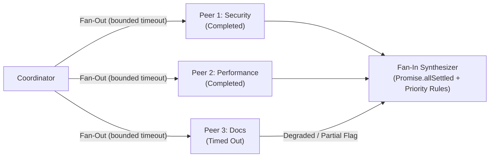

# Chapter 07 — Parallel Delegation & Fan-In Synthesis

> **Lecture 14 · Chapter 07 of 07** · Level: 🟠 Advanced · Phase 3 — Agency, Graphs & Loop Engineering
> **Source:** `FDE S06` · **Roadmap Reference:** [`roadmap-v1.md`](../../roadmap-v1.md#lecture-14--advanced-loop-engineering-adaptive-topologies--a2a-protocol)
> **Roadmap topics:** Parallel A2A fan-out · partial-failure handling (`Promise.allSettled`) · per-branch timeouts · fan-in synthesis & conflict reconciliation · end-to-end cost/trace aggregation.

---

## 07.0 What this chapter is for

When a coordinator decomposes a goal into independent sub-tasks (e.g., *Security Audit*, *Performance Analysis*, and *Cost Estimation*), running them sequentially multiplies wall-clock latency by $N$. **Parallel A2A delegation** dispatches all $N$ tasks concurrently and synthesizes their artifacts in a **Fan-In** step.

Parallelism introduces two production challenges: **partial failures** (2 of 3 peers succeed, 1 times out) and **conflicting recommendations** (Security says *"block"*, Performance says *"ship"*).

By the end of this chapter you should be able to:

1. Dispatch parallel A2A tasks with **per-branch timeouts** and **`Promise.allSettled`** resilience.
2. Design a **Fan-In Synthesizer** that reconciles conflicting peer artifacts using explicit priority rules.
3. Aggregate **token/cost usage and trace IDs** across all delegated A2A branches against the parent loop budget.

---

## 07.1 Parallel Fan-Out with `Promise.allSettled`

Never use bare `Promise.all` for multi-agent delegation: if one non-critical peer throws a `503`, `Promise.all` discards the completed work of the other $N-1$ peers.



### Partial-failure policy

Classify each delegated sub-task as **`required`** or **`best_effort`**:
- If a **`required`** peer fails (e.g., *Security Compliance*), the Fan-In step triggers a **Pivot** or **Escalation** — never silently approve.
- If a **`best_effort`** peer fails (e.g., *Optional Changelog Summary*), synthesize the remaining artifacts and attach a `warnings: ["DocsAgent timed out"]` field.

```typescript
// Concrete Fan-Out with per-branch timeout & Promise.allSettled
const results = await Promise.allSettled(
  branches.map((b) =>
    callA2APeer(b.agentUrl, b.task, { signal: AbortSignal.timeout(b.timeoutMs) })
  )
);
```

---

## 07.2 Conflict reconciliation in Fan-In synthesis

When two peer agents return conflicting conclusions, **never let the synthesizer average them or flip a coin**. Define deterministic precedence rules:

1. **Veto Precedence:** Any `BLOCKER` or `REJECT` from a compliance/security peer overrides `APPROVE` from a feature peer.
2. **Evidence Weighting:** Prefer artifacts backed by deterministic tool outputs (e.g., test exit codes, SQL query plans) over pure LLM prose.
3. **Explicit Conflict Escalation:** If two `required` peers disagree on a high-stakes decision, emit `status: "CONFLICT_ESCALATED"` for human resolution.

---

## 07.3 Aggregating budgets across A2A boundaries

Every A2A task response should report `{ tokensUsed, costUsd, durationMs }`. The coordinator sums these into the parent run's **Budget Ledger** (Chapter 02) so parallel fan-out cannot bypass `maxCostUsd`.

---

## 07.4 Key takeaways

1. **Use `Promise.allSettled` + per-branch timeouts** so one slow peer cannot hang or discard the entire fan-out.
2. **Mark branches `required` vs. `best_effort`** and enforce deterministic veto/precedence rules during Fan-In synthesis.
3. **Roll up every peer's token/dollar usage** into the parent loop's budget ledger.

---

**Next:** [Lecture 14 — Complete Notes (Master Consolidation)](./Lecture_14_Complete_Notes.md)

