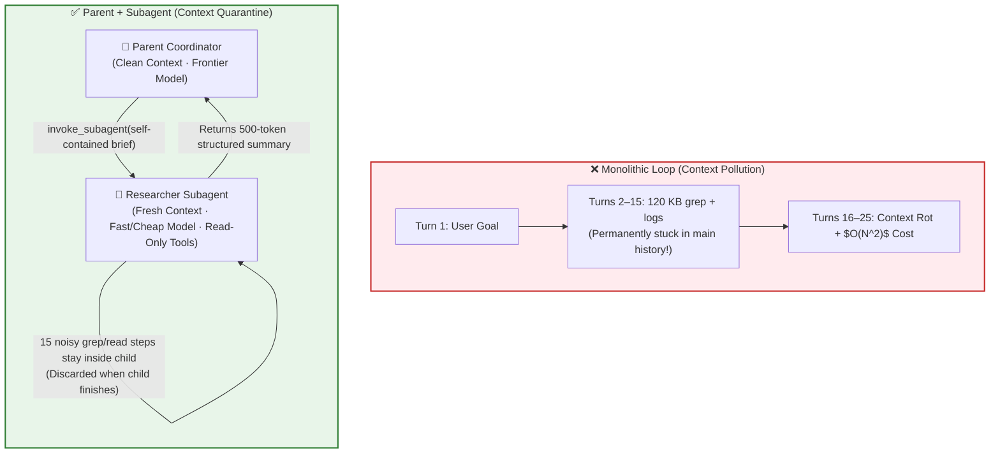
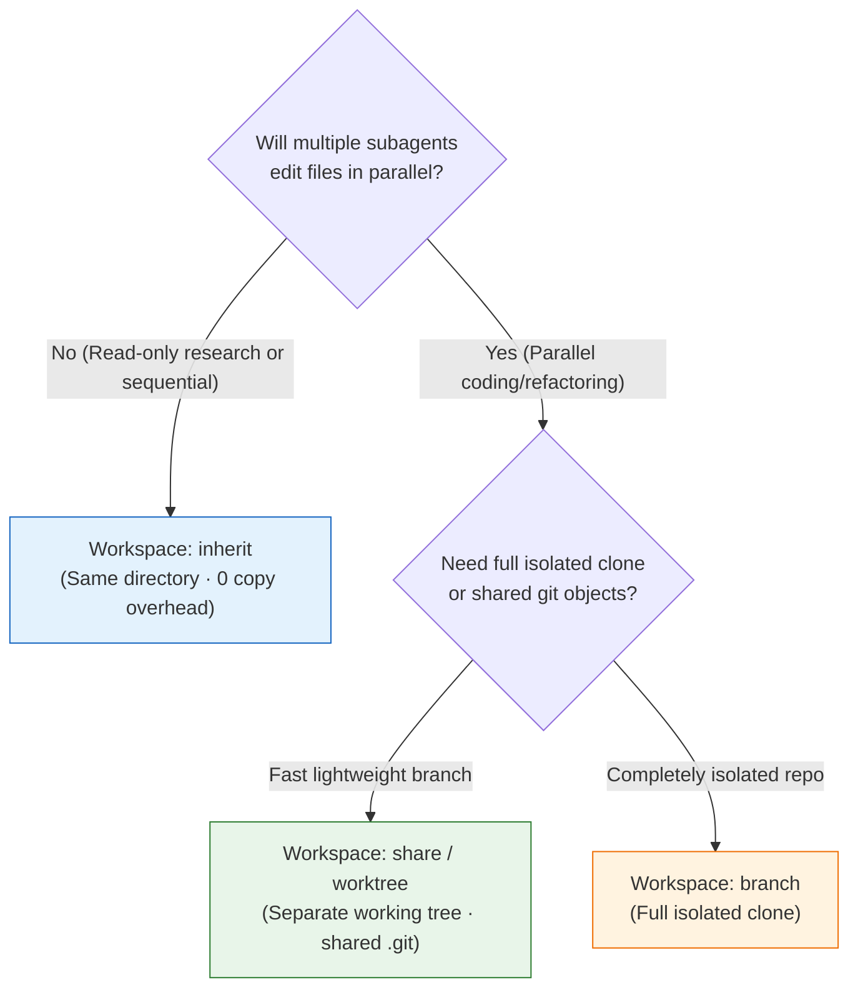

# Chapter 08 — Subagent Architectures: Context Isolation, Specialization & Delegation

> **Lecture 14 · Chapter 08 of 08** · Level: 🟠 Advanced · Phase 3 — Agency, Graphs & Loop Engineering
> **References:**
> - [LangChain DeepAgents — Subagents](https://docs.langchain.com/oss/javascript/deepagents/subagents)
> - [Claude Code — Sub-agents](https://code.claude.com/docs/en/sub-agents)
> - [Google Antigravity SDK — Subagents](https://antigravity.google/docs/sdk/subagents/)
> **Roadmap topics:** Context quarantine · **LangChain DeepAgents** (`SubAgent`, `CompiledSubAgent`, `general-purpose`, `task` tool) · **Claude Code** (`.claude/agents/*.md`, `Explore`, `Plan`, `isolation: worktree`, `background: true`, `memory`, `maxTurns`) · **Antigravity SDK** (`define_subagent`, `invoke_subagent`, `send_message`, `Workspace: inherit | share | branch`, reactive wakeup) · writing self-contained subagent briefs · Subagents vs. Skills vs. MCP vs. A2A.

---

## 08.0 What this chapter is for

Imagine you ask a senior architect: *"Find where auth token refresh handles clock skew, fix it, and check if billing has the same bug."*

If that one agent opens 40 files, reads 120 KB of stack traces, and runs 15 failed `grep` commands inside **its own** conversation history, two things happen immediately:
1. **Context Rot:** The 120 KB of noisy dead-end search results drown out the original goal and coding standards.
2. **Quadratic Cost ($O(N^2)$):** Every remaining turn re-sends those 120 KB of dead-end tool outputs to an expensive frontier model.

**Subagents** solve this with **Context Quarantine**: think of a **lead surgeon** dispatching a **diagnostic lab**. The lab runs 15 messy tests in its own clean room, throws away the raw test tubes, and hands the surgeon a **one-page summary**.

By the end of this chapter you should be able to:

1. Explain **Context Quarantine** and calculate the token/cost savings of subagent delegation.
2. Build and configure subagents in **LangChain DeepAgents**, **Claude Code**, and **Google Antigravity SDK**.
3. Choose the right **Workspace Isolation Mode** (`inherit`, `share` worktree, or `branch` clone) for read-only vs. parallel-write tasks.
4. Write **self-contained subagent briefs** (knowing a fresh child sees *zero* parent history).
5. Distinguish **Subagents**, **Skills**, **MCP**, and **A2A** cleanly in architecture reviews.

---

## 08.1 Context Quarantine & The Token Math



### Worked Cost & Context Calculation
Suppose an agent must run 10 more reasoning turns *after* investigating a 30,000-token codebase search:
- **Monolithic loop (`$3 / 1M` input tokens):** $30,000 \text{ tokens} \times 10 \text{ turns} = \mathbf{300,000}$ extra input tokens ($\mathbf{\$0.90}$ wasted just re-reading old search noise).
- **Subagent (`flash`/`haiku` at `$0.25 / 1M`):** Subagent consumes 30,000 tokens internally ($\mathbf{\$0.0075}$), discards its intermediate tool outputs, and returns a **600-token summary**. The parent carries $600 \times 10 = \mathbf{6,000}$ tokens ($\mathbf{\$0.018}$) → **98% cleaner parent context and ~35× lower search-carryover cost**.

> [!IMPORTANT]
> **The Golden Rule of Subagents:** A subagent is **not** just "another prompt." It is an **isolated execution boundary** with: (1) its own fresh message history, (2) a scoped tool allow-list, (3) an optional cheaper/faster model, and (4) an explicit workspace isolation mode.

---

## 08.2 Three Production Subagent Frameworks Compared

| Dimension | **LangChain DeepAgents** | **Claude Code Sub-agents** | **Google Antigravity SDK** |
| :--- | :--- | :--- | :--- |
| **Definition Format** | TS/JS `SubAgent` object (`name`, `description`, `systemPrompt`, `tools`, `model`) or `CompiledSubAgent` (`StateGraph`) | Markdown + YAML frontmatter in `.claude/agents/*.md` (project) or `~/.claude/agents/*.md` (user) | Programmatic `define_subagent({ Name, Description, SystemPrompt, EnableWriteTools, EnableMCPTools })` |
| **Built-in Subagents** | `general-purpose` (inherits parent tools + model) | **`Explore`** (Haiku, read-only), **`Plan`** (read-only), **`General-purpose`** (full tools) | `self`, `research` (read-only), `browser` (Chrome DevTools), `image-generator` |
| **Delegation Mechanism** | Built-in `task(name, description)` tool routed by `description` | Auto-routed via `description` or explicit `@agent` mention | `invoke_subagent({ TypeName, Role, Prompt, Model, Workspace })` |
| **Workspace Isolation** | Shared state / virtual filesystem middleware | `isolation: worktree` (temporary git worktree; auto-deleted if clean) | `Workspace`: `inherit` \| `share` (git worktree) \| `branch` (isolated clone) |
| **Recursion / Nesting** | Controlled via tool list | **Strictly blocked** (subagents cannot spawn subagents) | Explicit opt-in (`EnableSubagentTools: true`; default `false`) |
| **Execution Mode** | Sync `task` tool or LangGraph checkpointer | Foreground (blocking) or `background: true` (concurrent) | **Reactive wakeup** + `send_message(conversationId, msg)` (zero polling!) |

---

## 08.3 Concrete Examples Across All 3 Frameworks

### 1. LangChain DeepAgents (`SubAgent` & `CompiledSubAgent`)
In **DeepAgents**, the parent agent gets a single `task` tool. You register specialized subagents with narrow tools and a clear `description` so the parent routes cleanly:

```ts
const researchSubagent = {
  name: "code-researcher",
  description: "Read-only codebase explorer. Use for searching files, tracing auth flows, and summarizing findings.",
  systemPrompt: "Search the repo using grep/read tools. Return ONLY verified file paths, line numbers, and a 5-bullet summary.",
  tools: [grepTool, readFileTool], // No write/bash tools!
  model: "claude-haiku-4-5",       // Fast, cheap model for exploration
};
```
*(Need deterministic multi-step workflows inside a subagent? DeepAgents also lets you mount a **compiled LangGraph `StateGraph`** as a `CompiledSubAgent`.)*

### 2. Claude Code Sub-agents (`.claude/agents/*.md`)
Claude Code defines subagents declaratively as Markdown files with YAML frontmatter. Notice how **least-privilege**, **worktree isolation**, **turn caps**, and **persistent memory** are all configured declaratively:

```markdown
---
name: security-reviewer
description: Audits staged diffs for OWASP Top 10, secret leaks, and missing auth checks.
tools: Read, Grep, Glob, Bash
disallowedTools: Write, Edit
model: sonnet
permissionMode: plan
isolation: worktree
maxTurns: 12
memory: project
---
You are a strict security reviewer. Inspect the diff, verify every claim against actual files,
and return a severity-ranked list (Critical / High / Medium) with exact file:line citations.
```

### 3. Google Antigravity SDK (`define_subagent` → `invoke_subagent` → `send_message`)
Antigravity treats subagents as **long-lived, addressable async actors** with explicit workspace isolation and reactive wakeup:

```text
1. define_subagent(Name, Description, SystemPrompt, EnableWriteTools, EnableMCPTools)
2. invoke_subagent(TypeName, Role, Prompt, Model: "flash" | "pro" | "inherit", Workspace: "inherit" | "share" | "branch")
   └─► Returns conversationId immediately (runs in background)
3. Parent ends turn (NO polling loop!) → System wakes Parent reactively when child finishes or asks a question
4. send_message(conversationId, Message) → Resume the SAME subagent in its existing context/tab
5. manage_subagents("list" | "kill" | "kill_all") → Lifecycle cleanup
```

---

## 08.4 Workspace Isolation, Execution Modes & Writing Briefs

### 1. Choosing the Right Workspace Mode



### 2. Writing Self-Contained Subagent Briefs
> [!WARNING]
> **A fresh subagent sees ZERO parent conversation history.** Never write: *"Fix the bug we just discussed above."* Always include:
> 1. **Exact Goal & Scope:** Which files/modules it owns (and what it must *not* touch).
> 2. **Relevant Context:** Error logs, schema constraints, or decisions already made by the user.
> 3. **Definition of Done & Output Format:** What command to run (`npm test`) and what concise summary to return.

### 3. Foreground vs. Background vs. Reactive Wakeup
- **Foreground (Blocking):** Parent waits for the subagent's result before continuing — best when the next step depends 100% on the child's answer.
- **Background / Reactive Wakeup:** Launch 3 independent subagents in parallel (`auth/`, `billing/`, `ui/`), stop calling tools, and let the runtime wake the parent automatically as each child reports back. **Never** write a `while` loop polling child status!

---

## 08.5 Subagents vs. Skills vs. MCP vs. A2A (The 4-Way Map)

| Primitive | What It Is | Context & Isolation | When To Use |
| :--- | :--- | :--- | :--- |
| **MCP** (L27–28) | Standardized tool/resource protocol | Runs externally; results enter caller's context | Connecting an agent to DBs, APIs, SaaS tools |
| **Skills** (L29) | Progressive `SKILL.md` workflow instructions + scripts | Loads into the **same** agent's context | Teaching repeatable domain workflows (1–3 files) |
| **Subagents** (L14 Ch 08) | Isolated child agent inside **your** harness/SDK | **Separate fresh context** + scoped tools + worktree | Noisy search/exploration, parallel writers, independent review |
| **A2A** (L14 Ch 06) | Cross-runtime/cross-org HTTP peer protocol | Separate deployed service behind `agent.json` | Delegating across independent teams, vendors, or services |

---

## 08.6 Common Mistakes

| # | Common Mistake | Why It Hurts | What To Do Instead |
| :---: | :--- | :--- | :--- |
| 1 | **Running parallel writer subagents on `workspace: inherit`** | Race conditions overwrite edits and break `git` state | Use **`share` / `worktree` / `branch`** isolation for every parallel writer. |
| 2 | **Writing vague prompts like *"continue what we talked about"*** | Fresh subagent has **0 parent history** and guesses blindly | Write a **self-contained brief** with file paths, constraints, and done criteria. |
| 3 | **Allowing unbounded subagent-spawns-subagent nesting** | $k^d$ exponential fork bomb blows token/dollar budgets | Disable nested spawning (`allowNestedSubagents: false`) or cap `maxDepth` + share one Budget Ledger. |
| 4 | **Polling subagent status in an LLM loop** | Wastes tokens and turns asking *"done yet?"* | Use **reactive wakeup** / async callbacks (`send_message` / `Promise.allSettled`). |
| 5 | **Using frontier `pro`/`opus` models for `Explore` subagents** | Pays 10× more for simple grep/file discovery | Pin read-only exploration subagents to fast/cheap **`flash`/`haiku`** models. |

---

## 08.7 Key Takeaways

1. **Context Quarantine is the #1 reason subagents exist:** Keep noisy intermediate searches out of the parent's context window and return only a concise summary.
2. **Every modern agent system converges on 4 subagent knobs:** `tools` (least privilege), `model` (cost/speed tier), `workspace` (`inherit` vs. `worktree`/`share`/`branch`), and `description` (routing contract).
3. **Never poll and never nest without a budget:** Use reactive wakeup for async subagents, disable uncontrolled recursion, and roll all child token costs into the parent Budget Ledger.

---

**Next:** [Lecture 14 — Complete Notes (Master Consolidation)](./Lecture_14_Complete_Notes.md)
