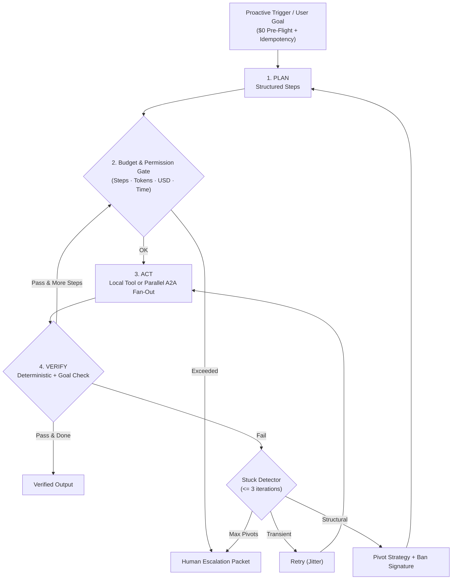

# Lecture 14 — Complete Notes
## Loop Engineering (`Plan-Act-Verify`, Stuck Detection) & A2A Protocol

> **Phase:** 3 · Agency, Graphs & Loop Engineering · **Level:** 🟠 Advanced
> **Scope:** A single-pass consolidation of the seven chapter notes in this folder.
> **How to use this file:** Read it to *revise and navigate*. Every section links back to the chapter that explains it in full.
>
> | Chapter | File |
> | :--- | :--- |
> | 01 · Beyond ReAct: Plan-Act-Verify loops | [01_Beyond_ReAct_Plan_Act_Verify_Loops.md](./01_Beyond_ReAct_Plan_Act_Verify_Loops.md) |
> | 02 · Bounded goal loops & budget enforcement | [02_Bounded_Goal_Loops_and_Budget_Enforcement.md](./02_Bounded_Goal_Loops_and_Budget_Enforcement.md) |
> | 03 · Proactive triggers: heartbeat, cron & events | [03_Proactive_Triggers_Heartbeat_Cron_and_Events.md](./03_Proactive_Triggers_Heartbeat_Cron_and_Events.md) |
> | 04 · Stuck detection, retry, pivot & escalation | [04_Stuck_Detection_Retry_Pivot_and_Escalation.md](./04_Stuck_Detection_Retry_Pivot_and_Escalation.md) |
> | 05 · Static vs. adaptive agent graph topologies | [05_Static_vs_Adaptive_Agent_Graph_Topologies.md](./05_Static_vs_Adaptive_Agent_Graph_Topologies.md) |
> | 06 · The A2A (Agent-to-Agent) protocol | [06_The_A2A_Agent_to_Agent_Protocol.md](./06_The_A2A_Agent_to_Agent_Protocol.md) |
> | 07 · Parallel delegation & fan-in synthesis | [07_Parallel_Delegation_and_Fan_In_Synthesis.md](./07_Parallel_Delegation_and_Fan_In_Synthesis.md) |

---

## 1. Executive summary

**The lecture in five sentences.**

1. **Plan-Act-Verify (PAV)** separates explicit planning, bounded execution, and deterministic verification so multi-step loops do not drift or declare premature victory like raw ReAct.
2. Every production loop must enforce **four hard budgets** (`maxSteps`, `maxTokens`, `maxCostUsd`, `maxDurationMs`) and **harness-level tool permissions** (`READ_ONLY`, `SCOPED_WRITE`, `APPROVAL_REQUIRED`, `FORBIDDEN`).
3. **Proactive triggers** (heartbeat, cron, webhooks) must run a **`$0` deterministic pre-flight check** and enforce **idempotency keys + cooldowns** before waking an LLM.
4. A **Stuck Detector** catches exact repeats, A-B-A-B oscillations, and zero-progress streaks within $\le 3$ iterations — **retrying** only transient errors, **pivoting** on structural failures, and **escalating** with a structured handoff packet when pivots are exhausted.
5. **Adaptive topologies** and the **A2A Protocol** (Agent Cards, stateful task lifecycle, and `Promise.allSettled` parallel fan-out/fan-in) let coordinator agents discover and delegate to opaque specialist peers while aggregating costs into the parent budget.

---

## 2. The arc of the lecture in one diagram

---

## 3. Cheat sheet

| Concept | One-line definition | Chapter |
| :--- | :--- | :--- |
| **Plan-Act-Verify (PAV)** | Explicit separation of planning, execution, and post-condition verification | [01](./01_Beyond_ReAct_Plan_Act_Verify_Loops.md) |
| **4D Loop Budget** | Hard caps on `maxSteps`, `maxTokens`, `maxCostUsd`, and `maxDurationMs` | [02](./02_Bounded_Goal_Loops_and_Budget_Enforcement.md) |
| **Tool Permission Tiers** | `READ_ONLY`, `SCOPED_WRITE`, `APPROVAL_REQUIRED`, `FORBIDDEN` enforced in code | [02](./02_Bounded_Goal_Loops_and_Budget_Enforcement.md) |
| **`$0` Pre-Flight Filter** | Deterministic state-diff check before waking an LLM on heartbeat/cron | [03](./03_Proactive_Triggers_Heartbeat_Cron_and_Events.md) |
| **Stuck Heuristics** | Exact repeat, A-B-A-B oscillation, and zero-progress error streaks | [04](./04_Stuck_Detection_Retry_Pivot_and_Escalation.md) |
| **Retry vs. Pivot** | Retry transient infra errors; Pivot (ban signature + re-plan) on structural errors | [04](./04_Stuck_Detection_Retry_Pivot_and_Escalation.md) |
| **Adaptive Topology** | Runtime fan-out/fan-in bounded by `maxFanOut` and `maxDepth` | [05](./05_Static_vs_Adaptive_Agent_Graph_Topologies.md) |
| **MCP vs. A2A** | MCP = Agent $\leftrightarrow$ Tool; A2A = Agent $\leftrightarrow$ Opaque Peer Agent | [06](./06_The_A2A_Agent_to_Agent_Protocol.md) |
| **Agent Card** | `/.well-known/agent.json` advertising peer capabilities, URL, and skills | [06](./06_The_A2A_Agent_to_Agent_Protocol.md) |
| **Fan-In Synthesis** | `Promise.allSettled` + required/best-effort + veto precedence reconciliation | [07](./07_Parallel_Delegation_and_Fan_In_Synthesis.md) |

---

## 4. Self-check questions (Release Gate Prep)

1. Why does raw ReAct suffer from goal drift and premature victory, and how does Plan-Act-Verify fix both?
2. Why must loop budgets be checked *before* dispatching the next model call rather than only after?
3. How do you prevent a 5-minute heartbeat loop from burning LLM tokens when nothing in the repo changed?
4. Given an infinite tool-failure loop (`400 Bad Request` on every call), why is **Retry** wrong and how does **Pivot** recover within 3 iterations?
5. When should you use **A2A** instead of **MCP**, and what does an **Agent Card** contain?
6. Why must parallel A2A fan-out use `Promise.allSettled` with per-branch timeouts instead of `Promise.all`?

