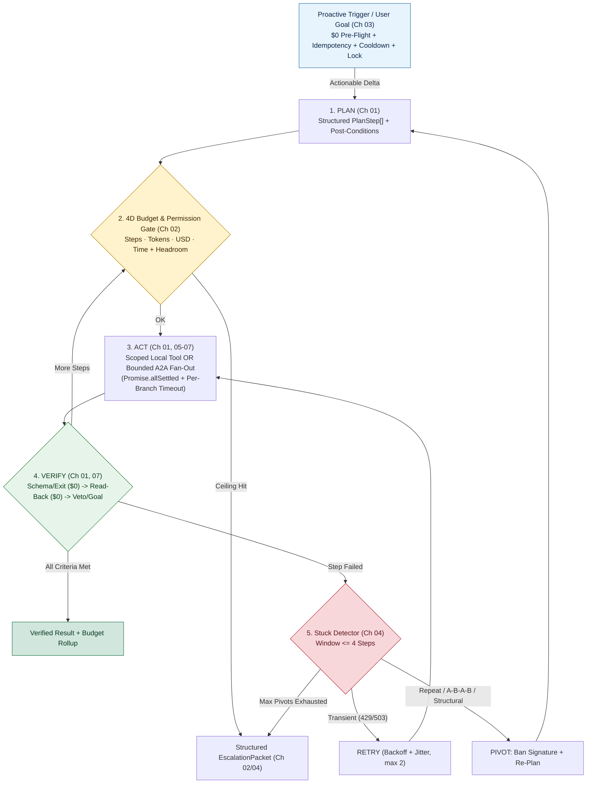

# Lecture 14 — Complete Notes
## Loop Engineering (`Plan-Act-Verify`, Stuck Detection) & A2A Protocol

> **Phase:** 3 · Agency, Graphs & Loop Engineering · **Level:** 🟠 Advanced
> **Scope:** Master revision guide consolidating all seven chapters of Lecture 14.
> **Thesis:** Production agent loops replace fragile, unbounded ReAct chat cycles with **Plan-Act-Verify (PAV)** state machines, **4D budgets & code-enforced tool permissions**, **`$0` pre-flight proactive triggers**, **$\le 4$-step stuck detection**, **bounded adaptive topologies**, and **opaque A2A parallel fan-out/fan-in synthesis**.

---

## 1. Executive Summary

**The lecture in five sentences:**

1. **Plan-Act-Verify (PAV)** separates explicit structured planning, bounded execution, and deterministic-first verification so multi-step workflows (5–30 steps) do not suffer from goal drift, premature victory, or action-verification blindness.
2. Every production loop must enforce **four hard budgets** (`maxSteps`, `maxTokens`, `maxCostUsd`, `maxDurationMs`) with pre-call headroom checks, alongside **code-enforced tool permissions** (`READ_ONLY`, `SCOPED_WRITE`, `APPROVAL_REQUIRED`, `FORBIDDEN`) and per-tool call caps.
3. **Proactive triggers** (heartbeat, cron, webhooks) must run a **`$0` deterministic pre-flight filter** before waking an LLM and enforce **idempotency keys, singleton locks, cooldowns, and quiet hours**.
4. A **Stuck Detector** catches exact repeats, A-B-A-B oscillations, and zero-progress streaks within $\le 4$ iterations — **retrying** only transient infra errors (`429`/`503`), **pivoting** (banning the failing signature + re-planning) on structural errors, and **escalating** with a structured `EscalationPacket`.
5. **Bounded adaptive topologies** (`maxFanOut`, `maxDepth`, shared budget ledger) and the **A2A Protocol** (`/.well-known/agent.json`, stateful task lifecycle, `Promise.allSettled` fan-out with deterministic veto precedence) enable safe cross-agent orchestration.

### Chapter Index

| Chapter | Topic | Core Focus | File |
| :---: | :--- | :--- | :--- |
| **01** | Beyond ReAct: PAV Loops | ReAct failure modes, Plan-Act-Verify separation, 3-layer verification hierarchy | [01_Beyond_ReAct_Plan_Act_Verify_Loops.md](./01_Beyond_ReAct_Plan_Act_Verify_Loops.md) |
| **02** | Bounded Loops & Budgets | 4D loop caps, pre-call headroom, tool permission tiers, resumable checkpoints | [02_Bounded_Goal_Loops_and_Budget_Enforcement.md](./02_Bounded_Goal_Loops_and_Budget_Enforcement.md) |
| **03** | Proactive Triggers | Heartbeat/cron/webhooks, `$0` pre-flight filters, idempotency, cooldowns, locks | [03_Proactive_Triggers_Heartbeat_Cron_and_Events.md](./03_Proactive_Triggers_Heartbeat_Cron_and_Events.md) |
| **04** | Stuck Detection & Recovery | Exact repeat, oscillation, zero-progress, Retry vs. Pivot, `EscalationPacket` | [04_Stuck_Detection_Retry_Pivot_and_Escalation.md](./04_Stuck_Detection_Retry_Pivot_and_Escalation.md) |
| **05** | Static vs. Adaptive Graphs | Static DAGs vs. runtime fan-out, 3 multi-agent topologies, stopping fork bombs | [05_Static_vs_Adaptive_Agent_Graph_Topologies.md](./05_Static_vs_Adaptive_Agent_Graph_Topologies.md) |
| **06** | The A2A Protocol | MCP vs. A2A, Agent Cards (`agent.json`), stateful task lifecycle, trace/cost metadata | [06_The_A2A_Agent_to_Agent_Protocol.md](./06_The_A2A_Agent_to_Agent_Protocol.md) |
| **07** | Parallel Delegation & Fan-In | `Promise.allSettled`, `required` vs. `best_effort`, veto precedence, ledger rollup | [07_Parallel_Delegation_and_Fan_In_Synthesis.md](./07_Parallel_Delegation_and_Fan_In_Synthesis.md) |

---

## 2. Master Architecture Diagram

---

## 3. Chapter-by-Chapter Short Revision Notes

### 3.1 Chapter 01 — Beyond ReAct: Plan-Act-Verify Loops

Raw ReAct (`Reason → Act → Observe → Repeat`) works for 1–4 step lookups but fails in 10–30 step workflows via **goal drift** (objective buried in noisy tool output), **premature victory** (declaring "Done!" after one `200 OK`), and **action-verification blindness** (never reading back writes). **Plan-Act-Verify (PAV)** separates an explicit `PlanStep[]` artifact (`PlanNode`), single-step execution (`ActNode`), and post-condition checking (`VerifyNode`).

- **3-Layer Verification Hierarchy:** (1) Schema / exit code / HTTP `2xx` (`$0`, `< 1 ms`), (2) State read-back (`$0`, `5–50 ms`), (3) LLM semantic judge (`$$`, reserved for final goal satisfaction).
- **Cost & Stability:** Re-plan *only* at start or on pivot; keeping the active plan stable preserves prompt prefix caching and cuts 15-step workflow cost by ~88% vs. re-reasoning every step on System-2 (`$0.035` vs. `$0.30`).

> 📖 **Need depth?** Read [Chapter 01 — Beyond ReAct: Plan-Act-Verify Loops](./01_Beyond_ReAct_Plan_Act_Verify_Loops.md)

### 3.2 Chapter 02 — Bounded Goal Loops & Budget Enforcement

Unbounded `while (!done)` loops are denial-of-wallet vulnerabilities. Production loops enforce **four hard ceilings** before *every* `Act()` call with **pre-call headroom** (`remainingUsd >= estimatedNextCallUsd`) so a System-2 call never overshoots mid-stream, plus a **soft threshold** (`>= 75%`) to compact history or downgrade to System-1. When halted, emit a resumable checkpoint (`completedSteps`, `pendingSteps`, `totalCostUsd`) rather than throwing away completed work.

| Budget Cap | Interactive | Background | Tool Permission Tier | Policy |
| :--- | :---: | :---: | :--- | :--- |
| **`maxSteps`** | `8–15` | `25–50` | `READ_ONLY` | Auto-execute up to `maxCallsPerRun` |
| **`maxTokens`** | `25k–60k` | `150k–300k` | `SCOPED_WRITE` | Allowed prefix/tenant scope only |
| **`maxCostUsd`** | `$0.10–$0.50` | `$1.00–$5.00` | `APPROVAL_REQUIRED` | Pause for signed HITL approval |
| **`maxDurationMs`** | `30s` | `300s` | `FORBIDDEN` | Reject immediately in harness code |

> 📖 **Need depth?** Read [Chapter 02 — Bounded Goal Loops & Budget Enforcement](./02_Bounded_Goal_Loops_and_Budget_Enforcement.md)

### 3.3 Chapter 03 — Proactive Triggers: Heartbeat, Cron & Events

Proactive agents wake up via **Heartbeats** (fixed polling, e.g., `5m`), **Cron schedules** (calendar expressions), or **Event-Driven triggers** (webhooks/queues). The golden rule is **separate the sensor from the reasoner**: run a **`$0` deterministic pre-flight filter** (`git ls-remote`, `ETag`, `error_rate > 0.05`) first so idle ticks cost zero tokens (cutting a 5-min PR monitor from `$259.20/mo` to `$1.80/mo` per repo — **99.3% savings**).

- **Reliability Guards:** Return `202 Accepted` fast on webhooks and deduplicate via **idempotency keys** (`triggerType:entityId:version`), enforce **per-entity cooldowns** (bypassed only on `critical`), acquire **singleton locks** on cron jobs to prevent overlaps, and apply **quiet-hours** batching (`22:00–07:00`) for non-critical alerts.

> 📖 **Need depth?** Read [Chapter 03 — Proactive Triggers: Heartbeat, Cron & Events](./03_Proactive_Triggers_Heartbeat_Cron_and_Events.md)

### 3.4 Chapter 04 — Stuck Detection, Retry, Pivot & Escalation

Waiting for `maxSteps = 25` to catch a broken loop wastes ~88% more tokens (`$0.375` vs. `$0.045`) than catching it early. Track a sliding window of normalized step signatures `hash(toolName + normalizedArgs + errorClass)` and diagnose stuck states within **2–4 iterations**:
- **Exact Repeat:** Identical signature `>= 2` consecutive steps.
- **Oscillation (A-B-A-B):** `h[n-1] === h[n-3] && h[n-2] === h[n-4]`.
- **Zero-Progress Streak:** `3` consecutive steps with `progressed === false`.

- **Recovery Policy:** **Retry** (exponential backoff + jitter, `maxRetries = 2`) *only* for transient errors (`429`, `503`, timeouts). **Pivot** (add signature to `bannedSignatures`, escalate to System-2, re-plan) for structural errors (`400`, `403`, `404`, repeats, oscillations). **Escalate** with a compact `EscalationPacket` when `maxPivots` is exhausted.

> 📖 **Need depth?** Read [Chapter 04 — Stuck Detection, Retry, Pivot & Escalation](./04_Stuck_Detection_Retry_Pivot_and_Escalation.md)

### 3.5 Chapter 05 — Static vs. Adaptive Agent Graph Topologies

Default to a **Static DAG** (compile-time fixed nodes/edges) whenever steps are known upfront; upgrade to an **Adaptive Topology** (runtime `Send()` or worker-pool fan-out) only when sub-task count $N$ is data-dependent. Multi-agent coordination follows three patterns: **Supervisor-Worker**, **Hierarchical Tree**, or **Peer-to-Peer A2A Mesh**.

- **Stopping Fork Bombs:** Without limits, 5 workers spawning 5 sub-workers at depth 3 launches $5^3 = 125$ concurrent loops! Enforce `maxFanOut` (width cap), `maxDepth` (recursion cap), cycle detection (`visitedAgents[]`), keyed output slots (`results[branchId]`), and a **single shared parent Budget Ledger**.

> 📖 **Need depth?** Read [Chapter 05 — Static vs. Adaptive Agent Graph Topologies](./05_Static_vs_Adaptive_Agent_Graph_Topologies.md)

### 3.6 Chapter 06 — The A2A (Agent-to-Agent) Protocol

**MCP** is vertical (**Agent $\leftrightarrow$ Tool/Resource**, `tools/list`, short calls); **A2A** is horizontal (**Agent $\leftrightarrow$ Opaque Peer Agent**, `tasks/send`, long-running stateful tasks). Peers advertise capabilities via an **Agent Card** at `/.well-known/agent.json` (`url`, `capabilities`, `skills[]` with tags) while keeping their internal prompts, loops, and private credentials **opaque**.

- **Stateful Task Lifecycle:** `submitted` $\rightarrow$ `working` $\rightarrow$ `completed` / `failed` / `canceled`, plus `input-required` for mid-task clarification or HITL. Always propagate `traceId` and `maxCostUsd` in task metadata and return `{ tokensUsed, costUsd }`.

> 📖 **Need depth?** Read [Chapter 06 — The A2A (Agent-to-Agent) Protocol](./06_The_A2A_Agent_to_Agent_Protocol.md)

### 3.7 Chapter 07 — Parallel Delegation & Fan-In Synthesis

Sequential A2A calls multiply latency ($\sum t_i$); parallel fan-out cuts wall-clock time to $\max(t_i)$ (e.g., `15s` $\rightarrow$ `6s`, 2.5× faster). Never use bare `Promise.all` (one `503` discards all other peers' completed work and spent tokens). Always use **`Promise.allSettled`** with **`AbortSignal.timeout(branch.timeoutMs)`** and classify each branch as `required` or `best_effort`.

- **Deterministic Conflict Reconciliation:** Compute the final verdict in code *before* LLM prose synthesis: (1) if any `required` branch fails $\rightarrow$ Escalate/Pivot; (2) **Veto Precedence** — any `REJECT`/`BLOCKER` from security/compliance overrides `APPROVE`; (3) roll up $\text{TotalRunCost} = C_{\text{coord}} + \sum C_{\text{peer},i}$ into the parent Budget Ledger.

> 📖 **Need depth?** Read [Chapter 07 — Parallel Delegation & Fan-In Synthesis](./07_Parallel_Delegation_and_Fan_In_Synthesis.md)

---

## 4. Cheat Sheet & Common Traps

### 4.1 Quick Reference

| Pattern | Key Mechanism | Primary Benefit |
| :--- | :--- | :--- |
| **PAV Loop** | Explicit `PlanStep[]` + `$0` post-condition checks | Eliminates goal drift & premature victory |
| **4D Budget** | Pre-call headroom check on Steps, Tokens, USD, Time | Prevents denial-of-wallet overshoots |
| **`$0` Pre-Flight** | Deterministic diff check before LLM wake-up | Cuts idle heartbeat costs by `> 99%` |
| **Stuck Detector** | Sliding window + `bannedSignatures` + `EscalationPacket` | Halts/pivots broken loops in `<= 4` steps |
| **A2A Fan-Out** | `Promise.allSettled` + `AbortSignal.timeout` + Veto Precedence | `max(t_i)` latency with safe partial failure |

### 4.2 Common Traps

| Trap | Why It Breaks Production | Fix |
| :--- | :--- | :--- |
| **Re-planning after every `Act` step** | Burns System-2 tokens and busts prefix cache | Re-plan only at start or when `Verify` triggers a pivot. |
| **Checking `maxCostUsd` only *after* calls** | One 32k-token System-2 call overshoots cap by 3× | Run pre-call headroom checks + set per-call `max_tokens`. |
| **Retrying deterministic `400` / `403` errors** | Invalid args never self-heal; wastes steps | Classify errors: Retry `429`/`503`; **Pivot** on `400`/`403`/`404`. |
| **Giving child workers separate budgets** | $5^3$ adaptive fan-out multiplies spend past parent cap | Deduct all child & A2A peer costs from one shared Budget Ledger. |
| **Using `Promise.all` or LLM voting in Fan-In** | One timeout drops all results; prose dilutes `REJECT` vetoes | Use `Promise.allSettled` + deterministic Veto Precedence in code. |

---

## 5. Self-Check Questions (Release Gate Prep)

1. What are the three failure modes of raw ReAct in 10–30 step workflows, and how does Plan-Act-Verify's 3-layer verification hierarchy solve them?
2. Why must a loop check **all four budget dimensions** *with pre-call headroom* before dispatching a System-2 call, and why are prompt-only tool restrictions insufficient?
3. Calculate the monthly savings of a `$0` pre-flight filter on a 5-minute heartbeat monitor (`288` ticks/day at `$0.03`/call) when only `2` ticks/day have actual state changes.
4. Given an alternating `edit(A) -> fail -> edit(B) -> fail -> edit(A) -> fail -> edit(B)` trace, how does `detectStuck()` diagnose it, and why is **Retry** the wrong action?
5. How do `maxFanOut`, `maxDepth`, `visitedAgents[]`, and a shared Budget Ledger prevent fork bombs in adaptive topologies?
6. When should you choose **MCP** vs. **A2A**, and why must parallel A2A fan-out use `Promise.allSettled` + deterministic Veto Precedence?
