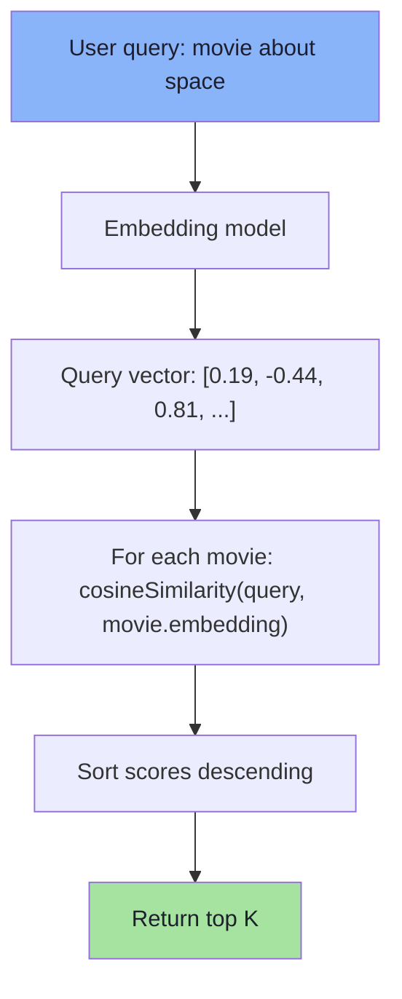
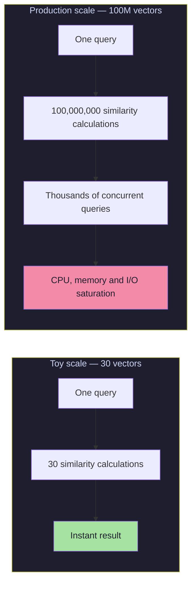
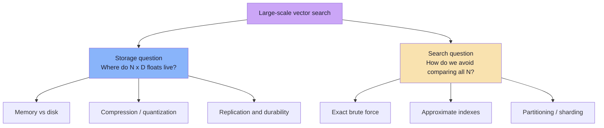
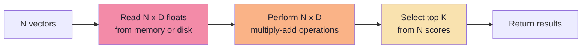
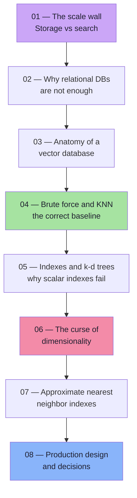

# Chapter 01: The Scale Wall — Why Toy Vector Search Breaks

> **Chapter Goal:** Start from the movie recommender built in Lecture 13 and push it past its limits. Understand exactly *which* assumption stops working when the catalogue grows from 30 vectors to hundreds of millions, and separate the two engineering problems that are often confused: **storing** vectors and **searching** them.

---

## 1.1 The Demo That Worked Beautifully

In Lecture 13 we built a movie recommendation engine with a tiny in-memory "vector database":



```ts
// Pseudo-code: the entire "vector database" from Lecture 13
interface Movie {
  id: string;
  title: string;
  description: string;
  embedding: number[]; // e.g. 1536 floats (float32)
}

const movies: Movie[] = [ /* 30 movies */ ];
```

With 30 movies, the loop runs 30 times. On a laptop this is effectively **instant** and **exact** — we compare against every vector, so we never miss the true nearest neighbour.

> **This is the correct starting point.** Every production vector system is an optimization of this exact loop.

---

## 1.2 Change One Variable: N

Replace the 30-movie catalogue with realistic scales:

| System | Approximate Vectors |
|--------|---------------------|
| Small SaaS knowledge base | 10,000 |
| Mid-size e-commerce catalogue | 1,000,000 |
| Spotify-scale music library | 100,000,000 |
| Large product marketplace | 500,000,000 |
| Web-scale search index | 10,000,000,000+ |

The algorithm does not change. The **cost** does.



With 100M vectors, a **single** query requires 100M comparisons. Multiply by thousands of queries/second. The naive design collapses because the **work per query grows linearly with dataset size**.

> **The scale wall:** An algorithm whose cost is proportional to the data size is fine for a demo and fatal for a product.

---

## 1.3 The Two Questions That Must Be Separated

```text
Question 1:  How do I STORE hundreds of millions of vectors?
Question 2:  How do I SEARCH those vectors efficiently?
```

They feel like one problem but are distinct:

| Concern | Storage Problem | Search Problem |
|---------|----------------|----------------|
| Core question | Where do the bytes live? | Which vectors are closest to this query? |
| Primary cost | Disk / RAM capacity, replication | CPU, memory bandwidth, I/O, latency |
| Typical solution | Object storage, DB, vector DB persistence | ANN index (HNSW, IVF, PQ, DiskANN) |
| Failure mode | "We ran out of memory" | "p99 latency is 4 seconds" |
| Independent? | Yes | Yes — index is a search structure, not storage format |



> **Common mistake:** Buying a "vector database" expecting it to solve both automatically. A vector DB provides both layers, but you must understand the trade-offs you select.

---

## 1.4 Why the Naive Approach Feels Deceptively Cheap

The brute-force loop hides three costs, all scaling badly:

### Cost 1 — Number of Comparisons
```text
comparisons per query = N
```
For N = 100M, that's 100M comparisons **per query**.

### Cost 2 — Work Inside One Comparison
An embedding has D dimensions (384, 768, 1536, 3072). Cosine similarity touches every dimension:
```text
work per comparison ≈ D
```
Real cost per query:
```text
work per query ≈ N × D
```

### Cost 3 — Bytes That Must Be Read
Each dimension is a number occupying memory. Before CPU can multiply, vectors must be fetched from RAM (or worse, disk). At scale, **memory bandwidth and I/O** often bottleneck before arithmetic.



Chapter 04 puts real numbers on these. Remember the shape: **read → compute → rank**.

---

## 1.5 Concrete Preview of the Wall

Suppose:
- N = 10,000,000 vectors
- D = 1536 dimensions
- Each dimension = float32 (4 bytes)

| Quantity | Calculation | Result |
|----------|-------------|--------|
| Dimension operations/query | 10,000,000 × 1536 | **15.36 billion** |
| Raw vector bytes | 10,000,000 × 1536 × 4 | **61.44 GB** |
| With IDs + metadata + overhead (1.3–2×) | | **80–120 GB** |

At 100M vectors, raw vector bytes alone ≈ **614 GB**.

> **Key observation:** The naive loop cost = linear function of dataset size × dimension count × query rate. All three multipliers are large in production.

---

## 1.6 What Changes in Our Thinking

The Lecture 13 mental model:
```text
REPRESENT → STORE → COMPARE → RANK
```

That model remains correct. Lecture 14 changes **how** we execute the last two steps at scale:

| Step | Toy Version | Production Version |
|------|-------------|-------------------|
| REPRESENT | Embed query with same model | Same, plus model versioning and batching |
| STORE | `Array<Movie>` in process memory | Vector DB / pgvector / object storage + index |
| COMPARE | Compare with all N | Compare with small candidate set (ANN) |
| RANK | Sort all scores | Top-K heap, filters, then reranker |

**The new central question:**
> **Can we search only a small fraction of vectors and still return results almost always matching true nearest neighbours?**

That question defines **Approximate Nearest Neighbor (ANN) search**, covered from Chapter 07 onward.

---

## 1.7 Lecture Roadmap



---

## 1.8 Chapter Summary

| Idea | Takeaway |
|------|----------|
| Lecture 13 loop | Correct, exact, fine for small N |
| Scale wall | Cost grows with N × D per query |
| Two problems | **Storage** and **search** are related but distinct |
| Hidden costs | Memory reads, arithmetic, and top-K selection all scale |
| Preview | 10M × 1536 = 15.36B dimension operations for one query |
| New goal | Search fraction of data, keep near-perfect accuracy |

> **Final mental model:** A toy vector search fails at scale for the same reason a linear scan of a database table fails — it does work proportional to the data on every request. Indexes exist to avoid that. The rest of this lecture is about why *usual* indexes don't work for vectors, and what we build instead.

---

## 1.9 Missing Topics Added for Depth

### 1.9.1 The "It Worked in Dev" Trap
Many teams ship the Lecture 13 pattern to production because:
- Dev dataset is small (100–1000 vectors)
- Local latency is < 10ms
- No load testing with realistic N

**The trap:** Linear algorithms feel fast until they don't. The transition from "fast" to "unusable" is sudden because the curve is linear — doubling N doubles latency.

### 1.9.2 Cost Dimensions Beyond Latency
| Dimension | Toy Scale | Production Scale |
|-----------|-----------|------------------|
| Compute cost/query | Negligible | Significant (CPU-hours/day) |
| Memory footprint | MB | 100s of GB to TB |
| Network I/O | Local | Cross-AZ / cross-region |
| Concurrency | 1 user | 1000s QPS |
| Tail latency | N/A | p99 matters for SLA |

### 1.9.3 The "Exact vs Approximate" False Dichotomy
Teams often think: *"Either we do exact search (correct but slow) or approximate (fast but wrong)."*

**Reality:** Approximate search with proper tuning achieves **95–99% recall** — meaning 95–99% of true neighbours are returned. The 1–5% miss rate is often acceptable for recommendation/search, and is **measured**, not guessed. This is an engineering trade-off, not a correctness bug.

---

**Next:** [Chapter 02 — Why a Relational Database Is Not Enough](./02_Why_Relational_Databases_Are_Not_Enough.md)