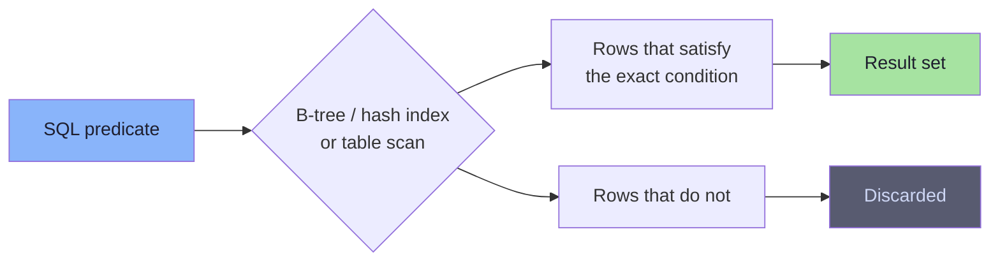
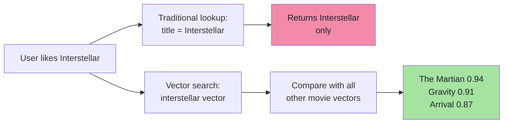
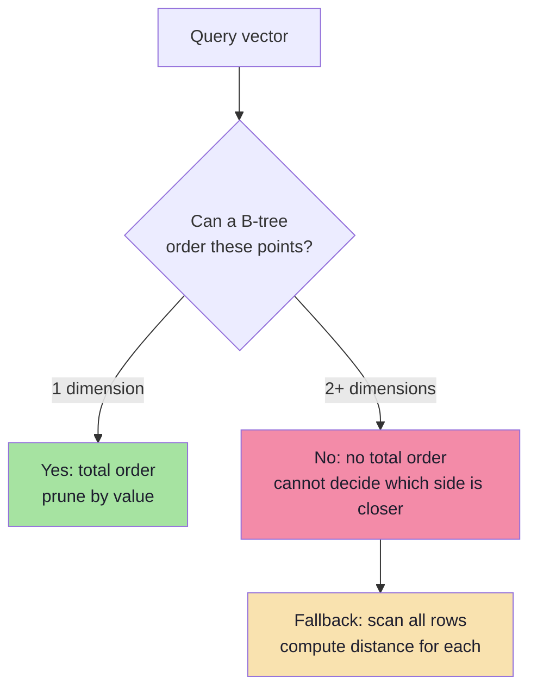
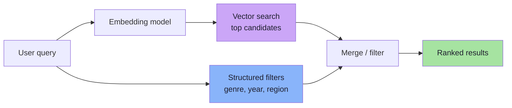
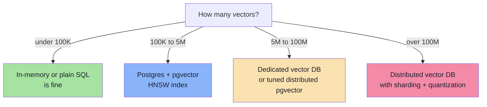

# Chapter 02: Why a Relational Database Is Not Enough

> **Chapter Goal:** Retire the myth that "normal databases cannot store vectors", then identify the real limitation. The problem is not storage — it is that relational databases answer **exact and ordered** questions, while vector search asks a **graded similarity** question. Also clarify when a relational database *is* enough (e.g., PostgreSQL with `pgvector`).

---

## 2.1 The Wrong Question

A common objection:

```text
"We already have MySQL / PostgreSQL. Why do we need anything else?"
```

And the equally common but incorrect claim:

```text
"Traditional databases cannot store vectors."
```

That claim is false. A relational table can absolutely hold an array of numbers:

| id | title | description | embedding |
|----|-------|-------------|-----------|
| 1 | Interstellar | Space exploration | [...] |
| 2 | Inception | Dream manipulation | [...] |
| 3 | Titanic | Romantic tragedy | [...] |

A vector can be persisted as:

| Storage Form | Example | Notes |
|--------------|---------|-------|
| JSON / JSONB | `[0.21, -0.47, 0.83, ...]` | Readable, larger, slower to parse |
| Binary blob | `bytea`, `BLOB` | Compact, opaque to the database |
| Serialized text | CSV / base64 | Simple, wasteful |
| Native vector type | `vector(1536)` in `pgvector` | Compact and indexable |

**Honest framing:**

> **Relational databases can store vectors. The hard part is finding the nearest ones efficiently.**

---

## 2.2 What Relational Databases Are Designed For

Traditional databases answer **predicates over scalar columns**:

```sql
SELECT * FROM movies WHERE id = 10;              -- exact equality
SELECT * FROM movies WHERE genre = 'Sci-Fi';     -- exact equality
SELECT * FROM movies WHERE year >= 2010;         -- ordered comparison
SELECT * FROM movies WHERE title LIKE '%space%'; -- pattern match
SELECT * FROM movies WHERE year BETWEEN 2000 AND 2010;
SELECT * FROM movies ORDER BY year DESC;
SELECT * FROM movies GROUP BY genre;
SELECT * FROM movies JOIN actors ON ...;
```

Underlying question:

```text
Which rows satisfy my condition?
```

Each row either matches or it does not — the answer is a **set of rows**.



Indexes work because `id`, `genre`, `year` have something a vector does not: **a total order** (or small exact value set) that lets the engine discard huge parts of the table.

---

## 2.3 What Vector Search Actually Asks

A vector query:

```text
Query vector Q = [0.2, 0.8, 0.3]
```

We almost never want:

```text
Find the stored vector exactly equal to [0.2, 0.8, 0.3]
```

Exact equality is useless — no real embedding is bit-for-bit identical to the query. Instead:

```text
Which stored vectors are CLOSEST to Q?
```

Given:

```text
A = [0.21, 0.79, 0.31]
B = [0.19, 0.82, 0.30]
C = [-0.7, 0.10, 0.50]
```

`A` and `B` are near `Q`; `C` is far. Useful answer is a **ranked list**:

```text
1. A  →  0.999
2. B  →  0.997
3. C  →  0.21
```

This is a **Nearest Neighbor Search**, not a `WHERE` clause.

---

## 2.4 Exact Lookup vs Similarity Lookup


| Traditional Search | Vector Search |
|--------------------|---------------|
| Boolean match | Graded similarity |
| `true` / `false` | `0.94`, `0.87`, `0.31` |
| Result set unordered by relevance | Result set inherently ranked |
| Exact predicates | Approximate geometric proximity |
| Index on scalar value | Index on multi-dimensional space |

> **Key conceptual difference:** Traditional search asks *"does it match?"*; vector search asks *"how similar is it, and how does that compare to everything else?"*

---

## 2.5 The Netflix Example

User likes **Interstellar**.

Traditional query:

```sql
SELECT * FROM movies WHERE title = 'Interstellar';
```

Returns Interstellar only — correct answer to the wrong question. The product wants:

```text
Movies similar to Interstellar.
```

That is a **similarity problem**, not an **exact-match problem**. Genre filters return every sci-fi movie, including weak matches — they cannot rank *how* space-survival-like each one is.



---

## 2.6 Why a B-Tree Cannot Save You

A B-tree is sorted. `age = 32` works because numbers share one ordering. Searching for `32`, seeing `27`, means every smaller value is irrelevant — pruning works.

For a vector this breaks:

```text
A = [2, 8]
B = [5, 3]
```

Is A "less than" B?
- By `x`: `A.x < B.x` → A smaller
- By `y`: `A.y > B.y` → A larger

**No natural total order** over points in 2D, let alone 1536D. Without order, a B-tree cannot prune. "Indexed" search degenerates to scanning every row plus computing distance.



Chapter 05 shows structures invented to work around this — and why they break at high dimensions.

---

## 2.7 The Real Cost of "Just Use Postgres"

You *can* implement vector search in a relational database without extensions:

```ts
// Pseudo-code: brute-force in Postgres without a vector index
const rows = await db.query("SELECT id, embedding FROM movies");

const scored = rows.map(row => ({
  id: row.id,
  score: cosineSimilarity(queryVector, row.embedding),
}));

scored.sort((a, b) => b.score - a.score);
return scored.slice(0, k);
```

This is correct. It is also exactly brute-force (Chapter 04), plus:
1. Serializing/deserializing every embedding over the DB protocol
2. Transferring `N × D` floats to the application
3. Computing distances in application code

At 10M movies × 1536 dims, that's **61 GB of data movement per query**. A dedicated vector index avoids leaving the storage engine.

---

## 2.8 Hybrid Queries: Where Relational Databases Still Win

Vectors rarely live alone. Realistic query combines **semantic similarity** with **structured filters**:

```text
Find movies similar to Interstellar
  WHERE genre = 'Sci-Fi'
  AND year > 2010
  AND available_in_region = 'IN'
```

Strongest argument for keeping vectors next to relational data:

| Requirement | Best Handled By |
|-------------|-----------------|
| Transactional updates (price, stock, status) | Relational database |
| Joins, constraints, foreign keys | Relational database |
| Metadata filtering | Relational DB / vector DB payload |
| Similarity ranking | Vector index |
| Hybrid text + vector ranking | Search engine or vector DB with hybrid support |



A vector database is not a replacement for your relational database. Production runs them side by side — relational as **source of truth**, vector index as **derived search structure**.

> **Architectural rule:** If you can rebuild the vector index from the relational database, your design is healthy. If the vector index is the only place your data exists, you've created a durability problem.

---

## 2.9 When a Relational Database *Is* Enough

PostgreSQL + `pgvector` adds:
- Native `vector(D)` column type
- Distance operators (`<->` L2, `<#>` dot product, `<=>` cosine)
- HNSW and IVFFlat indexes

| Scenario | Recommendation |
|----------|----------------|
| Fewer than ~100k vectors, low QPS | Plain PostgreSQL scan often fine |
| Up to a few million vectors, moderate QPS | PostgreSQL + `pgvector` with HNSW |
| Need ACID + vectors + joins in one system | PostgreSQL + `pgvector` |
| Hundreds of millions of vectors | Dedicated vector DB / distributed ANN |
| Multi-tenant, high QPS, strict p99 latency | Dedicated vector DB |
| Rapid prototyping | In-memory array or SQLite / Chroma |



Thresholds are guidelines, not laws. Real inputs: **latency target, query rate, recall requirement, operational budget**.

---

## 2.10 Chapter Summary

| Claim | Reality |
|-------|---------|
| "Relational DBs cannot store vectors" | False — JSON, blobs, native vector types all work |
| "Then why not just use SQL?" | SQL answers exact/ordered predicates, not similarity ranking |
| "An index will fix it" | B-trees need total order; vectors do not have one |
| "Vector DBs replace relational DBs" | No — derived search structures beside source of truth |
| "Postgres is never enough" | Often it is, especially with `pgvector` at moderate scale |

> **Final mental model:** The database is not failing to *hold* vectors. It is failing to *reason* about them. Traditional indexes exploit order; vector search needs geometry. That gap is what vector databases and ANN indexes fill.

---

## 2.11 Missing Topics Added for Depth

### 2.11.1 Scalar Columns vs Vector Geometry: A Formal View
| Property | Scalar (int, string, date) | Vector (embedding) |
|----------|---------------------------|-------------------|
| Ordering | Total order exists | No total order beyond 1D |
| Equality | Bit-exact equality meaningful | Near-exact equality meaningless |
| Range queries | `WHERE x > 10` has clear meaning | No natural range semantics |
| Index pruning | Prove subtree irrelevant | Cannot prove geometrically |
| Index structure | B-tree, B+ tree, hash | ANN graphs, clusters, hashes |

### 2.11.2 Why Vector Search Is "Fuzzy" by Design
In SQL, `year = 2014` returns exactly the rows with year 2014. In vector search, there is no "exact year." The notion of relevance is continuous:
- Two vectors can be 0.999 similar (nearly identical)
- Two vectors can be 0.998 similar (also nearly identical)
- A tiny query perturbation changes scores but not the ranking order much

This **continuity** means vector search inherently returns *degrees* of match, which SQL's boolean model cannot express natively.

### 2.11.3 Metadata Filtering Is the Bridge
Production vector queries almost always combine:
```text
semantic similarity (vector)  AND  structured filter (scalar)
```
The scalar part (`genre = 'Sci-Fi'`) is what relational databases excel at. The vector part (nearest neighbours) is what they fail at. This dual nature drives hybrid architectures — keep metadata in Postgres, vectors in a vector DB, merge at query time.

---

**Next:** [Chapter 03 — Anatomy of a Vector Database](./03_Anatomy_of_a_Vector_Database.md)